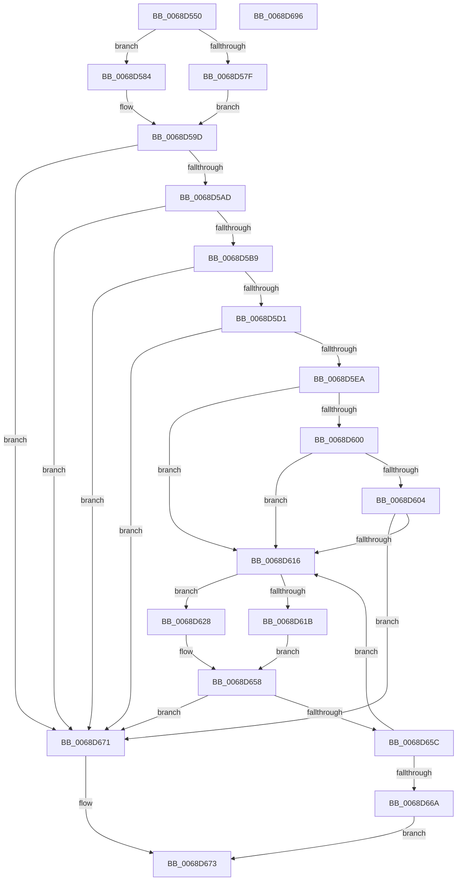

# MiDefragmentAllSlabsHelper

- RVA: `0x0068D550`–`0x0068D697` (길이 `327` bytes)
- VA: `0x000000014068D550`
- 실행 섹션: `.text`
- PDB 이름 있음: `예`; PDB Function 태그: `아니요`
- unwind 정보 RVA: `0x000D8EF4`
- 디코드: `91`개 명령, `327/327` bytes 표시
- 미해석 바이트: `0` (있으면 어셈블리에 `.byte`로 보존)

> 이 문서는 커널 이미지의 기계어와 PDB 기호를 분석해 생성했습니다. 4번과 5번은 함수 원형과 자료형을 바이너리 사용 방식에서 추정한 C 해석이며 원본 소스 복구 결과는 아닙니다.

## 1. Dependencies

- 직접 호출 지점: **5**; 고유 호출 대상: **5**
- 직접 호출자로 확인된 함수: **1**
- RIP 상대 이미지 참조: **2**

### Outgoing calls
- `0x0068D621` → [MiDefragmentSlabAllocator](MiDefragmentSlabAllocator_function_0068D6A0.md) (function, `0x0068D6A0`)
- `0x0068D635` → [memset](../6C/memset_function_006C6C40.md) (function, `0x006C6C40`)
- `0x0068D649` → [MiInitializeSlabDefragmentContext](MiInitializeSlabDefragmentContext_function_0068EB1C.md) (function, `0x0068EB1C`)
- `0x0068D653` → [MiDefragmentSlabWorker](MiDefragmentSlabWorker_function_0068D730.md) (function, `0x0068D730`)
- `0x0068D67E` → [_security_check_cookie](../6A/_security_check_cookie_function_006AC640.md) (function, `0x006AC640`)

### Direct callers
- [MiDefragmentAllSlabAllocators](MiDefragmentAllSlabAllocators_function_0068D43C.md) at `0x0068D4B9`

### Static image references
- `0x0068D55F` → RVA `0x00E0A740` (`.data`; read)
- `0x0068D5EE` → RVA `0x00011C60` (`.rdata`; read)

## 2. Other-region calls and transfers

- 다른 실행 섹션으로 향하는 call: **0**
- 별도 외부 분기/꼬리 이동을 확인하지 못했습니다.

## 3. Assembly (complete function range)

```asm
0068D550  48 89 5C 24 10                  mov qword ptr [rsp + 0x10], rbx
0068D555  55                              push rbp
0068D556  56                              push rsi
0068D557  57                              push rdi
0068D558  48 81 EC A0 02 00 00            sub rsp, 0x2a0
0068D55F  48 8B 05 DA D1 77 00            mov rax, qword ptr [rip + 0x77d1da]
0068D566  48 33 C4                        xor rax, rsp
0068D569  48 89 84 24 90 02 00 00         mov qword ptr [rsp + 0x290], rax
0068D571  49 8B D8                        mov rbx, r8
0068D574  48 8B FA                        mov rdi, rdx
0068D577  48 8B F1                        mov rsi, rcx
0068D57A  48 85 D2                        test rdx, rdx
0068D57D  74 05                           je 0x14068d584
0068D57F  4C 8B C2                        mov r8, rdx
0068D582  EB 19                           jmp 0x14068d59d
0068D584  49 63 40 1C                     movsxd rax, dword ptr [r8 + 0x1c]
0068D588  4C 8B 46 10                     mov r8, qword ptr [rsi + 0x10]
0068D58C  48 69 C8 E8 00 00 00            imul rcx, rax, 0xe8
0068D593  49 81 C0 50 3D 00 00            add r8, 0x3d50
0068D59A  4C 03 C1                        add r8, rcx
0068D59D  41 8B 90 80 00 00 00            mov edx, dword ptr [r8 + 0x80]
0068D5A4  83 FA 03                        cmp edx, 3
0068D5A7  0F 84 C4 00 00 00               je 0x14068d671
0068D5AD  8D 42 FB                        lea eax, [rdx - 5]
0068D5B0  83 F8 02                        cmp eax, 2
0068D5B3  0F 86 B8 00 00 00               jbe 0x14068d671
0068D5B9  33 C9                           xor ecx, ecx
0068D5BB  39 4B 18                        cmp dword ptr [rbx + 0x18], ecx
0068D5BE  0F 94 C1                        sete cl
0068D5C1  33 C0                           xor eax, eax
0068D5C3  83 FA 04                        cmp edx, 4
0068D5C6  0F 97 C0                        seta al
0068D5C9  3B C1                           cmp eax, ecx
0068D5CB  0F 85 A0 00 00 00               jne 0x14068d671
0068D5D1  41 8B 88 88 00 00 00            mov ecx, dword ptr [r8 + 0x88]
0068D5D8  8B C1                           mov eax, ecx
0068D5DA  8B 13                           mov edx, dword ptr [rbx]
0068D5DC  C1 E8 04                        shr eax, 4
0068D5DF  83 E0 03                        and eax, 3
0068D5E2  3B D0                           cmp edx, eax
0068D5E4  0F 82 87 00 00 00               jb 0x14068d671
0068D5EA  48 C1 E9 04                     shr rcx, 4
0068D5EE  48 8D 2D 6B 46 98 FF            lea rbp, [rip - 0x67b995]
0068D5F5  83 E1 03                        and ecx, 3
0068D5F8  8B 6C CD 00                     mov ebp, dword ptr [rbp + rcx*8]
0068D5FC  3B D0                           cmp edx, eax
0068D5FE  76 16                           jbe 0x14068d616
0068D600  85 C0                           test eax, eax
0068D602  75 12                           jne 0x14068d616
0068D604  48 8B 4B 08                     mov rcx, qword ptr [rbx + 8]
0068D608  8B C5                           mov eax, ebp
0068D60A  48 2B 4B 10                     sub rcx, qword ptr [rbx + 0x10]
0068D60E  48 D1 E8                        shr rax, 1
0068D611  48 3B C8                        cmp rcx, rax
0068D614  72 5B                           jb 0x14068d671
0068D616  48 85 FF                        test rdi, rdi
0068D619  74 0D                           je 0x14068d628
0068D61B  48 8B D7                        mov rdx, rdi
0068D61E  48 8B CE                        mov rcx, rsi
0068D621  E8 7A 00 00 00                  call 0x14068d6a0
0068D626  EB 30                           jmp 0x14068d658
0068D628  33 D2                           xor edx, edx
0068D62A  48 8D 4C 24 20                  lea rcx, [rsp + 0x20]
0068D62F  41 B8 68 02 00 00               mov r8d, 0x268
0068D635  E8 06 96 03 00                  call 0x1406c6c40
0068D63A  44 8B 4B 1C                     mov r9d, dword ptr [rbx + 0x1c]
0068D63E  48 8D 4C 24 20                  lea rcx, [rsp + 0x20]
0068D643  45 33 C0                        xor r8d, r8d
0068D646  48 8B D6                        mov rdx, rsi
0068D649  E8 CE 14 00 00                  call 0x14068eb1c
0068D64E  48 8D 4C 24 20                  lea rcx, [rsp + 0x20]
0068D653  E8 D8 00 00 00                  call 0x14068d730
0068D658  85 C0                           test eax, eax
0068D65A  75 15                           jne 0x14068d671
0068D65C  48 01 6B 10                     add qword ptr [rbx + 0x10], rbp
0068D660  48 8B 43 10                     mov rax, qword ptr [rbx + 0x10]
0068D664  48 3B 43 08                     cmp rax, qword ptr [rbx + 8]
0068D668  72 AC                           jb 0x14068d616
0068D66A  B8 01 00 00 00                  mov eax, 1
0068D66F  EB 02                           jmp 0x14068d673
0068D671  33 C0                           xor eax, eax
0068D673  48 8B 8C 24 90 02 00 00         mov rcx, qword ptr [rsp + 0x290]
0068D67B  48 33 CC                        xor rcx, rsp
0068D67E  E8 BD EF 01 00                  call 0x1406ac640
0068D683  48 8B 9C 24 C8 02 00 00         mov rbx, qword ptr [rsp + 0x2c8]
0068D68B  48 81 C4 A0 02 00 00            add rsp, 0x2a0
0068D692  5F                              pop rdi
0068D693  5E                              pop rsi
0068D694  5D                              pop rbp
0068D695  C3                              ret
0068D696  CC                              int3
```

## 4. C-style interpretation (structured pseudocode)

```c
__int64 __fastcall MiDefragmentAllSlabsHelper(__int64 a1, __int64 a2, __int64 a3)
{
    __int64 result;
    __int64 v_rsp;
    unsigned __int64 v_stack_m28;
    unsigned __int64 v_stack_m298;
    unsigned __int64 v_stack_p10;

    v_stack_p10 = v_rbx;
    v_rsp = (v_rsp) - (672);
    result = (*(unsigned __int64 *)(v_rip + 7852506)) ^ (v_rsp);
    v_stack_m28 = result;
    if (a2 == 0) goto loc_0068D584;
    goto loc_0068D59D;
loc_0068D584:
    a1 = (a1) * ((int)(*(unsigned int *)(a2 + 28)));
    a3 = (*(unsigned __int64 *)(a1 + 16)) + (0x3D50ULL);
    a3 = (a3) + (a1);
loc_0068D59D:
    if (((unsigned int)((unsigned int)(*(unsigned int *)(a3 + 128)))) == 3) goto loc_0068D671;
    if (((unsigned int)((unsigned int)(*(unsigned int *)(a3 + 128)) - 5)) <= 2) goto loc_0068D671;
    a1 = 0;
    a1 = ((*(unsigned int *)(a3 + 24)) == 0) ? 1 : 0;
    result = 0;
    result = (((unsigned int)((unsigned int)(*(unsigned int *)(a3 + 128)))) > 4) ? 1 : 0;
    if (((unsigned int)(result)) != ((unsigned int)(a1))) goto loc_0068D671;
    result = (unsigned int)(((unsigned int)((unsigned int)((unsigned int)(*(unsigned int *)(a3 + 136))))) >> (4));
    result = (unsigned int)((result) & (3));
    if (((unsigned int)((unsigned int)(*(unsigned int *)(a3)))) < ((unsigned int)(result))) goto loc_0068D671;
    a1 = ((unsigned int)(*(unsigned int *)(a3 + 136))) >> (4);
    a1 = (unsigned int)((a1) & (3));
    if (((unsigned int)((unsigned int)(*(unsigned int *)(a3)))) <= ((unsigned int)(result))) goto loc_0068D616;
    if ((unsigned int)(result) != 0) goto loc_0068D616;
    a1 = (*(unsigned __int64 *)(a3 + 8)) - (*(unsigned __int64 *)(a3 + 16));
    result = ((unsigned int)((unsigned int)((unsigned int)(*(unsigned int *)(v_rip - 6797717 + a1 * 8))))) >> (1);
    if (a1 < result) goto loc_0068D671;
loc_0068D616:
    if (a2 == 0) goto loc_0068D628;
    result = MiDefragmentSlabAllocator(a1, a2, a3, a4);
    goto loc_0068D658;
loc_0068D628:
    a2 = 0;
    result = memset(v_stack_m298, a2, 616, a4);
    a3 = 0;
    result = MiInitializeSlabDefragmentContext(v_stack_m298, a1, a3, (unsigned int)(*(unsigned int *)(a3 + 28)));
    result = MiDefragmentSlabWorker(v_stack_m298, a1, a3, (unsigned int)(*(unsigned int *)(a3 + 28)));
loc_0068D658:
    if ((unsigned int)(result) != 0) goto loc_0068D671;
    if ((*(unsigned __int64 *)(a3 + 16)) < (*(unsigned __int64 *)(a3 + 8))) goto loc_0068D616;
    goto loc_0068D673;
loc_0068D671:
    result = 0;
loc_0068D673:
    a1 = (v_stack_m28) ^ (v_rsp);
    result = _security_check_cookie(a1, a1, a3, (unsigned int)(*(unsigned int *)(a3 + 28)));
    v_rsp = (v_rsp) + (672);
    return result;
}
```

## 5. (Beta) C Style

```c
int64_t MiDefragmentAllSlabsHelper(void *Arg1, int64_t Arg2, void *Arg3)
{
    uint8_t *arg1 = (uint8_t *)Arg1;
    uint8_t *arg3 = (uint8_t *)Arg3;

    int64_t result;
    int64_t local_rsp;
    uint64_t v_stack_m28;
    uint64_t v_stack_m298;
    uint64_t v_stack_p10;

    v_stack_p10 = local_rbx;
    local_rsp = (local_rsp) - (672);
    result = (*(uint64_t *)(v_rip + 0x77D1DA)) ^ (local_rsp);
    v_stack_m28 = result;
    if (Arg2 == 0) goto loc_0068D584;
    goto loc_0068D59D;
loc_0068D584:
    Arg1 = (Arg1) * ((int32_t)(*(uint32_t *)(Arg2 + 0x1C)));
    Arg3 = (*(uint64_t *)(arg1 + 0x10)) + (0x3D50ULL);
    Arg3 = (Arg3) + (Arg1);
loc_0068D59D:
    if (((uint32_t)((uint32_t)(*(uint32_t *)(arg3 + 0x80)))) == 3) goto loc_0068D671;
    if (((uint32_t)((uint32_t)(*(uint32_t *)(arg3 + 0x80)) - 5)) <= 2) goto loc_0068D671;
    Arg1 = 0;
    Arg1 = ((*(uint32_t *)(arg3 + 0x18)) == 0) ? 1 : 0;
    result = 0;
    result = (((uint32_t)((uint32_t)(*(uint32_t *)(arg3 + 0x80)))) > 4) ? 1 : 0;
    if (((uint32_t)(result)) != ((uint32_t)(Arg1))) goto loc_0068D671;
    result = (uint32_t)(((uint32_t)((uint32_t)((uint32_t)(*(uint32_t *)(arg3 + 0x88))))) >> (4));
    result = (uint32_t)((result) & (3));
    if (((uint32_t)((uint32_t)(*(uint32_t *)(arg3)))) < ((uint32_t)(result))) goto loc_0068D671;
    Arg1 = ((uint32_t)(*(uint32_t *)(arg3 + 0x88))) >> (4);
    Arg1 = (uint32_t)((Arg1) & (3));
    if (((uint32_t)((uint32_t)(*(uint32_t *)(arg3)))) <= ((uint32_t)(result))) goto loc_0068D616;
    if ((uint32_t)(result) != 0) goto loc_0068D616;
    Arg1 = (*(uint64_t *)(arg3 + 0x8)) - (*(uint64_t *)(arg3 + 0x10));
    result = ((uint32_t)((uint32_t)((uint32_t)(*(uint32_t *)(v_rip - 0x67B995 + arg1 * 8))))) >> (1);
    if (Arg1 < result) goto loc_0068D671;
loc_0068D616:
    if (Arg2 == 0) goto loc_0068D628;
    result = MiDefragmentSlabAllocator(Arg1, Arg2, Arg3, a4);
    goto loc_0068D658;
loc_0068D628:
    Arg2 = 0;
    result = memset(v_stack_m298, Arg2, 616, a4);
    Arg3 = 0;
    result = MiInitializeSlabDefragmentContext(v_stack_m298, Arg1, Arg3, (uint32_t)(*(uint32_t *)(arg3 + 0x1C)));
    result = MiDefragmentSlabWorker(v_stack_m298, Arg1, Arg3, (uint32_t)(*(uint32_t *)(arg3 + 0x1C)));
loc_0068D658:
    if ((uint32_t)(result) != 0) goto loc_0068D671;
    if ((*(uint64_t *)(arg3 + 0x10)) < (*(uint64_t *)(arg3 + 0x8))) goto loc_0068D616;
    goto loc_0068D673;
loc_0068D671:
    result = 0;
loc_0068D673:
    Arg1 = (v_stack_m28) ^ (local_rsp);
    result = _security_check_cookie(Arg1, Arg1, Arg3, (uint32_t)(*(uint32_t *)(arg3 + 0x1C)));
    local_rsp = (local_rsp) + (672);
    return result;
}
```

### 관측된 메모리 오프셋

구조체 형식이 확인되지 않은 접근은 인자 기준의 오프셋으로만 기록했습니다.

| 기준 인자 | 오프셋 표현 | 폭 (bit) | 접근 |
|---|---:|---:|---|
| `Arg1` | `+ 0x10` | `64` | `R` |
| `Arg3` | `+ 0x0` | `32` | `R` |
| `Arg3` | `+ 0x8` | `64` | `R` |
| `Arg3` | `+ 0x10` | `64` | `R` |
| `Arg3` | `+ 0x10` | `64` | `R/W` |
| `Arg3` | `+ 0x18` | `32` | `R` |
| `Arg3` | `+ 0x1C` | `32` | `R` |

## 6. Execution-region graph

[열기: 2D/3D 그래프와 함수 탐색 컨트롤 패널](../../../control-panel.html?section=text&rva=0x0068D550&view=graph)

- 2D 그래프는 위에서 아래로 흐르고, 3D 그래프는 빈 공간을 드래그해 회전합니다. Shift+드래그는 이동, 휠은 확대·축소, 함수 노드 선택은 대상 보고서 이동입니다.

### Static fallback


