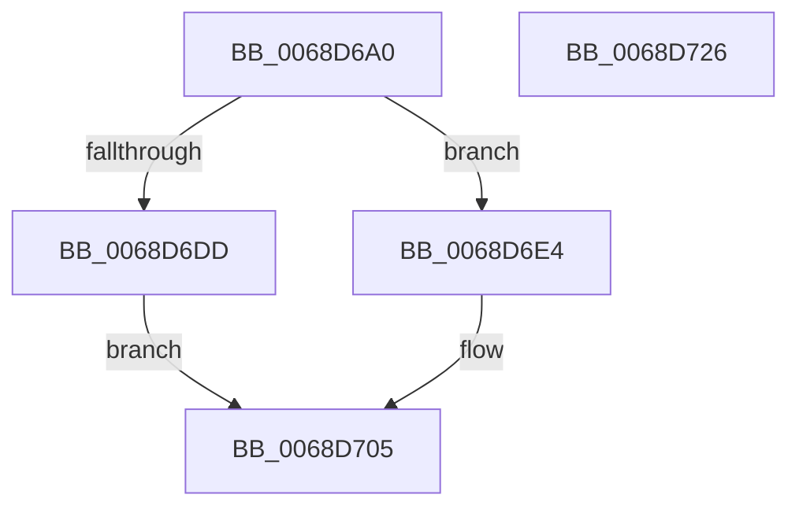

# MiDefragmentSlabAllocator

- RVA: `0x0068D6A0`–`0x0068D727` (길이 `135` bytes)
- VA: `0x000000014068D6A0`
- 실행 섹션: `.text`
- PDB 이름 있음: `예`; PDB Function 태그: `아니요`
- unwind 정보 RVA: `0x000D8F14`
- 디코드: `31`개 명령, `135/135` bytes 표시
- 미해석 바이트: `0` (있으면 어셈블리에 `.byte`로 보존)

> 이 문서는 커널 이미지의 기계어와 PDB 기호를 분석해 생성했습니다. 4번과 5번은 함수 원형과 자료형을 바이너리 사용 방식에서 추정한 C 해석이며 원본 소스 복구 결과는 아닙니다.

## 1. Dependencies

- 직접 호출 지점: **4**; 고유 호출 대상: **4**
- 직접 호출자로 확인된 함수: **1**
- RIP 상대 이미지 참조: **1**

### Outgoing calls
- `0x0068D6D2` → [memset](../6C/memset_function_006C6C40.md) (function, `0x006C6C40`)
- `0x0068D6F6` → [MiInitializeSlabDefragmentContext](MiInitializeSlabDefragmentContext_function_0068EB1C.md) (function, `0x0068EB1C`)
- `0x0068D700` → [MiDefragmentSlabWorker](MiDefragmentSlabWorker_function_0068D730.md) (function, `0x0068D730`)
- `0x0068D710` → [_security_check_cookie](../6A/_security_check_cookie_function_006AC640.md) (function, `0x006AC640`)

### Direct callers
- [MiDefragmentAllSlabsHelper](MiDefragmentAllSlabsHelper_function_0068D550.md) at `0x0068D621`

### Static image references
- `0x0068D6AD` → RVA `0x00E0A740` (`.data`; read)

## 2. Other-region calls and transfers

- 다른 실행 섹션으로 향하는 call: **0**
- 별도 외부 분기/꼬리 이동을 확인하지 못했습니다.

## 3. Assembly (complete function range)

```asm
0068D6A0  48 89 5C 24 10                  mov qword ptr [rsp + 0x10], rbx
0068D6A5  57                              push rdi
0068D6A6  48 81 EC A0 02 00 00            sub rsp, 0x2a0
0068D6AD  48 8B 05 8C D0 77 00            mov rax, qword ptr [rip + 0x77d08c]
0068D6B4  48 33 C4                        xor rax, rsp
0068D6B7  48 89 84 24 90 02 00 00         mov qword ptr [rsp + 0x290], rax
0068D6BF  48 8B DA                        mov rbx, rdx
0068D6C2  48 8B F9                        mov rdi, rcx
0068D6C5  33 D2                           xor edx, edx
0068D6C7  48 8D 4C 24 20                  lea rcx, [rsp + 0x20]
0068D6CC  41 B8 68 02 00 00               mov r8d, 0x268
0068D6D2  E8 69 95 03 00                  call 0x1406c6c40
0068D6D7  48 83 3B 00                     cmp qword ptr [rbx], 0
0068D6DB  75 07                           jne 0x14068d6e4
0068D6DD  B8 34 00 19 40                  mov eax, 0x40190034
0068D6E2  EB 21                           jmp 0x14068d705
0068D6E4  44 8B 8B 80 00 00 00            mov r9d, dword ptr [rbx + 0x80]
0068D6EB  48 8D 4C 24 20                  lea rcx, [rsp + 0x20]
0068D6F0  4C 8B C3                        mov r8, rbx
0068D6F3  48 8B D7                        mov rdx, rdi
0068D6F6  E8 21 14 00 00                  call 0x14068eb1c
0068D6FB  48 8D 4C 24 20                  lea rcx, [rsp + 0x20]
0068D700  E8 2B 00 00 00                  call 0x14068d730
0068D705  48 8B 8C 24 90 02 00 00         mov rcx, qword ptr [rsp + 0x290]
0068D70D  48 33 CC                        xor rcx, rsp
0068D710  E8 2B EF 01 00                  call 0x1406ac640
0068D715  48 8B 9C 24 B8 02 00 00         mov rbx, qword ptr [rsp + 0x2b8]
0068D71D  48 81 C4 A0 02 00 00            add rsp, 0x2a0
0068D724  5F                              pop rdi
0068D725  C3                              ret
0068D726  CC                              int3
```

## 4. C-style interpretation (structured pseudocode)

```c
__int64 __fastcall MiDefragmentSlabAllocator(__int64 a1, __int64 a2)
{
    __int64 result;
    __int64 v_rsp;
    unsigned __int64 v_stack_m18;
    unsigned __int64 v_stack_m288;
    unsigned __int64 v_stack_p10;

    v_stack_p10 = v_rbx;
    v_rsp = (v_rsp) - (672);
    result = (*(unsigned __int64 *)(v_rip + 7852172)) ^ (v_rsp);
    v_stack_m18 = result;
    a2 = 0;
    result = memset(v_stack_m288, a2, 616, a4);
    if ((*(unsigned __int64 *)(a2)) != 0) goto loc_0068D6E4;
    goto loc_0068D705;
loc_0068D6E4:
    result = MiInitializeSlabDefragmentContext(v_stack_m288, a1, 0, (unsigned int)(*(unsigned int *)(a2 + 128)));
    result = MiDefragmentSlabWorker(v_stack_m288, a1, 0, (unsigned int)(*(unsigned int *)(a2 + 128)));
loc_0068D705:
    a1 = (v_stack_m18) ^ (v_rsp);
    result = _security_check_cookie(a1, a1, 0, (unsigned int)(*(unsigned int *)(a2 + 128)));
    v_rsp = (v_rsp) + (672);
    return result;
}
```

## 5. (Beta) C Style

```c
int64_t MiDefragmentSlabAllocator(int64_t Arg1, void *Arg2)
{
    uint8_t *arg2 = (uint8_t *)Arg2;

    int64_t result;
    int64_t local_rsp;
    uint64_t v_stack_m18;
    uint64_t v_stack_m288;
    uint64_t v_stack_p10;

    v_stack_p10 = local_rbx;
    local_rsp = (local_rsp) - (672);
    result = (*(uint64_t *)(v_rip + 0x77D08C)) ^ (local_rsp);
    v_stack_m18 = result;
    Arg2 = 0;
    result = memset(v_stack_m288, Arg2, 616, a4);
    if ((*(uint64_t *)(arg2)) != 0) goto loc_0068D6E4;
    goto loc_0068D705;
loc_0068D6E4:
    result = MiInitializeSlabDefragmentContext(v_stack_m288, Arg1, 0, (uint32_t)(*(uint32_t *)(arg2 + 0x80)));
    result = MiDefragmentSlabWorker(v_stack_m288, Arg1, 0, (uint32_t)(*(uint32_t *)(arg2 + 0x80)));
loc_0068D705:
    Arg1 = (v_stack_m18) ^ (local_rsp);
    result = _security_check_cookie(Arg1, Arg1, 0, (uint32_t)(*(uint32_t *)(arg2 + 0x80)));
    local_rsp = (local_rsp) + (672);
    return result;
}
```

### 관측된 메모리 오프셋

구조체 형식이 확인되지 않은 접근은 인자 기준의 오프셋으로만 기록했습니다.

| 기준 인자 | 오프셋 표현 | 폭 (bit) | 접근 |
|---|---:|---:|---|
| `Arg2` | `+ 0x0` | `64` | `R` |
| `Arg2` | `+ 0x80` | `32` | `R` |

## 6. Execution-region graph

[열기: 2D/3D 그래프와 함수 탐색 컨트롤 패널](../../../control-panel.html?section=text&rva=0x0068D6A0&view=graph)

- 2D 그래프는 위에서 아래로 흐르고, 3D 그래프는 빈 공간을 드래그해 회전합니다. Shift+드래그는 이동, 휠은 확대·축소, 함수 노드 선택은 대상 보고서 이동입니다.

### Static fallback


