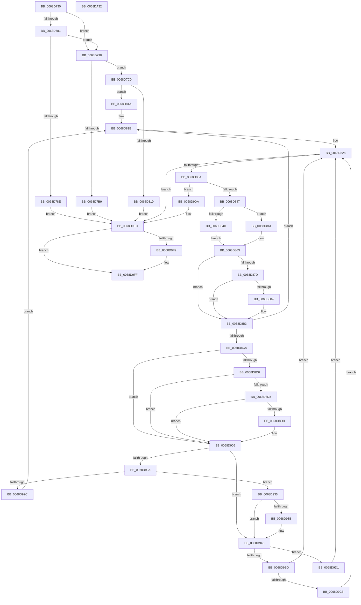

# MiDefragmentSlabWorker

- RVA: `0x0068D730`–`0x0068DA33` (길이 `771` bytes)
- VA: `0x000000014068D730`
- 실행 섹션: `.text`
- PDB 이름 있음: `예`; PDB Function 태그: `아니요`
- unwind 정보 RVA: `0x000D8F30`
- 디코드: `201`개 명령, `771/771` bytes 표시
- 미해석 바이트: `0` (있으면 어셈블리에 `.byte`로 보존)

> 이 문서는 커널 이미지의 기계어와 PDB 기호를 분석해 생성했습니다. 4번과 5번은 함수 원형과 자료형을 바이너리 사용 방식에서 추정한 C 해석이며 원본 소스 복구 결과는 아닙니다.

## 1. Dependencies

- 직접 호출 지점: **17**; 고유 호출 대상: **16**
- 직접 호출자로 확인된 함수: **2**
- RIP 상대 이미지 참조: **3**

### Outgoing calls
- `0x0068D76F` → [memset](../6C/memset_function_006C6C40.md) (function, `0x006C6C40`)
- `0x0068D7B0` → [MiEnumerateSlabAllocatorsEx](../47/MiEnumerateSlabAllocatorsEx_function_004746F8.md) (function, `0x004746F8`)
- `0x0068D7F3` → [MiInitializePageColorBase](../32/MiInitializePageColorBase_function_00320410.md) (function, `0x00320410`)
- `0x0068D807` → [MiCreateUltraThreadContext](../28/MiCreateUltraThreadContext_function_00288200.md) (function, `0x00288200`)
- `0x0068D82B` → [MiEstablishDefragSlabEntries](MiEstablishDefragSlabEntries_function_0068E0EC.md) (function, `0x0068E0EC`)
- `0x0068D866` → [MiGetSourcePageForDefrag](MiGetSourcePageForDefrag_function_0068E6E4.md) (function, `0x0068E6E4`)
- `0x0068D88C` → [MiGetPageFromSlabEntry](../37/MiGetPageFromSlabEntry_function_00377768.md) (function, `0x00377768`)
- `0x0068D8BB` → [MiLockUnlockSlabContextsForDefrag](MiLockUnlockSlabContextsForDefrag_function_0068EDA4.md) (function, `0x0068EDA4`)
- `0x0068D8E1` → [MiLockPageInline](../31/MiLockPageInline_function_0031A340.md) (function, `0x0031A340`)
- `0x0068D8F5` → [MiUpdateSlabPagePlaceholderState](../2A/MiUpdateSlabPagePlaceholderState_function_002A0FB0.md) (function, `0x002A0FB0`)
- `0x0068D900` → [MiUnlockPage](../31/MiUnlockPage_function_0031A3E0.md) (function, `0x0031A3E0`)
- `0x0068D922` → [MiPfnsWorthTrying](../31/MiPfnsWorthTrying_function_0031B0C0.md) (function, `0x0031B0C0`)
- `0x0068D943` → [MiAdjustCachedStacks](../2D/MiAdjustCachedStacks_function_002D8AAC.md) (function, `0x002D8AAC`)
- `0x0068D9B3` → [MiClaimPhysicalRun](../28/MiClaimPhysicalRun_function_0028CF00.md) (function, `0x0028CF00`)
- `0x0068D9FA` → [MiLockUnlockSlabContextsForDefrag](MiLockUnlockSlabContextsForDefrag_function_0068EDA4.md) (function, `0x0068EDA4`)
- `0x0068DA03` → [MiDeleteUltraThreadContext](../32/MiDeleteUltraThreadContext_function_00322C90.md) (function, `0x00322C90`)
- `0x0068DA11` → [_security_check_cookie](../6A/_security_check_cookie_function_006AC640.md) (function, `0x006AC640`)

### Direct callers
- [MiDefragmentAllSlabsHelper](MiDefragmentAllSlabsHelper_function_0068D550.md) at `0x0068D653`
- [MiDefragmentSlabAllocator](MiDefragmentSlabAllocator_function_0068D6A0.md) at `0x0068D700`

### Static image references
- `0x0068D74E` → RVA `0x00E0A740` (`.data`; read)
- `0x0068D79B` → RVA `0x0068D400` (`MiDefragFreeEmptySlabEntries`; read)
- `0x0068D95F` → RVA `0x00E2DCE0` (`.data`; read)

## 2. Other-region calls and transfers

- 다른 실행 섹션으로 향하는 call: **0**
- 별도 외부 분기/꼬리 이동을 확인하지 못했습니다.

## 3. Assembly (complete function range)

```asm
0068D730  48 89 5C 24 10                  mov qword ptr [rsp + 0x10], rbx
0068D735  48 89 74 24 18                  mov qword ptr [rsp + 0x18], rsi
0068D73A  55                              push rbp
0068D73B  57                              push rdi
0068D73C  41 54                           push r12
0068D73E  41 56                           push r14
0068D740  41 57                           push r15
0068D742  48 8D 6C 24 C9                  lea rbp, [rsp - 0x37]
0068D747  48 81 EC 00 01 00 00            sub rsp, 0x100
0068D74E  48 8B 05 EB CF 77 00            mov rax, qword ptr [rip + 0x77cfeb]
0068D755  48 33 C4                        xor rax, rsp
0068D758  48 89 45 27                     mov qword ptr [rbp + 0x27], rax
0068D75C  83 65 87 00                     and dword ptr [rbp - 0x79], 0
0068D760  48 8B F9                        mov rdi, rcx
0068D763  48 8D 4D A7                     lea rcx, [rbp - 0x59]
0068D767  33 D2                           xor edx, edx
0068D769  41 B8 80 00 00 00               mov r8d, 0x80
0068D76F  E8 CC 94 03 00                  call 0x1406c6c40
0068D774  83 7F 48 08                     cmp dword ptr [rdi + 0x48], 8
0068D778  0F 57 C0                        xorps xmm0, xmm0
0068D77B  0F 11 45 8F                     movups xmmword ptr [rbp - 0x71], xmm0
0068D77F  75 17                           jne 0x14068d798
0068D781  48 8B 07                        mov rax, qword ptr [rdi]
0068D784  8B 80 70 47 00 00               mov eax, dword ptr [rax + 0x4770]
0068D78A  85 C0                           test eax, eax
0068D78C  75 0A                           jne 0x14068d798
0068D78E  BB 1A 00 00 80                  mov ebx, 0x8000001a
0068D793  E9 54 02 00 00                  jmp 0x14068d9ec
0068D798  8B 47 48                        mov eax, dword ptr [rdi + 0x48]
0068D79B  48 8D 15 5E FC FF FF            lea rdx, [rip - 0x3a2]
0068D7A2  44 8B 4F 44                     mov r9d, dword ptr [rdi + 0x44]
0068D7A6  45 33 C0                        xor r8d, r8d
0068D7A9  48 8B 0F                        mov rcx, qword ptr [rdi]
0068D7AC  89 44 24 20                     mov dword ptr [rsp + 0x20], eax
0068D7B0  E8 43 6F DE FF                  call 0x1404746f8
0068D7B5  85 C0                           test eax, eax
0068D7B7  74 07                           je 0x14068d7c0
0068D7B9  33 DB                           xor ebx, ebx
0068D7BB  E9 2C 02 00 00                  jmp 0x14068d9ec
0068D7C0  8B 4F 44                        mov ecx, dword ptr [rdi + 0x44]
0068D7C3  4C 8D 4D 8F                     lea r9, [rbp - 0x71]
0068D7C7  83 F9 FF                        cmp ecx, -1
0068D7CA  41 B8 01 00 00 00               mov r8d, 1
0068D7D0  BA 03 00 00 00                  mov edx, 3
0068D7D5  8D 41 01                        lea eax, [rcx + 1]
0068D7D8  44 0F 45 C0                     cmovne r8d, eax
0068D7DC  65 48 8B 04 25 88 01 00 00      mov rax, qword ptr gs:[0x188]
0068D7E5  48 8B 88 B8 00 00 00            mov rcx, qword ptr [rax + 0xb8]
0068D7EC  48 81 C1 00 04 00 00            add rcx, 0x400
0068D7F3  E8 18 2C C9 FF                  call 0x140320410
0068D7F8  45 33 C9                        xor r9d, r9d
0068D7FB  48 8D 55 8F                     lea rdx, [rbp - 0x71]
0068D7FF  48 8D 4D A7                     lea rcx, [rbp - 0x59]
0068D803  45 8D 41 08                     lea r8d, [r9 + 8]
0068D807  E8 F4 A9 BF FF                  call 0x140288200
0068D80C  85 C0                           test eax, eax
0068D80E  75 0A                           jne 0x14068d81a
0068D810  BB 9A 00 00 C0                  mov ebx, 0xc000009a
0068D815  E9 D2 01 00 00                  jmp 0x14068d9ec
0068D81A  44 8B 7F 4C                     mov r15d, dword ptr [rdi + 0x4c]
0068D81E  49 BE 00 00 00 00 00 DE FF FF   movabs r14, 0xffffde0000000000
0068D828  48 8B CF                        mov rcx, rdi
0068D82B  E8 BC 08 00 00                  call 0x14068e0ec
0068D830  8B D8                           mov ebx, eax
0068D832  85 C0                           test eax, eax
0068D834  0F 88 B2 01 00 00               js 0x14068d9ec
0068D83A  48 8B 47 28                     mov rax, qword ptr [rdi + 0x28]
0068D83E  48 85 C0                        test rax, rax
0068D841  0F 84 93 01 00 00               je 0x14068d9da
0068D847  83 7F 40 00                     cmp dword ptr [rdi + 0x40], 0
0068D84B  75 14                           jne 0x14068d861
0068D84D  48 8B 40 28                     mov rax, qword ptr [rax + 0x28]
0068D851  48 8D 34 40                     lea rsi, [rax + rax*2]
0068D855  48 C1 E6 04                     shl rsi, 4
0068D859  49 8B C6                        mov rax, r14
0068D85C  48 03 F0                        add rsi, rax
0068D85F  EB 02                           jmp 0x14068d863
0068D861  33 F6                           xor esi, esi
0068D863  48 8B CF                        mov rcx, rdi
0068D866  E8 79 0E 00 00                  call 0x14068e6e4
0068D86B  4C 8B E0                        mov r12, rax
0068D86E  48 83 C8 FF                     or rax, 0xffffffffffffffff
0068D872  4C 8B F0                        mov r14, rax
0068D875  48 8B D8                        mov rbx, rax
0068D878  4C 3B E0                        cmp r12, rax
0068D87B  74 36                           je 0x14068d8b3
0068D87D  48 83 7F 38 00                  cmp qword ptr [rdi + 0x38], 0
0068D882  75 2F                           jne 0x14068d8b3
0068D884  48 8B 4F 30                     mov rcx, qword ptr [rdi + 0x30]
0068D888  48 8B 51 38                     mov rdx, qword ptr [rcx + 0x38]
0068D88C  E8 D7 9E CE FF                  call 0x140377768
0068D891  4C 8B F0                        mov r14, rax
0068D894  48 8D 0C 40                     lea rcx, [rax + rax*2]
0068D898  48 B8 00 00 00 00 00 DE FF FF   movabs rax, 0xffffde0000000000
0068D8A2  48 C1 E1 04                     shl rcx, 4
0068D8A6  48 8B C0                        mov rax, rax
0068D8A9  48 03 C8                        add rcx, rax
0068D8AC  49 8B DE                        mov rbx, r14
0068D8AF  48 89 4F 38                     mov qword ptr [rdi + 0x38], rcx
0068D8B3  45 33 C0                        xor r8d, r8d
0068D8B6  33 D2                           xor edx, edx
0068D8B8  48 8B CF                        mov rcx, rdi
0068D8BB  E8 E4 14 00 00                  call 0x14068eda4
0068D8C0  49 83 FC FF                     cmp r12, -1
0068D8C4  0F 84 54 FF FF FF               je 0x14068d81e
0068D8CA  48 83 FB FF                     cmp rbx, -1
0068D8CE  74 35                           je 0x14068d905
0068D8D0  8B 47 48                        mov eax, dword ptr [rdi + 0x48]
0068D8D3  83 F8 04                        cmp eax, 4
0068D8D6  77 2D                           ja 0x14068d905
0068D8D8  83 F8 02                        cmp eax, 2
0068D8DB  74 28                           je 0x14068d905
0068D8DD  48 8B 4F 38                     mov rcx, qword ptr [rdi + 0x38]
0068D8E1  E8 5A CA C8 FF                  call 0x14031a340
0068D8E6  8B 4F 48                        mov ecx, dword ptr [rdi + 0x48]
0068D8E9  45 33 C9                        xor r9d, r9d
0068D8EC  49 8B D6                        mov rdx, r14
0068D8EF  8A D8                           mov bl, al
0068D8F1  45 8D 41 01                     lea r8d, [r9 + 1]
0068D8F5  E8 B6 36 C1 FF                  call 0x1402a0fb0
0068D8FA  48 8B 4F 38                     mov rcx, qword ptr [rdi + 0x38]
0068D8FE  8A D3                           mov dl, bl
0068D900  E8 DB CA C8 FF                  call 0x14031a3e0
0068D905  48 85 F6                        test rsi, rsi
0068D908  74 3E                           je 0x14068d948
0068D90A  48 8B 0F                        mov rcx, qword ptr [rdi]
0068D90D  48 8D 45 87                     lea rax, [rbp - 0x79]
0068D911  4D 8B C7                        mov r8, r15
0068D914  48 89 44 24 20                  mov qword ptr [rsp + 0x20], rax
0068D919  41 B9 00 00 41 00               mov r9d, 0x410000
0068D91F  48 8B D6                        mov rdx, rsi
0068D922  E8 99 D7 C8 FF                  call 0x14031b0c0
0068D927  48 85 C0                        test rax, rax
0068D92A  74 09                           je 0x14068d935
0068D92C  44 89 7F 40                     mov dword ptr [rdi + 0x40], r15d
0068D930  E9 E9 FE FF FF                  jmp 0x14068d81e
0068D935  F6 45 87 01                     test byte ptr [rbp - 0x79], 1
0068D939  74 0D                           je 0x14068d948
0068D93B  48 8B 0F                        mov rcx, qword ptr [rdi]
0068D93E  BA 01 00 00 00                  mov edx, 1
0068D943  E8 64 B1 C4 FF                  call 0x1402d8aac
0068D948  49 BE 00 00 00 00 00 DE FF FF   movabs r14, 0xffffde0000000000
0068D952  49 8B C6                        mov rax, r14
0068D955  48 8B 4F 38                     mov rcx, qword ptr [rdi + 0x38]
0068D959  41 B8 01 00 00 00               mov r8d, 1
0068D95F  4C 8B 0D 7A 03 7A 00            mov r9, qword ptr [rip + 0x7a037a]
0068D966  48 2B C8                        sub rcx, rax
0068D969  48 C1 F9 04                     sar rcx, 4
0068D96D  48 B8 AB AA AA AA AA AA AA AA   movabs rax, 0xaaaaaaaaaaaaaaab
0068D977  48 0F AF C8                     imul rcx, rax
0068D97B  48 8D 45 87                     lea rax, [rbp - 0x79]
0068D97F  49 8B D4                        mov rdx, r12
0068D982  48 89 44 24 48                  mov qword ptr [rsp + 0x48], rax
0068D987  48 8D 45 8F                     lea rax, [rbp - 0x71]
0068D98B  48 89 44 24 40                  mov qword ptr [rsp + 0x40], rax
0068D990  48 8D 45 A7                     lea rax, [rbp - 0x59]
0068D994  48 83 64 24 38 00               and qword ptr [rsp + 0x38], 0
0068D99A  83 64 24 30 00                  and dword ptr [rsp + 0x30], 0
0068D99F  48 89 4D 8F                     mov qword ptr [rbp - 0x71], rcx
0068D9A3  48 8B 0F                        mov rcx, qword ptr [rdi]
0068D9A6  C7 44 24 28 00 00 41 00         mov dword ptr [rsp + 0x28], 0x410000
0068D9AE  48 89 44 24 20                  mov qword ptr [rsp + 0x20], rax
0068D9B3  E8 48 F5 BF FF                  call 0x14028cf00
0068D9B8  48 85 C0                        test rax, rax
0068D9BB  75 14                           jne 0x14068d9d1
0068D9BD  48 83 7D 8F FF                  cmp qword ptr [rbp - 0x71], -1
0068D9C2  0F 84 60 FE FF FF               je 0x14068d828
0068D9C8  48 21 47 38                     and qword ptr [rdi + 0x38], rax
0068D9CC  E9 57 FE FF FF                  jmp 0x14068d828
0068D9D1  44 89 7F 40                     mov dword ptr [rdi + 0x40], r15d
0068D9D5  E9 4E FE FF FF                  jmp 0x14068d828
0068D9DA  8A 47 54                        mov al, byte ptr [rdi + 0x54]
0068D9DD  BB 1A 00 00 80                  mov ebx, 0x8000001a
0068D9E2  24 02                           and al, 2
0068D9E4  F6 D8                           neg al
0068D9E6  1B D2                           sbb edx, edx
0068D9E8  F7 D2                           not edx
0068D9EA  23 DA                           and ebx, edx
0068D9EC  80 7F 50 11                     cmp byte ptr [rdi + 0x50], 0x11
0068D9F0  74 0D                           je 0x14068d9ff
0068D9F2  45 33 C0                        xor r8d, r8d
0068D9F5  33 D2                           xor edx, edx
0068D9F7  48 8B CF                        mov rcx, rdi
0068D9FA  E8 A5 13 00 00                  call 0x14068eda4
0068D9FF  48 8D 4D A7                     lea rcx, [rbp - 0x59]
0068DA03  E8 88 52 C9 FF                  call 0x140322c90
0068DA08  8B C3                           mov eax, ebx
0068DA0A  48 8B 4D 27                     mov rcx, qword ptr [rbp + 0x27]
0068DA0E  48 33 CC                        xor rcx, rsp
0068DA11  E8 2A EC 01 00                  call 0x1406ac640
0068DA16  4C 8D 9C 24 00 01 00 00         lea r11, [rsp + 0x100]
0068DA1E  49 8B 5B 38                     mov rbx, qword ptr [r11 + 0x38]
0068DA22  49 8B 73 40                     mov rsi, qword ptr [r11 + 0x40]
0068DA26  49 8B E3                        mov rsp, r11
0068DA29  41 5F                           pop r15
0068DA2B  41 5E                           pop r14
0068DA2D  41 5C                           pop r12
0068DA2F  5F                              pop rdi
0068DA30  5D                              pop rbp
0068DA31  C3                              ret
0068DA32  CC                              int3
```

## 4. C-style interpretation (structured pseudocode)

```c
__int64 __fastcall MiDefragmentSlabWorker(__int64 a1, int a2)
{
    __int64 result;
    __int64 v_r14;
    __int64 v_rbx;
    __int64 v_rsi;
    __int64 v_rsp;
    unsigned int v_stack_m100;
    unsigned int v_stack_m108;
    unsigned __int64 v_stack_m28;
    unsigned __int64 v_stack_m38;
    unsigned __int64 v_stack_m5F;
    unsigned __int64 v_stack_mB8;
    unsigned __int64 v_stack_mD0;
    unsigned int v_stack_mD8;
    unsigned __int64 v_stack_mE0;
    unsigned __int64 v_stack_mE8;
    unsigned __int64 v_stack_mF0;
    unsigned int v_stack_mF8;
    unsigned __int64 v_stack_p10;
    unsigned __int64 v_stack_p18;

    v_stack_p10 = v_rbx;
    v_stack_p18 = v_rsi;
    v_rsp = (v_rsp) - (256);
    result = (*(unsigned __int64 *)(v_rip + 7852011)) ^ (v_rsp);
    v_stack_m38 = result;
    a2 = 0;
    result = memset(v_stack_mB8, a2, 128, a4);
    v_stack_mD0 = v_xmm0;
    if ((*(unsigned int *)(a1 + 72)) != 8) goto loc_0068D798;
    if ((unsigned int)((unsigned int)(*(unsigned int *)(*(unsigned __int64 *)(a1) + 18288))) != 0) goto loc_0068D798;
    goto loc_0068D9EC;
loc_0068D798:
    a3 = 0;
    v_stack_m108 = (unsigned int)((unsigned int)(*(unsigned int *)(a1 + 72)));
    result = MiEnumerateSlabAllocatorsEx(*(unsigned __int64 *)(a1), v_rip - 930, a3, (unsigned int)(*(unsigned int *)(a1 + 68)));
    if ((unsigned int)(result) == 0) goto loc_0068D7C0;
    v_rbx = 0;
    goto loc_0068D9EC;
loc_0068D7C0:
    a3 = 1;
    if (((unsigned int)((unsigned int)(*(unsigned int *)(a1 + 68)))) != -1) { a3 = (unsigned int)((unsigned int)(*(unsigned int *)(a1 + 68)) + 1); }
    a1 = (*(unsigned __int64 *)(*(unsigned __int64 *)(gs_base + (0 + 392)) + 184)) + (0x400ULL);
    result = MiInitializePageColorBase(a1, 3, a3, v_stack_mD0);
    a4 = 0;
    result = MiCreateUltraThreadContext(v_stack_mB8, v_stack_mD0, a4 + 8, a4);
    if ((unsigned int)(result) != 0) goto loc_0068D81A;
    goto loc_0068D9EC;
loc_0068D81A:
loc_0068D81E:
loc_0068D828:
    result = MiEstablishDefragSlabEntries(a1, v_stack_mD0, a4 + 8, a4);
    if (sign_flag) goto loc_0068D9EC;
    if (*(unsigned __int64 *)(a1 + 40) == 0) goto loc_0068D9DA;
    if ((*(unsigned int *)(a1 + 64)) != 0) goto loc_0068D861;
    v_rsi = (*(unsigned __int64 *)(*(unsigned __int64 *)(a1 + 40) + 40) + *(unsigned __int64 *)(*(unsigned __int64 *)(a1 + 40) + 40) * 2) << (4);
    v_rsi = (v_rsi) + (v_r14);
    goto loc_0068D863;
loc_0068D861:
    v_rsi = 0;
loc_0068D863:
    result = MiGetSourcePageForDefrag(a1, v_stack_mD0, a4 + 8, a4);
    result = (result) | (-1);
    if (result == result) goto loc_0068D8B3;
    v_rbx = result;
    v_r14 = result;
    if ((*(unsigned __int64 *)(a1 + 56)) == 0) {
        a1 = *(unsigned __int64 *)(a1 + 48);
        a2 = *(unsigned __int64 *)(a1 + 56);
        result = MiGetPageFromSlabEntry(a1, a2, a4 + 8, a4);
        v_r14 = result;
        a1 = result + result * 2;
        a1 = (a1) << (4);
        result = result;
        a1 = (a1) + (result);
        v_rbx = v_r14;
        *(unsigned __int64 *)(a1 + 56) = a1;
    }
    a3 = 0;
    a2 = 0;
    result = MiLockUnlockSlabContextsForDefrag(a1, a2, a3, a4);
    if (result == -1) goto loc_0068D81E;
    if (v_rbx == -1) goto loc_0068D905;
    if (((unsigned int)((unsigned int)(*(unsigned int *)(a1 + 72)))) > 4) goto loc_0068D905;
    result = (unsigned int)(*(unsigned int *)(a1 + 72));
    if (((unsigned int)((unsigned int)(*(unsigned int *)(a1 + 72)))) != 2) {
        a1 = *(unsigned __int64 *)(a1 + 56);
        result = MiLockPageInline(a1, a2, a3, a4);
        a1 = *(unsigned int *)(a1 + 72);
        a4 = 0;
        a2 = v_r14;
        v_rbx = (unsigned __int8)(result);
        a3 = a4 + 1;
        result = MiUpdateSlabPagePlaceholderState(a1, a2, a3, a4);
        a1 = *(unsigned __int64 *)(a1 + 56);
        a2 = (unsigned __int8)(v_rbx);
        result = MiUnlockPage(a1, a2, a3, a4);
    }
    if (0 == 0) goto loc_0068D948;
    v_stack_m108 = v_stack_mD8;
    result = MiPfnsWorthTrying(*(unsigned __int64 *)(a1), 0, (unsigned int)(*(unsigned int *)(a1 + 76)), (unsigned int)(0x410000ULL));
    if (result == 0) goto loc_0068D935;
    *(unsigned int *)(a1 + 64) = (unsigned int)((unsigned int)(*(unsigned int *)(a1 + 76)));
    goto loc_0068D81E;
loc_0068D935:
    if (((v_stack_mD8) & (1)) != 0) {
        a1 = *(unsigned __int64 *)(a1);
        a2 = 1;
        result = MiAdjustCachedStacks(a1, a2, (unsigned int)(*(unsigned int *)(a1 + 76)), (unsigned int)(0x410000ULL));
    }
    a1 = (*(unsigned __int64 *)(a1 + 56)) - (v_r14);
    a1 = (a1) >> (4);
    a1 = (a1) * (v_r14);
    v_stack_mE0 = v_stack_mD8;
    v_stack_mE8 = v_stack_mD0;
    v_stack_mD0 = a1;
    v_stack_m100 = 0x410000ULL;
    v_stack_m108 = v_stack_mB8;
    result = MiClaimPhysicalRun(*(unsigned __int64 *)(a1), result, 1, *(unsigned __int64 *)(v_rip + 7996282));
    if (result != 0) goto loc_0068D9D1;
    if (v_stack_mD0 == -1) goto loc_0068D828;
    goto loc_0068D828;
loc_0068D9D1:
    *(unsigned int *)(a1 + 64) = (unsigned int)((unsigned int)(*(unsigned int *)(a1 + 76)));
    goto loc_0068D828;
loc_0068D9DA:
    result = (unsigned __int8)((*(unsigned __int8 *)(a1 + 84)) & (2));
    result = (unsigned __int8)(-(result));
    a2 = (unsigned int)(~(result));
    v_rbx = (unsigned int)(((unsigned int)(0x8000001AULL)) & (a2));
loc_0068D9EC:
    if ((*(unsigned __int8 *)(a1 + 80)) != 17) {
        a3 = 0;
        a2 = 0;
        a1 = a1;
        result = MiLockUnlockSlabContextsForDefrag(a1, a2, a3, *(unsigned __int64 *)(v_rip + 7996282));
    }
    result = MiDeleteUltraThreadContext(v_stack_mB8, a2, a3, *(unsigned __int64 *)(v_rip + 7996282));
    a1 = (v_stack_m38) ^ (v_rsp);
    result = _security_check_cookie(a1, a2, a3, *(unsigned __int64 *)(v_rip + 7996282));
    return result;
}
```

## 5. (Beta) C Style

```c
int64_t MiDefragmentSlabWorker(void *Arg1, int32_t Arg2)
{
    uint8_t *arg1 = (uint8_t *)Arg1;

    int64_t result;
    int64_t local_r14;
    int64_t local_rbx;
    int64_t local_rsi;
    int64_t local_rsp;
    uint32_t v_stack_m100;
    uint32_t v_stack_m108;
    uint64_t v_stack_m28;
    uint64_t v_stack_m38;
    uint64_t v_stack_m5F;
    uint64_t v_stack_mB8;
    uint64_t v_stack_mD0;
    uint32_t v_stack_mD8;
    uint64_t v_stack_mE0;
    uint64_t v_stack_mE8;
    uint64_t v_stack_mF0;
    uint32_t v_stack_mF8;
    uint64_t v_stack_p10;
    uint64_t v_stack_p18;

    v_stack_p10 = local_rbx;
    v_stack_p18 = local_rsi;
    local_rsp = (local_rsp) - (256);
    result = (*(uint64_t *)(v_rip + 0x77CFEB)) ^ (local_rsp);
    v_stack_m38 = result;
    Arg2 = 0;
    result = memset(v_stack_mB8, Arg2, 128, a4);
    v_stack_mD0 = v_xmm0;
    if ((*(uint32_t *)(arg1 + 0x48)) != 8) goto loc_0068D798;
    if ((uint32_t)((uint32_t)(*(uint32_t *)(*(uint64_t *)(arg1) + 0x4770))) != 0) goto loc_0068D798;
    goto loc_0068D9EC;
loc_0068D798:
    a3 = 0;
    v_stack_m108 = (uint32_t)((uint32_t)(*(uint32_t *)(arg1 + 0x48)));
    result = MiEnumerateSlabAllocatorsEx(*(uint64_t *)(arg1), v_rip - 930, a3, (uint32_t)(*(uint32_t *)(arg1 + 0x44)));
    if ((uint32_t)(result) == 0) goto loc_0068D7C0;
    local_rbx = 0;
    goto loc_0068D9EC;
loc_0068D7C0:
    a3 = 1;
    if (((uint32_t)((uint32_t)(*(uint32_t *)(arg1 + 0x44)))) != -1) { a3 = (uint32_t)((uint32_t)(*(uint32_t *)(arg1 + 0x44)) + 1); }
    Arg1 = (*(uint64_t *)(*(uint64_t *)(gs_base + (0 + 0x188)) + 0xB8)) + (0x400ULL);
    result = MiInitializePageColorBase(Arg1, 3, a3, v_stack_mD0);
    a4 = 0;
    result = MiCreateUltraThreadContext(v_stack_mB8, v_stack_mD0, a4 + 8, a4);
    if ((uint32_t)(result) != 0) goto loc_0068D81A;
    goto loc_0068D9EC;
loc_0068D81A:
loc_0068D81E:
loc_0068D828:
    result = MiEstablishDefragSlabEntries(Arg1, v_stack_mD0, a4 + 8, a4);
    if (sign_flag) goto loc_0068D9EC;
    if (*(uint64_t *)(arg1 + 0x28) == 0) goto loc_0068D9DA;
    if ((*(uint32_t *)(arg1 + 0x40)) != 0) goto loc_0068D861;
    local_rsi = (*(uint64_t *)(*(uint64_t *)(arg1 + 0x28) + 0x28) + *(uint64_t *)(*(uint64_t *)(arg1 + 0x28) + 0x28) * 2) << (4);
    local_rsi = (local_rsi) + (local_r14);
    goto loc_0068D863;
loc_0068D861:
    local_rsi = 0;
loc_0068D863:
    result = MiGetSourcePageForDefrag(Arg1, v_stack_mD0, a4 + 8, a4);
    result = (result) | (-1);
    if (result == result) goto loc_0068D8B3;
    local_rbx = result;
    local_r14 = result;
    if ((*(uint64_t *)(arg1 + 0x38)) == 0) {
        Arg1 = *(uint64_t *)(arg1 + 0x30);
        Arg2 = *(uint64_t *)(arg1 + 0x38);
        result = MiGetPageFromSlabEntry(Arg1, Arg2, a4 + 8, a4);
        local_r14 = result;
        Arg1 = result + result * 2;
        Arg1 = (Arg1) << (4);
        result = result;
        Arg1 = (Arg1) + (result);
        local_rbx = local_r14;
        *(void **)(arg1 + 0x38) = Arg1;
    }
    a3 = 0;
    Arg2 = 0;
    result = MiLockUnlockSlabContextsForDefrag(Arg1, Arg2, a3, a4);
    if (result == -1) goto loc_0068D81E;
    if (local_rbx == -1) goto loc_0068D905;
    if (((uint32_t)((uint32_t)(*(uint32_t *)(arg1 + 0x48)))) > 4) goto loc_0068D905;
    result = (uint32_t)(*(uint32_t *)(arg1 + 0x48));
    if (((uint32_t)((uint32_t)(*(uint32_t *)(arg1 + 0x48)))) != 2) {
        Arg1 = *(uint64_t *)(arg1 + 0x38);
        result = MiLockPageInline(Arg1, Arg2, a3, a4);
        Arg1 = *(uint32_t *)(arg1 + 0x48);
        a4 = 0;
        Arg2 = local_r14;
        local_rbx = (uint8_t)(result);
        a3 = a4 + 1;
        result = MiUpdateSlabPagePlaceholderState(Arg1, Arg2, a3, a4);
        Arg1 = *(uint64_t *)(arg1 + 0x38);
        Arg2 = (uint8_t)(local_rbx);
        result = MiUnlockPage(Arg1, Arg2, a3, a4);
    }
    if (0 == 0) goto loc_0068D948;
    v_stack_m108 = v_stack_mD8;
    result = MiPfnsWorthTrying(*(uint64_t *)(arg1), 0, (uint32_t)(*(uint32_t *)(arg1 + 0x4C)), (uint32_t)(0x410000ULL));
    if (result == 0) goto loc_0068D935;
    *(uint32_t *)(arg1 + 0x40) = (uint32_t)((uint32_t)(*(uint32_t *)(arg1 + 0x4C)));
    goto loc_0068D81E;
loc_0068D935:
    if (((v_stack_mD8) & (1)) != 0) {
        Arg1 = *(uint64_t *)(arg1);
        Arg2 = 1;
        result = MiAdjustCachedStacks(Arg1, Arg2, (uint32_t)(*(uint32_t *)(arg1 + 0x4C)), (uint32_t)(0x410000ULL));
    }
    Arg1 = (*(uint64_t *)(arg1 + 0x38)) - (local_r14);
    Arg1 = (Arg1) >> (4);
    Arg1 = (Arg1) * (local_r14);
    v_stack_mE0 = v_stack_mD8;
    v_stack_mE8 = v_stack_mD0;
    v_stack_mD0 = Arg1;
    v_stack_m100 = 0x410000ULL;
    v_stack_m108 = v_stack_mB8;
    result = MiClaimPhysicalRun(*(uint64_t *)(arg1), result, 1, *(uint64_t *)(v_rip + 0x7A037A));
    if (result != 0) goto loc_0068D9D1;
    if (v_stack_mD0 == -1) goto loc_0068D828;
    goto loc_0068D828;
loc_0068D9D1:
    *(uint32_t *)(arg1 + 0x40) = (uint32_t)((uint32_t)(*(uint32_t *)(arg1 + 0x4C)));
    goto loc_0068D828;
loc_0068D9DA:
    result = (uint8_t)((*(uint8_t *)(arg1 + 0x54)) & (2));
    result = (uint8_t)(-(result));
    Arg2 = (uint32_t)(~(result));
    local_rbx = (uint32_t)(((uint32_t)(0x8000001AULL)) & (Arg2));
loc_0068D9EC:
    if ((*(uint8_t *)(arg1 + 0x50)) != 17) {
        a3 = 0;
        Arg2 = 0;
        Arg1 = Arg1;
        result = MiLockUnlockSlabContextsForDefrag(Arg1, Arg2, a3, *(uint64_t *)(v_rip + 0x7A037A));
    }
    result = MiDeleteUltraThreadContext(v_stack_mB8, Arg2, a3, *(uint64_t *)(v_rip + 0x7A037A));
    Arg1 = (v_stack_m38) ^ (local_rsp);
    result = _security_check_cookie(Arg1, Arg2, a3, *(uint64_t *)(v_rip + 0x7A037A));
    return result;
}
```

### 관측된 메모리 오프셋

구조체 형식이 확인되지 않은 접근은 인자 기준의 오프셋으로만 기록했습니다.

| 기준 인자 | 오프셋 표현 | 폭 (bit) | 접근 |
|---|---:|---:|---|
| `Arg1` | `+ 0x0` | `64` | `R` |
| `Arg1` | `+ 0x28` | `64` | `R` |
| `Arg1` | `+ 0x30` | `64` | `R` |
| `Arg1` | `+ 0x38` | `64` | `R` |
| `Arg1` | `+ 0x38` | `64` | `R/W` |
| `Arg1` | `+ 0x38` | `64` | `W` |
| `Arg1` | `+ 0x40` | `32` | `R` |
| `Arg1` | `+ 0x40` | `32` | `W` |
| `Arg1` | `+ 0x44` | `32` | `R` |
| `Arg1` | `+ 0x48` | `32` | `R` |
| `Arg1` | `+ 0x4C` | `32` | `R` |
| `Arg1` | `+ 0x50` | `8` | `R` |
| `Arg1` | `+ 0x54` | `8` | `R` |

## 6. Execution-region graph

[열기: 2D/3D 그래프와 함수 탐색 컨트롤 패널](../../../control-panel.html?section=text&rva=0x0068D730&view=graph)

- 2D 그래프는 위에서 아래로 흐르고, 3D 그래프는 빈 공간을 드래그해 회전합니다. Shift+드래그는 이동, 휠은 확대·축소, 함수 노드 선택은 대상 보고서 이동입니다.

### Static fallback


