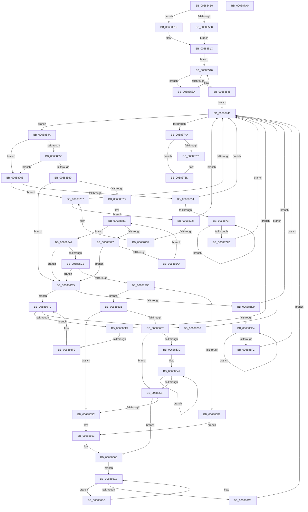

# MiDeleteAwePageTables

- RVA: `0x006884B0`–`0x006887A1` (길이 `753` bytes)
- VA: `0x00000001406884B0`
- 실행 섹션: `.text`
- PDB 이름 있음: `예`; PDB Function 태그: `아니요`
- unwind 정보 RVA: `0x000D8B28`
- 디코드: `218`개 명령, `753/753` bytes 표시
- 미해석 바이트: `0` (있으면 어셈블리에 `.byte`로 보존)

> 이 문서는 커널 이미지의 기계어와 PDB 기호를 분석해 생성했습니다. 4번과 5번은 함수 원형과 자료형을 바이너리 사용 방식에서 추정한 C 해석이며 원본 소스 복구 결과는 아닙니다.

## 1. Dependencies

- 직접 호출 지점: **9**; 고유 호출 대상: **7**
- 직접 호출자로 확인된 함수: **0**
- RIP 상대 이미지 참조: **1**

### Outgoing calls
- `0x0068850F` → [KiStackAttachProcess](../21/KiStackAttachProcess_function_00216820.md) (function, `0x00216820`)
- `0x00688526` → [ExAcquireSpinLockShared](../24/ExAcquireSpinLockShared_function_0024DCE0.md) (function, `0x0024DCE0`)
- `0x0068867D` → [MiReleaseSpinLockShared](../34/MiReleaseSpinLockShared_function_00348BF0.md) (function, `0x00348BF0`)
- `0x006886A4` → [MiDeleteEmptyPageTables](../2A/MiDeleteEmptyPageTables_function_002A5220.md) (function, `0x002A5220`)
- `0x006886AC` → [ExAcquireSpinLockShared](../24/ExAcquireSpinLockShared_function_0024DCE0.md) (function, `0x0024DCE0`)
- `0x00688757` → [MiReleaseSpinLockShared](../34/MiReleaseSpinLockShared_function_00348BF0.md) (function, `0x00348BF0`)
- `0x00688768` → [KiUnstackDetachProcess](../21/KiUnstackDetachProcess_function_00217D30.md) (function, `0x00217D30`)
- `0x00688775` → [ObfDereferenceObjectWithTag](../2F/ObfDereferenceObjectWithTag_function_002F78E0.md) (function, `0x002F78E0`)
- `0x00688782` → [_security_check_cookie](../6A/_security_check_cookie_function_006AC640.md) (function, `0x006AC640`)

### Direct callers
- 이 함수 시작 RVA로 연결되는 직접 call은 확인되지 않았습니다. 간접 호출은 완전히 역산할 수 없습니다.

### Static image references
- `0x006884C6` → RVA `0x00E0A740` (`.data`; read)

## 2. Other-region calls and transfers

- 다른 실행 섹션으로 향하는 call: **0**
- 별도 외부 분기/꼬리 이동을 확인하지 못했습니다.

## 3. Assembly (complete function range)

```asm
006884B0  48 89 5C 24 10                  mov qword ptr [rsp + 0x10], rbx
006884B5  48 89 6C 24 18                  mov qword ptr [rsp + 0x18], rbp
006884BA  56                              push rsi
006884BB  57                              push rdi
006884BC  41 54                           push r12
006884BE  41 56                           push r14
006884C0  41 57                           push r15
006884C2  48 83 EC 60                     sub rsp, 0x60
006884C6  48 8B 05 73 22 78 00            mov rax, qword ptr [rip + 0x782273]
006884CD  48 33 C4                        xor rax, rsp
006884D0  48 89 44 24 58                  mov qword ptr [rsp + 0x58], rax
006884D5  48 8B A9 10 04 00 00            mov rbp, qword ptr [rcx + 0x410]
006884DC  0F 57 C0                        xorps xmm0, xmm0
006884DF  0F 11 44 24 28                  movups xmmword ptr [rsp + 0x28], xmm0
006884E4  48 8B F1                        mov rsi, rcx
006884E7  BB 01 00 00 00                  mov ebx, 1
006884EC  0F 11 44 24 38                  movups xmmword ptr [rsp + 0x38], xmm0
006884F1  0F 11 44 24 48                  movups xmmword ptr [rsp + 0x48], xmm0
006884F6  65 48 8B 04 25 88 01 00 00      mov rax, qword ptr gs:[0x188]
006884FF  48 3B 88 B8 00 00 00            cmp rcx, qword ptr [rax + 0xb8]
00688506  74 11                           je 0x140688519
00688508  4C 8D 44 24 28                  lea r8, [rsp + 0x28]
0068850D  33 D2                           xor edx, edx
0068850F  E8 0C E3 B8 FF                  call 0x140216820
00688514  44 8B F3                        mov r14d, ebx
00688517  EB 03                           jmp 0x14068851c
00688519  45 33 F6                        xor r14d, r14d
0068851C  4C 8D BD 68 04 00 00            lea r15, [rbp + 0x468]
00688523  49 8B CF                        mov rcx, r15
00688526  E8 B5 57 BC FF                  call 0x14024dce0
0068852B  48 8B 8D 50 04 00 00            mov rcx, qword ptr [rbp + 0x450]
00688532  44 8A E0                        mov r12b, al
00688535  45 33 C0                        xor r8d, r8d
00688538  EB 06                           jmp 0x140688540
0068853A  4C 8B C1                        mov r8, rcx
0068853D  48 8B 09                        mov rcx, qword ptr [rcx]
00688540  48 85 C9                        test rcx, rcx
00688543  75 F5                           jne 0x14068853a
00688545  E9 F7 01 00 00                  jmp 0x140688741
0068854A  49 83 78 30 00                  cmp qword ptr [r8 + 0x30], 0
0068854F  0F 84 B3 01 00 00               je 0x140688708
00688555  41 80 78 40 3F                  cmp byte ptr [r8 + 0x40], 0x3f
0068855A  0F 82 A8 01 00 00               jb 0x140688708
00688560  49 8B 48 30                     mov rcx, qword ptr [r8 + 0x30]
00688564  83 64 24 20 00                  and dword ptr [rsp + 0x20], 0
00688569  48 FF C9                        dec rcx
0068856C  49 8B 50 38                     mov rdx, qword ptr [r8 + 0x38]
00688570  48 8D 41 01                     lea rax, [rcx + 1]
00688574  48 3B C3                        cmp rax, rbx
00688577  0F 82 50 01 00 00               jb 0x1406886cd
0068857D  48 8B C1                        mov rax, rcx
00688580  4C 8B CA                        mov r9, rdx
00688583  48 C1 E8 06                     shr rax, 6
00688587  4C 8D 14 C2                     lea r10, [rdx + rax*8]
0068858B  48 8B 02                        mov rax, qword ptr [rdx]
0068858E  48 F7 D0                        not rax
00688591  48 83 F8 FF                     cmp rax, -1
00688595  75 12                           jne 0x1406885a9
00688597  49 83 C1 08                     add r9, 8
0068859B  4D 3B CA                        cmp r9, r10
0068859E  0F 87 29 01 00 00               ja 0x1406886cd
006885A4  49 8B 01                        mov rax, qword ptr [r9]
006885A7  EB E5                           jmp 0x14068858e
006885A9  4C 2B CA                        sub r9, rdx
006885AC  48 F7 D0                        not rax
006885AF  48 0F BC C0                     bsf rax, rax
006885B3  49 C1 F9 03                     sar r9, 3
006885B7  49 C1 E1 06                     shl r9, 6
006885BB  4C 03 C8                        add r9, rax
006885BE  89 44 24 20                     mov dword ptr [rsp + 0x20], eax
006885C2  4C 3B C9                        cmp r9, rcx
006885C5  0F 87 02 01 00 00               ja 0x1406886cd
006885CB  49 83 F9 FF                     cmp r9, -1
006885CF  0F 84 F8 00 00 00               je 0x1406886cd
006885D5  4D 8B D9                        mov r11, r9
006885D8  49 8B C1                        mov rax, r9
006885DB  48 C1 E8 05                     shr rax, 5
006885DF  41 83 E3 1F                     and r11d, 0x1f
006885E3  48 8B CB                        mov rcx, rbx
006885E6  49 8B F9                        mov rdi, r9
006885E9  4C 8D 14 82                     lea r10, [rdx + rax*4]
006885ED  49 8D 43 01                     lea rax, [r11 + 1]
006885F1  48 83 F8 20                     cmp rax, 0x20
006885F5  77 0B                           ja 0x140688602
006885F7  41 8B CB                        mov ecx, r11d
006885FA  8B C3                           mov eax, ebx
006885FC  D3 E0                           shl eax, cl
006885FE  F7 D0                           not eax
00688600  EB 5F                           jmp 0x140688661
00688602  4D 85 DB                        test r11, r11
00688605  74 55                           je 0x14068865c
00688607  41 8B C1                        mov eax, r9d
0068860A  BA 20 00 00 00                  mov edx, 0x20
0068860F  83 E0 1F                        and eax, 0x1f
00688612  2B D0                           sub edx, eax
00688614  8B C3                           mov eax, ebx
00688616  8B CA                           mov ecx, edx
00688618  D3 E0                           shl eax, cl
0068861A  49 8B CB                        mov rcx, r11
0068861D  2B C3                           sub eax, ebx
0068861F  D3 E0                           shl eax, cl
00688621  F7 D0                           not eax
00688623  F0 41 21 02                     lock and dword ptr [r10], eax
00688627  8B C2                           mov eax, edx
00688629  48 8B CB                        mov rcx, rbx
0068862C  48 2B C8                        sub rcx, rax
0068862F  49 83 C2 04                     add r10, 4
00688633  48 83 F9 20                     cmp rcx, 0x20
00688637  72 1E                           jb 0x140688657
00688639  48 8B D1                        mov rdx, rcx
0068863C  48 C1 EA 05                     shr rdx, 5
00688640  48 6B C2 E0                     imul rax, rdx, -0x20
00688644  48 03 C8                        add rcx, rax
00688647  41 C7 02 00 00 00 00            mov dword ptr [r10], 0
0068864E  49 83 C2 04                     add r10, 4
00688652  48 2B D3                        sub rdx, rbx
00688655  75 F0                           jne 0x140688647
00688657  48 85 C9                        test rcx, rcx
0068865A  74 09                           je 0x140688665
0068865C  83 C8 FF                        or eax, 0xffffffff
0068865F  D3 E0                           shl eax, cl
00688661  F0 41 21 02                     lock and dword ptr [r10], eax
00688665  49 8B 40 18                     mov rax, qword ptr [r8 + 0x18]
00688669  41 8A D4                        mov dl, r12b
0068866C  49 8B CF                        mov rcx, r15
0068866F  0F B6 58 20                     movzx ebx, byte ptr [rax + 0x20]
00688673  8B 40 18                        mov eax, dword ptr [rax + 0x18]
00688676  48 C1 E3 20                     shl rbx, 0x20
0068867A  48 0B D8                        or rbx, rax
0068867D  E8 6E 05 CC FF                  call 0x140348bf0
00688682  48 81 E3 00 FE FF FF            and rbx, 0xfffffffffffffe00
00688689  48 C1 E7 15                     shl rdi, 0x15
0068868D  48 C1 E3 0C                     shl rbx, 0xc
00688691  41 B8 01 00 00 00               mov r8d, 1
00688697  48 03 DF                        add rbx, rdi
0068869A  48 8B CB                        mov rcx, rbx
0068869D  48 8D 93 FF FF 1F 00            lea rdx, [rbx + 0x1fffff]
006886A4  E8 77 CB C1 FF                  call 0x1402a5220
006886A9  49 8B CF                        mov rcx, r15
006886AC  E8 2F 56 BC FF                  call 0x14024dce0
006886B1  48 8B 85 50 04 00 00            mov rax, qword ptr [rbp + 0x450]
006886B8  45 33 C0                        xor r8d, r8d
006886BB  EB 06                           jmp 0x1406886c3
006886BD  4C 8B C0                        mov r8, rax
006886C0  48 8B 00                        mov rax, qword ptr [rax]
006886C3  48 85 C0                        test rax, rax
006886C6  75 F5                           jne 0x1406886bd
006886C8  8D 58 01                        lea ebx, [rax + 1]
006886CB  EB 74                           jmp 0x140688741
006886CD  49 8B 40 08                     mov rax, qword ptr [r8 + 8]
006886D1  49 8B C8                        mov rcx, r8
006886D4  48 85 C0                        test rax, rax
006886D7  74 23                           je 0x1406886fc
006886D9  48 8B 08                        mov rcx, qword ptr [rax]
006886DC  4C 8B C0                        mov r8, rax
006886DF  48 85 C9                        test rcx, rcx
006886E2  74 5D                           je 0x140688741
006886E4  48 8B 01                        mov rax, qword ptr [rcx]
006886E7  4C 8B C1                        mov r8, rcx
006886EA  48 8B C8                        mov rcx, rax
006886ED  48 85 C0                        test rax, rax
006886F0  75 F2                           jne 0x1406886e4
006886F2  EB 4D                           jmp 0x140688741
006886F4  49 39 08                        cmp qword ptr [r8], rcx
006886F7  74 48                           je 0x140688741
006886F9  49 8B C8                        mov rcx, r8
006886FC  4D 8B 40 10                     mov r8, qword ptr [r8 + 0x10]
00688700  49 83 E0 FC                     and r8, 0xfffffffffffffffc
00688704  75 EE                           jne 0x1406886f4
00688706  EB 39                           jmp 0x140688741
00688708  49 8B 40 08                     mov rax, qword ptr [r8 + 8]
0068870C  49 8B C8                        mov rcx, r8
0068870F  48 85 C0                        test rax, rax
00688712  74 23                           je 0x140688737
00688714  48 8B 08                        mov rcx, qword ptr [rax]
00688717  4C 8B C0                        mov r8, rax
0068871A  48 85 C9                        test rcx, rcx
0068871D  74 22                           je 0x140688741
0068871F  48 8B 01                        mov rax, qword ptr [rcx]
00688722  4C 8B C1                        mov r8, rcx
00688725  48 8B C8                        mov rcx, rax
00688728  48 85 C0                        test rax, rax
0068872B  75 F2                           jne 0x14068871f
0068872D  EB 12                           jmp 0x140688741
0068872F  49 39 08                        cmp qword ptr [r8], rcx
00688732  74 0D                           je 0x140688741
00688734  49 8B C8                        mov rcx, r8
00688737  4D 8B 40 10                     mov r8, qword ptr [r8 + 0x10]
0068873B  49 83 E0 FC                     and r8, 0xfffffffffffffffc
0068873F  75 EE                           jne 0x14068872f
00688741  4D 85 C0                        test r8, r8
00688744  0F 85 00 FE FF FF               jne 0x14068854a
0068874A  4C 21 85 80 04 00 00            and qword ptr [rbp + 0x480], r8
00688751  41 8A D4                        mov dl, r12b
00688754  49 8B CF                        mov rcx, r15
00688757  E8 94 04 CC FF                  call 0x140348bf0
0068875C  45 85 F6                        test r14d, r14d
0068875F  74 0C                           je 0x14068876d
00688761  33 D2                           xor edx, edx
00688763  48 8D 4C 24 28                  lea rcx, [rsp + 0x28]
00688768  E8 C3 F5 B8 FF                  call 0x140217d30
0068876D  BA 4D 6D 50 68                  mov edx, 0x68506d4d
00688772  48 8B CE                        mov rcx, rsi
00688775  E8 66 F1 C6 FF                  call 0x1402f78e0
0068877A  48 8B 4C 24 58                  mov rcx, qword ptr [rsp + 0x58]
0068877F  48 33 CC                        xor rcx, rsp
00688782  E8 B9 3E 02 00                  call 0x1406ac640
00688787  4C 8D 5C 24 60                  lea r11, [rsp + 0x60]
0068878C  49 8B 5B 38                     mov rbx, qword ptr [r11 + 0x38]
00688790  49 8B 6B 40                     mov rbp, qword ptr [r11 + 0x40]
00688794  49 8B E3                        mov rsp, r11
00688797  41 5F                           pop r15
00688799  41 5E                           pop r14
0068879B  41 5C                           pop r12
0068879D  5F                              pop rdi
0068879E  5E                              pop rsi
0068879F  C3                              ret
006887A0  CC                              int3
```

## 4. C-style interpretation (structured pseudocode)

```c
__int64 __fastcall MiDeleteAwePageTables(__int64 a1, int a2)
{
    __int64 result;
    __int64 v_r10;
    __int64 v_r11;
    __int64 v_r14;
    __int64 v_rbx;
    __int64 v_rdi;
    __int64 v_rsp;
    unsigned __int64 v_stack_m28;
    unsigned __int64 v_stack_m30;
    unsigned __int64 v_stack_m40;
    unsigned __int64 v_stack_m50;
    unsigned __int64 v_stack_m60;
    unsigned int v_stack_m68;
    unsigned __int64 v_stack_p10;
    unsigned __int64 v_stack_p18;

    v_stack_p10 = v_rbx;
    v_stack_p18 = v_rbp;
    v_rsp = (v_rsp) - (96);
    result = (*(unsigned __int64 *)(v_rip + 7873139)) ^ (v_rsp);
    v_stack_m30 = result;
    v_stack_m60 = v_xmm0;
    v_stack_m50 = v_xmm0;
    v_stack_m40 = v_xmm0;
    if (a1 == (*(unsigned __int64 *)(*(unsigned __int64 *)(gs_base + (0 + 392)) + 184))) goto loc_00688519;
    a2 = 0;
    result = KiStackAttachProcess(a1, a2, v_stack_m60, a4);
    goto loc_0068851C;
loc_00688519:
    v_r14 = 0;
loc_0068851C:
    result = ExAcquireSpinLockShared(*(unsigned __int64 *)(a1 + 1040) + 1128, a2, v_stack_m60, a4);
    a3 = 0;
    goto loc_00688540;
loc_0068853A:
loc_00688540:
    if (*(unsigned __int64 *)(*(unsigned __int64 *)(*(unsigned __int64 *)(a1 + 1040) + 1104)) != 0) goto loc_0068853A;
    goto loc_00688741;
loc_0068854A:
    if ((*(unsigned __int64 *)(*(unsigned __int64 *)(*(unsigned __int64 *)(a1 + 1040) + 1104) + 48)) == 0) goto loc_00688708;
    if ((*(unsigned __int8 *)(*(unsigned __int64 *)(*(unsigned __int64 *)(a1 + 1040) + 1104) + 64)) < 63) goto loc_00688708;
    a1 = (*(unsigned __int64 *)(*(unsigned __int64 *)(*(unsigned __int64 *)(a1 + 1040) + 1104) + 48)) - 1;
    if ((a1 + 1) < 1) goto loc_006886CD;
    result = (a1) >> (6);
loc_0068858E:
    result = ~(*(unsigned __int64 *)(*(unsigned __int64 *)(*(unsigned __int64 *)(*(unsigned __int64 *)(a1 + 1040) + 1104) + 56)));
    if (result != -1) goto loc_006885A9;
    a4 = (*(unsigned __int64 *)(*(unsigned __int64 *)(*(unsigned __int64 *)(a1 + 1040) + 1104) + 56)) + (8);
    if (a4 > (*(unsigned __int64 *)(*(unsigned __int64 *)(*(unsigned __int64 *)(a1 + 1040) + 1104) + 56) + result * 8)) goto loc_006886CD;
    goto loc_0068858E;
loc_006885A9:
    a4 = (a4) - (*(unsigned __int64 *)(*(unsigned __int64 *)(*(unsigned __int64 *)(a1 + 1040) + 1104) + 56));
    result = ~(*(unsigned __int64 *)(a4));
    a4 = (a4) >> (3);
    a4 = (a4) << (6);
    a4 = (a4) + (result);
    v_stack_m68 = (unsigned int)(result);
    if (a4 > a1) goto loc_006886CD;
    if (a4 == -1) goto loc_006886CD;
    result = (a4) >> (5);
    v_r11 = (unsigned int)((a4) & (31));
    if ((v_r11 + 1) > 32) goto loc_00688602;
    result = (unsigned int)((1) << ((unsigned __int8)((unsigned int)((unsigned int)(v_r11)))));
    result = (unsigned int)(~(result));
    goto loc_00688661;
loc_00688602:
    if (v_r11 == 0) goto loc_0068865C;
    result = (unsigned int)(((unsigned int)((unsigned int)(a4))) & (31));
    a2 = (unsigned int)((32) - ((unsigned int)(result)));
    result = (unsigned int)((1) << ((unsigned __int8)((unsigned int)(a2))));
    result = (unsigned int)((result) - (1));
    result = (unsigned int)((result) << ((unsigned __int8)(v_r11)));
    result = (unsigned int)(~(result));
    a1 = (1) - ((unsigned int)(a2));
    v_r10 = (*(unsigned __int64 *)(*(unsigned __int64 *)(*(unsigned __int64 *)(a1 + 1040) + 1104) + 56) + result * 4) + (4);
    if (a1 < 32) goto loc_00688657;
    a2 = (a1) >> (5);
    result = ((unsigned int)(a2)) * (a2);
    a1 = (a1) + (result);
loc_00688647:
    *(unsigned int *)(v_r10) = 0;
    v_r10 = (v_r10) + (4);
    a2 = (a2) - (1);
    if (condition_is_not_equal) goto loc_00688647;
loc_00688657:
    if (a1 == 0) goto loc_00688665;
loc_0068865C:
    result = (unsigned int)((result) | (0xFFFFFFFFULL));
    result = (unsigned int)((result) << ((unsigned __int8)(a1)));
loc_00688661:
loc_00688665:
    v_rbx = (*(unsigned __int8 *)(*(unsigned __int64 *)(*(unsigned __int64 *)(*(unsigned __int64 *)(a1 + 1040) + 1104) + 24) + 32)) << (32);
    v_rbx = (v_rbx) | ((unsigned int)(*(unsigned int *)(*(unsigned __int64 *)(*(unsigned __int64 *)(*(unsigned __int64 *)(a1 + 1040) + 1104) + 24) + 24)));
    result = MiReleaseSpinLockShared(*(unsigned __int64 *)(a1 + 1040) + 1128, (unsigned __int8)((unsigned __int8)(result)), *(unsigned __int64 *)(*(unsigned __int64 *)(a1 + 1040) + 1104), a4);
    v_rbx = (v_rbx) & (-512);
    v_rdi = (a4) << (21);
    v_rbx = (v_rbx) << (12);
    v_rbx = (v_rbx) + (v_rdi);
    result = MiDeleteEmptyPageTables(v_rbx, v_rbx + 2097151, 1, a4);
    result = ExAcquireSpinLockShared(*(unsigned __int64 *)(a1 + 1040) + 1128, v_rbx + 2097151, 1, a4);
    a3 = 0;
    goto loc_006886C3;
loc_006886BD:
loc_006886C3:
    if (*(unsigned __int64 *)(*(unsigned __int64 *)(*(unsigned __int64 *)(a1 + 1040) + 1104)) != 0) goto loc_006886BD;
    goto loc_00688741;
loc_006886CD:
    if (*(unsigned __int64 *)(*(unsigned __int64 *)(*(unsigned __int64 *)(a1 + 1040) + 1104) + 8) == 0) goto loc_006886FC;
    if (*(unsigned __int64 *)(*(unsigned __int64 *)(*(unsigned __int64 *)(*(unsigned __int64 *)(a1 + 1040) + 1104) + 8)) == 0) goto loc_00688741;
loc_006886E4:
    if (*(unsigned __int64 *)(*(unsigned __int64 *)(*(unsigned __int64 *)(*(unsigned __int64 *)(*(unsigned __int64 *)(a1 + 1040) + 1104) + 8))) != 0) goto loc_006886E4;
    goto loc_00688741;
loc_006886F4:
    if ((*(unsigned __int64 *)(*(unsigned __int64 *)(*(unsigned __int64 *)(*(unsigned __int64 *)(*(unsigned __int64 *)(a1 + 1040) + 1104) + 8)))) == (*(unsigned __int64 *)(*(unsigned __int64 *)(*(unsigned __int64 *)(*(unsigned __int64 *)(*(unsigned __int64 *)(a1 + 1040) + 1104) + 8))))) goto loc_00688741;
loc_006886FC:
    a3 = (*(unsigned __int64 *)(*(unsigned __int64 *)(*(unsigned __int64 *)(*(unsigned __int64 *)(*(unsigned __int64 *)(a1 + 1040) + 1104) + 8)) + 16)) & (-4);
    if (condition_is_not_equal) goto loc_006886F4;
    goto loc_00688741;
loc_00688708:
    if (*(unsigned __int64 *)(a3 + 8) == 0) goto loc_00688737;
    if (*(unsigned __int64 *)(*(unsigned __int64 *)(a3 + 8)) == 0) goto loc_00688741;
loc_0068871F:
    if (*(unsigned __int64 *)(*(unsigned __int64 *)(*(unsigned __int64 *)(a3 + 8))) != 0) goto loc_0068871F;
    goto loc_00688741;
loc_0068872F:
    if ((*(unsigned __int64 *)(*(unsigned __int64 *)(*(unsigned __int64 *)(a3 + 8)))) == (*(unsigned __int64 *)(*(unsigned __int64 *)(*(unsigned __int64 *)(a3 + 8))))) goto loc_00688741;
loc_00688737:
    a3 = (*(unsigned __int64 *)(*(unsigned __int64 *)(*(unsigned __int64 *)(a3 + 8)) + 16)) & (-4);
    if (condition_is_not_equal) goto loc_0068872F;
loc_00688741:
    if (a3 != 0) goto loc_0068854A;
    result = MiReleaseSpinLockShared(*(unsigned __int64 *)(a1 + 1040) + 1128, (unsigned __int8)((unsigned __int8)(result)), a3, a4);
    if (0 != 0) {
        a2 = 0;
        a1 = v_stack_m60;
        result = KiUnstackDetachProcess(a1, a2, a3, a4);
    }
    result = ObfDereferenceObjectWithTag(a1, (unsigned int)(0x68506D4DULL), a3, a4);
    a1 = (v_stack_m30) ^ (v_rsp);
    result = _security_check_cookie(a1, (unsigned int)(0x68506D4DULL), a3, a4);
    return result;
}
```

## 5. (Beta) C Style

```c
int64_t MiDeleteAwePageTables(void *Arg1, int32_t Arg2)
{
    uint8_t *arg1 = (uint8_t *)Arg1;

    int64_t result;
    int64_t local_r10;
    int64_t local_r11;
    int64_t local_r14;
    int64_t local_rbx;
    int64_t local_rdi;
    int64_t local_rsp;
    uint64_t v_stack_m28;
    uint64_t v_stack_m30;
    uint64_t v_stack_m40;
    uint64_t v_stack_m50;
    uint64_t v_stack_m60;
    uint32_t v_stack_m68;
    uint64_t v_stack_p10;
    uint64_t v_stack_p18;

    v_stack_p10 = local_rbx;
    v_stack_p18 = local_rbp;
    local_rsp = (local_rsp) - (96);
    result = (*(uint64_t *)(v_rip + 0x782273)) ^ (local_rsp);
    v_stack_m30 = result;
    v_stack_m60 = v_xmm0;
    v_stack_m50 = v_xmm0;
    v_stack_m40 = v_xmm0;
    if (Arg1 == (*(uint64_t *)(*(uint64_t *)(gs_base + (0 + 0x188)) + 0xB8))) goto loc_00688519;
    Arg2 = 0;
    result = KiStackAttachProcess(Arg1, Arg2, v_stack_m60, a4);
    goto loc_0068851C;
loc_00688519:
    local_r14 = 0;
loc_0068851C:
    result = ExAcquireSpinLockShared(*(uint64_t *)(arg1 + 0x410) + 1128, Arg2, v_stack_m60, a4);
    a3 = 0;
    goto loc_00688540;
loc_0068853A:
loc_00688540:
    if (*(uint64_t *)(*(uint64_t *)(*(uint64_t *)(arg1 + 0x410) + 0x450)) != 0) goto loc_0068853A;
    goto loc_00688741;
loc_0068854A:
    if ((*(uint64_t *)(*(uint64_t *)(*(uint64_t *)(arg1 + 0x410) + 0x450) + 0x30)) == 0) goto loc_00688708;
    if ((*(uint8_t *)(*(uint64_t *)(*(uint64_t *)(arg1 + 0x410) + 0x450) + 0x40)) < 63) goto loc_00688708;
    Arg1 = (*(uint64_t *)(*(uint64_t *)(*(uint64_t *)(arg1 + 0x410) + 0x450) + 0x30)) - 1;
    if ((Arg1 + 1) < 1) goto loc_006886CD;
    result = (Arg1) >> (6);
loc_0068858E:
    result = ~(*(uint64_t *)(*(uint64_t *)(*(uint64_t *)(*(uint64_t *)(arg1 + 0x410) + 0x450) + 0x38)));
    if (result != -1) goto loc_006885A9;
    a4 = (*(uint64_t *)(*(uint64_t *)(*(uint64_t *)(arg1 + 0x410) + 0x450) + 0x38)) + (8);
    if (a4 > (*(uint64_t *)(*(uint64_t *)(*(uint64_t *)(arg1 + 0x410) + 0x450) + 0x38) + result * 8)) goto loc_006886CD;
    goto loc_0068858E;
loc_006885A9:
    a4 = (a4) - (*(uint64_t *)(*(uint64_t *)(*(uint64_t *)(arg1 + 0x410) + 0x450) + 0x38));
    result = ~(*(uint64_t *)(a4));
    a4 = (a4) >> (3);
    a4 = (a4) << (6);
    a4 = (a4) + (result);
    v_stack_m68 = (uint32_t)(result);
    if (a4 > Arg1) goto loc_006886CD;
    if (a4 == -1) goto loc_006886CD;
    result = (a4) >> (5);
    local_r11 = (uint32_t)((a4) & (31));
    if ((local_r11 + 1) > 32) goto loc_00688602;
    result = (uint32_t)((1) << ((uint8_t)((uint32_t)((uint32_t)(local_r11)))));
    result = (uint32_t)(~(result));
    goto loc_00688661;
loc_00688602:
    if (local_r11 == 0) goto loc_0068865C;
    result = (uint32_t)(((uint32_t)((uint32_t)(a4))) & (31));
    Arg2 = (uint32_t)((32) - ((uint32_t)(result)));
    result = (uint32_t)((1) << ((uint8_t)((uint32_t)(Arg2))));
    result = (uint32_t)((result) - (1));
    result = (uint32_t)((result) << ((uint8_t)(local_r11)));
    result = (uint32_t)(~(result));
    Arg1 = (1) - ((uint32_t)(Arg2));
    local_r10 = (*(uint64_t *)(*(uint64_t *)(*(uint64_t *)(arg1 + 0x410) + 0x450) + 0x38) + result * 4) + (4);
    if (Arg1 < 32) goto loc_00688657;
    Arg2 = (Arg1) >> (5);
    result = ((uint32_t)(Arg2)) * (Arg2);
    Arg1 = (Arg1) + (result);
loc_00688647:
    *(uint32_t *)(local_r10) = 0;
    local_r10 = (local_r10) + (4);
    Arg2 = (Arg2) - (1);
    if (condition_is_not_equal) goto loc_00688647;
loc_00688657:
    if (Arg1 == NULL) goto loc_00688665;
loc_0068865C:
    result = (uint32_t)((result) | (0xFFFFFFFFULL));
    result = (uint32_t)((result) << ((uint8_t)(Arg1)));
loc_00688661:
loc_00688665:
    local_rbx = (*(uint8_t *)(*(uint64_t *)(*(uint64_t *)(*(uint64_t *)(arg1 + 0x410) + 0x450) + 0x18) + 0x20)) << (32);
    local_rbx = (local_rbx) | ((uint32_t)(*(uint32_t *)(*(uint64_t *)(*(uint64_t *)(*(uint64_t *)(arg1 + 0x410) + 0x450) + 0x18) + 0x18)));
    result = MiReleaseSpinLockShared(*(uint64_t *)(arg1 + 0x410) + 1128, (uint8_t)((uint8_t)(result)), *(uint64_t *)(*(uint64_t *)(arg1 + 0x410) + 0x450), a4);
    local_rbx = (local_rbx) & (-512);
    local_rdi = (a4) << (21);
    local_rbx = (local_rbx) << (12);
    local_rbx = (local_rbx) + (local_rdi);
    result = MiDeleteEmptyPageTables(local_rbx, local_rbx + 2097151, 1, a4);
    result = ExAcquireSpinLockShared(*(uint64_t *)(arg1 + 0x410) + 1128, local_rbx + 2097151, 1, a4);
    a3 = 0;
    goto loc_006886C3;
loc_006886BD:
loc_006886C3:
    if (*(uint64_t *)(*(uint64_t *)(*(uint64_t *)(arg1 + 0x410) + 0x450)) != 0) goto loc_006886BD;
    goto loc_00688741;
loc_006886CD:
    if (*(uint64_t *)(*(uint64_t *)(*(uint64_t *)(arg1 + 0x410) + 0x450) + 0x8) == 0) goto loc_006886FC;
    if (*(uint64_t *)(*(uint64_t *)(*(uint64_t *)(*(uint64_t *)(arg1 + 0x410) + 0x450) + 0x8)) == 0) goto loc_00688741;
loc_006886E4:
    if (*(uint64_t *)(*(uint64_t *)(*(uint64_t *)(*(uint64_t *)(*(uint64_t *)(arg1 + 0x410) + 0x450) + 0x8))) != 0) goto loc_006886E4;
    goto loc_00688741;
loc_006886F4:
    if ((*(uint64_t *)(*(uint64_t *)(*(uint64_t *)(*(uint64_t *)(*(uint64_t *)(arg1 + 0x410) + 0x450) + 0x8)))) == (*(uint64_t *)(*(uint64_t *)(*(uint64_t *)(*(uint64_t *)(*(uint64_t *)(arg1 + 0x410) + 0x450) + 0x8))))) goto loc_00688741;
loc_006886FC:
    a3 = (*(uint64_t *)(*(uint64_t *)(*(uint64_t *)(*(uint64_t *)(*(uint64_t *)(arg1 + 0x410) + 0x450) + 0x8)) + 0x10)) & (-4);
    if (condition_is_not_equal) goto loc_006886F4;
    goto loc_00688741;
loc_00688708:
    if (*(uint64_t *)(a3 + 0x8) == 0) goto loc_00688737;
    if (*(uint64_t *)(*(uint64_t *)(a3 + 0x8)) == 0) goto loc_00688741;
loc_0068871F:
    if (*(uint64_t *)(*(uint64_t *)(*(uint64_t *)(a3 + 0x8))) != 0) goto loc_0068871F;
    goto loc_00688741;
loc_0068872F:
    if ((*(uint64_t *)(*(uint64_t *)(*(uint64_t *)(a3 + 0x8)))) == (*(uint64_t *)(*(uint64_t *)(*(uint64_t *)(a3 + 0x8))))) goto loc_00688741;
loc_00688737:
    a3 = (*(uint64_t *)(*(uint64_t *)(*(uint64_t *)(a3 + 0x8)) + 0x10)) & (-4);
    if (condition_is_not_equal) goto loc_0068872F;
loc_00688741:
    if (a3 != 0) goto loc_0068854A;
    result = MiReleaseSpinLockShared(*(uint64_t *)(arg1 + 0x410) + 1128, (uint8_t)((uint8_t)(result)), a3, a4);
    if (0 != 0) {
        Arg2 = 0;
        Arg1 = v_stack_m60;
        result = KiUnstackDetachProcess(Arg1, Arg2, a3, a4);
    }
    result = ObfDereferenceObjectWithTag(Arg1, (uint32_t)(0x68506D4DULL), a3, a4);
    Arg1 = (v_stack_m30) ^ (local_rsp);
    result = _security_check_cookie(Arg1, (uint32_t)(0x68506D4DULL), a3, a4);
    return result;
}
```

### 관측된 메모리 오프셋

구조체 형식이 확인되지 않은 접근은 인자 기준의 오프셋으로만 기록했습니다.

| 기준 인자 | 오프셋 표현 | 폭 (bit) | 접근 |
|---|---:|---:|---|
| `Arg1` | `+ 0x410` | `64` | `R` |

## 6. Execution-region graph

[열기: 2D/3D 그래프와 함수 탐색 컨트롤 패널](../../../control-panel.html?section=text&rva=0x006884B0&view=graph)

- 2D 그래프는 위에서 아래로 흐르고, 3D 그래프는 빈 공간을 드래그해 회전합니다. Shift+드래그는 이동, 휠은 확대·축소, 함수 노드 선택은 대상 보고서 이동입니다.

### Static fallback


