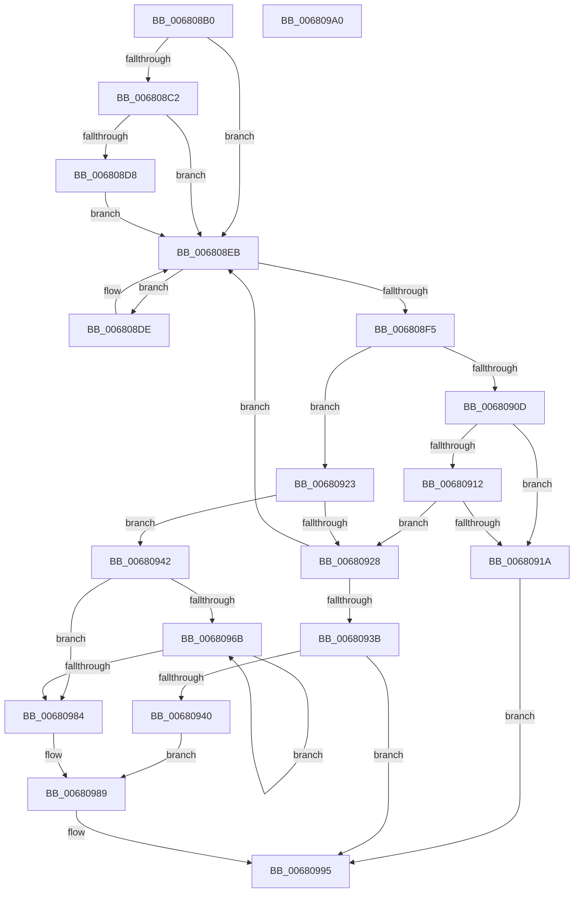

# MiDeleteExtentPfns

- RVA: `0x006808B0`–`0x006809A1` (길이 `241` bytes)
- VA: `0x00000001406808B0`
- 실행 섹션: `.text`
- PDB 이름 있음: `예`; PDB Function 태그: `아니요`
- unwind 정보 RVA: `0x0005CAAC`
- 디코드: `65`개 명령, `241/241` bytes 표시
- 미해석 바이트: `0` (있으면 어셈블리에 `.byte`로 보존)

> 이 문서는 커널 이미지의 기계어와 PDB 기호를 분석해 생성했습니다. 4번과 5번은 함수 원형과 자료형을 바이너리 사용 방식에서 추정한 C 해석이며 원본 소스 복구 결과는 아닙니다.

## 1. Dependencies

- 직접 호출 지점: **9**; 고유 호출 대상: **8**
- 직접 호출자로 확인된 함수: **1**
- RIP 상대 이미지 참조: **7**

### Outgoing calls
- `0x006808CE` → [KeAbPreAcquire](../21/KeAbPreAcquire_function_00210230.md) (function, `0x00210230`)
- `0x006808E6` → [MiRemovePhysicalMemory](../../page/7F/MiRemovePhysicalMemory_function_007FAD3C.md) (function, `0x007FAD3C`)
- `0x006808FC` → [ExAcquireSpinLockExclusive](../24/ExAcquireSpinLockExclusive_function_00248690.md) (function, `0x00248690`)
- `0x0068091C` → [MiWaitForExtentDeletions](MiWaitForExtentDeletions_function_00681F80.md) (function, `0x00681F80`)
- `0x00680931` → [MiReleaseSpinLockExclusive](../24/MiReleaseSpinLockExclusive_function_002482C0.md) (function, `0x002482C0`)
- `0x00680961` → [MiReleaseSpinLockExclusive](../24/MiReleaseSpinLockExclusive_function_002482C0.md) (function, `0x002482C0`)
- `0x00680977` → [KeSignalGate](../2C/KeSignalGate_function_002C748C.md) (function, `0x002C748C`)
- `0x00680984` → [MiPurgeBadFileOnlyPages](MiPurgeBadFileOnlyPages_function_00681ADC.md) (function, `0x00681ADC`)
- `0x00680990` → [KeAbPostRelease](../2E/KeAbPostRelease_function_002E1600.md) (function, `0x002E1600`)

### Direct callers
- [MiAddPhysicalMemory](../../page/7F/MiAddPhysicalMemory_function_007F95FC.md) at `0x007F969B`

### Static image references
- `0x006808C5` → RVA `0x00E2D6E0` (`.data`; read)
- `0x006808EB` → RVA `0x00E2D6B8` (`.data`; read)
- `0x006808F5` → RVA `0x00E3A8A0` (`.data`; read)
- `0x00680901` → RVA `0x00E2D6A8` (`.data`; read)
- `0x00680912` → RVA `0x00E2D701` (`.data`; read)
- `0x00680950` → RVA `0x00E2D6E0` (`.data`; read/write)
- `0x0068095A` → RVA `0x00E2D701` (`.data`; write)

## 2. Other-region calls and transfers

- 다른 실행 섹션으로 향하는 call: **1**
  - `0x006808E6` → [MiRemovePhysicalMemory](../../page/7F/MiRemovePhysicalMemory_function_007FAD3C.md) (`.text` → `PAGE`)
- 별도 외부 분기/꼬리 이동을 확인하지 못했습니다.

## 3. Assembly (complete function range)

```asm
006808B0  48 89 5C 24 08                  mov qword ptr [rsp + 8], rbx
006808B5  57                              push rdi
006808B6  48 83 EC 20                     sub rsp, 0x20
006808BA  48 8B D9                        mov rbx, rcx
006808BD  48 85 C9                        test rcx, rcx
006808C0  74 29                           je 0x1406808eb
006808C2  45 33 C0                        xor r8d, r8d
006808C5  48 8D 0D 14 CE 7A 00            lea rcx, [rip + 0x7ace14]
006808CC  33 D2                           xor edx, edx
006808CE  E8 5D F9 B8 FF                  call 0x140210230
006808D3  48 85 C0                        test rax, rax
006808D6  74 13                           je 0x1406808eb
006808D8  C6 40 0A 01                     mov byte ptr [rax + 0xa], 1
006808DC  EB 0D                           jmp 0x1406808eb
006808DE  33 D2                           xor edx, edx
006808E0  33 C9                           xor ecx, ecx
006808E2  44 8D 42 62                     lea r8d, [rdx + 0x62]
006808E6  E8 51 A4 17 00                  call 0x1407fad3c
006808EB  48 83 3D C5 CD 7A 00 00         cmp qword ptr [rip + 0x7acdc5], 0
006808F3  75 E9                           jne 0x1406808de
006808F5  48 8D 0D A4 9F 7B 00            lea rcx, [rip + 0x7b9fa4]
006808FC  E8 8F 7D BC FF                  call 0x140248690
00680901  48 8B 3D A0 CD 7A 00            mov rdi, qword ptr [rip + 0x7acda0]
00680908  48 85 DB                        test rbx, rbx
0068090B  75 16                           jne 0x140680923
0068090D  48 85 FF                        test rdi, rdi
00680910  75 08                           jne 0x14068091a
00680912  38 1D E9 CD 7A 00               cmp byte ptr [rip + 0x7acde9], bl
00680918  74 0E                           je 0x140680928
0068091A  8A D0                           mov dl, al
0068091C  E8 5F 16 00 00                  call 0x140681f80
00680921  EB 72                           jmp 0x140680995
00680923  48 85 FF                        test rdi, rdi
00680926  74 1A                           je 0x140680942
00680928  8A D0                           mov dl, al
0068092A  48 8D 0D 6F 9F 7B 00            lea rcx, [rip + 0x7b9f6f]
00680931  E8 8A 79 BC FF                  call 0x1402482c0
00680936  48 85 FF                        test rdi, rdi
00680939  75 B0                           jne 0x1406808eb
0068093B  48 85 DB                        test rbx, rbx
0068093E  74 55                           je 0x140680995
00680940  EB 47                           jmp 0x140680989
00680942  48 8B 3D 97 CD 7A 00            mov rdi, qword ptr [rip + 0x7acd97]
00680949  48 8D 0D 50 9F 7B 00            lea rcx, [rip + 0x7b9f50]
00680950  48 83 25 88 CD 7A 00 00         and qword ptr [rip + 0x7acd88], 0
00680958  8A D0                           mov dl, al
0068095A  C6 05 A0 CD 7A 00 00            mov byte ptr [rip + 0x7acda0], 0
00680961  E8 5A 79 BC FF                  call 0x1402482c0
00680966  48 85 FF                        test rdi, rdi
00680969  74 19                           je 0x140680984
0068096B  48 8B 1F                        mov rbx, qword ptr [rdi]
0068096E  48 8D 4F 08                     lea rcx, [rdi + 8]
00680972  BA 01 00 00 00                  mov edx, 1
00680977  E8 10 6B C4 FF                  call 0x1402c748c
0068097C  48 8B FB                        mov rdi, rbx
0068097F  48 85 DB                        test rbx, rbx
00680982  75 E7                           jne 0x14068096b
00680984  E8 53 11 00 00                  call 0x140681adc
00680989  48 8D 0D 50 CD 7A 00            lea rcx, [rip + 0x7acd50]
00680990  E8 6B 0C C6 FF                  call 0x1402e1600
00680995  48 8B 5C 24 30                  mov rbx, qword ptr [rsp + 0x30]
0068099A  48 83 C4 20                     add rsp, 0x20
0068099E  5F                              pop rdi
0068099F  C3                              ret
006809A0  CC                              int3
```

## 4. C-style interpretation (structured pseudocode)

```c
__int64 __fastcall MiDeleteExtentPfns(__int64 a1, int a2, int a3)
{
    __int64 result;
    __int64 v_rsp;
    unsigned __int64 v_stack_p8;

    v_stack_p8 = v_rbx;
    v_rsp = (v_rsp) - (32);
    if (a1 == 0) goto loc_006808EB;
    a3 = 0;
    a2 = 0;
    result = KeAbPreAcquire(v_rip + 8048148, a2, a3, a4);
    if (result == 0) goto loc_006808EB;
    *(unsigned __int8 *)(result + 10) = 1;
    goto loc_006808EB;
loc_006808DE:
    a2 = 0;
    a1 = 0;
    result = MiRemovePhysicalMemory(a1, a2, a2 + 98, a4);
loc_006808EB:
    if ((*(unsigned __int64 *)(v_rip + 8048069)) != 0) goto loc_006808DE;
    result = ExAcquireSpinLockExclusive(v_rip + 8101796, a2, a2 + 98, a4);
    if (0 != 0) goto loc_00680923;
    if (*(unsigned __int64 *)(v_rip + 8048032) != 0) goto loc_0068091A;
    if ((*(unsigned __int8 *)(v_rip + 8048105)) == 0) goto loc_00680928;
loc_0068091A:
    result = MiWaitForExtentDeletions(v_rip + 8101796, (unsigned __int8)(result), a2 + 98, a4);
    goto loc_00680995;
loc_00680923:
    if (*(unsigned __int64 *)(v_rip + 8048032) == 0) goto loc_00680942;
loc_00680928:
    result = MiReleaseSpinLockExclusive(v_rip + 8101743, (unsigned __int8)(result), a2 + 98, a4);
    if (*(unsigned __int64 *)(v_rip + 8048032) != 0) goto loc_006808EB;
    if (0 == 0) goto loc_00680995;
    goto loc_00680989;
loc_00680942:
    *(unsigned __int8 *)(v_rip + 8048032) = 0;
    result = MiReleaseSpinLockExclusive(v_rip + 8101712, (unsigned __int8)(result), a2 + 98, a4);
    if (*(unsigned __int64 *)(v_rip + 8048023) == 0) goto loc_00680984;
loc_0068096B:
    result = KeSignalGate(*(unsigned __int64 *)(v_rip + 8048023) + 8, 1, a2 + 98, a4);
    if (*(unsigned __int64 *)(*(unsigned __int64 *)(v_rip + 8048023)) != 0) goto loc_0068096B;
loc_00680984:
    result = MiPurgeBadFileOnlyPages(*(unsigned __int64 *)(v_rip + 8048023) + 8, 1, a2 + 98, a4);
loc_00680989:
    result = KeAbPostRelease(v_rip + 8047952, 1, a2 + 98, a4);
loc_00680995:
    v_rsp = (v_rsp) + (32);
    return result;
}
```

## 5. (Beta) C Style

```c
int64_t MiDeleteExtentPfns(int64_t Arg1, int32_t Arg2, int32_t Arg3)
{
    int64_t result;
    int64_t local_rsp;
    uint64_t v_stack_p8;

    v_stack_p8 = local_rbx;
    local_rsp = (local_rsp) - (32);
    if (Arg1 == 0) goto loc_006808EB;
    Arg3 = 0;
    Arg2 = 0;
    result = KeAbPreAcquire(v_rip + 8048148, Arg2, Arg3, a4);
    if (result == 0) goto loc_006808EB;
    *(uint8_t *)(result + 0xA) = 1;
    goto loc_006808EB;
loc_006808DE:
    Arg2 = 0;
    Arg1 = 0;
    result = MiRemovePhysicalMemory(Arg1, Arg2, Arg2 + 98, a4);
loc_006808EB:
    if ((*(uint64_t *)(v_rip + 0x7ACDC5)) != 0) goto loc_006808DE;
    result = ExAcquireSpinLockExclusive(v_rip + 8101796, Arg2, Arg2 + 98, a4);
    if (0 != 0) goto loc_00680923;
    if (*(uint64_t *)(v_rip + 0x7ACDA0) != 0) goto loc_0068091A;
    if ((*(uint8_t *)(v_rip + 0x7ACDE9)) == 0) goto loc_00680928;
loc_0068091A:
    result = MiWaitForExtentDeletions(v_rip + 8101796, (uint8_t)(result), Arg2 + 98, a4);
    goto loc_00680995;
loc_00680923:
    if (*(uint64_t *)(v_rip + 0x7ACDA0) == 0) goto loc_00680942;
loc_00680928:
    result = MiReleaseSpinLockExclusive(v_rip + 8101743, (uint8_t)(result), Arg2 + 98, a4);
    if (*(uint64_t *)(v_rip + 0x7ACDA0) != 0) goto loc_006808EB;
    if (0 == 0) goto loc_00680995;
    goto loc_00680989;
loc_00680942:
    *(uint8_t *)(v_rip + 0x7ACDA0) = 0;
    result = MiReleaseSpinLockExclusive(v_rip + 8101712, (uint8_t)(result), Arg2 + 98, a4);
    if (*(uint64_t *)(v_rip + 0x7ACD97) == 0) goto loc_00680984;
loc_0068096B:
    result = KeSignalGate(*(uint64_t *)(v_rip + 0x7ACD97) + 8, 1, Arg2 + 98, a4);
    if (*(uint64_t *)(*(uint64_t *)(v_rip + 0x7ACD97)) != 0) goto loc_0068096B;
loc_00680984:
    result = MiPurgeBadFileOnlyPages(*(uint64_t *)(v_rip + 0x7ACD97) + 8, 1, Arg2 + 98, a4);
loc_00680989:
    result = KeAbPostRelease(v_rip + 8047952, 1, Arg2 + 98, a4);
loc_00680995:
    local_rsp = (local_rsp) + (32);
    return result;
}
```

## 6. Execution-region graph

[열기: 2D/3D 그래프와 함수 탐색 컨트롤 패널](../../../control-panel.html?section=text&rva=0x006808B0&view=graph)

- 2D 그래프는 위에서 아래로 흐르고, 3D 그래프는 빈 공간을 드래그해 회전합니다. Shift+드래그는 이동, 휠은 확대·축소, 함수 노드 선택은 대상 보고서 이동입니다.

### Static fallback


