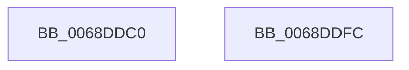

# MiDeleteSlabAllocator

- RVA: `0x0068DDC0`–`0x0068DDFD` (길이 `61` bytes)
- VA: `0x000000014068DDC0`
- 실행 섹션: `.text`
- PDB 이름 있음: `예`; PDB Function 태그: `아니요`
- unwind 정보 RVA: `0x0005CAAC`
- 디코드: `19`개 명령, `61/61` bytes 표시
- 미해석 바이트: `0` (있으면 어셈블리에 `.byte`로 보존)

> 이 문서는 커널 이미지의 기계어와 PDB 기호를 분석해 생성했습니다. 4번과 5번은 함수 원형과 자료형을 바이너리 사용 방식에서 추정한 C 해석이며 원본 소스 복구 결과는 아닙니다.

## 1. Dependencies

- 직접 호출 지점: **2**; 고유 호출 대상: **2**
- 직접 호출자로 확인된 함수: **0**
- RIP 상대 이미지 참조: **0**

### Outgoing calls
- `0x0068DDD9` → [MiAsyncSlabReplenish](../4A/MiAsyncSlabReplenish_function_004AA54C.md) (function, `0x004AA54C`)
- `0x0068DDEA` → [MiFreeSlabEntries](../2D/MiFreeSlabEntries_function_002DAFC0.md) (function, `0x002DAFC0`)

### Direct callers
- 이 함수 시작 RVA로 연결되는 직접 call은 확인되지 않았습니다. 간접 호출은 완전히 역산할 수 없습니다.

### Static image references
- 디코드된 RIP-relative 메모리 참조가 없습니다.

## 2. Other-region calls and transfers

- 다른 실행 섹션으로 향하는 call: **0**
- 별도 외부 분기/꼬리 이동을 확인하지 못했습니다.

## 3. Assembly (complete function range)

```asm
0068DDC0  48 89 5C 24 08                  mov qword ptr [rsp + 8], rbx
0068DDC5  57                              push rdi
0068DDC6  48 83 EC 20                     sub rsp, 0x20
0068DDCA  48 8B DA                        mov rbx, rdx
0068DDCD  48 8B F9                        mov rdi, rcx
0068DDD0  33 D2                           xor edx, edx
0068DDD2  48 8B CB                        mov rcx, rbx
0068DDD5  44 8D 42 02                     lea r8d, [rdx + 2]
0068DDD9  E8 6E C7 E1 FF                  call 0x1404aa54c
0068DDDE  41 B8 01 00 00 00               mov r8d, 1
0068DDE4  48 8B D3                        mov rdx, rbx
0068DDE7  48 8B CF                        mov rcx, rdi
0068DDEA  E8 D1 D1 C4 FF                  call 0x1402dafc0
0068DDEF  48 8B 5C 24 30                  mov rbx, qword ptr [rsp + 0x30]
0068DDF4  33 C0                           xor eax, eax
0068DDF6  48 83 C4 20                     add rsp, 0x20
0068DDFA  5F                              pop rdi
0068DDFB  C3                              ret
0068DDFC  CC                              int3
```

## 4. C-style interpretation (structured pseudocode)

```c
__int64 __fastcall MiDeleteSlabAllocator(__int64 a1, __int64 a2)
{
    __int64 result;
    __int64 v_rsp;
    unsigned __int64 v_stack_p8;

    v_stack_p8 = v_rbx;
    v_rsp = (v_rsp) - (32);
    a2 = 0;
    result = MiAsyncSlabReplenish(0, a2, a2 + 2, a4);
    result = MiFreeSlabEntries(a1, 0, 1, a4);
    result = 0;
    v_rsp = (v_rsp) + (32);
    return result;
}
```

## 5. (Beta) C Style

```c
int64_t MiDeleteSlabAllocator(int64_t Arg1, int64_t Arg2)
{
    int64_t result;
    int64_t local_rsp;
    uint64_t v_stack_p8;

    v_stack_p8 = local_rbx;
    local_rsp = (local_rsp) - (32);
    Arg2 = 0;
    result = MiAsyncSlabReplenish(0, Arg2, Arg2 + 2, a4);
    result = MiFreeSlabEntries(Arg1, 0, 1, a4);
    result = 0;
    local_rsp = (local_rsp) + (32);
    return result;
}
```

## 6. Execution-region graph

[열기: 2D/3D 그래프와 함수 탐색 컨트롤 패널](../../../control-panel.html?section=text&rva=0x0068DDC0&view=graph)

- 2D 그래프는 위에서 아래로 흐르고, 3D 그래프는 빈 공간을 드래그해 회전합니다. Shift+드래그는 이동, 휠은 확대·축소, 함수 노드 선택은 대상 보고서 이동입니다.

### Static fallback


