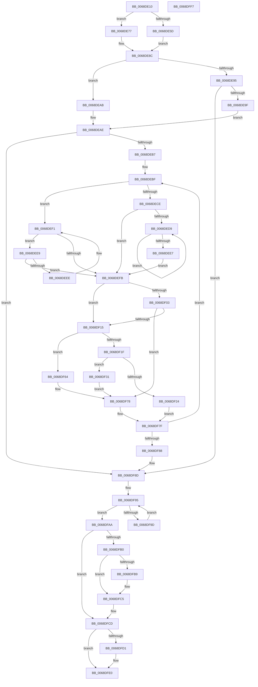

# MiDeleteSlabEntriesForIdentity

- RVA: `0x0068DE10`–`0x0068DFF8` (길이 `488` bytes)
- VA: `0x000000014068DE10`
- 실행 섹션: `.text`
- PDB 이름 있음: `예`; PDB Function 태그: `아니요`
- unwind 정보 RVA: `0x000BE7D0`
- 디코드: `142`개 명령, `488/488` bytes 표시
- 미해석 바이트: `0` (있으면 어셈블리에 `.byte`로 보존)

> 이 문서는 커널 이미지의 기계어와 PDB 기호를 분석해 생성했습니다. 4번과 5번은 함수 원형과 자료형을 바이너리 사용 방식에서 추정한 C 해석이며 원본 소스 복구 결과는 아닙니다.

## 1. Dependencies

- 직접 호출 지점: **12**; 고유 호출 대상: **10**
- 직접 호출자로 확인된 함수: **0**
- RIP 상대 이미지 참조: **3**

### Outgoing calls
- `0x0068DE70` → [ExAcquireSpinLockExclusiveAtDpcLevel](../24/ExAcquireSpinLockExclusiveAtDpcLevel_function_00248E80.md) (function, `0x00248E80`)
- `0x0068DE80` → [ExAcquireSpinLockExclusive](../24/ExAcquireSpinLockExclusive_function_00248690.md) (function, `0x00248690`)
- `0x0068DF34` → [ExReleaseSpinLockExclusiveFromDpcLevel](../24/ExReleaseSpinLockExclusiveFromDpcLevel_function_002497E0.md) (function, `0x002497E0`)
- `0x0068DF3C` → [MiUnlinkTransitionSlabPages](../44/MiUnlinkTransitionSlabPages_function_0044D140.md) (function, `0x0044D140`)
- `0x0068DF4D` → [MiChangeSlabEntryIdentity](MiChangeSlabEntryIdentity_function_0068CE30.md) (function, `0x0068CE30`)
- `0x0068DF55` → [MiRelinkTransitionSlabPages](../44/MiRelinkTransitionSlabPages_function_0044D060.md) (function, `0x0044D060`)
- `0x0068DF5D` → [ExAcquireSpinLockExclusiveAtDpcLevel](../24/ExAcquireSpinLockExclusiveAtDpcLevel_function_00248E80.md) (function, `0x00248E80`)
- `0x0068DF6D` → [MiRemoveSlabEntry](../44/MiRemoveSlabEntry_function_0044CF08.md) (function, `0x0044CF08`)
- `0x0068DF90` → [ExReleaseSpinLockExclusiveFromDpcLevel](../24/ExReleaseSpinLockExclusiveFromDpcLevel_function_002497E0.md) (function, `0x002497E0`)
- `0x0068DFA3` → [MiFreeSlabEntry](../2D/MiFreeSlabEntry_function_002DC650.md) (function, `0x002DC650`)
- `0x0068DFC0` → [KiLowerIrqlProcessIrqlFlags](../4F/KiLowerIrqlProcessIrqlFlags_function_004F5698.md) (function, `0x004F5698`)
- `0x0068DFDB` → [KeGenericCallDpcEx](../2C/KeGenericCallDpcEx_function_002C99F4.md) (function, `0x002C99F4`)

### Direct callers
- 이 함수 시작 RVA로 연결되는 직접 call은 확인되지 않았습니다. 간접 호출은 완전히 역산할 수 없습니다.

### Static image references
- `0x0068DE38` → RVA `0x00011C60` (`.rdata`; read)
- `0x0068DFB0` → RVA `0x00FC6D20` (`ALMOSTRO`; read)
- `0x0068DFD4` → RVA `0x0068CF10` (`MiChangeSlabIdentitiesDpc`; read)

## 2. Other-region calls and transfers

- 다른 실행 섹션으로 향하는 call: **0**
- 별도 외부 분기/꼬리 이동을 확인하지 못했습니다.

## 3. Assembly (complete function range)

```asm
0068DE10  48 89 5C 24 08                  mov qword ptr [rsp + 8], rbx
0068DE15  55                              push rbp
0068DE16  56                              push rsi
0068DE17  57                              push rdi
0068DE18  41 54                           push r12
0068DE1A  41 55                           push r13
0068DE1C  41 56                           push r14
0068DE1E  41 57                           push r15
0068DE20  48 83 EC 30                     sub rsp, 0x30
0068DE24  8B 82 88 00 00 00               mov eax, dword ptr [rdx + 0x88]
0068DE2A  4C 8D 62 10                     lea r12, [rdx + 0x10]
0068DE2E  48 C1 E8 04                     shr rax, 4
0068DE32  4C 8B E9                        mov r13, rcx
0068DE35  83 E0 03                        and eax, 3
0068DE38  48 8D 0D 21 3E 98 FF            lea rcx, [rip - 0x67c1df]
0068DE3F  33 FF                           xor edi, edi
0068DE41  33 DB                           xor ebx, ebx
0068DE43  89 BC 24 80 00 00 00            mov dword ptr [rsp + 0x80], edi
0068DE4A  48 8B EA                        mov rbp, rdx
0068DE4D  8B 04 C1                        mov eax, dword ptr [rcx + rax*8]
0068DE50  49 8B CC                        mov rcx, r12
0068DE53  89 44 24 20                     mov dword ptr [rsp + 0x20], eax
0068DE57  41 F6 C0 01                     test r8b, 1
0068DE5B  74 1A                           je 0x14068de77
0068DE5D  41 B7 11                        mov r15b, 0x11
0068DE60  C7 84 24 88 00 00 00 01 00 00 00  mov dword ptr [rsp + 0x88], 1
0068DE6B  44 88 7C 24 78                  mov byte ptr [rsp + 0x78], r15b
0068DE70  E8 0B B0 BB FF                  call 0x140248e80
0068DE75  EB 15                           jmp 0x14068de8c
0068DE77  33 C0                           xor eax, eax
0068DE79  89 84 24 88 00 00 00            mov dword ptr [rsp + 0x88], eax
0068DE80  E8 0B A8 BB FF                  call 0x140248690
0068DE85  44 8A F8                        mov r15b, al
0068DE88  88 44 24 78                     mov byte ptr [rsp + 0x78], al
0068DE8C  48 8B 4D 08                     mov rcx, qword ptr [rbp + 8]
0068DE90  F6 C1 01                        test cl, 1
0068DE93  74 16                           je 0x14068deab
0068DE95  48 83 F9 01                     cmp rcx, 1
0068DE99  0F 84 EE 00 00 00               je 0x14068df8d
0068DE9F  48 8B F5                        mov rsi, rbp
0068DEA2  48 83 CE 01                     or rsi, 1
0068DEA6  48 33 F1                        xor rsi, rcx
0068DEA9  EB 03                           jmp 0x14068deae
0068DEAB  48 8B F1                        mov rsi, rcx
0068DEAE  48 85 F6                        test rsi, rsi
0068DEB1  0F 84 D6 00 00 00               je 0x14068df8d
0068DEB7  44 8B BC 24 88 00 00 00         mov r15d, dword ptr [rsp + 0x88]
0068DEBF  48 8B 46 08                     mov rax, qword ptr [rsi + 8]
0068DEC3  4C 8B F6                        mov r14, rsi
0068DEC6  48 8B CE                        mov rcx, rsi
0068DEC9  48 85 C0                        test rax, rax
0068DECC  74 23                           je 0x14068def1
0068DECE  48 8B 08                        mov rcx, qword ptr [rax]
0068DED1  48 8B F0                        mov rsi, rax
0068DED4  48 85 C9                        test rcx, rcx
0068DED7  74 22                           je 0x14068defb
0068DED9  48 8B 01                        mov rax, qword ptr [rcx]
0068DEDC  48 8B F1                        mov rsi, rcx
0068DEDF  48 8B C8                        mov rcx, rax
0068DEE2  48 85 C0                        test rax, rax
0068DEE5  75 F2                           jne 0x14068ded9
0068DEE7  EB 12                           jmp 0x14068defb
0068DEE9  48 39 0E                        cmp qword ptr [rsi], rcx
0068DEEC  74 0D                           je 0x14068defb
0068DEEE  48 8B CE                        mov rcx, rsi
0068DEF1  48 8B 76 10                     mov rsi, qword ptr [rsi + 0x10]
0068DEF5  48 83 E6 FC                     and rsi, 0xfffffffffffffffc
0068DEF9  75 EE                           jne 0x14068dee9
0068DEFB  41 8B 46 5C                     mov eax, dword ptr [r14 + 0x5c]
0068DEFF  A8 04                           test al, 4
0068DF01  74 12                           je 0x14068df15
0068DF03  48 C1 E8 03                     shr rax, 3
0068DF07  83 E0 3F                        and eax, 0x3f
0068DF0A  49 83 BC C5 58 45 00 00 00      cmp qword ptr [r13 + rax*8 + 0x4558], 0
0068DF13  75 63                           jne 0x14068df78
0068DF15  8B 44 24 20                     mov eax, dword ptr [rsp + 0x20]
0068DF19  41 39 46 54                     cmp dword ptr [r14 + 0x54], eax
0068DF1D  74 45                           je 0x14068df64
0068DF1F  45 85 FF                        test r15d, r15d
0068DF22  75 0D                           jne 0x14068df31
0068DF24  41 8D 7F 01                     lea edi, [r15 + 1]
0068DF28  89 BC 24 80 00 00 00            mov dword ptr [rsp + 0x80], edi
0068DF2F  EB 4E                           jmp 0x14068df7f
0068DF31  49 8B CC                        mov rcx, r12
0068DF34  E8 A7 B8 BB FF                  call 0x1402497e0
0068DF39  49 8B D6                        mov rdx, r14
0068DF3C  E8 FF F1 DB FF                  call 0x14044d140
0068DF41  41 B0 FF                        mov r8b, 0xff
0068DF44  49 8B D6                        mov rdx, r14
0068DF47  48 8B CD                        mov rcx, rbp
0068DF4A  48 8B F8                        mov rdi, rax
0068DF4D  E8 DE EE FF FF                  call 0x14068ce30
0068DF52  48 8B CF                        mov rcx, rdi
0068DF55  E8 06 F1 DB FF                  call 0x14044d060
0068DF5A  49 8B CC                        mov rcx, r12
0068DF5D  E8 1E AF BB FF                  call 0x140248e80
0068DF62  EB 14                           jmp 0x14068df78
0068DF64  4D 8B C6                        mov r8, r14
0068DF67  48 8B D5                        mov rdx, rbp
0068DF6A  49 8B CD                        mov rcx, r13
0068DF6D  E8 96 EF DB FF                  call 0x14044cf08
0068DF72  49 89 1E                        mov qword ptr [r14], rbx
0068DF75  49 8B DE                        mov rbx, r14
0068DF78  8B BC 24 80 00 00 00            mov edi, dword ptr [rsp + 0x80]
0068DF7F  48 85 F6                        test rsi, rsi
0068DF82  0F 85 37 FF FF FF               jne 0x14068debf
0068DF88  44 8A 7C 24 78                  mov r15b, byte ptr [rsp + 0x78]
0068DF8D  49 8B CC                        mov rcx, r12
0068DF90  E8 4B B8 BB FF                  call 0x1402497e0
0068DF95  48 8B D3                        mov rdx, rbx
0068DF98  48 85 DB                        test rbx, rbx
0068DF9B  74 0D                           je 0x14068dfaa
0068DF9D  48 8B 1B                        mov rbx, qword ptr [rbx]
0068DFA0  48 8B CD                        mov rcx, rbp
0068DFA3  E8 A8 E6 C4 FF                  call 0x1402dc650
0068DFA8  EB EB                           jmp 0x14068df95
0068DFAA  41 80 FF 11                     cmp r15b, 0x11
0068DFAE  74 1D                           je 0x14068dfcd
0068DFB0  83 3D 69 8D 93 00 00            cmp dword ptr [rip + 0x938d69], 0
0068DFB7  74 0C                           je 0x14068dfc5
0068DFB9  44 0F 20 C1                     mov rcx, cr8
0068DFBD  41 8A D7                        mov dl, r15b
0068DFC0  E8 D3 76 E6 FF                  call 0x1404f5698
0068DFC5  41 0F B6 C7                     movzx eax, r15b
0068DFC9  44 0F 22 C0                     mov cr8, rax
0068DFCD  85 FF                           test edi, edi
0068DFCF  74 0F                           je 0x14068dfe0
0068DFD1  49 8B D5                        mov rdx, r13
0068DFD4  48 8D 0D 35 EF FF FF            lea rcx, [rip - 0x10cb]
0068DFDB  E8 14 BA C3 FF                  call 0x1402c99f4
0068DFE0  48 8B 5C 24 70                  mov rbx, qword ptr [rsp + 0x70]
0068DFE5  33 C0                           xor eax, eax
0068DFE7  48 83 C4 30                     add rsp, 0x30
0068DFEB  41 5F                           pop r15
0068DFED  41 5E                           pop r14
0068DFEF  41 5D                           pop r13
0068DFF1  41 5C                           pop r12
0068DFF3  5F                              pop rdi
0068DFF4  5E                              pop rsi
0068DFF5  5D                              pop rbp
0068DFF6  C3                              ret
0068DFF7  CC                              int3
```

## 4. C-style interpretation (structured pseudocode)

```c
__int64 __fastcall MiDeleteSlabEntriesForIdentity(__int64 a1, __int64 a2, unsigned __int8 a3)
{
    __int64 result;
    __int64 v_rbx;
    __int64 v_rdi;
    __int64 v_rsi;
    __int64 v_rsp;
    unsigned int v_stack_m48;
    unsigned __int8 v_stack_p10;
    unsigned int v_stack_p18;
    unsigned int v_stack_p20;
    unsigned __int64 v_stack_p8;

    v_stack_p8 = v_rbx;
    v_rsp = (v_rsp) - (48);
    result = ((unsigned int)(*(unsigned int *)(a2 + 136))) >> (4);
    result = (unsigned int)((result) & (3));
    v_rdi = 0;
    v_rbx = 0;
    v_stack_p18 = 0;
    v_stack_m48 = (unsigned int)((unsigned int)(*(unsigned int *)(v_rip - 6799839 + result * 8)));
    if (((a3) & (1)) == 0) goto loc_0068DE77;
    v_stack_p20 = 1;
    v_stack_p10 = 17;
    result = ExAcquireSpinLockExclusiveAtDpcLevel(a2 + 16, a2, a3, a4);
    goto loc_0068DE8C;
loc_0068DE77:
    result = 0;
    v_stack_p20 = 0;
    result = ExAcquireSpinLockExclusive(a2 + 16, a2, a3, a4);
    v_stack_p10 = (unsigned __int8)(result);
loc_0068DE8C:
    if ((((unsigned __int8)(*(unsigned __int64 *)(a2 + 8))) & (1)) == 0) goto loc_0068DEAB;
    if ((*(unsigned __int64 *)(a2 + 8)) == 1) goto loc_0068DF8D;
    v_rsi = (a2) | (1);
    v_rsi = (v_rsi) ^ (*(unsigned __int64 *)(a2 + 8));
    goto loc_0068DEAE;
loc_0068DEAB:
loc_0068DEAE:
    if (*(unsigned __int64 *)(a2 + 8) == 0) goto loc_0068DF8D;
loc_0068DEBF:
    if (*(unsigned __int64 *)(*(unsigned __int64 *)(a2 + 8) + 8) == 0) goto loc_0068DEF1;
    if (*(unsigned __int64 *)(*(unsigned __int64 *)(*(unsigned __int64 *)(a2 + 8) + 8)) == 0) goto loc_0068DEFB;
loc_0068DED9:
    if (*(unsigned __int64 *)(*(unsigned __int64 *)(*(unsigned __int64 *)(*(unsigned __int64 *)(a2 + 8) + 8))) != 0) goto loc_0068DED9;
    goto loc_0068DEFB;
loc_0068DEE9:
    if ((*(unsigned __int64 *)(*(unsigned __int64 *)(*(unsigned __int64 *)(*(unsigned __int64 *)(a2 + 8) + 8)))) == (*(unsigned __int64 *)(*(unsigned __int64 *)(*(unsigned __int64 *)(*(unsigned __int64 *)(a2 + 8) + 8))))) goto loc_0068DEFB;
loc_0068DEF1:
    v_rsi = (*(unsigned __int64 *)(*(unsigned __int64 *)(*(unsigned __int64 *)(*(unsigned __int64 *)(a2 + 8) + 8)) + 16)) & (-4);
    if (condition_is_not_equal) goto loc_0068DEE9;
loc_0068DEFB:
    if ((((unsigned __int8)((unsigned int)(*(unsigned int *)(*(unsigned __int64 *)(a2 + 8) + 92)))) & (4)) == 0) goto loc_0068DF15;
    result = ((unsigned int)(*(unsigned int *)(*(unsigned __int64 *)(a2 + 8) + 92))) >> (3);
    result = (unsigned int)((result) & (63));
    if ((*(unsigned __int64 *)(a1 + result * 8 + 17752)) != 0) goto loc_0068DF78;
loc_0068DF15:
    if ((*(unsigned int *)(*(unsigned __int64 *)(a2 + 8) + 84)) == ((unsigned int)((unsigned int)(v_stack_m48)))) goto loc_0068DF64;
    if ((unsigned int)((unsigned int)(v_stack_p20)) != 0) goto loc_0068DF31;
    v_stack_p18 = (unsigned int)((unsigned int)(v_stack_p20) + 1);
    goto loc_0068DF7F;
loc_0068DF31:
    result = ExReleaseSpinLockExclusiveFromDpcLevel(a2 + 16, a2, a3, a4);
    result = MiUnlinkTransitionSlabPages(a2 + 16, *(unsigned __int64 *)(a2 + 8), a3, a4);
    result = MiChangeSlabEntryIdentity(a2, *(unsigned __int64 *)(a2 + 8), 255, a4);
    result = MiRelinkTransitionSlabPages(result, *(unsigned __int64 *)(a2 + 8), 255, a4);
    result = ExAcquireSpinLockExclusiveAtDpcLevel(a2 + 16, *(unsigned __int64 *)(a2 + 8), 255, a4);
    goto loc_0068DF78;
loc_0068DF64:
    result = MiRemoveSlabEntry(a1, a2, *(unsigned __int64 *)(a2 + 8), a4);
    *(unsigned __int64 *)(*(unsigned __int64 *)(a2 + 8)) = 0;
loc_0068DF78:
loc_0068DF7F:
    if (v_rsi != 0) goto loc_0068DEBF;
loc_0068DF8D:
    result = ExReleaseSpinLockExclusiveFromDpcLevel(a2 + 16, a2, *(unsigned __int64 *)(a2 + 8), a4);
loc_0068DF95:
    if (*(unsigned __int64 *)(a2 + 8) == 0) goto loc_0068DFAA;
    result = MiFreeSlabEntry(a2, *(unsigned __int64 *)(a2 + 8), *(unsigned __int64 *)(a2 + 8), a4);
    goto loc_0068DF95;
loc_0068DFAA:
    if (((unsigned __int8)(v_stack_p10)) == 17) goto loc_0068DFCD;
    if ((*(unsigned int *)(v_rip + 9669993)) != 0) {
        a1 = v_cr8;
        a2 = (unsigned __int8)(v_stack_p10);
        result = KiLowerIrqlProcessIrqlFlags(a1, a2, *(unsigned __int64 *)(a2 + 8), a4);
    }
loc_0068DFCD:
    result = (unsigned __int8)(v_stack_p10);
    if ((unsigned int)((unsigned int)(v_stack_p18)) != 0) {
        a2 = a1;
        a1 = v_rip - 4299;
        result = KeGenericCallDpcEx(a1, a2, *(unsigned __int64 *)(a2 + 8), a4);
    }
    result = 0;
    v_rsp = (v_rsp) + (48);
    return result;
}
```

## 5. (Beta) C Style

```c
int64_t MiDeleteSlabEntriesForIdentity(void *Arg1, void *Arg2, uint8_t Arg3)
{
    uint8_t *arg1 = (uint8_t *)Arg1;
    uint8_t *arg2 = (uint8_t *)Arg2;

    int64_t result;
    int64_t local_rbx;
    int64_t local_rdi;
    int64_t local_rsi;
    int64_t local_rsp;
    uint32_t v_stack_m48;
    uint8_t v_stack_p10;
    uint32_t v_stack_p18;
    uint32_t v_stack_p20;
    uint64_t v_stack_p8;

    v_stack_p8 = local_rbx;
    local_rsp = (local_rsp) - (48);
    result = ((uint32_t)(*(uint32_t *)(arg2 + 0x88))) >> (4);
    result = (uint32_t)((result) & (3));
    local_rdi = 0;
    local_rbx = 0;
    v_stack_p18 = 0;
    v_stack_m48 = (uint32_t)((uint32_t)(*(uint32_t *)(v_rip - 0x67C1DF + result * 8)));
    if (((Arg3) & (1)) == 0) goto loc_0068DE77;
    v_stack_p20 = 1;
    v_stack_p10 = 17;
    result = ExAcquireSpinLockExclusiveAtDpcLevel(Arg2 + 16, Arg2, Arg3, a4);
    goto loc_0068DE8C;
loc_0068DE77:
    result = 0;
    v_stack_p20 = 0;
    result = ExAcquireSpinLockExclusive(Arg2 + 16, Arg2, Arg3, a4);
    v_stack_p10 = (uint8_t)(result);
loc_0068DE8C:
    if ((((uint8_t)(*(uint64_t *)(arg2 + 0x8))) & (1)) == 0) goto loc_0068DEAB;
    if ((*(uint64_t *)(arg2 + 0x8)) == 1) goto loc_0068DF8D;
    local_rsi = (Arg2) | (1);
    local_rsi = (local_rsi) ^ (*(uint64_t *)(arg2 + 0x8));
    goto loc_0068DEAE;
loc_0068DEAB:
loc_0068DEAE:
    if (*(uint64_t *)(arg2 + 0x8) == 0) goto loc_0068DF8D;
loc_0068DEBF:
    if (*(uint64_t *)(*(uint64_t *)(arg2 + 0x8) + 0x8) == 0) goto loc_0068DEF1;
    if (*(uint64_t *)(*(uint64_t *)(*(uint64_t *)(arg2 + 0x8) + 0x8)) == 0) goto loc_0068DEFB;
loc_0068DED9:
    if (*(uint64_t *)(*(uint64_t *)(*(uint64_t *)(*(uint64_t *)(arg2 + 0x8) + 0x8))) != 0) goto loc_0068DED9;
    goto loc_0068DEFB;
loc_0068DEE9:
    if ((*(uint64_t *)(*(uint64_t *)(*(uint64_t *)(*(uint64_t *)(arg2 + 0x8) + 0x8)))) == (*(uint64_t *)(*(uint64_t *)(*(uint64_t *)(*(uint64_t *)(arg2 + 0x8) + 0x8))))) goto loc_0068DEFB;
loc_0068DEF1:
    local_rsi = (*(uint64_t *)(*(uint64_t *)(*(uint64_t *)(*(uint64_t *)(arg2 + 0x8) + 0x8)) + 0x10)) & (-4);
    if (condition_is_not_equal) goto loc_0068DEE9;
loc_0068DEFB:
    if ((((uint8_t)((uint32_t)(*(uint32_t *)(*(uint64_t *)(arg2 + 0x8) + 0x5C)))) & (4)) == 0) goto loc_0068DF15;
    result = ((uint32_t)(*(uint32_t *)(*(uint64_t *)(arg2 + 0x8) + 0x5C))) >> (3);
    result = (uint32_t)((result) & (63));
    if ((*(uint64_t *)(arg1 + result * 8 + 0x4558)) != 0) goto loc_0068DF78;
loc_0068DF15:
    if ((*(uint32_t *)(*(uint64_t *)(arg2 + 0x8) + 0x54)) == ((uint32_t)((uint32_t)(v_stack_m48)))) goto loc_0068DF64;
    if ((uint32_t)((uint32_t)(v_stack_p20)) != 0) goto loc_0068DF31;
    v_stack_p18 = (uint32_t)((uint32_t)(v_stack_p20) + 1);
    goto loc_0068DF7F;
loc_0068DF31:
    result = ExReleaseSpinLockExclusiveFromDpcLevel(Arg2 + 16, Arg2, Arg3, a4);
    result = MiUnlinkTransitionSlabPages(Arg2 + 16, *(uint64_t *)(arg2 + 0x8), Arg3, a4);
    result = MiChangeSlabEntryIdentity(Arg2, *(uint64_t *)(arg2 + 0x8), 255, a4);
    result = MiRelinkTransitionSlabPages(result, *(uint64_t *)(arg2 + 0x8), 255, a4);
    result = ExAcquireSpinLockExclusiveAtDpcLevel(Arg2 + 16, *(uint64_t *)(arg2 + 0x8), 255, a4);
    goto loc_0068DF78;
loc_0068DF64:
    result = MiRemoveSlabEntry(Arg1, Arg2, *(uint64_t *)(arg2 + 0x8), a4);
    *(uint64_t *)(*(uint64_t *)(arg2 + 0x8)) = 0;
loc_0068DF78:
loc_0068DF7F:
    if (local_rsi != 0) goto loc_0068DEBF;
loc_0068DF8D:
    result = ExReleaseSpinLockExclusiveFromDpcLevel(Arg2 + 16, Arg2, *(uint64_t *)(arg2 + 0x8), a4);
loc_0068DF95:
    if (*(uint64_t *)(arg2 + 0x8) == 0) goto loc_0068DFAA;
    result = MiFreeSlabEntry(Arg2, *(uint64_t *)(arg2 + 0x8), *(uint64_t *)(arg2 + 0x8), a4);
    goto loc_0068DF95;
loc_0068DFAA:
    if (((uint8_t)(v_stack_p10)) == 17) goto loc_0068DFCD;
    if ((*(uint32_t *)(v_rip + 0x938D69)) != 0) {
        Arg1 = v_cr8;
        Arg2 = (uint8_t)(v_stack_p10);
        result = KiLowerIrqlProcessIrqlFlags(Arg1, Arg2, *(uint64_t *)(arg2 + 0x8), a4);
    }
loc_0068DFCD:
    result = (uint8_t)(v_stack_p10);
    if ((uint32_t)((uint32_t)(v_stack_p18)) != 0) {
        Arg2 = Arg1;
        Arg1 = v_rip - 4299;
        result = KeGenericCallDpcEx(Arg1, Arg2, *(uint64_t *)(arg2 + 0x8), a4);
    }
    result = 0;
    local_rsp = (local_rsp) + (48);
    return result;
}
```

### 관측된 메모리 오프셋

구조체 형식이 확인되지 않은 접근은 인자 기준의 오프셋으로만 기록했습니다.

| 기준 인자 | 오프셋 표현 | 폭 (bit) | 접근 |
|---|---:|---:|---|
| `Arg1` | `+ 0x4558 + rax*8` | `64` | `R` |
| `Arg2` | `+ 0x8` | `64` | `R` |
| `Arg2` | `+ 0x10` | `64` | `R` |
| `Arg2` | `+ 0x88` | `32` | `R` |

## 6. Execution-region graph

[열기: 2D/3D 그래프와 함수 탐색 컨트롤 패널](../../../control-panel.html?section=text&rva=0x0068DE10&view=graph)

- 2D 그래프는 위에서 아래로 흐르고, 3D 그래프는 빈 공간을 드래그해 회전합니다. Shift+드래그는 이동, 휠은 확대·축소, 함수 노드 선택은 대상 보고서 이동입니다.

### Static fallback


