# MiDemoteValidLargePageOneLevel

- RVA: `0x0068A3F4`–`0x0068A96F` (길이 `1,403` bytes)
- VA: `0x000000014068A3F4`
- 실행 섹션: `.text`
- PDB 이름 있음: `예`; PDB Function 태그: `아니요`
- unwind 정보 RVA: `0x000CC4E0`
- 디코드: `333`개 명령, `1,403/1,403` bytes 표시
- 미해석 바이트: `0` (있으면 어셈블리에 `.byte`로 보존)

> 이 문서는 커널 이미지의 기계어와 PDB 기호를 분석해 생성했습니다. 4번과 5번은 함수 원형과 자료형을 바이너리 사용 방식에서 추정한 C 해석이며 원본 소스 복구 결과는 아닙니다.

## 1. Dependencies

- 직접 호출 지점: **30**; 고유 호출 대상: **27**
- 직접 호출자로 확인된 함수: **1**
- RIP 상대 이미지 참조: **4**

### Outgoing calls
- `0x0068A44B` → [memset](../6C/memset_function_006C6C40.md) (function, `0x006C6C40`)
- `0x0068A459` → [MI_IS_PHYSICAL_ADDRESS](../23/MI_IS_PHYSICAL_ADDRESS_function_0023B3A0.md) (function, `0x0023B3A0`)
- `0x0068A4D1` → [MI_READ_PTE_LOCK_FREE](../28/MI_READ_PTE_LOCK_FREE_function_002828A0.md) (function, `0x002828A0`)
- `0x0068A52E` → [MiPageToNode](../33/MiPageToNode_function_00338CD0.md) (function, `0x00338CD0`)
- `0x0068A53D` → [MiInitializeColorBase](../3B/MiInitializeColorBase_function_003B5E38.md) (function, `0x003B5E38`)
- `0x0068A553` → [MiGetPageTablePages](../37/MiGetPageTablePages_function_00376C3C.md) (function, `0x00376C3C`)
- `0x0068A567` → [MiUnlinkPageChainHead](../36/MiUnlinkPageChainHead_function_00365C40.md) (function, `0x00365C40`)
- `0x0068A5C5` → [MI_READ_PTE_LOCK_FREE](../28/MI_READ_PTE_LOCK_FREE_function_002828A0.md) (function, `0x002828A0`)
- `0x0068A622` → [MiMakeValidPte](../2C/MiMakeValidPte_function_002C5590.md) (function, `0x002C5590`)
- `0x0068A652` → [MiMapPageInHyperSpaceWorker](../33/MiMapPageInHyperSpaceWorker_function_00332B10.md) (function, `0x00332B10`)
- `0x0068A6AE` → [MiCheckLinearProtectedPteAccessedBit](../29/MiCheckLinearProtectedPteAccessedBit_function_00292D80.md) (function, `0x00292D80`)
- `0x0068A6E0` → [MiUnmapPageInHyperSpaceWorker](../43/MiUnmapPageInHyperSpaceWorker_function_00432800.md) (function, `0x00432800`)
- `0x0068A707` → [MiMakeValidPte](../2C/MiMakeValidPte_function_002C5590.md) (function, `0x002C5590`)
- `0x0068A725` → [MiInitializePfnForOtherProcess](../38/MiInitializePfnForOtherProcess_function_00382A20.md) (function, `0x00382A20`)
- `0x0068A741` → [KeYieldProcessorEx](../3F/KeYieldProcessorEx_function_003FBD00.md) (function, `0x003FBD00`)
- `0x0068A785` → [MiInitializeUsedPtesCount](../44/MiInitializeUsedPtesCount_function_00443AB0.md) (function, `0x00443AB0`)
- `0x0068A7CA` → [MiTransformValidPteInPlace](../37/MiTransformValidPteInPlace_function_003765E0.md) (function, `0x003765E0`)
- `0x0068A7DC` → [MiVaToFlushVm](../31/MiVaToFlushVm_function_0031AD84.md) (function, `0x0031AD84`)
- `0x0068A7E4` → [MiGetProcessorFlushList](../24/MiGetProcessorFlushList_function_00242C90.md) (function, `0x00242C90`)
- `0x0068A804` → [MiInitializeTbFlushList](../29/MiInitializeTbFlushList_function_00294F00.md) (function, `0x00294F00`)
- `0x0068A80E` → [MiInsertLargeTbFlushEntry](../37/MiInsertLargeTbFlushEntry_function_0037827C.md) (function, `0x0037827C`)
- `0x0068A839` → [MiGetPfnPageSizeIndex](../31/MiGetPfnPageSizeIndex_function_0031C710.md) (function, `0x0031C710`)
- `0x0068A890` → [KeYieldProcessorEx](../3F/KeYieldProcessorEx_function_003FBD00.md) (function, `0x003FBD00`)
- `0x0068A8BF` → [MiConvertLargePfnToSmall](../42/MiConvertLargePfnToSmall_function_00420CA0.md) (function, `0x00420CA0`)
- `0x0068A8C9` → [MiUpdateDemotedSubPage](../43/MiUpdateDemotedSubPage_function_00435840.md) (function, `0x00435840`)
- `0x0068A8DA` → [MiSetPfnContainingFrame](../36/MiSetPfnContainingFrame_function_00363FC0.md) (function, `0x00363FC0`)
- `0x0068A920` → [MiUpdateLargePageBitMap](../37/MiUpdateLargePageBitMap_function_0037619C.md) (function, `0x0037619C`)
- `0x0068A932` → [MiFlushTbList](../31/MiFlushTbList_function_00311FC0.md) (function, `0x00311FC0`)
- `0x0068A937` → [MiReleaseProcessorFlushList](../31/MiReleaseProcessorFlushList_function_00313C70.md) (function, `0x00313C70`)
- `0x0068A948` → [_security_check_cookie](../6A/_security_check_cookie_function_006AC640.md) (function, `0x006AC640`)

### Direct callers
- [MiPfnRangeIsZero](../67/MiPfnRangeIsZero_function_006735C0.md) at `0x006738D2`

### Static image references
- `0x0068A418` → RVA `0x00E0A740` (`.data`; read)
- `0x0068A516` → RVA `0x00E38D00` (`.data`; read)
- `0x0068A636` → RVA `0x00E2DBC9` (`.data`; reference)
- `0x0068A67D` → RVA `0x00FC6A88` (`ALMOSTRO`; read)

## 2. Other-region calls and transfers

- 다른 실행 섹션으로 향하는 call: **0**
- 별도 외부 분기/꼬리 이동을 확인하지 못했습니다.

## 3. Assembly (complete function range)

```asm
0068A3F4  48 89 5C 24 10                  mov qword ptr [rsp + 0x10], rbx
0068A3F9  48 89 74 24 18                  mov qword ptr [rsp + 0x18], rsi
0068A3FE  48 89 7C 24 20                  mov qword ptr [rsp + 0x20], rdi
0068A403  55                              push rbp
0068A404  41 54                           push r12
0068A406  41 55                           push r13
0068A408  41 56                           push r14
0068A40A  41 57                           push r15
0068A40C  48 8D 6C 24 80                  lea rbp, [rsp - 0x80]
0068A411  48 81 EC 80 01 00 00            sub rsp, 0x180
0068A418  48 8B 05 21 03 78 00            mov rax, qword ptr [rip + 0x780321]
0068A41F  48 33 C4                        xor rax, rsp
0068A422  48 89 45 70                     mov qword ptr [rbp + 0x70], rax
0068A426  48 8B D9                        mov rbx, rcx
0068A429  48 89 4D 88                     mov qword ptr [rbp - 0x78], rcx
0068A42D  0F 57 C0                        xorps xmm0, xmm0
0068A430  C6 44 24 30 00                  mov byte ptr [rsp + 0x30], 0
0068A435  33 C0                           xor eax, eax
0068A437  48 8D 4D B0                     lea rcx, [rbp - 0x50]
0068A43B  33 D2                           xor edx, edx
0068A43D  48 89 45 A8                     mov qword ptr [rbp - 0x58], rax
0068A441  41 B8 B8 00 00 00               mov r8d, 0xb8
0068A447  0F 11 45 98                     movups xmmword ptr [rbp - 0x68], xmm0
0068A44B  E8 F0 C7 03 00                  call 0x1406c6c40
0068A450  48 83 64 24 68 00               and qword ptr [rsp + 0x68], 0
0068A456  48 8B CB                        mov rcx, rbx
0068A459  E8 42 0F BB FF                  call 0x14023b3a0
0068A45E  48 8B F3                        mov rsi, rbx
0068A461  89 44 24 38                     mov dword ptr [rsp + 0x38], eax
0068A465  48 C1 EE 12                     shr rsi, 0x12
0068A469  44 8B E0                        mov r12d, eax
0068A46C  81 E6 F8 FF FF 3F               and esi, 0x3ffffff8
0068A472  48 B8 00 00 00 40 FB F6 FF FF   movabs rax, 0xfffff6fb40000000
0068A47C  48 03 F0                        add rsi, rax
0068A47F  48 BA 00 00 00 00 80 F6 FF FF   movabs rdx, 0xfffff68000000000
0068A489  41 BF 01 00 00 00               mov r15d, 1
0068A48F  41 BD 00 00 20 00               mov r13d, 0x200000
0068A495  4C 89 6C 24 58                  mov qword ptr [rsp + 0x58], r13
0068A49A  49 B8 F8 FF FF FF 7F 00 00 00   movabs r8, 0x7ffffffff8
0068A4A4  45 3B E7                        cmp r12d, r15d
0068A4A7  74 25                           je 0x14068a4ce
0068A4A9  41 8D 4C 24 FF                  lea ecx, [r12 - 1]
0068A4AE  48 C1 EE 09                     shr rsi, 9
0068A4B2  49 23 F0                        and rsi, r8
0068A4B5  48 8B C2                        mov rax, rdx
0068A4B8  48 03 F0                        add rsi, rax
0068A4BB  49 C1 E5 09                     shl r13, 9
0068A4BF  49 C1 E7 09                     shl r15, 9
0068A4C3  48 83 E9 01                     sub rcx, 1
0068A4C7  75 E5                           jne 0x14068a4ae
0068A4C9  4C 89 6C 24 58                  mov qword ptr [rsp + 0x58], r13
0068A4CE  48 8B CE                        mov rcx, rsi
0068A4D1  E8 CA 83 BF FF                  call 0x1402828a0
0068A4D6  4C 8B F0                        mov r14, rax
0068A4D9  48 89 44 24 48                  mov qword ptr [rsp + 0x48], rax
0068A4DE  48 8B F8                        mov rdi, rax
0068A4E1  49 C1 EE 0C                     shr r14, 0xc
0068A4E5  48 B8 FF FF FF FF FF 00 00 00   movabs rax, 0xffffffffff
0068A4EF  B9 04 00 00 00                  mov ecx, 4
0068A4F4  4C 23 F0                        and r14, rax
0068A4F7  48 8D 45 B0                     lea rax, [rbp - 0x50]
0068A4FB  4C 89 74 24 60                  mov qword ptr [rsp + 0x60], r14
0068A500  48 83 60 10 00                  and qword ptr [rax + 0x10], 0
0068A505  48 89 40 08                     mov qword ptr [rax + 8], rax
0068A509  48 89 00                        mov qword ptr [rax], rax
0068A50C  48 83 C0 18                     add rax, 0x18
0068A510  48 83 E9 01                     sub rcx, 1
0068A514  75 EA                           jne 0x14068a500
0068A516  48 8D 05 E3 E7 7A 00            lea rax, [rip + 0x7ae7e3]
0068A51D  48 89 45 10                     mov qword ptr [rbp + 0x10], rax
0068A521  8D 41 03                        lea eax, [rcx + 3]
0068A524  49 8B CE                        mov rcx, r14
0068A527  89 44 24 34                     mov dword ptr [rsp + 0x34], eax
0068A52B  89 45 28                        mov dword ptr [rbp + 0x28], eax
0068A52E  E8 9D E7 CA FF                  call 0x140338cd0
0068A533  4C 8D 45 48                     lea r8, [rbp + 0x48]
0068A537  48 8B CB                        mov rcx, rbx
0068A53A  8D 50 01                        lea edx, [rax + 1]
0068A53D  E8 F6 B8 D2 FF                  call 0x1403b5e38
0068A542  BA 01 00 00 00                  mov edx, 1
0068A547  4C 8D 4D 98                     lea r9, [rbp - 0x68]
0068A54B  48 8D 4D B0                     lea rcx, [rbp - 0x50]
0068A54F  44 8D 42 01                     lea r8d, [rdx + 1]
0068A553  E8 E4 C6 CE FF                  call 0x140376c3c
0068A558  85 C0                           test eax, eax
0068A55A  79 07                           jns 0x14068a563
0068A55C  33 C0                           xor eax, eax
0068A55E  E9 DE 03 00 00                  jmp 0x14068a941
0068A563  48 8D 4D 98                     lea rcx, [rbp - 0x68]
0068A567  E8 D4 B6 CD FF                  call 0x140365c40
0068A56C  48 8B C8                        mov rcx, rax
0068A56F  48 89 45 80                     mov qword ptr [rbp - 0x80], rax
0068A573  48 C7 00 00 00 00 00            mov qword ptr [rax], 0
0068A57A  48 B8 00 00 00 00 00 DE FF FF   movabs rax, 0xffffde0000000000
0068A584  48 8B C0                        mov rax, rax
0068A587  48 2B C8                        sub rcx, rax
0068A58A  48 BB 00 00 00 00 80 F6 FF FF   movabs rbx, 0xfffff68000000000
0068A594  48 C1 F9 04                     sar rcx, 4
0068A598  48 B8 AB AA AA AA AA AA AA AA   movabs rax, 0xaaaaaaaaaaaaaaab
0068A5A2  48 0F AF C8                     imul rcx, rax
0068A5A6  48 B8 F8 FF FF FF 7F 00 00 00   movabs rax, 0x7ffffffff8
0068A5B0  48 89 4C 24 50                  mov qword ptr [rsp + 0x50], rcx
0068A5B5  48 8B CE                        mov rcx, rsi
0068A5B8  48 C1 E9 09                     shr rcx, 9
0068A5BC  48 23 C8                        and rcx, rax
0068A5BF  48 8B C3                        mov rax, rbx
0068A5C2  48 03 C8                        add rcx, rax
0068A5C5  E8 D6 82 BF FF                  call 0x1402828a0
0068A5CA  48 C1 E8 0C                     shr rax, 0xc
0068A5CE  48 B9 FF FF FF FF FF 00 00 00   movabs rcx, 0xffffffffff
0068A5D8  48 23 C1                        and rax, rcx
0068A5DB  B9 04 00 00 80                  mov ecx, 0x80000004
0068A5E0  48 89 44 24 78                  mov qword ptr [rsp + 0x78], rax
0068A5E5  41 83 FC 01                     cmp r12d, 1
0068A5E9  B8 04 00 00 84                  mov eax, 0x84000004
0068A5EE  0F 44 C1                        cmove eax, ecx
0068A5F1  44 8B C0                        mov r8d, eax
0068A5F4  48 0F BA E7 08                  bt rdi, 8
0068A5F9  73 0B                           jae 0x14068a606
0068A5FB  41 83 FC 01                     cmp r12d, 1
0068A5FF  75 05                           jne 0x14068a606
0068A601  41 0F BA E8 1D                  bts r8d, 0x1d
0068A606  48 8B CE                        mov rcx, rsi
0068A609  48 C1 E1 19                     shl rcx, 0x19
0068A60D  48 8B C3                        mov rax, rbx
0068A610  48 C1 E0 19                     shl rax, 0x19
0068A614  49 8B D6                        mov rdx, r14
0068A617  48 2B C8                        sub rcx, rax
0068A61A  48 89 4D 90                     mov qword ptr [rbp - 0x70], rcx
0068A61E  48 C1 F9 10                     sar rcx, 0x10
0068A622  E8 69 AF C3 FF                  call 0x1402c5590
0068A627  41 8D 4C 24 FF                  lea ecx, [r12 - 1]
0068A62C  BA 01 00 00 00                  mov edx, 1
0068A631  D3 E2                           shl edx, cl
0068A633  48 8B D8                        mov rbx, rax
0068A636  84 15 8D 35 7A 00               test byte ptr [rip + 0x7a358d], dl
0068A63C  74 04                           je 0x14068a642
0068A63E  48 83 E3 DF                     and rbx, 0xffffffffffffffdf
0068A642  48 8B 4C 24 50                  mov rcx, qword ptr [rsp + 0x50]
0068A647  48 8D 54 24 30                  lea rdx, [rsp + 0x30]
0068A64C  41 B8 00 00 00 80               mov r8d, 0x80000000
0068A652  E8 B9 84 CA FF                  call 0x140332b10
0068A657  48 89 44 24 70                  mov qword ptr [rsp + 0x70], rax
0068A65C  4C 8B E0                        mov r12, rax
0068A65F  49 8B C7                        mov rax, r15
0068A662  49 BE 00 00 00 00 80 F6 FF FF   movabs r14, 0xfffff68000000000
0068A66C  48 C1 E0 0C                     shl rax, 0xc
0068A670  48 BF FF 0F 00 00 00 00 F0 FF   movabs rdi, 0xfff0000000000fff
0068A67A  4C 8B E8                        mov r13, rax
0068A67D  48 0F BA 25 02 C4 93 00 24      bt qword ptr [rip + 0x93c402], 0x24
0068A686  73 2B                           jae 0x14068a6b3
0068A688  F6 C3 20                        test bl, 0x20
0068A68B  75 26                           jne 0x14068a6b3
0068A68D  49 8B C6                        mov rax, r14
0068A690  48 B9 00 00 00 00 40 00 00 00   movabs rcx, 0x4000000000
0068A69A  48 03 C1                        add rax, rcx
0068A69D  4C 3B E0                        cmp r12, rax
0068A6A0  72 11                           jb 0x14068a6b3
0068A6A2  41 B8 80 00 00 00               mov r8d, 0x80
0068A6A8  48 8B D3                        mov rdx, rbx
0068A6AB  49 8B CC                        mov rcx, r12
0068A6AE  E8 CD 86 C0 FF                  call 0x140292d80
0068A6B3  49 89 1C 24                     mov qword ptr [r12], rbx
0068A6B7  4A 8D 0C 2B                     lea rcx, [rbx + r13]
0068A6BB  48 33 D9                        xor rbx, rcx
0068A6BE  49 83 C4 08                     add r12, 8
0068A6C2  48 23 DF                        and rbx, rdi
0068A6C5  48 33 D9                        xor rbx, rcx
0068A6C8  49 F7 C4 FF 0F 00 00            test r12, 0xfff
0068A6CF  75 AC                           jne 0x14068a67d
0068A6D1  8A 54 24 30                     mov dl, byte ptr [rsp + 0x30]
0068A6D5  41 B8 00 00 00 80               mov r8d, 0x80000000
0068A6DB  48 8B 4C 24 70                  mov rcx, qword ptr [rsp + 0x70]
0068A6E0  E8 1B 81 DA FF                  call 0x140432800
0068A6E5  4C 8B 44 24 48                  mov r8, qword ptr [rsp + 0x48]
0068A6EA  48 8B CE                        mov rcx, rsi
0068A6ED  4C 8B 74 24 60                  mov r14, qword ptr [rsp + 0x60]
0068A6F2  49 C1 E0 15                     shl r8, 0x15
0068A6F6  49 8B D6                        mov rdx, r14
0068A6F9  41 81 E0 00 00 00 20            and r8d, 0x20000000
0068A700  41 81 C8 04 00 00 88            or r8d, 0x88000004
0068A707  E8 84 AE C3 FF                  call 0x1402c5590
0068A70C  4C 8B 64 24 50                  mov r12, qword ptr [rsp + 0x50]
0068A711  41 B9 00 0A 00 00               mov r9d, 0xa00
0068A717  4C 8B 44 24 78                  mov r8, qword ptr [rsp + 0x78]
0068A71C  49 8B CC                        mov rcx, r12
0068A71F  48 8B D6                        mov rdx, rsi
0068A722  48 8B F8                        mov rdi, rax
0068A725  E8 F6 82 CF FF                  call 0x140382a20
0068A72A  83 64 24 48 00                  and dword ptr [rsp + 0x48], 0
0068A72F  48 8B 5D 80                     mov rbx, qword ptr [rbp - 0x80]
0068A733  F0 48 0F BA 6B 18 3F            lock bts qword ptr [rbx + 0x18], 0x3f
0068A73A  73 15                           jae 0x14068a751
0068A73C  48 8D 4C 24 48                  lea rcx, [rsp + 0x48]
0068A741  E8 BA 15 D7 FF                  call 0x1403fbd00
0068A746  48 8B 43 18                     mov rax, qword ptr [rbx + 0x18]
0068A74A  48 85 C0                        test rax, rax
0068A74D  78 ED                           js 0x14068a73c
0068A74F  EB E2                           jmp 0x14068a733
0068A751  48 8B 43 18                     mov rax, qword ptr [rbx + 0x18]
0068A755  48 8D 88 00 02 00 00            lea rcx, [rax + 0x200]
0068A75C  48 8B D1                        mov rdx, rcx
0068A75F  48 33 D0                        xor rdx, rax
0068A762  48 B8 00 00 00 00 00 00 00 C0   movabs rax, 0xc000000000000000
0068A76C  48 23 D0                        and rdx, rax
0068A76F  B8 00 02 00 00                  mov eax, 0x200
0068A774  48 33 D1                        xor rdx, rcx
0068A777  48 89 44 24 40                  mov qword ptr [rsp + 0x40], rax
0068A77C  48 89 53 18                     mov qword ptr [rbx + 0x18], rdx
0068A780  48 8B CB                        mov rcx, rbx
0068A783  8B D0                           mov edx, eax
0068A785  E8 26 93 DB FF                  call 0x140443ab0
0068A78A  48 B8 FF FF FF FF FF FF FF 7F   movabs rax, 0x7fffffffffffffff
0068A794  F0 48 21 43 18                  lock and qword ptr [rbx + 0x18], rax
0068A799  8B 5C 24 38                     mov ebx, dword ptr [rsp + 0x38]
0068A79D  48 B9 FF 0F 00 00 00 00 F0 FF   movabs rcx, 0xfff0000000000fff
0068A7A7  49 8B C4                        mov rax, r12
0068A7AA  89 5C 24 20                     mov dword ptr [rsp + 0x20], ebx
0068A7AE  48 C1 E0 0C                     shl rax, 0xc
0068A7B2  41 B9 60 00 00 00               mov r9d, 0x60
0068A7B8  4C 8B C0                        mov r8, rax
0068A7BB  48 8B D6                        mov rdx, rsi
0068A7BE  4C 33 C7                        xor r8, rdi
0068A7C1  4C 23 C1                        and r8, rcx
0068A7C4  48 8B CE                        mov rcx, rsi
0068A7C7  4C 33 C0                        xor r8, rax
0068A7CA  E8 11 BE CE FF                  call 0x1403765e0
0068A7CF  BF 03 00 00 00                  mov edi, 3
0068A7D4  3B DF                           cmp ebx, edi
0068A7D6  75 3B                           jne 0x14068a813
0068A7D8  48 8B 4D 88                     mov rcx, qword ptr [rbp - 0x78]
0068A7DC  E8 A3 05 C9 FF                  call 0x14031ad84
0068A7E1  48 8B D8                        mov rbx, rax
0068A7E4  E8 A7 84 BB FF                  call 0x140242c90
0068A7E9  48 8B C8                        mov rcx, rax
0068A7EC  48 89 44 24 68                  mov qword ptr [rsp + 0x68], rax
0068A7F1  44 8D 4F 05                     lea r9d, [rdi + 5]
0068A7F5  C7 44 24 20 01 00 00 00         mov dword ptr [rsp + 0x20], 1
0068A7FD  48 8B D3                        mov rdx, rbx
0068A800  44 8B 40 0C                     mov r8d, dword ptr [rax + 0xc]
0068A804  E8 F7 A6 C0 FF                  call 0x140294f00
0068A809  4C 8B C6                        mov r8, rsi
0068A80C  8B D7                           mov edx, edi
0068A80E  E8 69 DA CE FF                  call 0x14037827c
0068A813  4B 8D 34 76                     lea rsi, [r14 + r14*2]
0068A817  48 B8 00 00 00 00 00 DE FF FF   movabs rax, 0xffffde0000000000
0068A821  48 C1 E6 04                     shl rsi, 4
0068A825  48 8B C0                        mov rax, rax
0068A828  48 03 F0                        add rsi, rax
0068A82B  48 8B 46 28                     mov rax, qword ptr [rsi + 0x28]
0068A82F  48 0F BA E0 28                  bt rax, 0x28
0068A834  73 0E                           jae 0x14068a844
0068A836  48 8B CE                        mov rcx, rsi
0068A839  E8 D2 1E C9 FF                  call 0x14031c710
0068A83E  FF C0                           inc eax
0068A840  89 44 24 34                     mov dword ptr [rsp + 0x34], eax
0068A844  4C 8B 65 90                     mov r12, qword ptr [rbp - 0x70]
0068A848  4B 8D 3C 7F                     lea rdi, [r15 + r15*2]
0068A84C  44 8B 6C 24 34                  mov r13d, dword ptr [rsp + 0x34]
0068A851  4F 8D 34 7F                     lea r14, [r15 + r15*2]
0068A855  44 8B 7C 24 38                  mov r15d, dword ptr [rsp + 0x38]
0068A85A  49 81 C4 00 00 00 10            add r12, 0x10000000
0068A861  48 C1 E7 0D                     shl rdi, 0xd
0068A865  48 03 FE                        add rdi, rsi
0068A868  49 C1 FC 10                     sar r12, 0x10
0068A86C  49 C1 E6 04                     shl r14, 4
0068A870  48 8D 5F 18                     lea rbx, [rdi + 0x18]
0068A874  49 2B FE                        sub rdi, r14
0068A877  49 2B DE                        sub rbx, r14
0068A87A  49 83 EC 08                     sub r12, 8
0068A87E  83 64 24 34 00                  and dword ptr [rsp + 0x34], 0
0068A883  F0 48 0F BA 2B 3F               lock bts qword ptr [rbx], 0x3f
0068A889  73 14                           jae 0x14068a89f
0068A88B  48 8D 4C 24 34                  lea rcx, [rsp + 0x34]
0068A890  E8 6B 14 D7 FF                  call 0x1403fbd00
0068A895  48 8B 03                        mov rax, qword ptr [rbx]
0068A898  48 85 C0                        test rax, rax
0068A89B  78 EE                           js 0x14068a88b
0068A89D  EB E4                           jmp 0x14068a883
0068A89F  F6 43 0B 10                     test byte ptr [rbx + 0xb], 0x10
0068A8A3  75 3A                           jne 0x14068a8df
0068A8A5  48 8B 43 10                     mov rax, qword ptr [rbx + 0x10]
0068A8A9  48 0F BA E0 28                  bt rax, 0x28
0068A8AE  73 1E                           jae 0x14068a8ce
0068A8B0  48 8B D7                        mov rdx, rdi
0068A8B3  48 8B CE                        mov rcx, rsi
0068A8B6  41 83 FF 01                     cmp r15d, 1
0068A8BA  75 0A                           jne 0x14068a8c6
0068A8BC  45 33 C0                        xor r8d, r8d
0068A8BF  E8 DC 63 D9 FF                  call 0x140420ca0
0068A8C4  EB 08                           jmp 0x14068a8ce
0068A8C6  45 8B C5                        mov r8d, r13d
0068A8C9  E8 72 AF DA FF                  call 0x140435840
0068A8CE  48 8B 54 24 50                  mov rdx, qword ptr [rsp + 0x50]
0068A8D3  48 8B CF                        mov rcx, rdi
0068A8D6  4C 89 63 F0                     mov qword ptr [rbx - 0x10], r12
0068A8DA  E8 E1 96 CD FF                  call 0x140363fc0
0068A8DF  48 B8 FF FF FF FF FF FF FF 7F   movabs rax, 0x7fffffffffffffff
0068A8E9  F0 48 21 03                     lock and qword ptr [rbx], rax
0068A8ED  48 83 6C 24 40 01               sub qword ptr [rsp + 0x40], 1
0068A8F3  0F 85 7B FF FF FF               jne 0x14068a874
0068A8F9  4C 8B 74 24 60                  mov r14, qword ptr [rsp + 0x60]
0068A8FE  4C 8B 6C 24 58                  mov r13, qword ptr [rsp + 0x58]
0068A903  41 83 FF 01                     cmp r15d, 1
0068A907  75 1C                           jne 0x14068a925
0068A909  49 C1 ED 0C                     shr r13, 0xc
0068A90D  48 8D 0D EC E3 7A 00            lea rcx, [rip + 0x7ae3ec]
0068A914  4D 8B C5                        mov r8, r13
0068A917  41 B9 06 00 00 00               mov r9d, 6
0068A91D  49 8B D6                        mov rdx, r14
0068A920  E8 77 B8 CE FF                  call 0x14037619c
0068A925  48 8B 44 24 68                  mov rax, qword ptr [rsp + 0x68]
0068A92A  48 85 C0                        test rax, rax
0068A92D  74 0D                           je 0x14068a93c
0068A92F  48 8B C8                        mov rcx, rax
0068A932  E8 89 76 C8 FF                  call 0x140311fc0
0068A937  E8 34 93 C8 FF                  call 0x140313c70
0068A93C  B8 01 00 00 00                  mov eax, 1
0068A941  48 8B 4D 70                     mov rcx, qword ptr [rbp + 0x70]
0068A945  48 33 CC                        xor rcx, rsp
0068A948  E8 F3 1C 02 00                  call 0x1406ac640
0068A94D  4C 8D 9C 24 80 01 00 00         lea r11, [rsp + 0x180]
0068A955  49 8B 5B 38                     mov rbx, qword ptr [r11 + 0x38]
0068A959  49 8B 73 40                     mov rsi, qword ptr [r11 + 0x40]
0068A95D  49 8B 7B 48                     mov rdi, qword ptr [r11 + 0x48]
0068A961  49 8B E3                        mov rsp, r11
0068A964  41 5F                           pop r15
0068A966  41 5E                           pop r14
0068A968  41 5D                           pop r13
0068A96A  41 5C                           pop r12
0068A96C  5D                              pop rbp
0068A96D  C3                              ret
0068A96E  CC                              int3
```

## 4. C-style interpretation (structured pseudocode)

```c
__int64 __fastcall MiDemoteValidLargePageOneLevel(__int64 a1, int a2)
{
    __int64 result;
    __int64 v_r12;
    __int64 v_r13;
    __int64 v_r14;
    __int64 v_r15;
    __int64 v_rbx;
    __int64 v_rdi;
    __int64 v_rsi;
    __int64 v_rsp;
    unsigned __int64 v_stack_m100;
    unsigned __int64 v_stack_m110;
    unsigned __int64 v_stack_m118;
    unsigned __int64 v_stack_m120;
    unsigned __int64 v_stack_m128;
    unsigned __int64 v_stack_m130;
    unsigned __int64 v_stack_m138;
    unsigned __int64 v_stack_m140;
    unsigned __int64 v_stack_m148;
    unsigned __int64 v_stack_m150;
    unsigned __int64 v_stack_m158;
    unsigned __int64 v_stack_m160;
    unsigned __int64 v_stack_m168;
    unsigned int v_stack_m170;
    unsigned int v_stack_m174;
    unsigned __int8 v_stack_m178;
    unsigned int v_stack_m188;
    unsigned __int64 v_stack_m28;
    unsigned __int64 v_stack_m38;
    unsigned __int64 v_stack_m60;
    unsigned int v_stack_m80;
    unsigned __int64 v_stack_m98;
    unsigned __int64 v_stack_mA8;
    unsigned __int64 v_stack_mF8;
    unsigned __int64 v_stack_p10;
    unsigned __int64 v_stack_p18;
    unsigned __int64 v_stack_p20;

    v_stack_p10 = v_rbx;
    v_stack_p18 = v_rsi;
    v_stack_p20 = v_rdi;
    v_rsp = (v_rsp) - (384);
    result = (*(unsigned __int64 *)(v_rip + 7865121)) ^ (v_rsp);
    v_stack_m38 = result;
    v_stack_m120 = a1;
    v_stack_m178 = 0;
    result = 0;
    a2 = 0;
    v_stack_m100 = 0;
    v_stack_m110 = v_xmm0;
    result = memset(v_stack_mF8, a2, 184, a4);
    result = MI_IS_PHYSICAL_ADDRESS(a1, a2, 184, a4);
    v_stack_m170 = (unsigned int)(result);
    v_rsi = (a1) >> (18);
    v_rsi = (unsigned int)((v_rsi) & (0x3FFFFFF8ULL));
    v_rsi = (v_rsi) + (result);
    v_stack_m150 = (unsigned int)(0x200000ULL);
    if (((unsigned int)((unsigned int)((unsigned int)(result)))) == 1) goto loc_0068A4CE;
loc_0068A4AE:
    v_rsi = (v_rsi) >> (9);
    v_rsi = (v_rsi) & (184);
    v_rsi = (v_rsi) + (0);
    v_r13 = ((unsigned int)(0x200000ULL)) << (9);
    v_r15 = (1) << (9);
    a1 = ((unsigned int)((unsigned int)(result)) - 1) - (1);
    if (condition_is_not_equal) goto loc_0068A4AE;
    v_stack_m150 = v_r13;
loc_0068A4CE:
    result = MI_READ_PTE_LOCK_FREE(v_rsi, a2, 184, a4);
    v_stack_m160 = result;
    v_r14 = (result) >> (12);
    v_r14 = (v_r14) & (result);
    v_stack_m148 = v_r14;
loc_0068A500:
    *(unsigned __int64 *)(v_stack_mF8 + 8) = v_stack_mF8;
    *(unsigned __int64 *)(v_stack_mF8) = v_stack_mF8;
    result = (v_stack_mF8) + (24);
    a1 = (4) - (1);
    if (condition_is_not_equal) goto loc_0068A500;
    v_stack_m98 = v_rip + 8054755;
    v_stack_m174 = (unsigned int)(a1 + 3);
    v_stack_m80 = (unsigned int)(a1 + 3);
    result = MiPageToNode(v_r14, a2, 184, a4);
    result = MiInitializeColorBase(a1, result + 1, v_stack_m60, a4);
    result = MiGetPageTablePages(v_stack_mF8, 1, 1 + 1, v_stack_m110);
    if (!sign_flag) goto loc_0068A563;
    result = 0;
    goto loc_0068A941;
loc_0068A563:
    result = MiUnlinkPageChainHead(v_stack_m110, 1, 1 + 1, v_stack_m110);
    v_stack_m128 = result;
    *(unsigned __int64 *)(result) = 0;
    a1 = (result) - (result);
    a1 = (a1) >> (4);
    a1 = (a1) * (result);
    v_stack_m158 = a1;
    a1 = (v_rsi) >> (9);
    a1 = (a1) & (result);
    a1 = (a1) + (a1);
    result = MI_READ_PTE_LOCK_FREE(a1, 1, 1 + 1, v_stack_m110);
    result = (result) >> (12);
    result = (result) & (a1);
    v_stack_m130 = result;
    result = (unsigned int)(0x84000004ULL);
    if (((unsigned int)((unsigned int)((unsigned int)(result)))) == 1) { result = (unsigned int)((unsigned int)(0x80000004ULL)); }
    if (((unsigned int)((unsigned int)((unsigned int)(result)))) >= 1) goto loc_0068A606;
    if (((unsigned int)((unsigned int)((unsigned int)(result)))) == 1) {
    }
    a1 = (v_rsi) << (25);
    result = (a1) << (25);
    a1 = (a1) - (result);
    v_stack_m118 = a1;
    a1 = (a1) >> (16);
    result = MiMakeValidPte(a1, v_r14, (unsigned int)((unsigned int)(result)), v_stack_m110);
    a2 = (unsigned int)((1) << ((unsigned __int8)((unsigned int)((unsigned int)(result)) - 1)));
    v_rbx = result;
    if (((*(unsigned __int8 *)(v_rip + 8009101)) & ((unsigned __int8)(a2))) != 0) {
        v_rbx = (result) & (-33);
    }
    result = MiMapPageInHyperSpaceWorker(v_stack_m158, v_stack_m178, (unsigned int)(0x80000000ULL), v_stack_m110);
    v_stack_m138 = result;
    result = (v_r15) << (12);
loc_0068A67D:
    if (condition_is_above_or_equal) goto loc_0068A6B3;
    if ((((unsigned __int8)(v_rbx)) & (32)) != 0) goto loc_0068A6B3;
    result = (v_r14) + (v_stack_m158);
    if (result >= result) {
        a3 = 128;
        a2 = v_rbx;
        a1 = result;
        result = MiCheckLinearProtectedPteAccessedBit(a1, a2, a3, v_stack_m110);
    }
    *(unsigned __int64 *)(result) = v_rbx;
    v_rbx = (v_rbx) ^ (v_rbx + result * 1);
    v_r12 = (result) + (8);
    v_rbx = (v_rbx) & (result);
    v_rbx = (v_rbx) ^ (v_rbx + result * 1);
    if (((v_r12) & (0xFFFULL)) != 0) goto loc_0068A67D;
    result = MiUnmapPageInHyperSpaceWorker(v_stack_m138, v_stack_m178, (unsigned int)(0x80000000ULL), v_stack_m110);
    a3 = (v_stack_m160) << (21);
    a3 = (unsigned int)((a3) & (0x20000000ULL));
    a3 = (unsigned int)((a3) | (0x88000004ULL));
    result = MiMakeValidPte(v_rsi, v_stack_m148, a3, v_stack_m110);
    result = MiInitializePfnForOtherProcess(v_stack_m158, v_rsi, v_stack_m130, (unsigned int)(0xA00ULL));
loc_0068A733:
    if (condition_is_above_or_equal) goto loc_0068A751;
loc_0068A73C:
    result = KeYieldProcessorEx(v_stack_m160, v_rsi, v_stack_m130, (unsigned int)(0xA00ULL));
    if (sign_flag) goto loc_0068A73C;
    goto loc_0068A733;
loc_0068A751:
    a2 = (*(unsigned __int64 *)(v_stack_m128 + 24) + 512) ^ (*(unsigned __int64 *)(v_stack_m128 + 24));
    a2 = (a2) & (*(unsigned __int64 *)(v_stack_m128 + 24));
    a2 = (a2) ^ (*(unsigned __int64 *)(v_stack_m128 + 24) + 512);
    v_stack_m168 = 512;
    *(unsigned __int64 *)(v_stack_m128 + 24) = a2;
    result = MiInitializeUsedPtesCount(v_stack_m128, 512, v_stack_m130, (unsigned int)(0xA00ULL));
    v_stack_m188 = (unsigned int)((unsigned int)(v_stack_m170));
    result = (v_stack_m158) << (12);
    a3 = (result) ^ (result);
    a3 = (a3) & (v_stack_m128);
    a3 = (a3) ^ (result);
    result = MiTransformValidPteInPlace(v_rsi, v_rsi, a3, 96);
    v_rbx = (unsigned int)(v_stack_m170);
    if (((unsigned int)((unsigned int)(v_stack_m170))) == 3) {
        a1 = v_stack_m120;
        result = MiVaToFlushVm(a1, v_rsi, a3, 96);
        v_rbx = result;
        result = MiGetProcessorFlushList(a1, v_rsi, a3, 96);
        a1 = result;
        v_stack_m140 = result;
        a4 = 3 + 5;
        v_stack_m188 = 1;
        a2 = v_rbx;
        a3 = *(unsigned int *)(result + 12);
        result = MiInitializeTbFlushList(a1, a2, a3, a4);
        a3 = v_rsi;
        a2 = 3;
        result = MiInsertLargeTbFlushEntry(a1, a2, a3, a4);
    }
    v_rsi = (v_stack_m148 + v_stack_m148 * 2) << (4);
    v_rsi = (v_rsi) + (result);
    result = *(unsigned __int64 *)(v_rsi + 40);
    if (!(condition_is_above_or_equal)) {
        a1 = v_rsi;
        result = MiGetPfnPageSizeIndex(a1, a2, a3, a4);
        result = (unsigned int)((result) + 1);
        v_stack_m174 = (unsigned int)(result);
    }
    v_r12 = (v_stack_m118) + (0x10000000ULL);
    v_rdi = (v_r15 + v_r15 * 2) << (13);
    v_rdi = (v_rdi) + (v_rsi);
    v_r12 = (v_r12) >> (16);
    v_r14 = (v_r15 + v_r15 * 2) << (4);
loc_0068A874:
    v_rdi = (v_rdi) - (v_r14);
    v_rbx = (v_rdi + 24) - (v_r14);
    v_r12 = (v_r12) - (8);
loc_0068A883:
    if (condition_is_above_or_equal) goto loc_0068A89F;
loc_0068A88B:
    result = KeYieldProcessorEx(v_stack_m174, a2, a3, a4);
    if (sign_flag) goto loc_0068A88B;
    goto loc_0068A883;
loc_0068A89F:
    if (((*(unsigned __int8 *)(v_rbx + 11)) & (16)) != 0) goto loc_0068A8DF;
    if (condition_is_above_or_equal) goto loc_0068A8CE;
    if (((unsigned int)((unsigned int)(v_stack_m170))) != 1) goto loc_0068A8C6;
    a3 = 0;
    result = MiConvertLargePfnToSmall(v_rsi, v_rdi, a3, a4);
    goto loc_0068A8CE;
loc_0068A8C6:
    result = MiUpdateDemotedSubPage(v_rsi, v_rdi, (unsigned int)((unsigned int)((unsigned int)(v_stack_m174))), a4);
loc_0068A8CE:
    *(unsigned __int64 *)(v_rbx - 16) = v_r12;
    result = MiSetPfnContainingFrame(v_rdi, v_stack_m158, (unsigned int)((unsigned int)((unsigned int)(v_stack_m174))), a4);
loc_0068A8DF:
    if (condition_is_not_equal) goto loc_0068A874;
    v_r13 = v_stack_m150;
    if (((unsigned int)((unsigned int)(v_stack_m170))) == 1) {
        v_r13 = (v_stack_m150) >> (12);
        a1 = v_rip + 8053740;
        a3 = v_r13;
        a4 = 6;
        a2 = v_stack_m148;
        result = MiUpdateLargePageBitMap(a1, a2, a3, a4);
    }
    result = v_stack_m140;
    if (v_stack_m140 != 0) {
        a1 = v_stack_m140;
        result = MiFlushTbList(a1, a2, a3, a4);
        result = MiReleaseProcessorFlushList(a1, a2, a3, a4);
    }
loc_0068A941:
    a1 = (v_stack_m38) ^ (v_rsp);
    result = _security_check_cookie(a1, a2, a3, a4);
    return result;
}
```

## 5. (Beta) C Style

```c
int64_t MiDemoteValidLargePageOneLevel(int64_t Arg1, int32_t Arg2)
{
    int64_t result;
    int64_t local_r12;
    int64_t local_r13;
    int64_t local_r14;
    int64_t local_r15;
    int64_t local_rbx;
    int64_t local_rdi;
    int64_t local_rsi;
    int64_t local_rsp;
    uint64_t v_stack_m100;
    uint64_t v_stack_m110;
    uint64_t v_stack_m118;
    uint64_t v_stack_m120;
    uint64_t v_stack_m128;
    uint64_t v_stack_m130;
    uint64_t v_stack_m138;
    uint64_t v_stack_m140;
    uint64_t v_stack_m148;
    uint64_t v_stack_m150;
    uint64_t v_stack_m158;
    uint64_t v_stack_m160;
    uint64_t v_stack_m168;
    uint32_t v_stack_m170;
    uint32_t v_stack_m174;
    uint8_t v_stack_m178;
    uint32_t v_stack_m188;
    uint64_t v_stack_m28;
    uint64_t v_stack_m38;
    uint64_t v_stack_m60;
    uint32_t v_stack_m80;
    uint64_t v_stack_m98;
    uint64_t v_stack_mA8;
    uint64_t v_stack_mF8;
    uint64_t v_stack_p10;
    uint64_t v_stack_p18;
    uint64_t v_stack_p20;

    v_stack_p10 = local_rbx;
    v_stack_p18 = local_rsi;
    v_stack_p20 = local_rdi;
    local_rsp = (local_rsp) - (384);
    result = (*(uint64_t *)(v_rip + 0x780321)) ^ (local_rsp);
    v_stack_m38 = result;
    v_stack_m120 = Arg1;
    v_stack_m178 = 0;
    result = 0;
    Arg2 = 0;
    v_stack_m100 = 0;
    v_stack_m110 = v_xmm0;
    result = memset(v_stack_mF8, Arg2, 184, a4);
    result = MI_IS_PHYSICAL_ADDRESS(Arg1, Arg2, 184, a4);
    v_stack_m170 = (uint32_t)(result);
    local_rsi = (Arg1) >> (18);
    local_rsi = (uint32_t)((local_rsi) & (0x3FFFFFF8ULL));
    local_rsi = (local_rsi) + (result);
    v_stack_m150 = (uint32_t)(0x200000ULL);
    if (((uint32_t)((uint32_t)((uint32_t)(result)))) == 1) goto loc_0068A4CE;
loc_0068A4AE:
    local_rsi = (local_rsi) >> (9);
    local_rsi = (local_rsi) & (184);
    local_rsi = (local_rsi) + (0);
    local_r13 = ((uint32_t)(0x200000ULL)) << (9);
    local_r15 = (1) << (9);
    Arg1 = ((uint32_t)((uint32_t)(result)) - 1) - (1);
    if (condition_is_not_equal) goto loc_0068A4AE;
    v_stack_m150 = local_r13;
loc_0068A4CE:
    result = MI_READ_PTE_LOCK_FREE(local_rsi, Arg2, 184, a4);
    v_stack_m160 = result;
    local_r14 = (result) >> (12);
    local_r14 = (local_r14) & (result);
    v_stack_m148 = local_r14;
loc_0068A500:
    *(uint64_t *)(v_stack_mF8 + 0x8) = v_stack_mF8;
    *(uint64_t *)(v_stack_mF8) = v_stack_mF8;
    result = (v_stack_mF8) + (24);
    Arg1 = (4) - (1);
    if (condition_is_not_equal) goto loc_0068A500;
    v_stack_m98 = v_rip + 8054755;
    v_stack_m174 = (uint32_t)(Arg1 + 3);
    v_stack_m80 = (uint32_t)(Arg1 + 3);
    result = MiPageToNode(local_r14, Arg2, 184, a4);
    result = MiInitializeColorBase(Arg1, result + 1, v_stack_m60, a4);
    result = MiGetPageTablePages(v_stack_mF8, 1, 1 + 1, v_stack_m110);
    if (!sign_flag) goto loc_0068A563;
    result = 0;
    goto loc_0068A941;
loc_0068A563:
    result = MiUnlinkPageChainHead(v_stack_m110, 1, 1 + 1, v_stack_m110);
    v_stack_m128 = result;
    *(uint64_t *)(result) = 0;
    Arg1 = (result) - (result);
    Arg1 = (Arg1) >> (4);
    Arg1 = (Arg1) * (result);
    v_stack_m158 = Arg1;
    Arg1 = (local_rsi) >> (9);
    Arg1 = (Arg1) & (result);
    Arg1 = (Arg1) + (Arg1);
    result = MI_READ_PTE_LOCK_FREE(Arg1, 1, 1 + 1, v_stack_m110);
    result = (result) >> (12);
    result = (result) & (Arg1);
    v_stack_m130 = result;
    result = (uint32_t)(0x84000004ULL);
    if (((uint32_t)((uint32_t)((uint32_t)(result)))) == 1) { result = (uint32_t)((uint32_t)(0x80000004ULL)); }
    if (((uint32_t)((uint32_t)((uint32_t)(result)))) >= 1) goto loc_0068A606;
    if (((uint32_t)((uint32_t)((uint32_t)(result)))) == 1) {
    }
    Arg1 = (local_rsi) << (25);
    result = (Arg1) << (25);
    Arg1 = (Arg1) - (result);
    v_stack_m118 = Arg1;
    Arg1 = (Arg1) >> (16);
    result = MiMakeValidPte(Arg1, local_r14, (uint32_t)((uint32_t)(result)), v_stack_m110);
    Arg2 = (uint32_t)((1) << ((uint8_t)((uint32_t)((uint32_t)(result)) - 1)));
    local_rbx = result;
    if (((*(uint8_t *)(v_rip + 0x7A358D)) & ((uint8_t)(Arg2))) != 0) {
        local_rbx = (result) & (-33);
    }
    result = MiMapPageInHyperSpaceWorker(v_stack_m158, v_stack_m178, (uint32_t)(0x80000000ULL), v_stack_m110);
    v_stack_m138 = result;
    result = (local_r15) << (12);
loc_0068A67D:
    if (condition_is_above_or_equal) goto loc_0068A6B3;
    if ((((uint8_t)(local_rbx)) & (32)) != 0) goto loc_0068A6B3;
    result = (local_r14) + (v_stack_m158);
    if (result >= result) {
        a3 = 128;
        Arg2 = local_rbx;
        Arg1 = result;
        result = MiCheckLinearProtectedPteAccessedBit(Arg1, Arg2, a3, v_stack_m110);
    }
    *(uint64_t *)(result) = local_rbx;
    local_rbx = (local_rbx) ^ (local_rbx + result * 1);
    local_r12 = (result) + (8);
    local_rbx = (local_rbx) & (result);
    local_rbx = (local_rbx) ^ (local_rbx + result * 1);
    if (((local_r12) & (0xFFFULL)) != 0) goto loc_0068A67D;
    result = MiUnmapPageInHyperSpaceWorker(v_stack_m138, v_stack_m178, (uint32_t)(0x80000000ULL), v_stack_m110);
    a3 = (v_stack_m160) << (21);
    a3 = (uint32_t)((a3) & (0x20000000ULL));
    a3 = (uint32_t)((a3) | (0x88000004ULL));
    result = MiMakeValidPte(local_rsi, v_stack_m148, a3, v_stack_m110);
    result = MiInitializePfnForOtherProcess(v_stack_m158, local_rsi, v_stack_m130, (uint32_t)(0xA00ULL));
loc_0068A733:
    if (condition_is_above_or_equal) goto loc_0068A751;
loc_0068A73C:
    result = KeYieldProcessorEx(v_stack_m160, local_rsi, v_stack_m130, (uint32_t)(0xA00ULL));
    if (sign_flag) goto loc_0068A73C;
    goto loc_0068A733;
loc_0068A751:
    Arg2 = (*(uint64_t *)(v_stack_m128 + 0x18) + 512) ^ (*(uint64_t *)(v_stack_m128 + 0x18));
    Arg2 = (Arg2) & (*(uint64_t *)(v_stack_m128 + 0x18));
    Arg2 = (Arg2) ^ (*(uint64_t *)(v_stack_m128 + 0x18) + 512);
    v_stack_m168 = 512;
    *(uint64_t *)(v_stack_m128 + 0x18) = Arg2;
    result = MiInitializeUsedPtesCount(v_stack_m128, 512, v_stack_m130, (uint32_t)(0xA00ULL));
    v_stack_m188 = (uint32_t)((uint32_t)(v_stack_m170));
    result = (v_stack_m158) << (12);
    a3 = (result) ^ (result);
    a3 = (a3) & (v_stack_m128);
    a3 = (a3) ^ (result);
    result = MiTransformValidPteInPlace(local_rsi, local_rsi, a3, 96);
    local_rbx = (uint32_t)(v_stack_m170);
    if (((uint32_t)((uint32_t)(v_stack_m170))) == 3) {
        Arg1 = v_stack_m120;
        result = MiVaToFlushVm(Arg1, local_rsi, a3, 96);
        local_rbx = result;
        result = MiGetProcessorFlushList(Arg1, local_rsi, a3, 96);
        Arg1 = result;
        v_stack_m140 = result;
        a4 = 3 + 5;
        v_stack_m188 = 1;
        Arg2 = local_rbx;
        a3 = *(uint32_t *)(result + 0xC);
        result = MiInitializeTbFlushList(Arg1, Arg2, a3, a4);
        a3 = local_rsi;
        Arg2 = 3;
        result = MiInsertLargeTbFlushEntry(Arg1, Arg2, a3, a4);
    }
    local_rsi = (v_stack_m148 + v_stack_m148 * 2) << (4);
    local_rsi = (local_rsi) + (result);
    result = *(uint64_t *)(local_rsi + 0x28);
    if (!(condition_is_above_or_equal)) {
        Arg1 = local_rsi;
        result = MiGetPfnPageSizeIndex(Arg1, Arg2, a3, a4);
        result = (uint32_t)((result) + 1);
        v_stack_m174 = (uint32_t)(result);
    }
    local_r12 = (v_stack_m118) + (0x10000000ULL);
    local_rdi = (local_r15 + local_r15 * 2) << (13);
    local_rdi = (local_rdi) + (local_rsi);
    local_r12 = (local_r12) >> (16);
    local_r14 = (local_r15 + local_r15 * 2) << (4);
loc_0068A874:
    local_rdi = (local_rdi) - (local_r14);
    local_rbx = (local_rdi + 24) - (local_r14);
    local_r12 = (local_r12) - (8);
loc_0068A883:
    if (condition_is_above_or_equal) goto loc_0068A89F;
loc_0068A88B:
    result = KeYieldProcessorEx(v_stack_m174, Arg2, a3, a4);
    if (sign_flag) goto loc_0068A88B;
    goto loc_0068A883;
loc_0068A89F:
    if (((*(uint8_t *)(local_rbx + 0xB)) & (16)) != 0) goto loc_0068A8DF;
    if (condition_is_above_or_equal) goto loc_0068A8CE;
    if (((uint32_t)((uint32_t)(v_stack_m170))) != 1) goto loc_0068A8C6;
    a3 = 0;
    result = MiConvertLargePfnToSmall(local_rsi, local_rdi, a3, a4);
    goto loc_0068A8CE;
loc_0068A8C6:
    result = MiUpdateDemotedSubPage(local_rsi, local_rdi, (uint32_t)((uint32_t)((uint32_t)(v_stack_m174))), a4);
loc_0068A8CE:
    *(uint64_t *)(local_rbx - 0x10) = local_r12;
    result = MiSetPfnContainingFrame(local_rdi, v_stack_m158, (uint32_t)((uint32_t)((uint32_t)(v_stack_m174))), a4);
loc_0068A8DF:
    if (condition_is_not_equal) goto loc_0068A874;
    local_r13 = v_stack_m150;
    if (((uint32_t)((uint32_t)(v_stack_m170))) == 1) {
        local_r13 = (v_stack_m150) >> (12);
        Arg1 = v_rip + 8053740;
        a3 = local_r13;
        a4 = 6;
        Arg2 = v_stack_m148;
        result = MiUpdateLargePageBitMap(Arg1, Arg2, a3, a4);
    }
    result = v_stack_m140;
    if (v_stack_m140 != 0) {
        Arg1 = v_stack_m140;
        result = MiFlushTbList(Arg1, Arg2, a3, a4);
        result = MiReleaseProcessorFlushList(Arg1, Arg2, a3, a4);
    }
loc_0068A941:
    Arg1 = (v_stack_m38) ^ (local_rsp);
    result = _security_check_cookie(Arg1, Arg2, a3, a4);
    return result;
}
```

## 6. Execution-region graph

[열기: 2D/3D 그래프와 함수 탐색 컨트롤 패널](../../../control-panel.html?section=text&rva=0x0068A3F4&view=graph)

- 2D 그래프는 위에서 아래로 흐르고, 3D 그래프는 빈 공간을 드래그해 회전합니다. Shift+드래그는 이동, 휠은 확대·축소, 함수 노드 선택은 대상 보고서 이동입니다.

### Static fallback

```mermaid
flowchart TD
  bb_0068A3F4[BB_0068A3F4]
  bb_0068A4A9[BB_0068A4A9]
  bb_0068A4AE[BB_0068A4AE]
  bb_0068A4C9[BB_0068A4C9]
  bb_0068A4CE[BB_0068A4CE]
  bb_0068A500[BB_0068A500]
  bb_0068A516[BB_0068A516]
  bb_0068A55C[BB_0068A55C]
  bb_0068A563[BB_0068A563]
  bb_0068A5FB[BB_0068A5FB]
  bb_0068A601[BB_0068A601]
  bb_0068A606[BB_0068A606]
  bb_0068A63E[BB_0068A63E]
  bb_0068A642[BB_0068A642]
  bb_0068A67D[BB_0068A67D]
  bb_0068A688[BB_0068A688]
  bb_0068A68D[BB_0068A68D]
  bb_0068A6A2[BB_0068A6A2]
  bb_0068A6B3[BB_0068A6B3]
  bb_0068A6D1[BB_0068A6D1]
  bb_0068A733[BB_0068A733]
  bb_0068A73C[BB_0068A73C]
  bb_0068A74F[BB_0068A74F]
  bb_0068A751[BB_0068A751]
  bb_0068A7D8[BB_0068A7D8]
  bb_0068A813[BB_0068A813]
  bb_0068A836[BB_0068A836]
  bb_0068A844[BB_0068A844]
  bb_0068A874[BB_0068A874]
  bb_0068A883[BB_0068A883]
  bb_0068A88B[BB_0068A88B]
  bb_0068A89D[BB_0068A89D]
  bb_0068A89F[BB_0068A89F]
  bb_0068A8A5[BB_0068A8A5]
  bb_0068A8B0[BB_0068A8B0]
  bb_0068A8BC[BB_0068A8BC]
  bb_0068A8C6[BB_0068A8C6]
  bb_0068A8CE[BB_0068A8CE]
  bb_0068A8DF[BB_0068A8DF]
  bb_0068A8F9[BB_0068A8F9]
  bb_0068A909[BB_0068A909]
  bb_0068A925[BB_0068A925]
  bb_0068A92F[BB_0068A92F]
  bb_0068A93C[BB_0068A93C]
  bb_0068A941[BB_0068A941]
  bb_0068A96E[BB_0068A96E]
  bb_0068A3F4 -->|branch| bb_0068A4CE
  bb_0068A3F4 -->|fallthrough| bb_0068A4A9
  bb_0068A4A9 -->|flow| bb_0068A4AE
  bb_0068A4AE -->|branch| bb_0068A4AE
  bb_0068A4AE -->|fallthrough| bb_0068A4C9
  bb_0068A4C9 -->|flow| bb_0068A4CE
  bb_0068A4CE -->|flow| bb_0068A500
  bb_0068A500 -->|branch| bb_0068A500
  bb_0068A500 -->|fallthrough| bb_0068A516
  bb_0068A516 -->|branch| bb_0068A563
  bb_0068A516 -->|fallthrough| bb_0068A55C
  bb_0068A55C -->|branch| bb_0068A941
  bb_0068A563 -->|branch| bb_0068A606
  bb_0068A563 -->|fallthrough| bb_0068A5FB
  bb_0068A5FB -->|branch| bb_0068A606
  bb_0068A5FB -->|fallthrough| bb_0068A601
  bb_0068A601 -->|flow| bb_0068A606
  bb_0068A606 -->|branch| bb_0068A642
  bb_0068A606 -->|fallthrough| bb_0068A63E
  bb_0068A63E -->|flow| bb_0068A642
  bb_0068A642 -->|flow| bb_0068A67D
  bb_0068A67D -->|branch| bb_0068A6B3
  bb_0068A67D -->|fallthrough| bb_0068A688
  bb_0068A688 -->|branch| bb_0068A6B3
  bb_0068A688 -->|fallthrough| bb_0068A68D
  bb_0068A68D -->|branch| bb_0068A6B3
  bb_0068A68D -->|fallthrough| bb_0068A6A2
  bb_0068A6A2 -->|flow| bb_0068A6B3
  bb_0068A6B3 -->|branch| bb_0068A67D
  bb_0068A6B3 -->|fallthrough| bb_0068A6D1
  bb_0068A6D1 -->|flow| bb_0068A733
  bb_0068A733 -->|branch| bb_0068A751
  bb_0068A733 -->|fallthrough| bb_0068A73C
  bb_0068A73C -->|branch| bb_0068A73C
  bb_0068A73C -->|fallthrough| bb_0068A74F
  bb_0068A74F -->|branch| bb_0068A733
  bb_0068A751 -->|branch| bb_0068A813
  bb_0068A751 -->|fallthrough| bb_0068A7D8
  bb_0068A7D8 -->|flow| bb_0068A813
  bb_0068A813 -->|branch| bb_0068A844
  bb_0068A813 -->|fallthrough| bb_0068A836
  bb_0068A836 -->|flow| bb_0068A844
  bb_0068A844 -->|flow| bb_0068A874
  bb_0068A874 -->|flow| bb_0068A883
  bb_0068A883 -->|branch| bb_0068A89F
  bb_0068A883 -->|fallthrough| bb_0068A88B
  bb_0068A88B -->|branch| bb_0068A88B
  bb_0068A88B -->|fallthrough| bb_0068A89D
  bb_0068A89D -->|branch| bb_0068A883
  bb_0068A89F -->|branch| bb_0068A8DF
  bb_0068A89F -->|fallthrough| bb_0068A8A5
  bb_0068A8A5 -->|branch| bb_0068A8CE
  bb_0068A8A5 -->|fallthrough| bb_0068A8B0
  bb_0068A8B0 -->|branch| bb_0068A8C6
  bb_0068A8B0 -->|fallthrough| bb_0068A8BC
  bb_0068A8BC -->|branch| bb_0068A8CE
  bb_0068A8C6 -->|flow| bb_0068A8CE
  bb_0068A8CE -->|flow| bb_0068A8DF
  bb_0068A8DF -->|branch| bb_0068A874
  bb_0068A8DF -->|fallthrough| bb_0068A8F9
  bb_0068A8F9 -->|branch| bb_0068A925
  bb_0068A8F9 -->|fallthrough| bb_0068A909
  bb_0068A909 -->|flow| bb_0068A925
  bb_0068A925 -->|branch| bb_0068A93C
  bb_0068A925 -->|fallthrough| bb_0068A92F
  bb_0068A92F -->|flow| bb_0068A93C
  bb_0068A93C -->|flow| bb_0068A941
```


