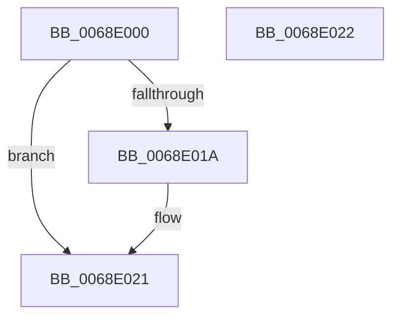

# MiDereferenceSlabIdentity

- RVA: `0x0068E000`–`0x0068E023` (길이 `35` bytes)
- VA: `0x000000014068E000`
- 실행 섹션: `.text`
- PDB 이름 있음: `예`; PDB Function 태그: `아니요`
- unwind 정보 RVA: `0x000DB714`
- 디코드: `10`개 명령, `35/35` bytes 표시
- 미해석 바이트: `0` (있으면 어셈블리에 `.byte`로 보존)

> 이 문서는 커널 이미지의 기계어와 PDB 기호를 분석해 생성했습니다. 4번과 5번은 함수 원형과 자료형을 바이너리 사용 방식에서 추정한 C 해석이며 원본 소스 복구 결과는 아닙니다.

## 1. Dependencies

- 직접 호출 지점: **0**; 고유 호출 대상: **0**
- 직접 호출자로 확인된 함수: **2**
- RIP 상대 이미지 참조: **0**

### Outgoing calls
- 직접 디코드된 call 명령이 없습니다.

### Direct callers
- [MmCreateProcessAddressSpace](../../page/A5/MmCreateProcessAddressSpace_function_00A5EE5C.md) at `0x00A5F0EA`
- [MmDeleteProcessAddressSpace](../../page/AC/MmDeleteProcessAddressSpace_function_00AC804C.md) at `0x00AC8239`

### Static image references
- 디코드된 RIP-relative 메모리 참조가 없습니다.

## 2. Other-region calls and transfers

- 다른 실행 섹션으로 향하는 call: **0**
- 별도 외부 분기/꼬리 이동을 확인하지 못했습니다.

## 3. Assembly (complete function range)

```asm
0068E000  0F B6 C2                        movzx eax, dl
0068E003  48 83 CA FF                     or rdx, 0xffffffffffffffff
0068E007  F0 48 0F C1 94 C1 58 45 00 00   lock xadd qword ptr [rcx + rax*8 + 0x4558], rdx
0068E011  48 FF CA                        dec rdx
0068E014  48 83 FA FF                     cmp rdx, -1
0068E018  7F 07                           jg 0x14068e021
0068E01A  B9 0E 00 00 00                  mov ecx, 0xe
0068E01F  CD 29                           int 0x29
0068E021  C3                              ret
0068E022  CC                              int3
```

## 4. C-style interpretation (structured pseudocode)

```c
__int64 __fastcall MiDereferenceSlabIdentity(__int64 a1, __int64 a2)
{
    a2 = (a2) | (-1);
    a2 = (a2) - 1;
    if (a2 <= -1) {
        a1 = 14;
    }
    return (unsigned __int8)(a2);
}
```

## 5. (Beta) C Style

```c
int64_t MiDereferenceSlabIdentity(void *Arg1, int64_t Arg2)
{
    uint8_t *arg1 = (uint8_t *)Arg1;

    Arg2 = (Arg2) | (-1);
    Arg2 = (Arg2) - 1;
    if (Arg2 <= -1) {
        Arg1 = 14;
    }
    return (uint8_t)(Arg2);
}
```

### 관측된 메모리 오프셋

구조체 형식이 확인되지 않은 접근은 인자 기준의 오프셋으로만 기록했습니다.

| 기준 인자 | 오프셋 표현 | 폭 (bit) | 접근 |
|---|---:|---:|---|
| `Arg1` | `+ 0x4558 + rax*8` | `64` | `R/W` |

## 6. Execution-region graph

[열기: 2D/3D 그래프와 함수 탐색 컨트롤 패널](../../../control-panel.html?section=text&rva=0x0068E000&view=graph)

- 2D 그래프는 위에서 아래로 흐르고, 3D 그래프는 빈 공간을 드래그해 회전합니다. Shift+드래그는 이동, 휠은 확대·축소, 함수 노드 선택은 대상 보고서 이동입니다.

### Static fallback


