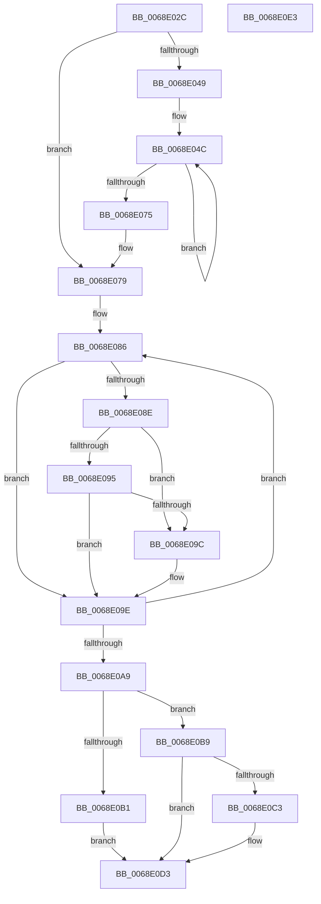

# MiDetermineDefragmentSlabIdentity

- RVA: `0x0068E02C`–`0x0068E0E4` (길이 `184` bytes)
- VA: `0x000000014068E02C`
- 실행 섹션: `.text`
- PDB 이름 있음: `예`; PDB Function 태그: `아니요`
- unwind 정보 RVA: `0x000794E0`
- 디코드: `55`개 명령, `184/184` bytes 표시
- 미해석 바이트: `0` (있으면 어셈블리에 `.byte`로 보존)

> 이 문서는 커널 이미지의 기계어와 PDB 기호를 분석해 생성했습니다. 4번과 5번은 함수 원형과 자료형을 바이너리 사용 방식에서 추정한 C 해석이며 원본 소스 복구 결과는 아닙니다.

## 1. Dependencies

- 직접 호출 지점: **1**; 고유 호출 대상: **1**
- 직접 호출자로 확인된 함수: **1**
- RIP 상대 이미지 참조: **1**

### Outgoing calls
- `0x0068E067` → [MiEnumerateSlabAllocatorsEx](../47/MiEnumerateSlabAllocatorsEx_function_004746F8.md) (function, `0x004746F8`)

### Direct callers
- [MiEstablishDefragSlabEntries](MiEstablishDefragSlabEntries_function_0068E0EC.md) at `0x0068E163`
- [MiEstablishDefragSlabEntries](MiEstablishDefragSlabEntries_function_0068E0EC.md) at `0x0068E407`

### Static image references
- `0x0068E04F` → RVA `0x0068D280` (`MiCountSlabContextFreePagesByIdentity`; read)

## 2. Other-region calls and transfers

- 다른 실행 섹션으로 향하는 call: **0**
- 별도 외부 분기/꼬리 이동을 확인하지 못했습니다.

## 3. Assembly (complete function range)

```asm
0068E02C  48 89 5C 24 08                  mov qword ptr [rsp + 8], rbx
0068E031  48 89 74 24 10                  mov qword ptr [rsp + 0x10], rsi
0068E036  57                              push rdi
0068E037  48 83 EC 30                     sub rsp, 0x30
0068E03B  8B 41 54                        mov eax, dword ptr [rcx + 0x54]
0068E03E  48 8D 79 58                     lea rdi, [rcx + 0x58]
0068E042  48 8B D9                        mov rbx, rcx
0068E045  A8 04                           test al, 4
0068E047  75 30                           jne 0x14068e079
0068E049  40 32 F6                        xor sil, sil
0068E04C  8B 43 48                        mov eax, dword ptr [rbx + 0x48]
0068E04F  48 8D 15 2A F2 FF FF            lea rdx, [rip - 0xdd6]
0068E056  44 8B 4B 44                     mov r9d, dword ptr [rbx + 0x44]
0068E05A  4C 8B C3                        mov r8, rbx
0068E05D  48 8B 0B                        mov rcx, qword ptr [rbx]
0068E060  89 44 24 20                     mov dword ptr [rsp + 0x20], eax
0068E064  40 88 37                        mov byte ptr [rdi], sil
0068E067  E8 8C 66 DE FF                  call 0x1404746f8
0068E06C  40 FE C6                        inc sil
0068E06F  40 80 FE 40                     cmp sil, 0x40
0068E073  76 D7                           jbe 0x14068e04c
0068E075  83 4B 54 04                     or dword ptr [rbx + 0x54], 4
0068E079  44 8B 4B 4C                     mov r9d, dword ptr [rbx + 0x4c]
0068E07D  48 8D 53 60                     lea rdx, [rbx + 0x60]
0068E081  C6 07 FF                        mov byte ptr [rdi], 0xff
0068E084  32 C9                           xor cl, cl
0068E086  4C 8B 02                        mov r8, qword ptr [rdx]
0068E089  4D 3B C1                        cmp r8, r9
0068E08C  72 10                           jb 0x14068e09e
0068E08E  0F B6 07                        movzx eax, byte ptr [rdi]
0068E091  3C FF                           cmp al, 0xff
0068E093  74 07                           je 0x14068e09c
0068E095  4C 39 44 C3 60                  cmp qword ptr [rbx + rax*8 + 0x60], r8
0068E09A  73 02                           jae 0x14068e09e
0068E09C  88 0F                           mov byte ptr [rdi], cl
0068E09E  FE C1                           inc cl
0068E0A0  48 83 C2 08                     add rdx, 8
0068E0A4  80 F9 40                        cmp cl, 0x40
0068E0A7  76 DD                           jbe 0x14068e086
0068E0A9  0F B6 43 58                     movzx eax, byte ptr [rbx + 0x58]
0068E0AD  3C FF                           cmp al, 0xff
0068E0AF  74 08                           je 0x14068e0b9
0068E0B1  48 83 64 C3 60 00               and qword ptr [rbx + rax*8 + 0x60], 0
0068E0B7  EB 1A                           jmp 0x14068e0d3
0068E0B9  48 83 BB 60 02 00 00 00         cmp qword ptr [rbx + 0x260], 0
0068E0C1  74 10                           je 0x14068e0d3
0068E0C3  48 83 A3 60 02 00 00 00         and qword ptr [rbx + 0x260], 0
0068E0CB  83 4B 54 08                     or dword ptr [rbx + 0x54], 8
0068E0CF  C6 43 58 40                     mov byte ptr [rbx + 0x58], 0x40
0068E0D3  48 8B 5C 24 40                  mov rbx, qword ptr [rsp + 0x40]
0068E0D8  48 8B 74 24 48                  mov rsi, qword ptr [rsp + 0x48]
0068E0DD  48 83 C4 30                     add rsp, 0x30
0068E0E1  5F                              pop rdi
0068E0E2  C3                              ret
0068E0E3  CC                              int3
```

## 4. C-style interpretation (structured pseudocode)

```c
__int64 __fastcall MiDetermineDefragmentSlabIdentity(__int64 a1)
{
    __int64 result;
    __int64 v_rsi;
    __int64 v_rsp;
    unsigned int v_stack_m18;
    unsigned __int64 v_stack_p10;
    unsigned __int64 v_stack_p8;

    v_stack_p8 = v_rbx;
    v_stack_p10 = v_rsi;
    v_rsp = (v_rsp) - (48);
    if ((((unsigned __int8)((unsigned int)(*(unsigned int *)(a1 + 84)))) & (4)) != 0) goto loc_0068E079;
    v_rsi = 0;
loc_0068E04C:
    v_stack_m18 = (unsigned int)((unsigned int)(*(unsigned int *)(a1 + 72)));
    *(unsigned __int8 *)(a1 + 88) = 0;
    result = MiEnumerateSlabAllocatorsEx(*(unsigned __int64 *)(a1), v_rip - 3542, a1, (unsigned int)(*(unsigned int *)(a1 + 68)));
    v_rsi = (unsigned __int8)((v_rsi) + 1);
    if (((unsigned __int8)(v_rsi)) <= 64) goto loc_0068E04C;
loc_0068E079:
    *(unsigned __int8 *)(a1 + 88) = 255;
    a1 = 0;
loc_0068E086:
    if ((*(unsigned __int64 *)(a1 + 96)) < ((unsigned int)(*(unsigned int *)(a1 + 76)))) goto loc_0068E09E;
    if (((unsigned __int8)(*(unsigned __int8 *)(a1 + 88))) == 255) goto loc_0068E09C;
    if ((*(unsigned __int64 *)(a1 + *(unsigned __int8 *)(a1 + 88) * 8 + 96)) < (*(unsigned __int64 *)(a1 + 96))) {
        *(unsigned __int8 *)(a1 + 88) = 0;
    }
    a1 = (unsigned __int8)((a1) + 1);
    a2 = (a1 + 96) + (8);
    if (((unsigned __int8)(a1)) <= 64) goto loc_0068E086;
    if (((unsigned __int8)(*(unsigned __int8 *)(a1 + 88))) == 255) goto loc_0068E0B9;
    goto loc_0068E0D3;
loc_0068E0B9:
    if ((*(unsigned __int64 *)(a1 + 608)) != 0) {
        *(unsigned __int8 *)(a1 + 88) = 64;
    }
    v_rsp = (v_rsp) + (48);
    return *(unsigned __int8 *)(a1 + 88);
}
```

## 5. (Beta) C Style

```c
int64_t MiDetermineDefragmentSlabIdentity(void *Arg1)
{
    uint8_t *arg1 = (uint8_t *)Arg1;

    int64_t result;
    int64_t local_rsi;
    int64_t local_rsp;
    uint32_t v_stack_m18;
    uint64_t v_stack_p10;
    uint64_t v_stack_p8;

    v_stack_p8 = local_rbx;
    v_stack_p10 = local_rsi;
    local_rsp = (local_rsp) - (48);
    if ((((uint8_t)((uint32_t)(*(uint32_t *)(arg1 + 0x54)))) & (4)) != 0) goto loc_0068E079;
    local_rsi = 0;
loc_0068E04C:
    v_stack_m18 = (uint32_t)((uint32_t)(*(uint32_t *)(arg1 + 0x48)));
    *(uint8_t *)(arg1 + 0x58) = 0;
    result = MiEnumerateSlabAllocatorsEx(*(uint64_t *)(arg1), v_rip - 3542, Arg1, (uint32_t)(*(uint32_t *)(arg1 + 0x44)));
    local_rsi = (uint8_t)((local_rsi) + 1);
    if (((uint8_t)(local_rsi)) <= 64) goto loc_0068E04C;
loc_0068E079:
    *(uint8_t *)(arg1 + 0x58) = 255;
    Arg1 = 0;
loc_0068E086:
    if ((*(uint64_t *)(arg1 + 0x60)) < ((uint32_t)(*(uint32_t *)(arg1 + 0x4C)))) goto loc_0068E09E;
    if (((uint8_t)(*(uint8_t *)(arg1 + 0x58))) == 255) goto loc_0068E09C;
    if ((*(uint64_t *)(arg1 + *(uint8_t *)(arg1 + 0x58) * 8 + 0x60)) < (*(uint64_t *)(arg1 + 0x60))) {
        *(uint8_t *)(arg1 + 0x58) = 0;
    }
    Arg1 = (uint8_t)((Arg1) + 1);
    a2 = (Arg1 + 96) + (8);
    if (((uint8_t)(Arg1)) <= 64) goto loc_0068E086;
    if (((uint8_t)(*(uint8_t *)(arg1 + 0x58))) == 255) goto loc_0068E0B9;
    goto loc_0068E0D3;
loc_0068E0B9:
    if ((*(uint64_t *)(arg1 + 0x260)) != 0) {
        *(uint8_t *)(arg1 + 0x58) = 64;
    }
    local_rsp = (local_rsp) + (48);
    return *(uint8_t *)(arg1 + 0x58);
}
```

### 관측된 메모리 오프셋

구조체 형식이 확인되지 않은 접근은 인자 기준의 오프셋으로만 기록했습니다.

| 기준 인자 | 오프셋 표현 | 폭 (bit) | 접근 |
|---|---:|---:|---|
| `Arg1` | `+ 0x0` | `8` | `R` |
| `Arg1` | `+ 0x0` | `8` | `W` |
| `Arg1` | `+ 0x0` | `64` | `R` |
| `Arg1` | `+ 0x44` | `32` | `R` |
| `Arg1` | `+ 0x48` | `32` | `R` |
| `Arg1` | `+ 0x4C` | `32` | `R` |
| `Arg1` | `+ 0x54` | `32` | `R` |
| `Arg1` | `+ 0x54` | `32` | `R/W` |
| `Arg1` | `+ 0x58` | `8` | `R` |
| `Arg1` | `+ 0x58` | `8` | `W` |
| `Arg1` | `+ 0x58` | `64` | `R` |
| `Arg1` | `+ 0x60` | `64` | `R` |
| `Arg1` | `+ 0x60 + rax*8` | `64` | `R` |
| `Arg1` | `+ 0x60 + rax*8` | `64` | `R/W` |
| `Arg1` | `+ 0x260` | `64` | `R` |
| `Arg1` | `+ 0x260` | `64` | `R/W` |

## 6. Execution-region graph

[열기: 2D/3D 그래프와 함수 탐색 컨트롤 패널](../../../control-panel.html?section=text&rva=0x0068E02C&view=graph)

- 2D 그래프는 위에서 아래로 흐르고, 3D 그래프는 빈 공간을 드래그해 회전합니다. Shift+드래그는 이동, 휠은 확대·축소, 함수 노드 선택은 대상 보고서 이동입니다.

### Static fallback


