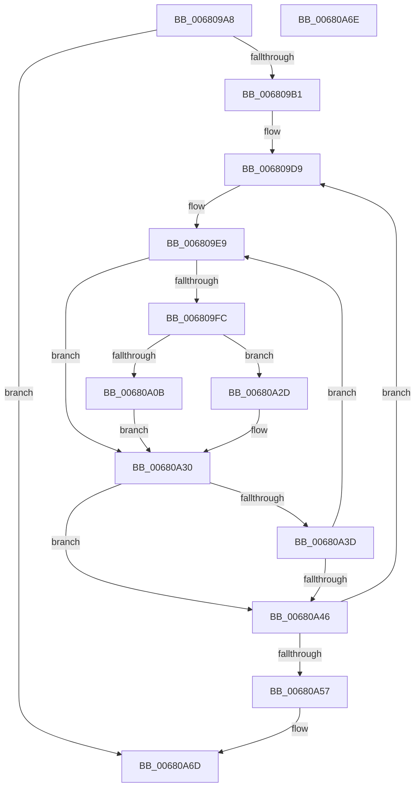

# MiEliminateStaleExtents

- RVA: `0x006809A8`–`0x00680A6F` (길이 `199` bytes)
- VA: `0x00000001406809A8`
- 실행 섹션: `.text`
- PDB 이름 있음: `예`; PDB Function 태그: `아니요`
- unwind 정보 RVA: `0x000D8264`
- 디코드: `58`개 명령, `199/199` bytes 표시
- 미해석 바이트: `0` (있으면 어셈블리에 `.byte`로 보존)

> 이 문서는 커널 이미지의 기계어와 PDB 기호를 분석해 생성했습니다. 4번과 5번은 함수 원형과 자료형을 바이너리 사용 방식에서 추정한 C 해석이며 원본 소스 복구 결과는 아닙니다.

## 1. Dependencies

- 직접 호출 지점: **3**; 고유 호출 대상: **3**
- 직접 호출자로 확인된 함수: **1**
- RIP 상대 이미지 참조: **0**

### Outgoing calls
- `0x006809E1` → [MiLockProtoPoolPageForce](../32/MiLockProtoPoolPageForce_function_00320E10.md) (function, `0x00320E10`)
- `0x00680A01` → [MiLockLeafPage](../36/MiLockLeafPage_function_003658C0.md) (function, `0x003658C0`)
- `0x00680A4D` → [MiUnlockProtoPoolPage](../24/MiUnlockProtoPoolPage_function_00246090.md) (function, `0x00246090`)

### Direct callers
- [MiAllocateFileExtents](../../page/AB/MiAllocateFileExtents_function_00ABDF54.md) at `0x00ABE300`

### Static image references
- 디코드된 RIP-relative 메모리 참조가 없습니다.

## 2. Other-region calls and transfers

- 다른 실행 섹션으로 향하는 call: **0**
- 별도 외부 분기/꼬리 이동을 확인하지 못했습니다.

## 3. Assembly (complete function range)

```asm
006809A8  4D 85 C0                        test r8, r8
006809AB  0F 84 BC 00 00 00               je 0x140680a6d
006809B1  48 89 5C 24 08                  mov qword ptr [rsp + 8], rbx
006809B6  48 89 6C 24 10                  mov qword ptr [rsp + 0x10], rbp
006809BB  56                              push rsi
006809BC  57                              push rdi
006809BD  41 54                           push r12
006809BF  41 56                           push r14
006809C1  41 57                           push r15
006809C3  48 83 EC 20                     sub rsp, 0x20
006809C7  33 F6                           xor esi, esi
006809C9  C6 44 24 60 11                  mov byte ptr [rsp + 0x60], 0x11
006809CE  33 FF                           xor edi, edi
006809D0  49 8B E8                        mov rbp, r8
006809D3  4C 8B FA                        mov r15, rdx
006809D6  48 8B D9                        mov rbx, rcx
006809D9  48 8D 54 24 60                  lea rdx, [rsp + 0x60]
006809DE  48 8B CB                        mov rcx, rbx
006809E1  E8 2A 04 CA FF                  call 0x140320e10
006809E6  4C 8B E0                        mov r12, rax
006809E9  4D 8B 34 FF                     mov r14, qword ptr [r15 + rdi*8]
006809ED  48 B8 00 00 00 00 00 00 00 80   movabs rax, 0x8000000000000000
006809F7  4C 3B F0                        cmp r14, rax
006809FA  74 34                           je 0x140680a30
006809FC  33 D2                           xor edx, edx
006809FE  48 8B CB                        mov rcx, rbx
00680A01  E8 BA 4E CE FF                  call 0x1403658c0
00680A06  48 85 C0                        test rax, rax
00680A09  74 22                           je 0x140680a2d
00680A0B  48 B9 FF FF FF FF FF FF FF 7F   movabs rcx, 0x7fffffffffffffff
00680A15  F0 48 21 48 18                  lock and qword ptr [rax + 0x18], rcx
00680A1A  48 B8 00 00 00 00 00 00 00 40   movabs rax, 0x4000000000000000
00680A24  4C 0B F0                        or r14, rax
00680A27  4D 89 34 FF                     mov qword ptr [r15 + rdi*8], r14
00680A2B  EB 03                           jmp 0x140680a30
00680A2D  48 8B 03                        mov rax, qword ptr [rbx]
00680A30  FF C6                           inc esi
00680A32  48 83 C3 08                     add rbx, 8
00680A36  8B FE                           mov edi, esi
00680A38  48 3B FD                        cmp rdi, rbp
00680A3B  73 09                           jae 0x140680a46
00680A3D  48 F7 C3 FF 0F 00 00            test rbx, 0xfff
00680A44  75 A3                           jne 0x1406809e9
00680A46  8A 54 24 60                     mov dl, byte ptr [rsp + 0x60]
00680A4A  49 8B CC                        mov rcx, r12
00680A4D  E8 3E 56 BC FF                  call 0x140246090
00680A52  48 3B FD                        cmp rdi, rbp
00680A55  72 82                           jb 0x1406809d9
00680A57  48 8B 5C 24 50                  mov rbx, qword ptr [rsp + 0x50]
00680A5C  48 8B 6C 24 58                  mov rbp, qword ptr [rsp + 0x58]
00680A61  48 83 C4 20                     add rsp, 0x20
00680A65  41 5F                           pop r15
00680A67  41 5E                           pop r14
00680A69  41 5C                           pop r12
00680A6B  5F                              pop rdi
00680A6C  5E                              pop rsi
00680A6D  C3                              ret
00680A6E  CC                              int3
```

## 4. C-style interpretation (structured pseudocode)

```c
__int64 __fastcall MiEliminateStaleExtents(__int64 a1, __int64 a2, __int64 a3)
{
    __int64 result;
    __int64 v_r14;
    __int64 v_rbx;
    __int64 v_rdi;
    __int64 v_rsi;
    __int64 v_rsp;
    unsigned __int64 v_stack_p10;
    unsigned __int8 v_stack_p18;
    unsigned __int64 v_stack_p8;

    if (a3 == 0) goto loc_00680A6D;
    v_stack_p8 = v_rbx;
    v_stack_p10 = v_rbp;
    v_rsp = (v_rsp) - (32);
    v_rsi = 0;
    v_stack_p18 = 17;
    v_rdi = 0;
loc_006809D9:
    result = MiLockProtoPoolPageForce(a1, v_stack_p18, a3, a4);
loc_006809E9:
    if ((*(unsigned __int64 *)(a2 + v_rdi * 8)) == result) goto loc_00680A30;
    a2 = 0;
    result = MiLockLeafPage(a1, a2, a3, a4);
    if (result == 0) goto loc_00680A2D;
    v_r14 = (*(unsigned __int64 *)(a2 + v_rdi * 8)) | (result);
    *(unsigned __int64 *)(a2 + v_rdi * 8) = v_r14;
    goto loc_00680A30;
loc_00680A2D:
loc_00680A30:
    v_rsi = (unsigned int)((v_rsi) + 1);
    v_rbx = (a1) + (8);
    if (((unsigned int)((unsigned int)(v_rsi))) >= a3) goto loc_00680A46;
    if (((v_rbx) & (0xFFFULL)) != 0) goto loc_006809E9;
loc_00680A46:
    result = MiUnlockProtoPoolPage(result, v_stack_p18, a3, a4);
    if (((unsigned int)((unsigned int)(v_rsi))) < a3) goto loc_006809D9;
    v_rsp = (v_rsp) + (32);
loc_00680A6D:
    return result;
}
```

## 5. (Beta) C Style

```c
int64_t MiEliminateStaleExtents(int64_t Arg1, void *Arg2, int64_t Arg3)
{
    uint8_t *arg2 = (uint8_t *)Arg2;

    int64_t result;
    int64_t local_r14;
    int64_t local_rbx;
    int64_t local_rdi;
    int64_t local_rsi;
    int64_t local_rsp;
    uint64_t v_stack_p10;
    uint8_t v_stack_p18;
    uint64_t v_stack_p8;

    if (Arg3 == 0) goto loc_00680A6D;
    v_stack_p8 = local_rbx;
    v_stack_p10 = local_rbp;
    local_rsp = (local_rsp) - (32);
    local_rsi = 0;
    v_stack_p18 = 17;
    local_rdi = 0;
loc_006809D9:
    result = MiLockProtoPoolPageForce(Arg1, v_stack_p18, Arg3, a4);
loc_006809E9:
    if ((*(uint64_t *)(arg2 + local_rdi * 8)) == result) goto loc_00680A30;
    Arg2 = 0;
    result = MiLockLeafPage(Arg1, Arg2, Arg3, a4);
    if (result == 0) goto loc_00680A2D;
    local_r14 = (*(uint64_t *)(arg2 + local_rdi * 8)) | (result);
    *(uint64_t *)(arg2 + local_rdi * 8) = local_r14;
    goto loc_00680A30;
loc_00680A2D:
loc_00680A30:
    local_rsi = (uint32_t)((local_rsi) + 1);
    local_rbx = (Arg1) + (8);
    if (((uint32_t)((uint32_t)(local_rsi))) >= Arg3) goto loc_00680A46;
    if (((local_rbx) & (0xFFFULL)) != 0) goto loc_006809E9;
loc_00680A46:
    result = MiUnlockProtoPoolPage(result, v_stack_p18, Arg3, a4);
    if (((uint32_t)((uint32_t)(local_rsi))) < Arg3) goto loc_006809D9;
    local_rsp = (local_rsp) + (32);
loc_00680A6D:
    return result;
}
```

### 관측된 메모리 오프셋

구조체 형식이 확인되지 않은 접근은 인자 기준의 오프셋으로만 기록했습니다.

| 기준 인자 | 오프셋 표현 | 폭 (bit) | 접근 |
|---|---:|---:|---|
| `Arg2` | `+ 0x0 + rdi*8` | `64` | `R` |
| `Arg2` | `+ 0x0 + rdi*8` | `64` | `W` |

## 6. Execution-region graph

[열기: 2D/3D 그래프와 함수 탐색 컨트롤 패널](../../../control-panel.html?section=text&rva=0x006809A8&view=graph)

- 2D 그래프는 위에서 아래로 흐르고, 3D 그래프는 빈 공간을 드래그해 회전합니다. Shift+드래그는 이동, 휠은 확대·축소, 함수 노드 선택은 대상 보고서 이동입니다.

### Static fallback


