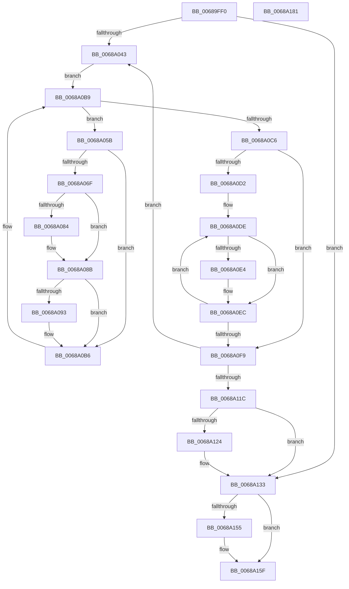

# MiEmptyAccessLogs

- RVA: `0x00689FF0`–`0x0068A182` (길이 `402` bytes)
- VA: `0x0000000140689FF0`
- 실행 섹션: `.text`
- PDB 이름 있음: `예`; PDB Function 태그: `아니요`
- unwind 정보 RVA: `0x000BE160`
- 디코드: `101`개 명령, `402/402` bytes 표시
- 미해석 바이트: `0` (있으면 어셈블리에 `.byte`로 보존)

> 이 문서는 커널 이미지의 기계어와 PDB 기호를 분석해 생성했습니다. 4번과 5번은 함수 원형과 자료형을 바이너리 사용 방식에서 추정한 C 해석이며 원본 소스 복구 결과는 아닙니다.

## 1. Dependencies

- 직접 호출 지점: **14**; 고유 호출 대상: **11**
- 직접 호출자로 확인된 함수: **0**
- RIP 상대 이미지 참조: **4**

### Outgoing calls
- `0x0068A032` → [ExAcquireSpinLockExclusive](../24/ExAcquireSpinLockExclusive_function_00248690.md) (function, `0x00248690`)
- `0x0068A052` → [MiReleaseSpinLockExclusive](../24/MiReleaseSpinLockExclusive_function_002482C0.md) (function, `0x002482C0`)
- `0x0068A065` → [MiGetVmAccessLoggingPartition](../38/MiGetVmAccessLoggingPartition_function_003815A0.md) (function, `0x003815A0`)
- `0x0068A09D` → [KiStackAttachProcess](../21/KiStackAttachProcess_function_00216820.md) (function, `0x00216820`)
- `0x0068A0A5` → [MiDrainSystemAccessLog](../47/MiDrainSystemAccessLog_function_00474144.md) (function, `0x00474144`)
- `0x0068A0B1` → [KiUnstackDetachProcess](../21/KiUnstackDetachProcess_function_00217D30.md) (function, `0x00217D30`)
- `0x0068A0B9` → [PsGetNextProcess](../../page/91/PsGetNextProcess_function_0091C900.md) (function, `0x0091C900`)
- `0x0068A0E7` → [MiDrainSystemAccessLog](../47/MiDrainSystemAccessLog_function_00474144.md) (function, `0x00474144`)
- `0x0068A102` → [MiCheckAndProcessCcAccessLog](../45/MiCheckAndProcessCcAccessLog_function_0045D1A4.md) (function, `0x0045D1A4`)
- `0x0068A10A` → [ExAcquireSpinLockExclusive](../24/ExAcquireSpinLockExclusive_function_00248690.md) (function, `0x00248690`)
- `0x0068A13F` → [MiReleaseSpinLockExclusive](../24/MiReleaseSpinLockExclusive_function_002482C0.md) (function, `0x002482C0`)
- `0x0068A14B` → [PsDereferencePartition](../34/PsDereferencePartition_function_00342E70.md) (function, `0x00342E70`)
- `0x0068A15A` → [ExFreePoolWithTag](../../poolcode/B8/ExFreePoolWithTag_function_00B82870.md) (function, `0x00B82870`)
- `0x0068A167` → [_security_check_cookie](../6A/_security_check_cookie_function_006AC640.md) (function, `0x006AC640`)

### Direct callers
- 이 함수 시작 RVA로 연결되는 직접 call은 확인되지 않았습니다. 간접 호출은 완전히 역산할 수 없습니다.

### Static image references
- `0x0068A002` → RVA `0x00E0A740` (`.data`; read)
- `0x0068A075` → RVA `0x00E38868` (`.data`; read)
- `0x0068A0C6` → RVA `0x00E38D00` (`.data`; read)
- `0x0068A0D2` → RVA `0x00E37D00` (`.data`; read)

## 2. Other-region calls and transfers

- 다른 실행 섹션으로 향하는 call: **2**
  - `0x0068A0B9` → [PsGetNextProcess](../../page/91/PsGetNextProcess_function_0091C900.md) (`.text` → `PAGE`)
  - `0x0068A15A` → [ExFreePoolWithTag](../../poolcode/B8/ExFreePoolWithTag_function_00B82870.md) (`.text` → `POOLCODE`)
- 별도 외부 분기/꼬리 이동을 확인하지 못했습니다.

## 3. Assembly (complete function range)

```asm
00689FF0  48 89 5C 24 10                  mov qword ptr [rsp + 0x10], rbx
00689FF5  48 89 6C 24 18                  mov qword ptr [rsp + 0x18], rbp
00689FFA  56                              push rsi
00689FFB  57                              push rdi
00689FFC  41 56                           push r14
00689FFE  48 83 EC 60                     sub rsp, 0x60
0068A002  48 8B 05 37 07 78 00            mov rax, qword ptr [rip + 0x780737]
0068A009  48 33 C4                        xor rax, rsp
0068A00C  48 89 44 24 50                  mov qword ptr [rsp + 0x50], rax
0068A011  0F 57 C0                        xorps xmm0, xmm0
0068A014  4C 8D B1 80 44 00 00            lea r14, [rcx + 0x4480]
0068A01B  48 8B D9                        mov rbx, rcx
0068A01E  33 ED                           xor ebp, ebp
0068A020  49 8B CE                        mov rcx, r14
0068A023  0F 11 44 24 20                  movups xmmword ptr [rsp + 0x20], xmm0
0068A028  0F 11 44 24 30                  movups xmmword ptr [rsp + 0x30], xmm0
0068A02D  0F 11 44 24 40                  movups xmmword ptr [rsp + 0x40], xmm0
0068A032  E8 59 E6 BB FF                  call 0x140248690
0068A037  39 AB 2C 44 00 00               cmp dword ptr [rbx + 0x442c], ebp
0068A03D  0F 85 F0 00 00 00               jne 0x14068a133
0068A043  8A D0                           mov dl, al
0068A045  C7 83 28 44 00 00 02 00 00 00   mov dword ptr [rbx + 0x4428], 2
0068A04F  49 8B CE                        mov rcx, r14
0068A052  E8 69 E2 BB FF                  call 0x1402482c0
0068A057  33 C9                           xor ecx, ecx
0068A059  EB 5E                           jmp 0x14068a0b9
0068A05B  48 8D B7 00 04 00 00            lea rsi, [rdi + 0x400]
0068A062  48 8B CE                        mov rcx, rsi
0068A065  E8 36 75 CF FF                  call 0x1403815a0
0068A06A  48 3B C3                        cmp rax, rbx
0068A06D  75 47                           jne 0x14068a0b6
0068A06F  8B 8E B8 00 00 00               mov ecx, dword ptr [rsi + 0xb8]
0068A075  48 8D 05 EC E7 7A 00            lea rax, [rip + 0x7ae7ec]
0068A07C  80 E1 0F                        and cl, 0xf
0068A07F  80 F9 01                        cmp cl, 1
0068A082  74 07                           je 0x14068a08b
0068A084  48 8D 86 E8 00 00 00            lea rax, [rsi + 0xe8]
0068A08B  48 8B 00                        mov rax, qword ptr [rax]
0068A08E  48 85 C0                        test rax, rax
0068A091  74 23                           je 0x14068a0b6
0068A093  4C 8D 44 24 20                  lea r8, [rsp + 0x20]
0068A098  33 D2                           xor edx, edx
0068A09A  48 8B CF                        mov rcx, rdi
0068A09D  E8 7E C7 B8 FF                  call 0x140216820
0068A0A2  48 8B CE                        mov rcx, rsi
0068A0A5  E8 9A A0 DE FF                  call 0x140474144
0068A0AA  33 D2                           xor edx, edx
0068A0AC  48 8D 4C 24 20                  lea rcx, [rsp + 0x20]
0068A0B1  E8 7A DC B8 FF                  call 0x140217d30
0068A0B6  48 8B CF                        mov rcx, rdi
0068A0B9  E8 42 28 29 00                  call 0x14091c900
0068A0BE  48 8B F8                        mov rdi, rax
0068A0C1  48 85 C0                        test rax, rax
0068A0C4  75 95                           jne 0x14068a05b
0068A0C6  48 8D 05 33 EC 7A 00            lea rax, [rip + 0x7aec33]
0068A0CD  48 3B D8                        cmp rbx, rax
0068A0D0  75 27                           jne 0x14068a0f9
0068A0D2  48 8D 3D 27 DC 7A 00            lea rdi, [rip + 0x7adc27]
0068A0D9  BE 04 00 00 00                  mov esi, 4
0068A0DE  48 39 6F 70                     cmp qword ptr [rdi + 0x70], rbp
0068A0E2  74 08                           je 0x14068a0ec
0068A0E4  48 8B CF                        mov rcx, rdi
0068A0E7  E8 58 A0 DE FF                  call 0x140474144
0068A0EC  48 81 C7 40 01 00 00            add rdi, 0x140
0068A0F3  48 83 EE 01                     sub rsi, 1
0068A0F7  75 E5                           jne 0x14068a0de
0068A0F9  33 D2                           xor edx, edx
0068A0FB  48 8B CB                        mov rcx, rbx
0068A0FE  44 8D 42 01                     lea r8d, [rdx + 1]
0068A102  E8 9D 30 DD FF                  call 0x14045d1a4
0068A107  49 8B CE                        mov rcx, r14
0068A10A  E8 81 E5 BB FF                  call 0x140248690
0068A10F  83 BB 28 44 00 00 02            cmp dword ptr [rbx + 0x4428], 2
0068A116  0F 85 27 FF FF FF               jne 0x14068a043
0068A11C  39 AB 2C 44 00 00               cmp dword ptr [rbx + 0x442c], ebp
0068A122  75 0F                           jne 0x14068a133
0068A124  48 8B AB 38 44 00 00            mov rbp, qword ptr [rbx + 0x4438]
0068A12B  48 83 A3 38 44 00 00 00         and qword ptr [rbx + 0x4438], 0
0068A133  83 A3 28 44 00 00 00            and dword ptr [rbx + 0x4428], 0
0068A13A  8A D0                           mov dl, al
0068A13C  49 8B CE                        mov rcx, r14
0068A13F  E8 7C E1 BB FF                  call 0x1402482c0
0068A144  48 8B 8B B8 00 00 00            mov rcx, qword ptr [rbx + 0xb8]
0068A14B  E8 20 8D CB FF                  call 0x140342e70
0068A150  48 85 ED                        test rbp, rbp
0068A153  74 0A                           je 0x14068a15f
0068A155  33 D2                           xor edx, edx
0068A157  48 8B CD                        mov rcx, rbp
0068A15A  E8 11 87 4F 00                  call 0x140b82870
0068A15F  48 8B 4C 24 50                  mov rcx, qword ptr [rsp + 0x50]
0068A164  48 33 CC                        xor rcx, rsp
0068A167  E8 D4 24 02 00                  call 0x1406ac640
0068A16C  4C 8D 5C 24 60                  lea r11, [rsp + 0x60]
0068A171  49 8B 5B 28                     mov rbx, qword ptr [r11 + 0x28]
0068A175  49 8B 6B 30                     mov rbp, qword ptr [r11 + 0x30]
0068A179  49 8B E3                        mov rsp, r11
0068A17C  41 5E                           pop r14
0068A17E  5F                              pop rdi
0068A17F  5E                              pop rsi
0068A180  C3                              ret
0068A181  CC                              int3
```

## 4. C-style interpretation (structured pseudocode)

```c
__int64 __fastcall MiEmptyAccessLogs(__int64 a1)
{
    __int64 result;
    __int64 v_rbp;
    __int64 v_rdi;
    __int64 v_rsi;
    __int64 v_rsp;
    unsigned __int64 v_stack_m18;
    unsigned __int64 v_stack_m28;
    unsigned __int64 v_stack_m38;
    unsigned __int64 v_stack_m48;
    unsigned __int64 v_stack_m58;
    unsigned __int64 v_stack_p10;
    unsigned __int64 v_stack_p18;

    v_stack_p10 = v_rbx;
    v_stack_p18 = v_rbp;
    v_rsp = (v_rsp) - (96);
    result = (*(unsigned __int64 *)(v_rip + 7866167)) ^ (v_rsp);
    v_stack_m28 = result;
    v_rbp = 0;
    v_stack_m58 = v_xmm0;
    v_stack_m48 = v_xmm0;
    v_stack_m38 = v_xmm0;
    result = ExAcquireSpinLockExclusive(a1 + 17536, a2, a3, a4);
    if ((*(unsigned int *)(a1 + 17452)) != 0) goto loc_0068A133;
loc_0068A043:
    *(unsigned int *)(a1 + 17448) = 2;
    result = MiReleaseSpinLockExclusive(a1 + 17536, (unsigned __int8)(result), a3, a4);
    a1 = 0;
    goto loc_0068A0B9;
loc_0068A05B:
    result = MiGetVmAccessLoggingPartition(v_rdi + 1024, (unsigned __int8)(result), a3, a4);
    if (result != 0) goto loc_0068A0B6;
    a1 = (unsigned __int8)(((unsigned int)(*(unsigned int *)(v_rdi + 1024 + 184))) & (15));
    result = v_rip + 8054764;
    if (((unsigned __int8)(a1)) != 1) {
        result = v_rdi + 1024 + 232;
    }
    result = *(unsigned __int64 *)(result);
    if (*(unsigned __int64 *)(result) != 0) {
        a3 = v_stack_m58;
        a2 = 0;
        a1 = v_rdi;
        result = KiStackAttachProcess(a1, a2, a3, a4);
        a1 = v_rdi + 1024;
        result = MiDrainSystemAccessLog(a1, a2, a3, a4);
        a2 = 0;
        a1 = v_stack_m58;
        result = KiUnstackDetachProcess(a1, a2, a3, a4);
    }
loc_0068A0B9:
    result = PsGetNextProcess(v_rdi, a2, a3, a4);
    if (result != 0) goto loc_0068A05B;
    if (a1 != (v_rip + 8055859)) goto loc_0068A0F9;
loc_0068A0DE:
    result = v_rip + 8055859;
    if ((*(unsigned __int64 *)(v_rip + 8051751 + 112)) != 0) {
        a1 = v_rip + 8051751;
        result = MiDrainSystemAccessLog(a1, a2, a3, a4);
    }
    v_rdi = (v_rip + 8051751) + (320);
    v_rsi = (4) - (1);
    if (condition_is_not_equal) goto loc_0068A0DE;
loc_0068A0F9:
    a2 = 0;
    result = MiCheckAndProcessCcAccessLog(a1, a2, a2 + 1, a4);
    result = ExAcquireSpinLockExclusive(a1 + 17536, a2, a2 + 1, a4);
    if ((*(unsigned int *)(a1 + 17448)) != 2) goto loc_0068A043;
    if ((*(unsigned int *)(a1 + 17452)) == 0) {
        v_rbp = *(unsigned __int64 *)(a1 + 17464);
    }
    result = MiReleaseSpinLockExclusive(a1 + 17536, (unsigned __int8)(result), a2 + 1, a4);
    result = PsDereferencePartition(*(unsigned __int64 *)(a1 + 184), (unsigned __int8)(result), a2 + 1, a4);
    if (v_rbp != 0) {
        a2 = 0;
        a1 = v_rbp;
        result = ExFreePoolWithTag(a1, a2, a2 + 1, a4);
    }
    a1 = (v_stack_m28) ^ (v_rsp);
    result = _security_check_cookie(a1, a2, a2 + 1, a4);
    return result;
}
```

## 5. (Beta) C Style

```c
int64_t MiEmptyAccessLogs(void *Arg1)
{
    uint8_t *arg1 = (uint8_t *)Arg1;

    int64_t result;
    int64_t local_rbp;
    int64_t local_rdi;
    int64_t local_rsi;
    int64_t local_rsp;
    uint64_t v_stack_m18;
    uint64_t v_stack_m28;
    uint64_t v_stack_m38;
    uint64_t v_stack_m48;
    uint64_t v_stack_m58;
    uint64_t v_stack_p10;
    uint64_t v_stack_p18;

    v_stack_p10 = local_rbx;
    v_stack_p18 = local_rbp;
    local_rsp = (local_rsp) - (96);
    result = (*(uint64_t *)(v_rip + 0x780737)) ^ (local_rsp);
    v_stack_m28 = result;
    local_rbp = 0;
    v_stack_m58 = v_xmm0;
    v_stack_m48 = v_xmm0;
    v_stack_m38 = v_xmm0;
    result = ExAcquireSpinLockExclusive(Arg1 + 17536, a2, a3, a4);
    if ((*(uint32_t *)(arg1 + 0x442C)) != 0) goto loc_0068A133;
loc_0068A043:
    *(uint32_t *)(arg1 + 0x4428) = 2;
    result = MiReleaseSpinLockExclusive(Arg1 + 17536, (uint8_t)(result), a3, a4);
    Arg1 = 0;
    goto loc_0068A0B9;
loc_0068A05B:
    result = MiGetVmAccessLoggingPartition(local_rdi + 1024, (uint8_t)(result), a3, a4);
    if (result != 0) goto loc_0068A0B6;
    Arg1 = (uint8_t)(((uint32_t)(*(uint32_t *)(local_rdi + 0x400 + 0xB8))) & (15));
    result = v_rip + 8054764;
    if (((uint8_t)(Arg1)) != 1) {
        result = local_rdi + 1024 + 232;
    }
    result = *(uint64_t *)(result);
    if (*(uint64_t *)(result) != 0) {
        a3 = v_stack_m58;
        a2 = 0;
        Arg1 = local_rdi;
        result = KiStackAttachProcess(Arg1, a2, a3, a4);
        Arg1 = local_rdi + 1024;
        result = MiDrainSystemAccessLog(Arg1, a2, a3, a4);
        a2 = 0;
        Arg1 = v_stack_m58;
        result = KiUnstackDetachProcess(Arg1, a2, a3, a4);
    }
loc_0068A0B9:
    result = PsGetNextProcess(local_rdi, a2, a3, a4);
    if (result != 0) goto loc_0068A05B;
    if (Arg1 != (v_rip + 8055859)) goto loc_0068A0F9;
loc_0068A0DE:
    result = v_rip + 8055859;
    if ((*(uint64_t *)(v_rip + 0x7ADC27 + 0x70)) != 0) {
        Arg1 = v_rip + 8051751;
        result = MiDrainSystemAccessLog(Arg1, a2, a3, a4);
    }
    local_rdi = (v_rip + 8051751) + (320);
    local_rsi = (4) - (1);
    if (condition_is_not_equal) goto loc_0068A0DE;
loc_0068A0F9:
    a2 = 0;
    result = MiCheckAndProcessCcAccessLog(Arg1, a2, a2 + 1, a4);
    result = ExAcquireSpinLockExclusive(Arg1 + 17536, a2, a2 + 1, a4);
    if ((*(uint32_t *)(arg1 + 0x4428)) != 2) goto loc_0068A043;
    if ((*(uint32_t *)(arg1 + 0x442C)) == 0) {
        local_rbp = *(uint64_t *)(arg1 + 0x4438);
    }
    result = MiReleaseSpinLockExclusive(Arg1 + 17536, (uint8_t)(result), a2 + 1, a4);
    result = PsDereferencePartition(*(uint64_t *)(arg1 + 0xB8), (uint8_t)(result), a2 + 1, a4);
    if (local_rbp != 0) {
        a2 = 0;
        Arg1 = local_rbp;
        result = ExFreePoolWithTag(Arg1, a2, a2 + 1, a4);
    }
    Arg1 = (v_stack_m28) ^ (local_rsp);
    result = _security_check_cookie(Arg1, a2, a2 + 1, a4);
    return result;
}
```

### 관측된 메모리 오프셋

구조체 형식이 확인되지 않은 접근은 인자 기준의 오프셋으로만 기록했습니다.

| 기준 인자 | 오프셋 표현 | 폭 (bit) | 접근 |
|---|---:|---:|---|
| `Arg1` | `+ 0x442C` | `32` | `R` |
| `Arg1` | `+ 0x4480` | `64` | `R` |

## 6. Execution-region graph

[열기: 2D/3D 그래프와 함수 탐색 컨트롤 패널](../../../control-panel.html?section=text&rva=0x00689FF0&view=graph)

- 2D 그래프는 위에서 아래로 흐르고, 3D 그래프는 빈 공간을 드래그해 회전합니다. Shift+드래그는 이동, 휠은 확대·축소, 함수 노드 선택은 대상 보고서 이동입니다.

### Static fallback


