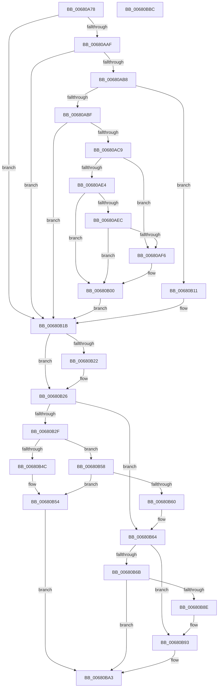

# MiEnableImageDirectMap

- RVA: `0x00680A78`–`0x00680BBD` (길이 `325` bytes)
- VA: `0x0000000140680A78`
- 실행 섹션: `.text`
- PDB 이름 있음: `예`; PDB Function 태그: `아니요`
- unwind 정보 RVA: `0x000D829C`
- 디코드: `99`개 명령, `325/325` bytes 표시
- 미해석 바이트: `0` (있으면 어셈블리에 `.byte`로 보존)

> 이 문서는 커널 이미지의 기계어와 PDB 기호를 분석해 생성했습니다. 4번과 5번은 함수 원형과 자료형을 바이너리 사용 방식에서 추정한 C 해석이며 원본 소스 복구 결과는 아닙니다.

## 1. Dependencies

- 직접 호출 지점: **6**; 고유 호출 대상: **6**
- 직접 호출자로 확인된 함수: **1**
- RIP 상대 이미지 참조: **2**

### Outgoing calls
- `0x00680AD0` → [ExAcquireSpinLockExclusive](../24/ExAcquireSpinLockExclusive_function_00248690.md) (function, `0x00248690`)
- `0x00680B0A` → [MiReleaseSpinLockExclusive](../24/MiReleaseSpinLockExclusive_function_002482C0.md) (function, `0x002482C0`)
- `0x00680B36` → [MiInitializeImageExtents](../../page/80/MiInitializeImageExtents_function_00800FE8.md) (function, `0x00800FE8`)
- `0x00680B43` → [ObFastReplaceObject](../45/ObFastReplaceObject_function_0045819C.md) (function, `0x0045819C`)
- `0x00680B4F` → [MiDeleteFileExtentList](../../page/80/MiDeleteFileExtentList_function_00800F6C.md) (function, `0x00800F6C`)
- `0x00680B85` → [MiAllocateEntireImageFileExtents](../../page/80/MiAllocateEntireImageFileExtents_function_008008DC.md) (function, `0x008008DC`)

### Direct callers
- [MiCreateImageFileMap](../../page/98/MiCreateImageFileMap_function_00986830.md) at `0x0098707D`

### Static image references
- `0x00680AAF` → RVA `0x00FC6A88` (`ALMOSTRO`; read)
- `0x00680AC9` → RVA `0x00E2CD00` (`.data`; read)

## 2. Other-region calls and transfers

- 다른 실행 섹션으로 향하는 call: **3**
  - `0x00680B36` → [MiInitializeImageExtents](../../page/80/MiInitializeImageExtents_function_00800FE8.md) (`.text` → `PAGE`)
  - `0x00680B4F` → [MiDeleteFileExtentList](../../page/80/MiDeleteFileExtentList_function_00800F6C.md) (`.text` → `PAGE`)
  - `0x00680B85` → [MiAllocateEntireImageFileExtents](../../page/80/MiAllocateEntireImageFileExtents_function_008008DC.md) (`.text` → `PAGE`)
- 별도 외부 분기/꼬리 이동을 확인하지 못했습니다.

## 3. Assembly (complete function range)

```asm
00680A78  48 89 5C 24 08                  mov qword ptr [rsp + 8], rbx
00680A7D  48 89 6C 24 18                  mov qword ptr [rsp + 0x18], rbp
00680A82  48 89 74 24 20                  mov qword ptr [rsp + 0x20], rsi
00680A87  57                              push rdi
00680A88  41 55                           push r13
00680A8A  41 57                           push r15
00680A8C  48 83 EC 20                     sub rsp, 0x20
00680A90  4C 8B 7A 60                     mov r15, qword ptr [rdx + 0x60]
00680A94  49 8B E9                        mov rbp, r9
00680A97  49 83 E7 F8                     and r15, 0xfffffffffffffff8
00680A9B  48 8B FA                        mov rdi, rdx
00680A9E  83 7C 24 70 00                  cmp dword ptr [rsp + 0x70], 0
00680AA3  4C 8B E9                        mov r13, rcx
00680AA6  BE 00 10 00 00                  mov esi, 0x1000
00680AAB  B3 04                           mov bl, 4
00680AAD  75 6C                           jne 0x140680b1b
00680AAF  48 85 35 D2 5F 94 00            test qword ptr [rip + 0x945fd2], rsi
00680AB6  75 63                           jne 0x140680b1b
00680AB8  83 7C 24 60 00                  cmp dword ptr [rsp + 0x60], 0
00680ABD  74 52                           je 0x140680b11
00680ABF  41 F7 40 08 FF 0F 00 00         test dword ptr [r8 + 8], 0xfff
00680AC7  75 52                           jne 0x140680b1b
00680AC9  48 8D 0D 30 C2 7A 00            lea rcx, [rip + 0x7ac230]
00680AD0  E8 BB 7B BC FF                  call 0x140248690
00680AD5  49 8B 4D 28                     mov rcx, qword ptr [r13 + 0x28]
00680AD9  44 8A C0                        mov r8b, al
00680ADC  48 8B 11                        mov rdx, qword ptr [rcx]
00680ADF  48 85 D2                        test rdx, rdx
00680AE2  74 12                           je 0x140680af6
00680AE4  8B 4A 38                        mov ecx, dword ptr [rdx + 0x38]
00680AE7  F6 C1 03                        test cl, 3
00680AEA  75 14                           jne 0x140680b00
00680AEC  8A 52 3E                        mov dl, byte ptr [rdx + 0x3e]
00680AEF  80 E2 0C                        and dl, 0xc
00680AF2  3A D3                           cmp dl, bl
00680AF4  74 0A                           je 0x140680b00
00680AF6  8A 47 3E                        mov al, byte ptr [rdi + 0x3e]
00680AF9  24 F7                           and al, 0xf7
00680AFB  0A C3                           or al, bl
00680AFD  88 47 3E                        mov byte ptr [rdi + 0x3e], al
00680B00  41 8A D0                        mov dl, r8b
00680B03  48 8D 0D F6 C1 7A 00            lea rcx, [rip + 0x7ac1f6]
00680B0A  E8 B1 77 BC FF                  call 0x1402482c0
00680B0F  EB 0A                           jmp 0x140680b1b
00680B11  8A 42 3E                        mov al, byte ptr [rdx + 0x3e]
00680B14  24 F7                           and al, 0xf7
00680B16  0A C3                           or al, bl
00680B18  88 42 3E                        mov byte ptr [rdx + 0x3e], al
00680B1B  83 7C 24 68 00                  cmp dword ptr [rsp + 0x68], 0
00680B20  74 04                           je 0x140680b26
00680B22  41 09 77 38                     or dword ptr [r15 + 0x38], esi
00680B26  8A 47 3E                        mov al, byte ptr [rdi + 0x3e]
00680B29  24 0C                           and al, 0xc
00680B2B  3A C3                           cmp al, bl
00680B2D  75 35                           jne 0x140680b64
00680B2F  48 8B CF                        mov rcx, rdi
00680B32  4C 89 6F 40                     mov qword ptr [rdi + 0x40], r13
00680B36  E8 AD 04 18 00                  call 0x140800fe8
00680B3B  33 D2                           xor edx, edx
00680B3D  48 8D 4F 40                     lea rcx, [rdi + 0x40]
00680B41  8B F0                           mov esi, eax
00680B43  E8 54 76 DD FF                  call 0x14045819c
00680B48  85 F6                           test esi, esi
00680B4A  78 0C                           js 0x140680b58
00680B4C  48 8B CD                        mov rcx, rbp
00680B4F  E8 18 04 18 00                  call 0x140800f6c
00680B54  8B C6                           mov eax, esi
00680B56  EB 4B                           jmp 0x140680ba3
00680B58  81 FE 18 00 00 C0               cmp esi, 0xc0000018
00680B5E  75 F4                           jne 0x140680b54
00680B60  80 67 3E F3                     and byte ptr [rdi + 0x3e], 0xf3
00680B64  83 7C 24 68 00                  cmp dword ptr [rsp + 0x68], 0
00680B69  74 28                           je 0x140680b93
00680B6B  48 8B 07                        mov rax, qword ptr [rdi]
00680B6E  4C 8D 4C 24 48                  lea r9, [rsp + 0x48]
00680B73  48 83 64 24 48 00               and qword ptr [rsp + 0x48], 0
00680B79  4C 8B C5                        mov r8, rbp
00680B7C  49 8B CD                        mov rcx, r13
00680B7F  8B 50 08                        mov edx, dword ptr [rax + 8]
00680B82  C1 E2 0C                        shl edx, 0xc
00680B85  E8 52 FD 17 00                  call 0x1408008dc
00680B8A  85 C0                           test eax, eax
00680B8C  78 15                           js 0x140680ba3
00680B8E  48 8B 6C 24 48                  mov rbp, qword ptr [rsp + 0x48]
00680B93  49 89 6F 30                     mov qword ptr [r15 + 0x30], rbp
00680B97  8A 47 3E                        mov al, byte ptr [rdi + 0x3e]
00680B9A  24 FB                           and al, 0xfb
00680B9C  0C 08                           or al, 8
00680B9E  88 47 3E                        mov byte ptr [rdi + 0x3e], al
00680BA1  33 C0                           xor eax, eax
00680BA3  48 8B 5C 24 40                  mov rbx, qword ptr [rsp + 0x40]
00680BA8  48 8B 6C 24 50                  mov rbp, qword ptr [rsp + 0x50]
00680BAD  48 8B 74 24 58                  mov rsi, qword ptr [rsp + 0x58]
00680BB2  48 83 C4 20                     add rsp, 0x20
00680BB6  41 5F                           pop r15
00680BB8  41 5D                           pop r13
00680BBA  5F                              pop rdi
00680BBB  C3                              ret
00680BBC  CC                              int3
```

## 4. C-style interpretation (structured pseudocode)

```c
__int64 __fastcall MiEnableImageDirectMap(__int64 a1, __int64 a2, __int64 a3, __int64 a4, unsigned int a5, unsigned int a6, unsigned int a7)
{
    __int64 result;
    __int64 v_r15;
    __int64 v_rsp;
    unsigned __int64 v_stack_p10;
    unsigned __int64 v_stack_p18;
    unsigned __int64 v_stack_p20;
    unsigned __int64 v_stack_p8;

    v_stack_p8 = v_rbx;
    v_stack_p18 = v_rbp;
    v_stack_p20 = v_rsi;
    v_rsp = (v_rsp) - (32);
    v_r15 = (*(unsigned __int64 *)(a2 + 96)) & (-8);
    if (a7 != 0) goto loc_00680B1B;
    if (((*(unsigned __int64 *)(v_rip + 9723858)) & ((unsigned int)(0x1000ULL))) != 0) goto loc_00680B1B;
    if (a5 == 0) goto loc_00680B11;
    if (((*(unsigned int *)(a3 + 8)) & (0xFFFULL)) != 0) goto loc_00680B1B;
    result = ExAcquireSpinLockExclusive(v_rip + 8045104, a2, a3, a4);
    if (*(unsigned __int64 *)(*(unsigned __int64 *)(a1 + 40)) == 0) goto loc_00680AF6;
    if ((((unsigned __int8)((unsigned int)(*(unsigned int *)(*(unsigned __int64 *)(*(unsigned __int64 *)(a1 + 40)) + 56)))) & (3)) != 0) goto loc_00680B00;
    a2 = (unsigned __int8)((*(unsigned __int8 *)(*(unsigned __int64 *)(*(unsigned __int64 *)(a1 + 40)) + 62)) & (12));
    if (((unsigned __int8)(a2)) != 4) {
        result = *(unsigned __int8 *)(a2 + 62);
        result = (unsigned __int8)((result) & (247));
        result = (unsigned __int8)((result) | (4));
        *(unsigned __int8 *)(a2 + 62) = (unsigned __int8)(result);
    }
    result = MiReleaseSpinLockExclusive(v_rip + 8045046, (unsigned __int8)((unsigned __int8)(result)), (unsigned __int8)(result), a4);
    goto loc_00680B1B;
loc_00680B11:
    result = (unsigned __int8)((*(unsigned __int8 *)((unsigned __int8)((unsigned __int8)(result)) + 62)) & (247));
    result = (unsigned __int8)((result) | (4));
    *(unsigned __int8 *)((unsigned __int8)((unsigned __int8)(result)) + 62) = (unsigned __int8)(result);
loc_00680B1B:
    if (a6 != 0) {
    }
    result = (unsigned __int8)((*(unsigned __int8 *)(a2 + 62)) & (12));
    if (((unsigned __int8)(result)) != 4) goto loc_00680B64;
    *(unsigned __int64 *)(a2 + 64) = a1;
    result = MiInitializeImageExtents(a2, (unsigned __int8)((unsigned __int8)(result)), (unsigned __int8)(result), a4);
    a2 = 0;
    result = ObFastReplaceObject(a2 + 64, a2, (unsigned __int8)(result), a4);
    if (sign_flag) goto loc_00680B58;
    result = MiDeleteFileExtentList(a4, a2, (unsigned __int8)(result), a4);
loc_00680B54:
    goto loc_00680BA3;
loc_00680B58:
    if (((unsigned int)((unsigned int)((unsigned int)(result)))) != 0xC0000018ULL) goto loc_00680B54;
loc_00680B64:
    if (a6 == 0) goto loc_00680B93;
    a2 = (unsigned int)(((unsigned int)(*(unsigned int *)(*(unsigned __int64 *)(a2) + 8))) << (12));
    result = MiAllocateEntireImageFileExtents(a1, a2, a4, v_stack_p10);
    if (sign_flag) goto loc_00680BA3;
loc_00680B93:
    *(unsigned __int64 *)(v_r15 + 48) = v_stack_p10;
    result = (unsigned __int8)((*(unsigned __int8 *)(a2 + 62)) & (251));
    result = (unsigned __int8)((result) | (8));
    *(unsigned __int8 *)(a2 + 62) = (unsigned __int8)(result);
    result = 0;
loc_00680BA3:
    v_rsp = (v_rsp) + (32);
    return result;
}
```

## 5. (Beta) C Style

```c
int64_t MiEnableImageDirectMap(void *Arg1, void *Arg2, void *Arg3, int64_t Arg4, uint32_t Arg5, uint32_t Arg6, uint32_t Arg7)
{
    uint8_t *arg1 = (uint8_t *)Arg1;
    uint8_t *arg2 = (uint8_t *)Arg2;
    uint8_t *arg3 = (uint8_t *)Arg3;

    int64_t result;
    int64_t local_r15;
    int64_t local_rsp;
    uint64_t v_stack_p10;
    uint64_t v_stack_p18;
    uint64_t v_stack_p20;
    uint64_t v_stack_p8;

    v_stack_p8 = local_rbx;
    v_stack_p18 = local_rbp;
    v_stack_p20 = local_rsi;
    local_rsp = (local_rsp) - (32);
    local_r15 = (*(uint64_t *)(arg2 + 0x60)) & (-8);
    if (Arg7 != 0) goto loc_00680B1B;
    if (((*(uint64_t *)(v_rip + 0x945FD2)) & ((uint32_t)(0x1000ULL))) != 0) goto loc_00680B1B;
    if (Arg5 == 0) goto loc_00680B11;
    if (((*(uint32_t *)(arg3 + 0x8)) & (0xFFFULL)) != 0) goto loc_00680B1B;
    result = ExAcquireSpinLockExclusive(v_rip + 8045104, Arg2, Arg3, Arg4);
    if (*(uint64_t *)(*(uint64_t *)(arg1 + 0x28)) == 0) goto loc_00680AF6;
    if ((((uint8_t)((uint32_t)(*(uint32_t *)(*(uint64_t *)(*(uint64_t *)(arg1 + 0x28)) + 0x38)))) & (3)) != 0) goto loc_00680B00;
    Arg2 = (uint8_t)((*(uint8_t *)(*(uint64_t *)(*(uint64_t *)(arg1 + 0x28)) + 0x3E)) & (12));
    if (((uint8_t)(Arg2)) != 4) {
        result = *(uint8_t *)(arg2 + 0x3E);
        result = (uint8_t)((result) & (247));
        result = (uint8_t)((result) | (4));
        *(uint8_t *)(arg2 + 0x3E) = (uint8_t)(result);
    }
    result = MiReleaseSpinLockExclusive(v_rip + 8045046, (uint8_t)((uint8_t)(result)), (uint8_t)(result), Arg4);
    goto loc_00680B1B;
loc_00680B11:
    result = (uint8_t)((*(uint8_t *)((uint8_t)((uint8_t)(result)) + 0x3E)) & (247));
    result = (uint8_t)((result) | (4));
    *(uint8_t *)((uint8_t)((uint8_t)(result)) + 0x3E) = (uint8_t)(result);
loc_00680B1B:
    if (Arg6 != 0) {
    }
    result = (uint8_t)((*(uint8_t *)(arg2 + 0x3E)) & (12));
    if (((uint8_t)(result)) != 4) goto loc_00680B64;
    *(void **)(arg2 + 0x40) = Arg1;
    result = MiInitializeImageExtents(Arg2, (uint8_t)((uint8_t)(result)), (uint8_t)(result), Arg4);
    Arg2 = 0;
    result = ObFastReplaceObject(Arg2 + 64, Arg2, (uint8_t)(result), Arg4);
    if (sign_flag) goto loc_00680B58;
    result = MiDeleteFileExtentList(Arg4, Arg2, (uint8_t)(result), Arg4);
loc_00680B54:
    goto loc_00680BA3;
loc_00680B58:
    if (((uint32_t)((uint32_t)((uint32_t)(result)))) != 0xC0000018ULL) goto loc_00680B54;
loc_00680B64:
    if (Arg6 == 0) goto loc_00680B93;
    Arg2 = (uint32_t)(((uint32_t)(*(uint32_t *)(*(uint64_t *)(arg2) + 0x8))) << (12));
    result = MiAllocateEntireImageFileExtents(Arg1, Arg2, Arg4, v_stack_p10);
    if (sign_flag) goto loc_00680BA3;
loc_00680B93:
    *(uint64_t *)(local_r15 + 0x30) = v_stack_p10;
    result = (uint8_t)((*(uint8_t *)(arg2 + 0x3E)) & (251));
    result = (uint8_t)((result) | (8));
    *(uint8_t *)(arg2 + 0x3E) = (uint8_t)(result);
    result = 0;
loc_00680BA3:
    local_rsp = (local_rsp) + (32);
    return result;
}
```

### 관측된 메모리 오프셋

구조체 형식이 확인되지 않은 접근은 인자 기준의 오프셋으로만 기록했습니다.

| 기준 인자 | 오프셋 표현 | 폭 (bit) | 접근 |
|---|---:|---:|---|
| `Arg1` | `+ 0x28` | `64` | `R` |
| `Arg2` | `+ 0x0` | `64` | `R` |
| `Arg2` | `+ 0x3E` | `8` | `R` |
| `Arg2` | `+ 0x3E` | `8` | `R/W` |
| `Arg2` | `+ 0x3E` | `8` | `W` |
| `Arg2` | `+ 0x40` | `64` | `R` |
| `Arg2` | `+ 0x40` | `64` | `W` |
| `Arg2` | `+ 0x60` | `64` | `R` |
| `Arg3` | `+ 0x8` | `32` | `R` |

## 6. Execution-region graph

[열기: 2D/3D 그래프와 함수 탐색 컨트롤 패널](../../../control-panel.html?section=text&rva=0x00680A78&view=graph)

- 2D 그래프는 위에서 아래로 흐르고, 3D 그래프는 빈 공간을 드래그해 회전합니다. Shift+드래그는 이동, 휠은 확대·축소, 함수 노드 선택은 대상 보고서 이동입니다.

### Static fallback


