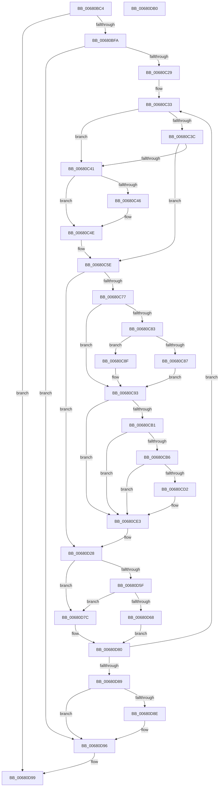

# MiEnableLargeSubsection

- RVA: `0x00680BC4`–`0x00680DB1` (길이 `493` bytes)
- VA: `0x0000000140680BC4`
- 실행 섹션: `.text`
- PDB 이름 있음: `예`; PDB Function 태그: `아니요`
- unwind 정보 RVA: `0x000D8214`
- 디코드: `135`개 명령, `493/493` bytes 표시
- 미해석 바이트: `0` (있으면 어셈블리에 `.byte`로 보존)

> 이 문서는 커널 이미지의 기계어와 PDB 기호를 분석해 생성했습니다. 4번과 5번은 함수 원형과 자료형을 바이너리 사용 방식에서 추정한 C 해석이며 원본 소스 복구 결과는 아닙니다.

## 1. Dependencies

- 직접 호출 지점: **10**; 고유 호출 대상: **8**
- 직접 호출자로 확인된 함수: **1**
- RIP 상대 이미지 참조: **2**

### Outgoing calls
- `0x00680BED` → [MiChargeLargeProtoSubsection](../../page/80/MiChargeLargeProtoSubsection_function_00800A24.md) (function, `0x00800A24`)
- `0x00680C10` → [MiMakeValidPte](../2C/MiMakeValidPte_function_002C5590.md) (function, `0x002C5590`)
- `0x00680C49` → [MiUnlockProtoPoolPage](../24/MiUnlockProtoPoolPage_function_00246090.md) (function, `0x00246090`)
- `0x00680C56` → [MiLockProtoPoolPageForce](../32/MiLockProtoPoolPageForce_function_00320E10.md) (function, `0x00320E10`)
- `0x00680C63` → [MiLockLeafPage](../36/MiLockLeafPage_function_003658C0.md) (function, `0x003658C0`)
- `0x00680CDE` → [MiCheckLinearProtectedPteAccessedBit](../29/MiCheckLinearProtectedPteAccessedBit_function_00292D80.md) (function, `0x00292D80`)
- `0x00680CF6` → [MiUnlinkPageFromListEx](../28/MiUnlinkPageFromListEx_function_00287590.md) (function, `0x00287590`)
- `0x00680D5F` → [KeShouldYieldProcessor](../27/KeShouldYieldProcessor_function_002773E0.md) (function, `0x002773E0`)
- `0x00680D6F` → [MiUnlockProtoPoolPage](../24/MiUnlockProtoPoolPage_function_00246090.md) (function, `0x00246090`)
- `0x00680D91` → [MiUnlockProtoPoolPage](../24/MiUnlockProtoPoolPage_function_00246090.md) (function, `0x00246090`)

### Direct callers
- [MiIncrementLargeSubsections](../4D/MiIncrementLargeSubsections_function_004D3410.md) at `0x004D34E1`

### Static image references
- `0x00680C77` → RVA `0x00E2DC80` (`.data`; read)
- `0x00680CA6` → RVA `0x00FC6A88` (`ALMOSTRO`; read)

## 2. Other-region calls and transfers

- 다른 실행 섹션으로 향하는 call: **1**
  - `0x00680BED` → [MiChargeLargeProtoSubsection](../../page/80/MiChargeLargeProtoSubsection_function_00800A24.md) (`.text` → `PAGE`)
- 별도 외부 분기/꼬리 이동을 확인하지 못했습니다.

## 3. Assembly (complete function range)

```asm
00680BC4  48 89 5C 24 18                  mov qword ptr [rsp + 0x18], rbx
00680BC9  48 89 6C 24 20                  mov qword ptr [rsp + 0x20], rbp
00680BCE  56                              push rsi
00680BCF  57                              push rdi
00680BD0  41 54                           push r12
00680BD2  41 55                           push r13
00680BD4  41 56                           push r14
00680BD6  48 83 EC 20                     sub rsp, 0x20
00680BDA  48 8B 79 08                     mov rdi, qword ptr [rcx + 8]
00680BDE  41 BC 01 00 00 00               mov r12d, 1
00680BE4  8B 71 2C                        mov esi, dword ptr [rcx + 0x2c]
00680BE7  41 8B D4                        mov edx, r12d
00680BEA  48 8B D9                        mov rbx, rcx
00680BED  E8 32 FE 17 00                  call 0x140800a24
00680BF2  85 C0                           test eax, eax
00680BF4  0F 84 9F 01 00 00               je 0x140680d99
00680BFA  44 8B 43 20                     mov r8d, dword ptr [rbx + 0x20]
00680BFE  4C 8D 34 F7                     lea r14, [rdi + rsi*8]
00680C02  41 D1 E8                        shr r8d, 1
00680C05  48 83 CA FF                     or rdx, 0xffffffffffffffff
00680C09  41 83 E0 1F                     and r8d, 0x1f
00680C0D  48 8B CF                        mov rcx, rdi
00680C10  E8 7B 49 C4 FF                  call 0x1402c5590
00680C15  33 F6                           xor esi, esi
00680C17  B2 11                           mov dl, 0x11
00680C19  88 54 24 50                     mov byte ptr [rsp + 0x50], dl
00680C1D  48 8B D8                        mov rbx, rax
00680C20  49 3B FE                        cmp rdi, r14
00680C23  0F 83 6D 01 00 00               jae 0x140680d96
00680C29  49 BD 00 00 00 00 00 00 00 C0   movabs r13, 0xc000000000000000
00680C33  48 F7 C7 FF 0F 00 00            test rdi, 0xfff
00680C3A  74 05                           je 0x140680c41
00680C3C  80 FA 11                        cmp dl, 0x11
00680C3F  75 1D                           jne 0x140680c5e
00680C41  80 FA 11                        cmp dl, 0x11
00680C44  74 08                           je 0x140680c4e
00680C46  48 8B CE                        mov rcx, rsi
00680C49  E8 42 54 BC FF                  call 0x140246090
00680C4E  48 8D 54 24 50                  lea rdx, [rsp + 0x50]
00680C53  48 8B CF                        mov rcx, rdi
00680C56  E8 B5 01 CA FF                  call 0x140320e10
00680C5B  48 8B F0                        mov rsi, rax
00680C5E  33 D2                           xor edx, edx
00680C60  48 8B CF                        mov rcx, rdi
00680C63  E8 58 4C CE FF                  call 0x1403658c0
00680C68  48 8B E8                        mov rbp, rax
00680C6B  48 8B 07                        mov rax, qword ptr [rdi]
00680C6E  41 84 C4                        test r12b, al
00680C71  0F 85 B1 00 00 00               jne 0x140680d28
00680C77  48 8B 0D 02 D0 7A 00            mov rcx, qword ptr [rip + 0x7ad002]
00680C7E  48 85 C9                        test rcx, rcx
00680C81  74 10                           je 0x140680c93
00680C83  A8 10                           test al, 0x10
00680C85  75 08                           jne 0x140680c8f
00680C87  48 F7 D1                        not rcx
00680C8A  48 23 C1                        and rax, rcx
00680C8D  EB 04                           jmp 0x140680c93
00680C8F  48 83 E0 EF                     and rax, 0xffffffffffffffef
00680C93  48 33 D8                        xor rbx, rax
00680C96  48 BA FF 0F 00 00 00 00 F0 FF   movabs rdx, 0xfff0000000000fff
00680CA0  48 23 DA                        and rbx, rdx
00680CA3  48 33 D8                        xor rbx, rax
00680CA6  48 0F BA 25 D9 5D 94 00 24      bt qword ptr [rip + 0x945dd9], 0x24
00680CAF  73 32                           jae 0x140680ce3
00680CB1  F6 C3 20                        test bl, 0x20
00680CB4  75 2D                           jne 0x140680ce3
00680CB6  48 B8 00 00 00 00 80 F6 FF FF   movabs rax, 0xfffff68000000000
00680CC0  48 B9 00 00 00 00 40 00 00 00   movabs rcx, 0x4000000000
00680CCA  48 03 C1                        add rax, rcx
00680CCD  48 3B F8                        cmp rdi, rax
00680CD0  72 11                           jb 0x140680ce3
00680CD2  41 B8 80 00 00 00               mov r8d, 0x80
00680CD8  48 8B D3                        mov rdx, rbx
00680CDB  48 8B CF                        mov rcx, rdi
00680CDE  E8 9D 20 C1 FF                  call 0x140292d80
00680CE3  48 89 1F                        mov qword ptr [rdi], rbx
00680CE6  33 D2                           xor edx, edx
00680CE8  48 8B 45 18                     mov rax, qword ptr [rbp + 0x18]
00680CEC  48 8B CD                        mov rcx, rbp
00680CEF  49 23 C5                        and rax, r13
00680CF2  48 89 45 18                     mov qword ptr [rbp + 0x18], rax
00680CF6  E8 95 68 C0 FF                  call 0x140287590
00680CFB  8B 45 20                        mov eax, dword ptr [rbp + 0x20]
00680CFE  89 44 24 58                     mov dword ptr [rsp + 0x58], eax
00680D02  C1 E8 10                        shr eax, 0x10
00680D05  24 FE                           and al, 0xfe
00680D07  0C 06                           or al, 6
00680D09  88 44 24 5A                     mov byte ptr [rsp + 0x5a], al
00680D0D  8B 44 24 58                     mov eax, dword ptr [rsp + 0x58]
00680D11  89 45 20                        mov dword ptr [rbp + 0x20], eax
00680D14  8B 45 20                        mov eax, dword ptr [rbp + 0x20]
00680D17  89 44 24 58                     mov dword ptr [rsp + 0x58], eax
00680D1B  66 44 01 64 24 58               add word ptr [rsp + 0x58], r12w
00680D21  8B 44 24 58                     mov eax, dword ptr [rsp + 0x58]
00680D25  89 45 20                        mov dword ptr [rbp + 0x20], eax
00680D28  48 8B 45 18                     mov rax, qword ptr [rbp + 0x18]
00680D2C  4C 8B C5                        mov r8, rbp
00680D2F  48 8D 48 01                     lea rcx, [rax + 1]
00680D33  48 8B D1                        mov rdx, rcx
00680D36  48 33 D0                        xor rdx, rax
00680D39  48 B8 FF FF FF FF FF FF FF 7F   movabs rax, 0x7fffffffffffffff
00680D43  49 23 D5                        and rdx, r13
00680D46  48 33 D1                        xor rdx, rcx
00680D49  48 89 55 18                     mov qword ptr [rbp + 0x18], rdx
00680D4D  F0 49 21 40 18                  lock and qword ptr [r8 + 0x18], rax
00680D52  48 83 C7 08                     add rdi, 8
00680D56  48 F7 C7 F8 01 00 00            test rdi, 0x1f8
00680D5D  75 1D                           jne 0x140680d7c
00680D5F  E8 7C 66 BF FF                  call 0x1402773e0
00680D64  85 C0                           test eax, eax
00680D66  74 14                           je 0x140680d7c
00680D68  8A 54 24 50                     mov dl, byte ptr [rsp + 0x50]
00680D6C  48 8B CE                        mov rcx, rsi
00680D6F  E8 1C 53 BC FF                  call 0x140246090
00680D74  B2 11                           mov dl, 0x11
00680D76  88 54 24 50                     mov byte ptr [rsp + 0x50], dl
00680D7A  EB 04                           jmp 0x140680d80
00680D7C  8A 54 24 50                     mov dl, byte ptr [rsp + 0x50]
00680D80  49 3B FE                        cmp rdi, r14
00680D83  0F 82 AA FE FF FF               jb 0x140680c33
00680D89  80 FA 11                        cmp dl, 0x11
00680D8C  74 08                           je 0x140680d96
00680D8E  48 8B CE                        mov rcx, rsi
00680D91  E8 FA 52 BC FF                  call 0x140246090
00680D96  41 8B C4                        mov eax, r12d
00680D99  48 8B 5C 24 60                  mov rbx, qword ptr [rsp + 0x60]
00680D9E  48 8B 6C 24 68                  mov rbp, qword ptr [rsp + 0x68]
00680DA3  48 83 C4 20                     add rsp, 0x20
00680DA7  41 5E                           pop r14
00680DA9  41 5D                           pop r13
00680DAB  41 5C                           pop r12
00680DAD  5F                              pop rdi
00680DAE  5E                              pop rsi
00680DAF  C3                              ret
00680DB0  CC                              int3
```

## 4. C-style interpretation (structured pseudocode)

```c
__int64 __fastcall MiEnableLargeSubsection(__int64 a1)
{
    __int64 result;
    __int64 v_rbx;
    __int64 v_rdi;
    __int64 v_rsi;
    __int64 v_rsp;
    unsigned int v_stack_p10;
    unsigned __int8 v_stack_p12;
    unsigned __int64 v_stack_p18;
    unsigned __int64 v_stack_p20;
    unsigned __int8 v_stack_p8;

    v_stack_p18 = v_rbx;
    v_stack_p20 = v_rbp;
    v_rsp = (v_rsp) - (32);
    result = MiChargeLargeProtoSubsection(a1, 1, a3, a4);
    if ((unsigned int)(result) == 0) goto loc_00680D99;
    a3 = (unsigned int)(((unsigned int)(*(unsigned int *)(a1 + 32))) >> (1));
    a2 = (1) | (-1);
    a3 = (unsigned int)((a3) & (31));
    result = MiMakeValidPte(*(unsigned __int64 *)(a1 + 8), a2, a3, a4);
    v_rsi = 0;
    v_stack_p8 = 17;
    if ((*(unsigned __int64 *)(a1 + 8)) >= (*(unsigned __int64 *)(a1 + 8) + (unsigned int)(*(unsigned int *)(a1 + 44)) * 8)) goto loc_00680D96;
loc_00680C33:
    if (((*(unsigned __int64 *)(a1 + 8)) & (0xFFFULL)) == 0) goto loc_00680C41;
    if (17 != 17) goto loc_00680C5E;
loc_00680C41:
    if (17 != 17) {
        a1 = 0;
        result = MiUnlockProtoPoolPage(a1, 17, a3, a4);
    }
    result = MiLockProtoPoolPageForce(*(unsigned __int64 *)(a1 + 8), v_stack_p8, a3, a4);
loc_00680C5E:
    a2 = 0;
    result = MiLockLeafPage(*(unsigned __int64 *)(a1 + 8), a2, a3, a4);
    if (((1) & ((unsigned __int8)(*(unsigned __int64 *)(*(unsigned __int64 *)(a1 + 8))))) != 0) goto loc_00680D28;
    if (*(unsigned __int64 *)(v_rip + 8048642) == 0) goto loc_00680C93;
    if ((((unsigned __int8)(*(unsigned __int64 *)(*(unsigned __int64 *)(a1 + 8)))) & (16)) != 0) goto loc_00680C8F;
    a1 = ~(*(unsigned __int64 *)(v_rip + 8048642));
    result = (*(unsigned __int64 *)(*(unsigned __int64 *)(a1 + 8))) & (a1);
    goto loc_00680C93;
loc_00680C8F:
    result = (result) & (-17);
loc_00680C93:
    v_rbx = (result) ^ (result);
    v_rbx = (v_rbx) & (0);
    v_rbx = (v_rbx) ^ (result);
    if (condition_is_above_or_equal) goto loc_00680CE3;
    if ((((unsigned __int8)(v_rbx)) & (32)) != 0) goto loc_00680CE3;
    result = (result) + (a1);
    if ((*(unsigned __int64 *)(a1 + 8)) >= result) {
        a3 = 128;
        a2 = v_rbx;
        a1 = *(unsigned __int64 *)(a1 + 8);
        result = MiCheckLinearProtectedPteAccessedBit(a1, a2, a3, a4);
    }
    *(unsigned __int64 *)(*(unsigned __int64 *)(a1 + 8)) = v_rbx;
    a2 = 0;
    result = (*(unsigned __int64 *)(result + 24)) & (v_r13);
    *(unsigned __int64 *)(result + 24) = result;
    result = MiUnlinkPageFromListEx(result, a2, a3, a4);
    v_stack_p10 = (unsigned int)((unsigned int)(*(unsigned int *)(result + 32)));
    result = (unsigned int)(((unsigned int)(*(unsigned int *)(result + 32))) >> (16));
    result = (unsigned __int8)((result) & (254));
    result = (unsigned __int8)((result) | (6));
    v_stack_p12 = (unsigned __int8)(result);
    *(unsigned int *)(result + 32) = (unsigned int)((unsigned int)(v_stack_p10));
    v_stack_p10 = (unsigned int)((unsigned int)(*(unsigned int *)(result + 32)));
    *(unsigned int *)(result + 32) = (unsigned int)((unsigned int)(v_stack_p10));
loc_00680D28:
    a2 = (*(unsigned __int64 *)(result + 24) + 1) ^ (*(unsigned __int64 *)(result + 24));
    a2 = (a2) & (v_r13);
    a2 = (a2) ^ (*(unsigned __int64 *)(result + 24) + 1);
    *(unsigned __int64 *)(result + 24) = a2;
    v_rdi = (*(unsigned __int64 *)(a1 + 8)) + (8);
    if (((v_rdi) & (504)) != 0) goto loc_00680D7C;
    result = KeShouldYieldProcessor(*(unsigned __int64 *)(result + 24) + 1, a2, result, a4);
    if ((unsigned int)(result) == 0) goto loc_00680D7C;
    result = MiUnlockProtoPoolPage(result, v_stack_p8, result, a4);
    v_stack_p8 = 17;
    goto loc_00680D80;
loc_00680D7C:
loc_00680D80:
    if (v_rdi < (*(unsigned __int64 *)(a1 + 8) + (unsigned int)(*(unsigned int *)(a1 + 44)) * 8)) goto loc_00680C33;
    if (((unsigned __int8)(v_stack_p8)) != 17) {
        a1 = result;
        result = MiUnlockProtoPoolPage(a1, v_stack_p8, result, a4);
    }
loc_00680D99:
    v_rsp = (v_rsp) + (32);
    return 1;
}
```

## 5. (Beta) C Style

```c
int64_t MiEnableLargeSubsection(void *Arg1)
{
    uint8_t *arg1 = (uint8_t *)Arg1;

    int64_t result;
    int64_t local_rbx;
    int64_t local_rdi;
    int64_t local_rsi;
    int64_t local_rsp;
    uint32_t v_stack_p10;
    uint8_t v_stack_p12;
    uint64_t v_stack_p18;
    uint64_t v_stack_p20;
    uint8_t v_stack_p8;

    v_stack_p18 = local_rbx;
    v_stack_p20 = local_rbp;
    local_rsp = (local_rsp) - (32);
    result = MiChargeLargeProtoSubsection(Arg1, 1, a3, a4);
    if ((uint32_t)(result) == 0) goto loc_00680D99;
    a3 = (uint32_t)(((uint32_t)(*(uint32_t *)(arg1 + 0x20))) >> (1));
    a2 = (1) | (-1);
    a3 = (uint32_t)((a3) & (31));
    result = MiMakeValidPte(*(uint64_t *)(arg1 + 0x8), a2, a3, a4);
    local_rsi = 0;
    v_stack_p8 = 17;
    if ((*(uint64_t *)(arg1 + 0x8)) >= (*(uint64_t *)(arg1 + 0x8) + (uint32_t)(*(uint32_t *)(arg1 + 0x2C)) * 8)) goto loc_00680D96;
loc_00680C33:
    if (((*(uint64_t *)(arg1 + 0x8)) & (0xFFFULL)) == 0) goto loc_00680C41;
    if (17 != 17) goto loc_00680C5E;
loc_00680C41:
    if (17 != 17) {
        Arg1 = 0;
        result = MiUnlockProtoPoolPage(Arg1, 17, a3, a4);
    }
    result = MiLockProtoPoolPageForce(*(uint64_t *)(arg1 + 0x8), v_stack_p8, a3, a4);
loc_00680C5E:
    a2 = 0;
    result = MiLockLeafPage(*(uint64_t *)(arg1 + 0x8), a2, a3, a4);
    if (((1) & ((uint8_t)(*(uint64_t *)(*(uint64_t *)(arg1 + 0x8))))) != 0) goto loc_00680D28;
    if (*(uint64_t *)(v_rip + 0x7AD002) == 0) goto loc_00680C93;
    if ((((uint8_t)(*(uint64_t *)(*(uint64_t *)(arg1 + 0x8)))) & (16)) != 0) goto loc_00680C8F;
    Arg1 = ~(*(uint64_t *)(v_rip + 0x7AD002));
    result = (*(uint64_t *)(*(uint64_t *)(arg1 + 0x8))) & (Arg1);
    goto loc_00680C93;
loc_00680C8F:
    result = (result) & (-17);
loc_00680C93:
    local_rbx = (result) ^ (result);
    local_rbx = (local_rbx) & (0);
    local_rbx = (local_rbx) ^ (result);
    if (condition_is_above_or_equal) goto loc_00680CE3;
    if ((((uint8_t)(local_rbx)) & (32)) != 0) goto loc_00680CE3;
    result = (result) + (Arg1);
    if ((*(uint64_t *)(arg1 + 0x8)) >= result) {
        a3 = 128;
        a2 = local_rbx;
        Arg1 = *(uint64_t *)(arg1 + 0x8);
        result = MiCheckLinearProtectedPteAccessedBit(Arg1, a2, a3, a4);
    }
    *(uint64_t *)(*(uint64_t *)(arg1 + 0x8)) = local_rbx;
    a2 = 0;
    result = (*(uint64_t *)(result + 0x18)) & (local_r13);
    *(uint64_t *)(result + 0x18) = result;
    result = MiUnlinkPageFromListEx(result, a2, a3, a4);
    v_stack_p10 = (uint32_t)((uint32_t)(*(uint32_t *)(result + 0x20)));
    result = (uint32_t)(((uint32_t)(*(uint32_t *)(result + 0x20))) >> (16));
    result = (uint8_t)((result) & (254));
    result = (uint8_t)((result) | (6));
    v_stack_p12 = (uint8_t)(result);
    *(uint32_t *)(result + 0x20) = (uint32_t)((uint32_t)(v_stack_p10));
    v_stack_p10 = (uint32_t)((uint32_t)(*(uint32_t *)(result + 0x20)));
    *(uint32_t *)(result + 0x20) = (uint32_t)((uint32_t)(v_stack_p10));
loc_00680D28:
    a2 = (*(uint64_t *)(result + 0x18) + 1) ^ (*(uint64_t *)(result + 0x18));
    a2 = (a2) & (local_r13);
    a2 = (a2) ^ (*(uint64_t *)(result + 0x18) + 1);
    *(uint64_t *)(result + 0x18) = a2;
    local_rdi = (*(uint64_t *)(arg1 + 0x8)) + (8);
    if (((local_rdi) & (504)) != 0) goto loc_00680D7C;
    result = KeShouldYieldProcessor(*(uint64_t *)(result + 0x18) + 1, a2, result, a4);
    if ((uint32_t)(result) == 0) goto loc_00680D7C;
    result = MiUnlockProtoPoolPage(result, v_stack_p8, result, a4);
    v_stack_p8 = 17;
    goto loc_00680D80;
loc_00680D7C:
loc_00680D80:
    if (local_rdi < (*(uint64_t *)(arg1 + 0x8) + (uint32_t)(*(uint32_t *)(arg1 + 0x2C)) * 8)) goto loc_00680C33;
    if (((uint8_t)(v_stack_p8)) != 17) {
        Arg1 = result;
        result = MiUnlockProtoPoolPage(Arg1, v_stack_p8, result, a4);
    }
loc_00680D99:
    local_rsp = (local_rsp) + (32);
    return 1;
}
```

### 관측된 메모리 오프셋

구조체 형식이 확인되지 않은 접근은 인자 기준의 오프셋으로만 기록했습니다.

| 기준 인자 | 오프셋 표현 | 폭 (bit) | 접근 |
|---|---:|---:|---|
| `Arg1` | `+ 0x8` | `64` | `R` |
| `Arg1` | `+ 0x20` | `32` | `R` |
| `Arg1` | `+ 0x2C` | `32` | `R` |

## 6. Execution-region graph

[열기: 2D/3D 그래프와 함수 탐색 컨트롤 패널](../../../control-panel.html?section=text&rva=0x00680BC4&view=graph)

- 2D 그래프는 위에서 아래로 흐르고, 3D 그래프는 빈 공간을 드래그해 회전합니다. Shift+드래그는 이동, 휠은 확대·축소, 함수 노드 선택은 대상 보고서 이동입니다.

### Static fallback


