# MiEstablishDefragSlabEntries

- RVA: `0x0068E0EC`–`0x0068E45C` (길이 `880` bytes)
- VA: `0x000000014068E0EC`
- 실행 섹션: `.text`
- PDB 이름 있음: `예`; PDB Function 태그: `아니요`
- unwind 정보 RVA: `0x000BEDC8`
- 디코드: `253`개 명령, `880/880` bytes 표시
- 미해석 바이트: `0` (있으면 어셈블리에 `.byte`로 보존)

> 이 문서는 커널 이미지의 기계어와 PDB 기호를 분석해 생성했습니다. 4번과 5번은 함수 원형과 자료형을 바이너리 사용 방식에서 추정한 C 해석이며 원본 소스 복구 결과는 아닙니다.

## 1. Dependencies

- 직접 호출 지점: **15**; 고유 호출 대상: **9**
- 직접 호출자로 확인된 함수: **1**
- RIP 상대 이미지 참조: **1**

### Outgoing calls
- `0x0068E113` → [MiLockUnlockSlabContextsForDefrag](MiLockUnlockSlabContextsForDefrag_function_0068EDA4.md) (function, `0x0068EDA4`)
- `0x0068E140` → [MiEnumerateSlabAllocatorsEx](../47/MiEnumerateSlabAllocatorsEx_function_004746F8.md) (function, `0x004746F8`)
- `0x0068E163` → [MiDetermineDefragmentSlabIdentity](MiDetermineDefragmentSlabIdentity_function_0068E02C.md) (function, `0x0068E02C`)
- `0x0068E19D` → [MiEnumerateSlabAllocatorsEx](../47/MiEnumerateSlabAllocatorsEx_function_004746F8.md) (function, `0x004746F8`)
- `0x0068E212` → [MiRemoveSlabEntry](../44/MiRemoveSlabEntry_function_0044CF08.md) (function, `0x0044CF08`)
- `0x0068E261` → [MiFindDefragmentSlabEntries](MiFindDefragmentSlabEntries_function_0068E464.md) (function, `0x0068E464`)
- `0x0068E2C1` → [MiClearHintSlabEntry](../44/MiClearHintSlabEntry_function_0044CFFC.md) (function, `0x0044CFFC`)
- `0x0068E35B` → [MiLockUnlockSlabContextsForDefrag](MiLockUnlockSlabContextsForDefrag_function_0068EDA4.md) (function, `0x0068EDA4`)
- `0x0068E37A` → [MiPurgeSlabEntry](../48/MiPurgeSlabEntry_function_0048D444.md) (function, `0x0048D444`)
- `0x0068E39F` → [MiPurgeSlabEntry](../48/MiPurgeSlabEntry_function_0048D444.md) (function, `0x0048D444`)
- `0x0068E3B5` → [MiFreeSlabEntry](../2D/MiFreeSlabEntry_function_002DC650.md) (function, `0x002DC650`)
- `0x0068E3C7` → [MiReleaseFreshPage](../33/MiReleaseFreshPage_function_00334AE0.md) (function, `0x00334AE0`)
- `0x0068E3DC` → [MiLockUnlockSlabContextsForDefrag](MiLockUnlockSlabContextsForDefrag_function_0068EDA4.md) (function, `0x0068EDA4`)
- `0x0068E407` → [MiDetermineDefragmentSlabIdentity](MiDetermineDefragmentSlabIdentity_function_0068E02C.md) (function, `0x0068E02C`)
- `0x0068E43C` → [MiEnumerateSlabAllocatorsEx](../47/MiEnumerateSlabAllocatorsEx_function_004746F8.md) (function, `0x004746F8`)

### Direct callers
- [MiDefragmentSlabWorker](MiDefragmentSlabWorker_function_0068D730.md) at `0x0068D82B`

### Static image references
- `0x0068E12B` → RVA `0x0068F1F0` (`MiSlabContextDefragInProgress`; read)

## 2. Other-region calls and transfers

- 다른 실행 섹션으로 향하는 call: **0**
- 별도 외부 분기/꼬리 이동을 확인하지 못했습니다.

## 3. Assembly (complete function range)

```asm
0068E0EC  48 89 5C 24 20                  mov qword ptr [rsp + 0x20], rbx
0068E0F1  55                              push rbp
0068E0F2  56                              push rsi
0068E0F3  57                              push rdi
0068E0F4  41 54                           push r12
0068E0F6  41 55                           push r13
0068E0F8  41 56                           push r14
0068E0FA  41 57                           push r15
0068E0FC  48 83 EC 30                     sub rsp, 0x30
0068E100  44 8B 79 4C                     mov r15d, dword ptr [rcx + 0x4c]
0068E104  45 33 C0                        xor r8d, r8d
0068E107  48 8B D9                        mov rbx, rcx
0068E10A  44 89 7C 24 70                  mov dword ptr [rsp + 0x70], r15d
0068E10F  41 8D 50 01                     lea edx, [r8 + 1]
0068E113  E8 8C 0C 00 00                  call 0x14068eda4
0068E118  48 8D 73 28                     lea rsi, [rbx + 0x28]
0068E11C  45 33 E4                        xor r12d, r12d
0068E11F  4C 39 26                        cmp qword ptr [rsi], r12
0068E122  0F 85 84 00 00 00               jne 0x14068e1ac
0068E128  8B 43 48                        mov eax, dword ptr [rbx + 0x48]
0068E12B  48 8D 15 BE 10 00 00            lea rdx, [rip + 0x10be]
0068E132  44 8B 4B 44                     mov r9d, dword ptr [rbx + 0x44]
0068E136  45 33 C0                        xor r8d, r8d
0068E139  48 8B 0B                        mov rcx, qword ptr [rbx]
0068E13C  89 44 24 20                     mov dword ptr [rsp + 0x20], eax
0068E140  E8 B3 65 DE FF                  call 0x1404746f8
0068E145  85 C0                           test eax, eax
0068E147  74 0A                           je 0x14068e153
0068E149  B8 76 04 00 C0                  mov eax, 0xc0000476
0068E14E  E9 F0 02 00 00                  jmp 0x14068e443
0068E153  83 4B 54 10                     or dword ptr [rbx + 0x54], 0x10
0068E157  48 8B FE                        mov rdi, rsi
0068E15A  83 7B 48 08                     cmp dword ptr [rbx + 0x48], 8
0068E15E  75 16                           jne 0x14068e176
0068E160  48 8B CB                        mov rcx, rbx
0068E163  E8 C4 FE FF FF                  call 0x14068e02c
0068E168  80 7B 58 FF                     cmp byte ptr [rbx + 0x58], 0xff
0068E16C  0F 84 CF 02 00 00               je 0x14068e441
0068E172  48 8D 7B 28                     lea rdi, [rbx + 0x28]
0068E176  48 8B 43 08                     mov rax, qword ptr [rbx + 8]
0068E17A  48 8D 15 6F 10 00 00            lea rdx, [rip + 0x106f]
0068E181  44 8B 4B 44                     mov r9d, dword ptr [rbx + 0x44]
0068E185  4C 8B C3                        mov r8, rbx
0068E188  48 8B 0B                        mov rcx, qword ptr [rbx]
0068E18B  48 89 06                        mov qword ptr [rsi], rax
0068E18E  48 8B 43 10                     mov rax, qword ptr [rbx + 0x10]
0068E192  48 89 43 30                     mov qword ptr [rbx + 0x30], rax
0068E196  8B 43 48                        mov eax, dword ptr [rbx + 0x48]
0068E199  89 44 24 20                     mov dword ptr [rsp + 0x20], eax
0068E19D  E8 56 65 DE FF                  call 0x1404746f8
0068E1A2  4C 89 26                        mov qword ptr [rsi], r12
0068E1A5  48 8B F7                        mov rsi, rdi
0068E1A8  4C 89 63 30                     mov qword ptr [rbx + 0x30], r12
0068E1AC  4C 89 64 24 78                  mov qword ptr [rsp + 0x78], r12
0068E1B1  4C 89 A4 24 80 00 00 00         mov qword ptr [rsp + 0x80], r12
0068E1B9  4C 8B 06                        mov r8, qword ptr [rsi]
0068E1BC  4D 85 C0                        test r8, r8
0068E1BF  0F 84 99 00 00 00               je 0x14068e25e
0068E1C5  4C 8D 73 20                     lea r14, [rbx + 0x20]
0068E1C9  49 8B 06                        mov rax, qword ptr [r14]
0068E1CC  48 8D 7B 30                     lea rdi, [rbx + 0x30]
0068E1D0  48 8B 17                        mov rdx, qword ptr [rdi]
0068E1D3  48 39 50 38                     cmp qword ptr [rax + 0x38], rdx
0068E1D7  74 0C                           je 0x14068e1e5
0068E1D9  83 4B 54 02                     or dword ptr [rbx + 0x54], 2
0068E1DD  4C 89 27                        mov qword ptr [rdi], r12
0068E1E0  E9 89 00 00 00                  jmp 0x14068e26e
0068E1E5  48 8B 43 18                     mov rax, qword ptr [rbx + 0x18]
0068E1E9  4C 39 40 30                     cmp qword ptr [rax + 0x30], r8
0068E1ED  74 17                           je 0x14068e206
0068E1EF  4C 89 26                        mov qword ptr [rsi], r12
0068E1F2  F6 40 30 01                     test byte ptr [rax + 0x30], 1
0068E1F6  74 06                           je 0x14068e1fe
0068E1F8  83 4B 54 02                     or dword ptr [rbx + 0x54], 2
0068E1FC  EB 70                           jmp 0x14068e26e
0068E1FE  83 7B 44 FF                     cmp dword ptr [rbx + 0x44], -1
0068E202  75 6A                           jne 0x14068e26e
0068E204  EB 28                           jmp 0x14068e22e
0068E206  45 39 78 54                     cmp dword ptr [r8 + 0x54], r15d
0068E20A  75 1C                           jne 0x14068e228
0068E20C  48 8B 0B                        mov rcx, qword ptr [rbx]
0068E20F  48 8B D0                        mov rdx, rax
0068E212  E8 F1 EC DB FF                  call 0x14044cf08
0068E217  48 8B 06                        mov rax, qword ptr [rsi]
0068E21A  83 4B 54 02                     or dword ptr [rbx + 0x54], 2
0068E21E  48 89 44 24 78                  mov qword ptr [rsp + 0x78], rax
0068E223  4C 89 26                        mov qword ptr [rsi], r12
0068E226  EB 46                           jmp 0x14068e26e
0068E228  44 39 7B 40                     cmp dword ptr [rbx + 0x40], r15d
0068E22C  72 0B                           jb 0x14068e239
0068E22E  83 4B 54 10                     or dword ptr [rbx + 0x54], 0x10
0068E232  48 8D 7B 30                     lea rdi, [rbx + 0x30]
0068E236  4C 89 26                        mov qword ptr [rsi], r12
0068E239  48 8B CA                        mov rcx, rdx
0068E23C  4C 39 63 38                     cmp qword ptr [rbx + 0x38], r12
0068E240  75 0C                           jne 0x14068e24e
0068E242  44 39 62 54                     cmp dword ptr [rdx + 0x54], r12d
0068E246  75 06                           jne 0x14068e24e
0068E248  4C 89 27                        mov qword ptr [rdi], r12
0068E24B  49 8B CC                        mov rcx, r12
0068E24E  8B 43 54                        mov eax, dword ptr [rbx + 0x54]
0068E251  A8 10                           test al, 0x10
0068E253  75 09                           jne 0x14068e25e
0068E255  48 85 C9                        test rcx, rcx
0068E258  0F 85 E3 01 00 00               jne 0x14068e441
0068E25E  48 8B CB                        mov rcx, rbx
0068E261  E8 FE 01 00 00                  call 0x14068e464
0068E266  4C 8D 73 20                     lea r14, [rbx + 0x20]
0068E26A  48 8D 7B 30                     lea rdi, [rbx + 0x30]
0068E26E  48 8B 4B 18                     mov rcx, qword ptr [rbx + 0x18]
0068E272  48 85 C9                        test rcx, rcx
0068E275  74 13                           je 0x14068e28a
0068E277  48 8B 43 08                     mov rax, qword ptr [rbx + 8]
0068E27B  48 89 41 30                     mov qword ptr [rcx + 0x30], rax
0068E27F  49 8B 0E                        mov rcx, qword ptr [r14]
0068E282  48 8B 43 10                     mov rax, qword ptr [rbx + 0x10]
0068E286  48 89 41 38                     mov qword ptr [rcx + 0x38], rax
0068E28A  48 8B 16                        mov rdx, qword ptr [rsi]
0068E28D  45 33 DB                        xor r11d, r11d
0068E290  45 8B FC                        mov r15d, r12d
0068E293  41 8B EC                        mov ebp, r12d
0068E296  45 8B EB                        mov r13d, r11d
0068E299  48 85 D2                        test rdx, rdx
0068E29C  0F 84 87 00 00 00               je 0x14068e329
0068E2A2  4C 8D 53 30                     lea r10, [rbx + 0x30]
0068E2A6  49 8B 02                        mov rax, qword ptr [r10]
0068E2A9  49 8B FA                        mov rdi, r10
0068E2AC  48 85 C0                        test rax, rax
0068E2AF  74 78                           je 0x14068e329
0068E2B1  48 3B D0                        cmp rdx, rax
0068E2B4  74 73                           je 0x14068e329
0068E2B6  8B 43 54                        mov eax, dword ptr [rbx + 0x54]
0068E2B9  A8 10                           test al, 0x10
0068E2BB  74 11                           je 0x14068e2ce
0068E2BD  48 8B 4A 38                     mov rcx, qword ptr [rdx + 0x38]
0068E2C1  E8 36 ED DB FF                  call 0x14044cffc
0068E2C6  44 89 5B 40                     mov dword ptr [rbx + 0x40], r11d
0068E2CA  4C 8D 73 20                     lea r14, [rbx + 0x20]
0068E2CE  49 8B 02                        mov rax, qword ptr [r10]
0068E2D1  BF 01 00 00 00                  mov edi, 1
0068E2D6  4C 8B 06                        mov r8, qword ptr [rsi]
0068E2D9  49 8B 50 38                     mov rdx, qword ptr [r8 + 0x38]
0068E2DD  48 89 53 18                     mov qword ptr [rbx + 0x18], rdx
0068E2E1  48 8B 48 38                     mov rcx, qword ptr [rax + 0x38]
0068E2E5  49 89 0E                        mov qword ptr [r14], rcx
0068E2E8  4C 89 42 30                     mov qword ptr [rdx + 0x30], r8
0068E2EC  49 8B 0E                        mov rcx, qword ptr [r14]
0068E2EF  49 8B 02                        mov rax, qword ptr [r10]
0068E2F2  4C 8B B4 24 80 00 00 00         mov r14, qword ptr [rsp + 0x80]
0068E2FA  48 89 41 38                     mov qword ptr [rcx + 0x38], rax
0068E2FE  B9 00 02 00 00                  mov ecx, 0x200
0068E303  48 8B 06                        mov rax, qword ptr [rsi]
0068E306  09 48 5C                        or dword ptr [rax + 0x5c], ecx
0068E309  49 8B 02                        mov rax, qword ptr [r10]
0068E30C  09 48 5C                        or dword ptr [rax + 0x5c], ecx
0068E30F  09 7B 54                        or dword ptr [rbx + 0x54], edi
0068E312  48 8B 06                        mov rax, qword ptr [rsi]
0068E315  4C 8B 60 28                     mov r12, qword ptr [rax + 0x28]
0068E319  44 8B 78 58                     mov r15d, dword ptr [rax + 0x58]
0068E31D  49 8B 02                        mov rax, qword ptr [r10]
0068E320  4C 8B 68 28                     mov r13, qword ptr [rax + 0x28]
0068E324  8B 68 58                        mov ebp, dword ptr [rax + 0x58]
0068E327  EB 2A                           jmp 0x14068e353
0068E329  48 8B 43 08                     mov rax, qword ptr [rbx + 8]
0068E32D  48 89 06                        mov qword ptr [rsi], rax
0068E330  48 8B 43 10                     mov rax, qword ptr [rbx + 0x10]
0068E334  4D 89 1E                        mov qword ptr [r14], r11
0068E337  4C 8B 73 38                     mov r14, qword ptr [rbx + 0x38]
0068E33B  48 89 07                        mov qword ptr [rdi], rax
0068E33E  BF 01 00 00 00                  mov edi, 1
0068E343  4C 89 5B 18                     mov qword ptr [rbx + 0x18], r11
0068E347  4C 89 B4 24 80 00 00 00         mov qword ptr [rsp + 0x80], r14
0068E34F  4C 89 5B 38                     mov qword ptr [rbx + 0x38], r11
0068E353  44 8B C7                        mov r8d, edi
0068E356  33 D2                           xor edx, edx
0068E358  48 8B CB                        mov rcx, rbx
0068E35B  E8 44 0A 00 00                  call 0x14068eda4
0068E360  45 85 FF                        test r15d, r15d
0068E363  74 1C                           je 0x14068e381
0068E365  45 8B C7                        mov r8d, r15d
0068E368  44 8B CF                        mov r9d, edi
0068E36B  44 8B 7C 24 70                  mov r15d, dword ptr [rsp + 0x70]
0068E370  49 8B CC                        mov rcx, r12
0068E373  49 8D 57 FF                     lea rdx, [r15 - 1]
0068E377  49 03 D4                        add rdx, r12
0068E37A  E8 C5 F0 DF FF                  call 0x14048d444
0068E37F  EB 05                           jmp 0x14068e386
0068E381  44 8B 7C 24 70                  mov r15d, dword ptr [rsp + 0x70]
0068E386  45 33 E4                        xor r12d, r12d
0068E389  85 ED                           test ebp, ebp
0068E38B  74 17                           je 0x14068e3a4
0068E38D  41 8B D7                        mov edx, r15d
0068E390  44 8B CF                        mov r9d, edi
0068E393  48 FF CA                        dec rdx
0068E396  44 8B C5                        mov r8d, ebp
0068E399  49 03 D5                        add rdx, r13
0068E39C  49 8B CD                        mov rcx, r13
0068E39F  E8 A0 F0 DF FF                  call 0x14048d444
0068E3A4  48 8B 6C 24 78                  mov rbp, qword ptr [rsp + 0x78]
0068E3A9  48 85 ED                        test rbp, rbp
0068E3AC  74 11                           je 0x14068e3bf
0068E3AE  48 8B 4D 38                     mov rcx, qword ptr [rbp + 0x38]
0068E3B2  48 8B D5                        mov rdx, rbp
0068E3B5  E8 96 E2 C4 FF                  call 0x1402dc650
0068E3BA  4C 89 64 24 78                  mov qword ptr [rsp + 0x78], r12
0068E3BF  4D 85 F6                        test r14, r14
0068E3C2  74 10                           je 0x14068e3d4
0068E3C4  49 8B CE                        mov rcx, r14
0068E3C7  E8 14 67 CA FF                  call 0x140334ae0
0068E3CC  4C 89 A4 24 80 00 00 00         mov qword ptr [rsp + 0x80], r12
0068E3D4  44 8B C7                        mov r8d, edi
0068E3D7  8B D7                           mov edx, edi
0068E3D9  48 8B CB                        mov rcx, rbx
0068E3DC  E8 C3 09 00 00                  call 0x14068eda4
0068E3E1  48 8B 43 08                     mov rax, qword ptr [rbx + 8]
0068E3E5  48 39 06                        cmp qword ptr [rsi], rax
0068E3E8  75 31                           jne 0x14068e41b
0068E3EA  83 7B 48 08                     cmp dword ptr [rbx + 0x48], 8
0068E3EE  4C 89 26                        mov qword ptr [rsi], r12
0068E3F1  4C 89 63 30                     mov qword ptr [rbx + 0x30], r12
0068E3F5  75 2D                           jne 0x14068e424
0068E3F7  8B 43 54                        mov eax, dword ptr [rbx + 0x54]
0068E3FA  A8 02                           test al, 2
0068E3FC  75 26                           jne 0x14068e424
0068E3FE  80 7B 58 FF                     cmp byte ptr [rbx + 0x58], 0xff
0068E402  74 20                           je 0x14068e424
0068E404  48 8B CB                        mov rcx, rbx
0068E407  E8 20 FC FF FF                  call 0x14068e02c
0068E40C  80 7B 58 FF                     cmp byte ptr [rbx + 0x58], 0xff
0068E410  74 12                           je 0x14068e424
0068E412  83 4B 54 10                     or dword ptr [rbx + 0x54], 0x10
0068E416  E9 9E FD FF FF                  jmp 0x14068e1b9
0068E41B  83 63 54 EF                     and dword ptr [rbx + 0x54], 0xffffffef
0068E41F  E9 95 FD FF FF                  jmp 0x14068e1b9
0068E424  8B 43 48                        mov eax, dword ptr [rbx + 0x48]
0068E427  48 8D 15 C2 0D 00 00            lea rdx, [rip + 0xdc2]
0068E42E  44 8B 4B 44                     mov r9d, dword ptr [rbx + 0x44]
0068E432  4C 8B C3                        mov r8, rbx
0068E435  48 8B 0B                        mov rcx, qword ptr [rbx]
0068E438  89 44 24 20                     mov dword ptr [rsp + 0x20], eax
0068E43C  E8 B7 62 DE FF                  call 0x1404746f8
0068E441  33 C0                           xor eax, eax
0068E443  48 8B 9C 24 88 00 00 00         mov rbx, qword ptr [rsp + 0x88]
0068E44B  48 83 C4 30                     add rsp, 0x30
0068E44F  41 5F                           pop r15
0068E451  41 5E                           pop r14
0068E453  41 5D                           pop r13
0068E455  41 5C                           pop r12
0068E457  5F                              pop rdi
0068E458  5E                              pop rsi
0068E459  5D                              pop rbp
0068E45A  C3                              ret
0068E45B  CC                              int3
```

## 4. C-style interpretation (structured pseudocode)

```c
__int64 __fastcall MiEstablishDefragSlabEntries(__int64 a1, __int64 a2, int a3)
{
    __int64 result;
    __int64 v_r11;
    __int64 v_r12;
    __int64 v_r14;
    __int64 v_rdi;
    __int64 v_rsp;
    unsigned int v_stack_m48;
    unsigned __int64 v_stack_p10;
    unsigned __int64 v_stack_p18;
    unsigned __int64 v_stack_p20;
    unsigned int v_stack_p8;

    v_stack_p20 = v_rbx;
    v_rsp = (v_rsp) - (48);
    a3 = 0;
    v_stack_p8 = (unsigned int)((unsigned int)(*(unsigned int *)(a1 + 76)));
    result = MiLockUnlockSlabContextsForDefrag(a1, a3 + 1, a3, a4);
    v_r12 = 0;
    if ((*(unsigned __int64 *)(a1 + 40)) != 0) goto loc_0068E1AC;
    a3 = 0;
    v_stack_m48 = (unsigned int)((unsigned int)(*(unsigned int *)(a1 + 72)));
    result = MiEnumerateSlabAllocatorsEx(*(unsigned __int64 *)(a1), v_rip + 4286, a3, (unsigned int)(*(unsigned int *)(a1 + 68)));
    if ((unsigned int)(result) == 0) goto loc_0068E153;
    goto loc_0068E443;
loc_0068E153:
    if ((*(unsigned int *)(a1 + 72)) != 8) goto loc_0068E176;
    result = MiDetermineDefragmentSlabIdentity(a1, v_rip + 4286, a3, (unsigned int)(*(unsigned int *)(a1 + 68)));
    if ((*(unsigned __int8 *)(a1 + 88)) == 255) goto loc_0068E441;
loc_0068E176:
    *(unsigned __int64 *)(a1 + 40) = *(unsigned __int64 *)(a1 + 8);
    *(unsigned __int64 *)(a1 + 48) = *(unsigned __int64 *)(a1 + 16);
    v_stack_m48 = (unsigned int)((unsigned int)(*(unsigned int *)(a1 + 72)));
    result = MiEnumerateSlabAllocatorsEx(*(unsigned __int64 *)(a1), v_rip + 4207, a1, (unsigned int)(*(unsigned int *)(a1 + 68)));
    *(unsigned __int64 *)(a1 + 40) = 0;
    *(unsigned __int64 *)(a1 + 48) = 0;
loc_0068E1AC:
    v_stack_p10 = 0;
    v_stack_p18 = 0;
loc_0068E1B9:
    if (*(unsigned __int64 *)(a1 + 40) == 0) goto loc_0068E25E;
    if ((*(unsigned __int64 *)(*(unsigned __int64 *)(a1 + 32) + 56)) == (*(unsigned __int64 *)(a1 + 48))) goto loc_0068E1E5;
    *(unsigned __int64 *)(a1 + 48) = 0;
    goto loc_0068E26E;
loc_0068E1E5:
    if ((*(unsigned __int64 *)(*(unsigned __int64 *)(a1 + 24) + 48)) == (*(unsigned __int64 *)(a1 + 40))) goto loc_0068E206;
    *(unsigned __int64 *)(a1 + 40) = 0;
    if (((*(unsigned __int8 *)(*(unsigned __int64 *)(a1 + 24) + 48)) & (1)) == 0) goto loc_0068E1FE;
    goto loc_0068E26E;
loc_0068E1FE:
    if ((*(unsigned int *)(a1 + 68)) != -1) goto loc_0068E26E;
    goto loc_0068E22E;
loc_0068E206:
    if ((*(unsigned int *)(*(unsigned __int64 *)(a1 + 40) + 84)) != ((unsigned int)((unsigned int)(*(unsigned int *)(a1 + 76))))) goto loc_0068E228;
    result = MiRemoveSlabEntry(*(unsigned __int64 *)(a1), *(unsigned __int64 *)(a1 + 24), *(unsigned __int64 *)(a1 + 40), (unsigned int)(*(unsigned int *)(a1 + 68)));
    v_stack_p10 = *(unsigned __int64 *)(a1 + 40);
    *(unsigned __int64 *)(a1 + 40) = 0;
    goto loc_0068E26E;
loc_0068E228:
    v_rdi = a1 + 48;
    if ((*(unsigned int *)(a1 + 64)) >= ((unsigned int)((unsigned int)(*(unsigned int *)(a1 + 76))))) {
        v_rdi = a1 + 48;
        *(unsigned __int64 *)(a1 + 40) = 0;
    }
    if ((*(unsigned __int64 *)(a1 + 56)) != 0) goto loc_0068E24E;
    if ((*(unsigned int *)(*(unsigned __int64 *)(a1 + 24) + 84)) == 0) {
        *(unsigned __int64 *)(v_rdi) = 0;
        a1 = 0;
    }
    if ((((unsigned __int8)((unsigned int)(*(unsigned int *)(a1 + 84)))) & (16)) != 0) goto loc_0068E25E;
    if (a1 != 0) goto loc_0068E441;
loc_0068E25E:
    result = MiFindDefragmentSlabEntries(a1, *(unsigned __int64 *)(a1 + 24), *(unsigned __int64 *)(a1 + 40), (unsigned int)(*(unsigned int *)(a1 + 68)));
loc_0068E26E:
    if (*(unsigned __int64 *)(a1 + 24) != 0) {
        result = *(unsigned __int64 *)(a1 + 8);
        *(unsigned __int64 *)(*(unsigned __int64 *)(a1 + 24) + 48) = result;
        a1 = *(unsigned __int64 *)(a1 + 32);
        result = *(unsigned __int64 *)(a1 + 16);
        *(unsigned __int64 *)(a1 + 56) = result;
    }
    v_r11 = 0;
    if (*(unsigned __int64 *)(a1 + 40) == 0) goto loc_0068E329;
    if (*(unsigned __int64 *)(a1 + 48) == 0) goto loc_0068E329;
    if ((*(unsigned __int64 *)(a1 + 40)) == (*(unsigned __int64 *)(a1 + 48))) goto loc_0068E329;
    result = (unsigned int)(*(unsigned int *)(a1 + 84));
    v_r14 = a1 + 32;
    if ((((unsigned __int8)((unsigned int)(*(unsigned int *)(a1 + 84)))) & (16)) != 0) {
        a1 = *(unsigned __int64 *)(*(unsigned __int64 *)(a1 + 40) + 56);
        result = MiClearHintSlabEntry(a1, *(unsigned __int64 *)(a1 + 40), *(unsigned __int64 *)(a1 + 40), (unsigned int)(*(unsigned int *)(a1 + 68)));
        *(unsigned int *)(a1 + 64) = 0;
        v_r14 = a1 + 32;
    }
    *(unsigned __int64 *)(a1 + 24) = *(unsigned __int64 *)(*(unsigned __int64 *)(a1 + 40) + 56);
    *(unsigned __int64 *)(v_r14) = *(unsigned __int64 *)(*(unsigned __int64 *)(a1 + 48) + 56);
    *(unsigned __int64 *)(*(unsigned __int64 *)(*(unsigned __int64 *)(a1 + 40) + 56) + 48) = *(unsigned __int64 *)(a1 + 40);
    *(unsigned __int64 *)(*(unsigned __int64 *)(v_r14) + 56) = *(unsigned __int64 *)(a1 + 48);
    goto loc_0068E353;
loc_0068E329:
    *(unsigned __int64 *)(a1 + 40) = *(unsigned __int64 *)(a1 + 8);
    *(unsigned __int64 *)(v_stack_p18) = 0;
    *(unsigned __int64 *)(1) = *(unsigned __int64 *)(a1 + 16);
    *(unsigned __int64 *)(a1 + 24) = 0;
    v_stack_p18 = *(unsigned __int64 *)(a1 + 56);
    *(unsigned __int64 *)(a1 + 56) = 0;
loc_0068E353:
    a2 = 0;
    result = MiLockUnlockSlabContextsForDefrag(a1, a2, 1, (unsigned int)(*(unsigned int *)(a1 + 68)));
    if ((unsigned int)((unsigned int)(*(unsigned int *)(*(unsigned __int64 *)(a1 + 40) + 88))) == 0) goto loc_0068E381;
    a2 = ((unsigned int)(v_stack_p8) - 1) + (*(unsigned __int64 *)(*(unsigned __int64 *)(a1 + 40) + 40));
    result = MiPurgeSlabEntry(*(unsigned __int64 *)(*(unsigned __int64 *)(a1 + 40) + 40), a2, (unsigned int)((unsigned int)((unsigned int)(*(unsigned int *)(*(unsigned __int64 *)(a1 + 40) + 88)))), 1);
    goto loc_0068E386;
loc_0068E381:
loc_0068E386:
    v_r12 = 0;
    if ((unsigned int)((unsigned int)(*(unsigned int *)(*(unsigned __int64 *)(a1 + 48) + 88))) != 0) {
        a2 = (unsigned int)((unsigned int)(v_stack_p8));
        a4 = 1;
        a2 = (a2) - 1;
        a3 = (unsigned int)((unsigned int)(*(unsigned int *)(*(unsigned __int64 *)(a1 + 48) + 88)));
        a2 = (a2) + (*(unsigned __int64 *)(*(unsigned __int64 *)(a1 + 48) + 40));
        a1 = *(unsigned __int64 *)(*(unsigned __int64 *)(a1 + 48) + 40);
        result = MiPurgeSlabEntry(a1, a2, a3, a4);
    }
    if (v_stack_p10 != 0) {
        a1 = *(unsigned __int64 *)(v_stack_p10 + 56);
        a2 = v_stack_p10;
        result = MiFreeSlabEntry(a1, a2, a3, a4);
        v_stack_p10 = 0;
    }
    if (*(unsigned __int64 *)(a1 + 56) != 0) {
        a1 = *(unsigned __int64 *)(a1 + 56);
        result = MiReleaseFreshPage(a1, a2, a3, a4);
        v_stack_p18 = 0;
    }
    result = MiLockUnlockSlabContextsForDefrag(a1, 1, 1, a4);
    if ((*(unsigned __int64 *)(a1 + 40)) != (*(unsigned __int64 *)(a1 + 8))) goto loc_0068E41B;
    *(unsigned __int64 *)(a1 + 40) = 0;
    *(unsigned __int64 *)(a1 + 48) = 0;
    if ((*(unsigned int *)(a1 + 72)) != 8) goto loc_0068E424;
    if ((((unsigned __int8)((unsigned int)(*(unsigned int *)(a1 + 84)))) & (2)) != 0) goto loc_0068E424;
    if ((*(unsigned __int8 *)(a1 + 88)) == 255) goto loc_0068E424;
    result = MiDetermineDefragmentSlabIdentity(a1, 1, 1, a4);
    if ((*(unsigned __int8 *)(a1 + 88)) == 255) goto loc_0068E424;
    goto loc_0068E1B9;
loc_0068E41B:
    goto loc_0068E1B9;
loc_0068E424:
    v_stack_m48 = (unsigned int)((unsigned int)(*(unsigned int *)(a1 + 72)));
    result = MiEnumerateSlabAllocatorsEx(*(unsigned __int64 *)(a1), v_rip + 3522, a1, (unsigned int)(*(unsigned int *)(a1 + 68)));
loc_0068E441:
    result = 0;
loc_0068E443:
    v_rsp = (v_rsp) + (48);
    return result;
}
```

## 5. (Beta) C Style

```c
int64_t MiEstablishDefragSlabEntries(void *Arg1, int64_t Arg2, int32_t Arg3)
{
    uint8_t *arg1 = (uint8_t *)Arg1;

    int64_t result;
    int64_t local_r11;
    int64_t local_r12;
    int64_t local_r14;
    int64_t local_rdi;
    int64_t local_rsp;
    uint32_t v_stack_m48;
    uint64_t v_stack_p10;
    uint64_t v_stack_p18;
    uint64_t v_stack_p20;
    uint32_t v_stack_p8;

    v_stack_p20 = local_rbx;
    local_rsp = (local_rsp) - (48);
    Arg3 = 0;
    v_stack_p8 = (uint32_t)((uint32_t)(*(uint32_t *)(arg1 + 0x4C)));
    result = MiLockUnlockSlabContextsForDefrag(Arg1, Arg3 + 1, Arg3, a4);
    local_r12 = 0;
    if ((*(uint64_t *)(arg1 + 0x28)) != 0) goto loc_0068E1AC;
    Arg3 = 0;
    v_stack_m48 = (uint32_t)((uint32_t)(*(uint32_t *)(arg1 + 0x48)));
    result = MiEnumerateSlabAllocatorsEx(*(uint64_t *)(arg1), v_rip + 4286, Arg3, (uint32_t)(*(uint32_t *)(arg1 + 0x44)));
    if ((uint32_t)(result) == 0) goto loc_0068E153;
    goto loc_0068E443;
loc_0068E153:
    if ((*(uint32_t *)(arg1 + 0x48)) != 8) goto loc_0068E176;
    result = MiDetermineDefragmentSlabIdentity(Arg1, v_rip + 4286, Arg3, (uint32_t)(*(uint32_t *)(arg1 + 0x44)));
    if ((*(uint8_t *)(arg1 + 0x58)) == 255) goto loc_0068E441;
loc_0068E176:
    *(uint64_t *)(arg1 + 0x28) = *(uint64_t *)(arg1 + 0x8);
    *(uint64_t *)(arg1 + 0x30) = *(uint64_t *)(arg1 + 0x10);
    v_stack_m48 = (uint32_t)((uint32_t)(*(uint32_t *)(arg1 + 0x48)));
    result = MiEnumerateSlabAllocatorsEx(*(uint64_t *)(arg1), v_rip + 4207, Arg1, (uint32_t)(*(uint32_t *)(arg1 + 0x44)));
    *(uint64_t *)(arg1 + 0x28) = 0;
    *(uint64_t *)(arg1 + 0x30) = 0;
loc_0068E1AC:
    v_stack_p10 = 0;
    v_stack_p18 = 0;
loc_0068E1B9:
    if (*(uint64_t *)(arg1 + 0x28) == 0) goto loc_0068E25E;
    if ((*(uint64_t *)(*(uint64_t *)(arg1 + 0x20) + 0x38)) == (*(uint64_t *)(arg1 + 0x30))) goto loc_0068E1E5;
    *(uint64_t *)(arg1 + 0x30) = 0;
    goto loc_0068E26E;
loc_0068E1E5:
    if ((*(uint64_t *)(*(uint64_t *)(arg1 + 0x18) + 0x30)) == (*(uint64_t *)(arg1 + 0x28))) goto loc_0068E206;
    *(uint64_t *)(arg1 + 0x28) = 0;
    if (((*(uint8_t *)(*(uint64_t *)(arg1 + 0x18) + 0x30)) & (1)) == 0) goto loc_0068E1FE;
    goto loc_0068E26E;
loc_0068E1FE:
    if ((*(uint32_t *)(arg1 + 0x44)) != -1) goto loc_0068E26E;
    goto loc_0068E22E;
loc_0068E206:
    if ((*(uint32_t *)(*(uint64_t *)(arg1 + 0x28) + 0x54)) != ((uint32_t)((uint32_t)(*(uint32_t *)(arg1 + 0x4C))))) goto loc_0068E228;
    result = MiRemoveSlabEntry(*(uint64_t *)(arg1), *(uint64_t *)(arg1 + 0x18), *(uint64_t *)(arg1 + 0x28), (uint32_t)(*(uint32_t *)(arg1 + 0x44)));
    v_stack_p10 = *(uint64_t *)(arg1 + 0x28);
    *(uint64_t *)(arg1 + 0x28) = 0;
    goto loc_0068E26E;
loc_0068E228:
    local_rdi = Arg1 + 48;
    if ((*(uint32_t *)(arg1 + 0x40)) >= ((uint32_t)((uint32_t)(*(uint32_t *)(arg1 + 0x4C))))) {
        local_rdi = Arg1 + 48;
        *(uint64_t *)(arg1 + 0x28) = 0;
    }
    if ((*(uint64_t *)(arg1 + 0x38)) != 0) goto loc_0068E24E;
    if ((*(uint32_t *)(*(uint64_t *)(arg1 + 0x18) + 0x54)) == 0) {
        *(uint64_t *)(local_rdi) = 0;
        Arg1 = 0;
    }
    if ((((uint8_t)((uint32_t)(*(uint32_t *)(arg1 + 0x54)))) & (16)) != 0) goto loc_0068E25E;
    if (Arg1 != NULL) goto loc_0068E441;
loc_0068E25E:
    result = MiFindDefragmentSlabEntries(Arg1, *(uint64_t *)(arg1 + 0x18), *(uint64_t *)(arg1 + 0x28), (uint32_t)(*(uint32_t *)(arg1 + 0x44)));
loc_0068E26E:
    if (*(uint64_t *)(arg1 + 0x18) != 0) {
        result = *(uint64_t *)(arg1 + 0x8);
        *(uint64_t *)(*(uint64_t *)(arg1 + 0x18) + 0x30) = result;
        Arg1 = *(uint64_t *)(arg1 + 0x20);
        result = *(uint64_t *)(arg1 + 0x10);
        *(uint64_t *)(arg1 + 0x38) = result;
    }
    local_r11 = 0;
    if (*(uint64_t *)(arg1 + 0x28) == 0) goto loc_0068E329;
    if (*(uint64_t *)(arg1 + 0x30) == 0) goto loc_0068E329;
    if ((*(uint64_t *)(arg1 + 0x28)) == (*(uint64_t *)(arg1 + 0x30))) goto loc_0068E329;
    result = (uint32_t)(*(uint32_t *)(arg1 + 0x54));
    local_r14 = Arg1 + 32;
    if ((((uint8_t)((uint32_t)(*(uint32_t *)(arg1 + 0x54)))) & (16)) != 0) {
        Arg1 = *(uint64_t *)(*(uint64_t *)(arg1 + 0x28) + 0x38);
        result = MiClearHintSlabEntry(Arg1, *(uint64_t *)(arg1 + 0x28), *(uint64_t *)(arg1 + 0x28), (uint32_t)(*(uint32_t *)(arg1 + 0x44)));
        *(uint32_t *)(arg1 + 0x40) = 0;
        local_r14 = Arg1 + 32;
    }
    *(uint64_t *)(arg1 + 0x18) = *(uint64_t *)(*(uint64_t *)(arg1 + 0x28) + 0x38);
    *(uint64_t *)(local_r14) = *(uint64_t *)(*(uint64_t *)(arg1 + 0x30) + 0x38);
    *(uint64_t *)(*(uint64_t *)(*(uint64_t *)(arg1 + 0x28) + 0x38) + 0x30) = *(uint64_t *)(arg1 + 0x28);
    *(uint64_t *)(*(uint64_t *)(local_r14) + 0x38) = *(uint64_t *)(arg1 + 0x30);
    goto loc_0068E353;
loc_0068E329:
    *(uint64_t *)(arg1 + 0x28) = *(uint64_t *)(arg1 + 0x8);
    *(uint64_t *)(v_stack_p18) = 0;
    *(uint64_t *)(1) = *(uint64_t *)(arg1 + 0x10);
    *(uint64_t *)(arg1 + 0x18) = 0;
    v_stack_p18 = *(uint64_t *)(arg1 + 0x38);
    *(uint64_t *)(arg1 + 0x38) = 0;
loc_0068E353:
    Arg2 = 0;
    result = MiLockUnlockSlabContextsForDefrag(Arg1, Arg2, 1, (uint32_t)(*(uint32_t *)(arg1 + 0x44)));
    if ((uint32_t)((uint32_t)(*(uint32_t *)(*(uint64_t *)(arg1 + 0x28) + 0x58))) == 0) goto loc_0068E381;
    Arg2 = ((uint32_t)(v_stack_p8) - 1) + (*(uint64_t *)(*(uint64_t *)(arg1 + 0x28) + 0x28));
    result = MiPurgeSlabEntry(*(uint64_t *)(*(uint64_t *)(arg1 + 0x28) + 0x28), Arg2, (uint32_t)((uint32_t)((uint32_t)(*(uint32_t *)(*(uint64_t *)(arg1 + 0x28) + 0x58)))), 1);
    goto loc_0068E386;
loc_0068E381:
loc_0068E386:
    local_r12 = 0;
    if ((uint32_t)((uint32_t)(*(uint32_t *)(*(uint64_t *)(arg1 + 0x30) + 0x58))) != 0) {
        Arg2 = (uint32_t)((uint32_t)(v_stack_p8));
        a4 = 1;
        Arg2 = (Arg2) - 1;
        Arg3 = (uint32_t)((uint32_t)(*(uint32_t *)(*(uint64_t *)(arg1 + 0x30) + 0x58)));
        Arg2 = (Arg2) + (*(uint64_t *)(*(uint64_t *)(arg1 + 0x30) + 0x28));
        Arg1 = *(uint64_t *)(*(uint64_t *)(arg1 + 0x30) + 0x28);
        result = MiPurgeSlabEntry(Arg1, Arg2, Arg3, a4);
    }
    if (v_stack_p10 != 0) {
        Arg1 = *(uint64_t *)(v_stack_p10 + 0x38);
        Arg2 = v_stack_p10;
        result = MiFreeSlabEntry(Arg1, Arg2, Arg3, a4);
        v_stack_p10 = 0;
    }
    if (*(uint64_t *)(arg1 + 0x38) != 0) {
        Arg1 = *(uint64_t *)(arg1 + 0x38);
        result = MiReleaseFreshPage(Arg1, Arg2, Arg3, a4);
        v_stack_p18 = 0;
    }
    result = MiLockUnlockSlabContextsForDefrag(Arg1, 1, 1, a4);
    if ((*(uint64_t *)(arg1 + 0x28)) != (*(uint64_t *)(arg1 + 0x8))) goto loc_0068E41B;
    *(uint64_t *)(arg1 + 0x28) = 0;
    *(uint64_t *)(arg1 + 0x30) = 0;
    if ((*(uint32_t *)(arg1 + 0x48)) != 8) goto loc_0068E424;
    if ((((uint8_t)((uint32_t)(*(uint32_t *)(arg1 + 0x54)))) & (2)) != 0) goto loc_0068E424;
    if ((*(uint8_t *)(arg1 + 0x58)) == 255) goto loc_0068E424;
    result = MiDetermineDefragmentSlabIdentity(Arg1, 1, 1, a4);
    if ((*(uint8_t *)(arg1 + 0x58)) == 255) goto loc_0068E424;
    goto loc_0068E1B9;
loc_0068E41B:
    goto loc_0068E1B9;
loc_0068E424:
    v_stack_m48 = (uint32_t)((uint32_t)(*(uint32_t *)(arg1 + 0x48)));
    result = MiEnumerateSlabAllocatorsEx(*(uint64_t *)(arg1), v_rip + 3522, Arg1, (uint32_t)(*(uint32_t *)(arg1 + 0x44)));
loc_0068E441:
    result = 0;
loc_0068E443:
    local_rsp = (local_rsp) + (48);
    return result;
}
```

### 관측된 메모리 오프셋

구조체 형식이 확인되지 않은 접근은 인자 기준의 오프셋으로만 기록했습니다.

| 기준 인자 | 오프셋 표현 | 폭 (bit) | 접근 |
|---|---:|---:|---|
| `Arg1` | `+ 0x0` | `64` | `R` |
| `Arg1` | `+ 0x0` | `64` | `W` |
| `Arg1` | `+ 0x8` | `64` | `R` |
| `Arg1` | `+ 0x10` | `64` | `R` |
| `Arg1` | `+ 0x18` | `64` | `R` |
| `Arg1` | `+ 0x18` | `64` | `W` |
| `Arg1` | `+ 0x20` | `64` | `R` |
| `Arg1` | `+ 0x28` | `64` | `R` |
| `Arg1` | `+ 0x30` | `64` | `R` |
| `Arg1` | `+ 0x30` | `64` | `W` |
| `Arg1` | `+ 0x38` | `64` | `R` |
| `Arg1` | `+ 0x38` | `64` | `W` |
| `Arg1` | `+ 0x40` | `32` | `R` |
| `Arg1` | `+ 0x40` | `32` | `W` |
| `Arg1` | `+ 0x44` | `32` | `R` |
| `Arg1` | `+ 0x48` | `32` | `R` |
| `Arg1` | `+ 0x4C` | `32` | `R` |
| `Arg1` | `+ 0x54` | `32` | `R` |
| `Arg1` | `+ 0x54` | `32` | `R/W` |
| `Arg1` | `+ 0x58` | `8` | `R` |

## 6. Execution-region graph

[열기: 2D/3D 그래프와 함수 탐색 컨트롤 패널](../../../control-panel.html?section=text&rva=0x0068E0EC&view=graph)

- 2D 그래프는 위에서 아래로 흐르고, 3D 그래프는 빈 공간을 드래그해 회전합니다. Shift+드래그는 이동, 휠은 확대·축소, 함수 노드 선택은 대상 보고서 이동입니다.

### Static fallback

```mermaid
flowchart TD
  bb_0068E0EC[BB_0068E0EC]
  bb_0068E128[BB_0068E128]
  bb_0068E149[BB_0068E149]
  bb_0068E153[BB_0068E153]
  bb_0068E160[BB_0068E160]
  bb_0068E172[BB_0068E172]
  bb_0068E176[BB_0068E176]
  bb_0068E1AC[BB_0068E1AC]
  bb_0068E1B9[BB_0068E1B9]
  bb_0068E1C5[BB_0068E1C5]
  bb_0068E1D9[BB_0068E1D9]
  bb_0068E1E5[BB_0068E1E5]
  bb_0068E1EF[BB_0068E1EF]
  bb_0068E1F8[BB_0068E1F8]
  bb_0068E1FE[BB_0068E1FE]
  bb_0068E204[BB_0068E204]
  bb_0068E206[BB_0068E206]
  bb_0068E20C[BB_0068E20C]
  bb_0068E228[BB_0068E228]
  bb_0068E22E[BB_0068E22E]
  bb_0068E239[BB_0068E239]
  bb_0068E242[BB_0068E242]
  bb_0068E248[BB_0068E248]
  bb_0068E24E[BB_0068E24E]
  bb_0068E255[BB_0068E255]
  bb_0068E25E[BB_0068E25E]
  bb_0068E26E[BB_0068E26E]
  bb_0068E277[BB_0068E277]
  bb_0068E28A[BB_0068E28A]
  bb_0068E2A2[BB_0068E2A2]
  bb_0068E2B1[BB_0068E2B1]
  bb_0068E2B6[BB_0068E2B6]
  bb_0068E2BD[BB_0068E2BD]
  bb_0068E2CE[BB_0068E2CE]
  bb_0068E329[BB_0068E329]
  bb_0068E353[BB_0068E353]
  bb_0068E365[BB_0068E365]
  bb_0068E381[BB_0068E381]
  bb_0068E386[BB_0068E386]
  bb_0068E38D[BB_0068E38D]
  bb_0068E3A4[BB_0068E3A4]
  bb_0068E3AE[BB_0068E3AE]
  bb_0068E3BF[BB_0068E3BF]
  bb_0068E3C4[BB_0068E3C4]
  bb_0068E3D4[BB_0068E3D4]
  bb_0068E3EA[BB_0068E3EA]
  bb_0068E3F7[BB_0068E3F7]
  bb_0068E3FE[BB_0068E3FE]
  bb_0068E404[BB_0068E404]
  bb_0068E412[BB_0068E412]
  bb_0068E41B[BB_0068E41B]
  bb_0068E424[BB_0068E424]
  bb_0068E441[BB_0068E441]
  bb_0068E443[BB_0068E443]
  bb_0068E45B[BB_0068E45B]
  bb_0068E0EC -->|branch| bb_0068E1AC
  bb_0068E0EC -->|fallthrough| bb_0068E128
  bb_0068E128 -->|branch| bb_0068E153
  bb_0068E128 -->|fallthrough| bb_0068E149
  bb_0068E149 -->|branch| bb_0068E443
  bb_0068E153 -->|branch| bb_0068E176
  bb_0068E153 -->|fallthrough| bb_0068E160
  bb_0068E160 -->|branch| bb_0068E441
  bb_0068E160 -->|fallthrough| bb_0068E172
  bb_0068E172 -->|flow| bb_0068E176
  bb_0068E176 -->|flow| bb_0068E1AC
  bb_0068E1AC -->|flow| bb_0068E1B9
  bb_0068E1B9 -->|branch| bb_0068E25E
  bb_0068E1B9 -->|fallthrough| bb_0068E1C5
  bb_0068E1C5 -->|branch| bb_0068E1E5
  bb_0068E1C5 -->|fallthrough| bb_0068E1D9
  bb_0068E1D9 -->|branch| bb_0068E26E
  bb_0068E1E5 -->|branch| bb_0068E206
  bb_0068E1E5 -->|fallthrough| bb_0068E1EF
  bb_0068E1EF -->|branch| bb_0068E1FE
  bb_0068E1EF -->|fallthrough| bb_0068E1F8
  bb_0068E1F8 -->|branch| bb_0068E26E
  bb_0068E1FE -->|branch| bb_0068E26E
  bb_0068E1FE -->|fallthrough| bb_0068E204
  bb_0068E204 -->|branch| bb_0068E22E
  bb_0068E206 -->|branch| bb_0068E228
  bb_0068E206 -->|fallthrough| bb_0068E20C
  bb_0068E20C -->|branch| bb_0068E26E
  bb_0068E228 -->|branch| bb_0068E239
  bb_0068E228 -->|fallthrough| bb_0068E22E
  bb_0068E22E -->|flow| bb_0068E239
  bb_0068E239 -->|branch| bb_0068E24E
  bb_0068E239 -->|fallthrough| bb_0068E242
  bb_0068E242 -->|branch| bb_0068E24E
  bb_0068E242 -->|fallthrough| bb_0068E248
  bb_0068E248 -->|flow| bb_0068E24E
  bb_0068E24E -->|branch| bb_0068E25E
  bb_0068E24E -->|fallthrough| bb_0068E255
  bb_0068E255 -->|branch| bb_0068E441
  bb_0068E255 -->|fallthrough| bb_0068E25E
  bb_0068E25E -->|flow| bb_0068E26E
  bb_0068E26E -->|branch| bb_0068E28A
  bb_0068E26E -->|fallthrough| bb_0068E277
  bb_0068E277 -->|flow| bb_0068E28A
  bb_0068E28A -->|branch| bb_0068E329
  bb_0068E28A -->|fallthrough| bb_0068E2A2
  bb_0068E2A2 -->|branch| bb_0068E329
  bb_0068E2A2 -->|fallthrough| bb_0068E2B1
  bb_0068E2B1 -->|branch| bb_0068E329
  bb_0068E2B1 -->|fallthrough| bb_0068E2B6
  bb_0068E2B6 -->|branch| bb_0068E2CE
  bb_0068E2B6 -->|fallthrough| bb_0068E2BD
  bb_0068E2BD -->|flow| bb_0068E2CE
  bb_0068E2CE -->|branch| bb_0068E353
  bb_0068E329 -->|flow| bb_0068E353
  bb_0068E353 -->|branch| bb_0068E381
  bb_0068E353 -->|fallthrough| bb_0068E365
  bb_0068E365 -->|branch| bb_0068E386
  bb_0068E381 -->|flow| bb_0068E386
  bb_0068E386 -->|branch| bb_0068E3A4
  bb_0068E386 -->|fallthrough| bb_0068E38D
  bb_0068E38D -->|flow| bb_0068E3A4
  bb_0068E3A4 -->|branch| bb_0068E3BF
  bb_0068E3A4 -->|fallthrough| bb_0068E3AE
  bb_0068E3AE -->|flow| bb_0068E3BF
  bb_0068E3BF -->|branch| bb_0068E3D4
  bb_0068E3BF -->|fallthrough| bb_0068E3C4
  bb_0068E3C4 -->|flow| bb_0068E3D4
  bb_0068E3D4 -->|branch| bb_0068E41B
  bb_0068E3D4 -->|fallthrough| bb_0068E3EA
  bb_0068E3EA -->|branch| bb_0068E424
  bb_0068E3EA -->|fallthrough| bb_0068E3F7
  bb_0068E3F7 -->|branch| bb_0068E424
  bb_0068E3F7 -->|fallthrough| bb_0068E3FE
  bb_0068E3FE -->|branch| bb_0068E424
  bb_0068E3FE -->|fallthrough| bb_0068E404
  bb_0068E404 -->|branch| bb_0068E424
  bb_0068E404 -->|fallthrough| bb_0068E412
  bb_0068E412 -->|branch| bb_0068E1B9
  bb_0068E41B -->|branch| bb_0068E1B9
  bb_0068E424 -->|flow| bb_0068E441
  bb_0068E441 -->|flow| bb_0068E443
```


