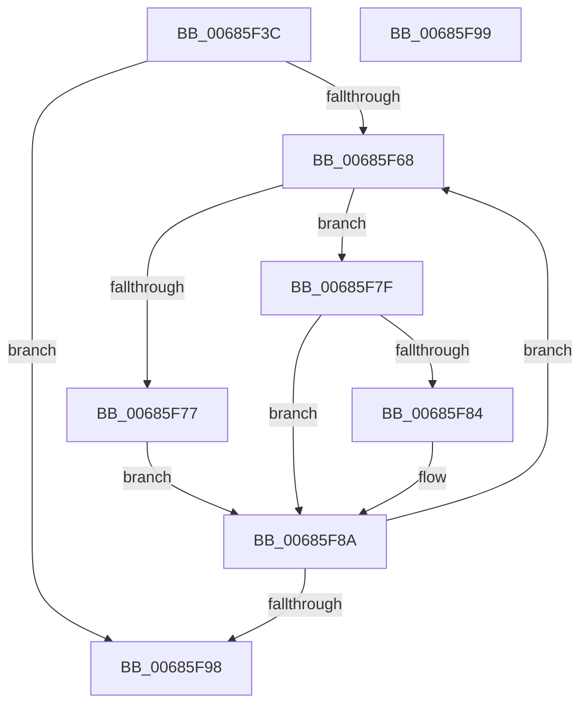

# MiFillDbgPatches

- RVA: `0x00685F3C`–`0x00685F9A` (길이 `94` bytes)
- VA: `0x0000000140685F3C`
- 실행 섹션: `.text`
- PDB 이름 있음: `예`; PDB Function 태그: `아니요`
- unwind 정보 RVA: `0x000DB714`
- 디코드: `31`개 명령, `94/94` bytes 표시
- 미해석 바이트: `0` (있으면 어셈블리에 `.byte`로 보존)

> 이 문서는 커널 이미지의 기계어와 PDB 기호를 분석해 생성했습니다. 4번과 5번은 함수 원형과 자료형을 바이너리 사용 방식에서 추정한 C 해석이며 원본 소스 복구 결과는 아닙니다.

## 1. Dependencies

- 직접 호출 지점: **0**; 고유 호출 대상: **0**
- 직접 호출자로 확인된 함수: **1**
- RIP 상대 이미지 참조: **0**

### Outgoing calls
- 직접 디코드된 call 명령이 없습니다.

### Direct callers
- [MiDbgCopyMemory](MiDbgCopyMemory_function_00684A18.md) at `0x00684D7E`
- [MiDbgCopyMemory](MiDbgCopyMemory_function_00684A18.md) at `0x00684DD5`

### Static image references
- 디코드된 RIP-relative 메모리 참조가 없습니다.

## 2. Other-region calls and transfers

- 다른 실행 섹션으로 향하는 call: **0**
- 별도 외부 분기/꼬리 이동을 확인하지 못했습니다.

## 3. Assembly (complete function range)

```asm
00685F3C  44 8B D1                        mov r10d, ecx
00685F3F  4C 8B D9                        mov r11, rcx
00685F42  41 81 E2 FF 0F 00 00            and r10d, 0xfff
00685F49  41 8B C2                        mov eax, r10d
00685F4C  83 E0 03                        and eax, 3
00685F4F  4C 2B D8                        sub r11, rax
00685F52  8D 42 FF                        lea eax, [rdx - 1]
00685F55  41 03 C2                        add eax, r10d
00685F58  41 C1 EA 02                     shr r10d, 2
00685F5C  C1 E8 02                        shr eax, 2
00685F5F  44 2B D0                        sub r10d, eax
00685F62  41 83 C2 01                     add r10d, 1
00685F66  74 30                           je 0x140685f98
00685F68  49 8B 00                        mov rax, qword ptr [r8]
00685F6B  48 8B C8                        mov rcx, rax
00685F6E  48 83 E1 FE                     and rcx, 0xfffffffffffffffe
00685F72  45 85 C9                        test r9d, r9d
00685F75  75 08                           jne 0x140685f7f
00685F77  41 8B 03                        mov eax, dword ptr [r11]
00685F7A  89 41 10                        mov dword ptr [rcx + 0x10], eax
00685F7D  EB 0B                           jmp 0x140685f8a
00685F7F  48 3B C8                        cmp rcx, rax
00685F82  75 06                           jne 0x140685f8a
00685F84  41 8B 03                        mov eax, dword ptr [r11]
00685F87  89 41 0C                        mov dword ptr [rcx + 0xc], eax
00685F8A  49 83 C3 04                     add r11, 4
00685F8E  49 83 C0 08                     add r8, 8
00685F92  41 83 C2 FF                     add r10d, -1
00685F96  75 D0                           jne 0x140685f68
00685F98  C3                              ret
00685F99  CC                              int3
```

## 4. C-style interpretation (structured pseudocode)

```c
__int64 __fastcall MiFillDbgPatches(__int64 a1, __int64 a2, __int64 a3, int a4)
{
    __int64 result;
    __int64 v_r10;
    __int64 v_r11;

    v_r10 = (unsigned int)(((unsigned int)((unsigned int)(a1))) & (0xFFFULL));
    result = (unsigned int)(((unsigned int)((unsigned int)(v_r10))) & (3));
    v_r11 = (a1) - (result);
    result = (unsigned int)((a2 - 1) + ((unsigned int)(v_r10)));
    v_r10 = (unsigned int)((v_r10) >> (2));
    result = (unsigned int)((result) >> (2));
    v_r10 = (unsigned int)((v_r10) - ((unsigned int)(result)));
    v_r10 = (unsigned int)((v_r10) + (1));
    if (condition_is_equal) goto loc_00685F98;
loc_00685F68:
    a1 = (*(unsigned __int64 *)(a3)) & (-2);
    if (a4 != 0) goto loc_00685F7F;
    *(unsigned int *)(a1 + 16) = (unsigned int)((unsigned int)(*(unsigned int *)(v_r11)));
    goto loc_00685F8A;
loc_00685F7F:
    result = (unsigned int)(*(unsigned int *)(v_r11));
    if (a1 == ((unsigned int)(*(unsigned int *)(v_r11)))) {
        result = *(unsigned int *)(v_r11);
        *(unsigned int *)(a1 + 12) = (unsigned int)(result);
    }
    v_r11 = (v_r11) + (4);
    a3 = (a3) + (8);
    v_r10 = (unsigned int)((v_r10) + (-1));
    if (condition_is_not_equal) goto loc_00685F68;
loc_00685F98:
    return result;
}
```

## 5. (Beta) C Style

```c
int64_t MiFillDbgPatches(void *Arg1, void *Arg2, void *Arg3, int32_t Arg4)
{
    uint8_t *arg1 = (uint8_t *)Arg1;
    uint8_t *arg2 = (uint8_t *)Arg2;
    uint8_t *arg3 = (uint8_t *)Arg3;

    int64_t result;
    int64_t local_r10;
    int64_t local_r11;

    local_r10 = (uint32_t)(((uint32_t)((uint32_t)(Arg1))) & (0xFFFULL));
    result = (uint32_t)(((uint32_t)((uint32_t)(local_r10))) & (3));
    local_r11 = (Arg1) - (result);
    result = (uint32_t)((Arg2 - 1) + ((uint32_t)(local_r10)));
    local_r10 = (uint32_t)((local_r10) >> (2));
    result = (uint32_t)((result) >> (2));
    local_r10 = (uint32_t)((local_r10) - ((uint32_t)(result)));
    local_r10 = (uint32_t)((local_r10) + (1));
    if (condition_is_equal) goto loc_00685F98;
loc_00685F68:
    Arg1 = (*(uint64_t *)(arg3)) & (-2);
    if (Arg4 != 0) goto loc_00685F7F;
    *(uint32_t *)(arg1 + 0x10) = (uint32_t)((uint32_t)(*(uint32_t *)(local_r11)));
    goto loc_00685F8A;
loc_00685F7F:
    result = (uint32_t)(*(uint32_t *)(local_r11));
    if (Arg1 == ((uint32_t)(*(uint32_t *)(local_r11)))) {
        result = *(uint32_t *)(local_r11);
        *(uint32_t *)(arg1 + 0xC) = (uint32_t)(result);
    }
    local_r11 = (local_r11) + (4);
    Arg3 = (Arg3) + (8);
    local_r10 = (uint32_t)((local_r10) + (-1));
    if (condition_is_not_equal) goto loc_00685F68;
loc_00685F98:
    return result;
}
```

### 관측된 메모리 오프셋

구조체 형식이 확인되지 않은 접근은 인자 기준의 오프셋으로만 기록했습니다.

| 기준 인자 | 오프셋 표현 | 폭 (bit) | 접근 |
|---|---:|---:|---|
| `Arg1` | `+ 0x0` | `32` | `R` |
| `Arg2` | `- 0x1` | `32` | `R` |
| `Arg3` | `+ 0x0` | `64` | `R` |

## 6. Execution-region graph

[열기: 2D/3D 그래프와 함수 탐색 컨트롤 패널](../../../control-panel.html?section=text&rva=0x00685F3C&view=graph)

- 2D 그래프는 위에서 아래로 흐르고, 3D 그래프는 빈 공간을 드래그해 회전합니다. Shift+드래그는 이동, 휠은 확대·축소, 함수 노드 선택은 대상 보고서 이동입니다.

### Static fallback


