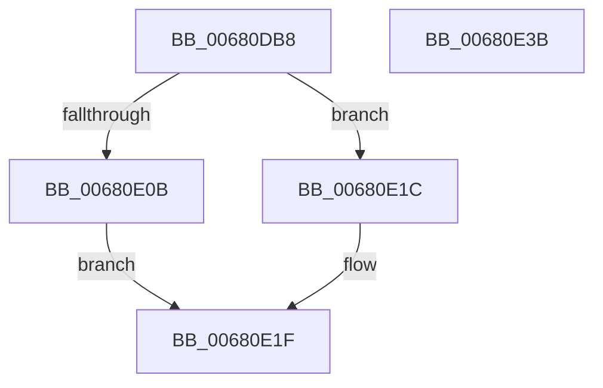

# MiFillFileOnlyProtoAsBad

- RVA: `0x00680DB8`–`0x00680E3C` (길이 `132` bytes)
- VA: `0x0000000140680DB8`
- 실행 섹션: `.text`
- PDB 이름 있음: `예`; PDB Function 태그: `아니요`
- unwind 정보 RVA: `0x0005FD94`
- 디코드: `36`개 명령, `132/132` bytes 표시
- 미해석 바이트: `0` (있으면 어셈블리에 `.byte`로 보존)

> 이 문서는 커널 이미지의 기계어와 PDB 기호를 분석해 생성했습니다. 4번과 5번은 함수 원형과 자료형을 바이너리 사용 방식에서 추정한 C 해석이며 원본 소스 복구 결과는 아닙니다.

## 1. Dependencies

- 직접 호출 지점: **4**; 고유 호출 대상: **4**
- 직접 호출자로 확인된 함수: **1**
- RIP 상대 이미지 참조: **0**

### Outgoing calls
- `0x00680DE4` → [MiSwizzleInvalidPte](../28/MiSwizzleInvalidPte_function_0028F5E0.md) (function, `0x0028F5E0`)
- `0x00680DF4` → [MiLockProtoPoolPageForce](../32/MiLockProtoPoolPageForce_function_00320E10.md) (function, `0x00320E10`)
- `0x00680E01` → [MiLockLeafPage](../36/MiLockLeafPage_function_003658C0.md) (function, `0x003658C0`)
- `0x00680E26` → [MiUnlockProtoPoolPage](../24/MiUnlockProtoPoolPage_function_00246090.md) (function, `0x00246090`)

### Direct callers
- [MiCreateFileOnlyPfns](../../page/80/MiCreateFileOnlyPfns_function_00800DB4.md) at `0x00800E4B`

### Static image references
- 디코드된 RIP-relative 메모리 참조가 없습니다.

## 2. Other-region calls and transfers

- 다른 실행 섹션으로 향하는 call: **0**
- 별도 외부 분기/꼬리 이동을 확인하지 못했습니다.

## 3. Assembly (complete function range)

```asm
00680DB8  48 89 5C 24 10                  mov qword ptr [rsp + 0x10], rbx
00680DBD  48 89 74 24 18                  mov qword ptr [rsp + 0x18], rsi
00680DC2  57                              push rdi
00680DC3  48 83 EC 20                     sub rsp, 0x20
00680DC7  8B 41 20                        mov eax, dword ptr [rcx + 0x20]
00680DCA  48 8B FA                        mov rdi, rdx
00680DCD  48 C1 E1 0C                     shl rcx, 0xc
00680DD1  83 E0 3E                        and eax, 0x3e
00680DD4  48 0B C8                        or rcx, rax
00680DD7  C6 44 24 30 11                  mov byte ptr [rsp + 0x30], 0x11
00680DDC  48 83 C9 40                     or rcx, 0x40
00680DE0  48 C1 E1 04                     shl rcx, 4
00680DE4  E8 F7 E7 C0 FF                  call 0x14028f5e0
00680DE9  48 8B CF                        mov rcx, rdi
00680DEC  48 8D 54 24 30                  lea rdx, [rsp + 0x30]
00680DF1  48 8B D8                        mov rbx, rax
00680DF4  E8 17 00 CA FF                  call 0x140320e10
00680DF9  33 D2                           xor edx, edx
00680DFB  48 8B CF                        mov rcx, rdi
00680DFE  48 8B F0                        mov rsi, rax
00680E01  E8 BA 4A CE FF                  call 0x1403658c0
00680E06  48 85 C0                        test rax, rax
00680E09  74 11                           je 0x140680e1c
00680E0B  48 B9 FF FF FF FF FF FF FF 7F   movabs rcx, 0x7fffffffffffffff
00680E15  F0 48 21 48 18                  lock and qword ptr [rax + 0x18], rcx
00680E1A  EB 03                           jmp 0x140680e1f
00680E1C  48 89 1F                        mov qword ptr [rdi], rbx
00680E1F  8A 54 24 30                     mov dl, byte ptr [rsp + 0x30]
00680E23  48 8B CE                        mov rcx, rsi
00680E26  E8 65 52 BC FF                  call 0x140246090
00680E2B  48 8B 5C 24 38                  mov rbx, qword ptr [rsp + 0x38]
00680E30  48 8B 74 24 40                  mov rsi, qword ptr [rsp + 0x40]
00680E35  48 83 C4 20                     add rsp, 0x20
00680E39  5F                              pop rdi
00680E3A  C3                              ret
00680E3B  CC                              int3
```

## 4. C-style interpretation (structured pseudocode)

```c
__int64 __fastcall MiFillFileOnlyProtoAsBad(__int64 a1, __int64 a2)
{
    __int64 result;
    __int64 v_rsp;
    unsigned __int64 v_stack_p10;
    unsigned __int64 v_stack_p18;
    unsigned __int8 v_stack_p8;

    v_stack_p10 = v_rbx;
    v_stack_p18 = v_rsi;
    v_rsp = (v_rsp) - (32);
    a1 = (a1) << (12);
    result = (unsigned int)(((unsigned int)(*(unsigned int *)(a1 + 32))) & (62));
    a1 = (a1) | (result);
    v_stack_p8 = 17;
    a1 = (a1) | (64);
    a1 = (a1) << (4);
    result = MiSwizzleInvalidPte(a1, a2, a3, a4);
    result = MiLockProtoPoolPageForce(a2, v_stack_p8, a3, a4);
    a2 = 0;
    result = MiLockLeafPage(0, a2, a3, a4);
    if (result == 0) goto loc_00680E1C;
    goto loc_00680E1F;
loc_00680E1C:
    *(unsigned __int64 *)(a2) = result;
loc_00680E1F:
    result = MiUnlockProtoPoolPage(result, v_stack_p8, a3, a4);
    v_rsp = (v_rsp) + (32);
    return result;
}
```

## 5. (Beta) C Style

```c
int64_t MiFillFileOnlyProtoAsBad(void *Arg1, void *Arg2)
{
    uint8_t *arg1 = (uint8_t *)Arg1;
    uint8_t *arg2 = (uint8_t *)Arg2;

    int64_t result;
    int64_t local_rsp;
    uint64_t v_stack_p10;
    uint64_t v_stack_p18;
    uint8_t v_stack_p8;

    v_stack_p10 = local_rbx;
    v_stack_p18 = local_rsi;
    local_rsp = (local_rsp) - (32);
    Arg1 = (Arg1) << (12);
    result = (uint32_t)(((uint32_t)(*(uint32_t *)(arg1 + 0x20))) & (62));
    Arg1 = (Arg1) | (result);
    v_stack_p8 = 17;
    Arg1 = (Arg1) | (64);
    Arg1 = (Arg1) << (4);
    result = MiSwizzleInvalidPte(Arg1, Arg2, a3, a4);
    result = MiLockProtoPoolPageForce(Arg2, v_stack_p8, a3, a4);
    Arg2 = 0;
    result = MiLockLeafPage(0, Arg2, a3, a4);
    if (result == 0) goto loc_00680E1C;
    goto loc_00680E1F;
loc_00680E1C:
    *(uint64_t *)(arg2) = result;
loc_00680E1F:
    result = MiUnlockProtoPoolPage(result, v_stack_p8, a3, a4);
    local_rsp = (local_rsp) + (32);
    return result;
}
```

### 관측된 메모리 오프셋

구조체 형식이 확인되지 않은 접근은 인자 기준의 오프셋으로만 기록했습니다.

| 기준 인자 | 오프셋 표현 | 폭 (bit) | 접근 |
|---|---:|---:|---|
| `Arg1` | `+ 0x20` | `32` | `R` |
| `Arg2` | `+ 0x0` | `64` | `W` |

## 6. Execution-region graph

[열기: 2D/3D 그래프와 함수 탐색 컨트롤 패널](../../../control-panel.html?section=text&rva=0x00680DB8&view=graph)

- 2D 그래프는 위에서 아래로 흐르고, 3D 그래프는 빈 공간을 드래그해 회전합니다. Shift+드래그는 이동, 휠은 확대·축소, 함수 노드 선택은 대상 보고서 이동입니다.

### Static fallback


