# MiFillPageWithImageExtentContents

- RVA: `0x00680E44`–`0x0068119D` (길이 `857` bytes)
- VA: `0x0000000140680E44`
- 실행 섹션: `.text`
- PDB 이름 있음: `예`; PDB Function 태그: `아니요`
- unwind 정보 RVA: `0x000D81F8`
- 디코드: `221`개 명령, `857/857` bytes 표시
- 미해석 바이트: `0` (있으면 어셈블리에 `.byte`로 보존)

> 이 문서는 커널 이미지의 기계어와 PDB 기호를 분석해 생성했습니다. 4번과 5번은 함수 원형과 자료형을 바이너리 사용 방식에서 추정한 C 해석이며 원본 소스 복구 결과는 아닙니다.

## 1. Dependencies

- 직접 호출 지점: **12**; 고유 호출 대상: **6**
- 직접 호출자로 확인된 함수: **2**
- RIP 상대 이미지 참조: **3**

### Outgoing calls
- `0x00680EB4` → [MiGetPteMappingSet](../32/MiGetPteMappingSet_function_00322EB0.md) (function, `0x00322EB0`)
- `0x00680EF6` → [MiMakeValidPte](../2C/MiMakeValidPte_function_002C5590.md) (function, `0x002C5590`)
- `0x00680F2F` → [MiCheckLinearProtectedPteAccessedBit](../29/MiCheckLinearProtectedPteAccessedBit_function_00292D80.md) (function, `0x00292D80`)
- `0x00680F9C` → [KeBugCheckEx](../4F/KeBugCheckEx_function_004FD660.md) (function, `0x004FD660`)
- `0x00680FC1` → [MiMakeValidPte](../2C/MiMakeValidPte_function_002C5590.md) (function, `0x002C5590`)
- `0x00681003` → [MiCheckLinearProtectedPteAccessedBit](../29/MiCheckLinearProtectedPteAccessedBit_function_00292D80.md) (function, `0x00292D80`)
- `0x006810B6` → [KeBugCheckEx](../4F/KeBugCheckEx_function_004FD660.md) (function, `0x004FD660`)
- `0x00681109` → [MiCheckLinearProtectedPteAccessedBit](../29/MiCheckLinearProtectedPteAccessedBit_function_00292D80.md) (function, `0x00292D80`)
- `0x0068111F` → [memcpy](../6C/memcpy_function_006C6840.md) (function, `0x006C6840`)
- `0x0068113A` → [memcpy](../6C/memcpy_function_006C6840.md) (function, `0x006C6840`)
- `0x00681164` → [MiReturnPteMappingSet](../2B/MiReturnPteMappingSet_function_002B2600.md) (function, `0x002B2600`)
- `0x00681197` → [KeBugCheckEx](../4F/KeBugCheckEx_function_004FD660.md) (function, `0x004FD660`)

### Direct callers
- [MiCopyImageExtentContents](../4D/MiCopyImageExtentContents_function_004D6558.md) at `0x004D65CE`
- [MiCopyFromDirectMapExtent](../../page/80/MiCopyFromDirectMapExtent_function_00800D24.md) at `0x00800D7D`

### Static image references
- `0x00680EFB` → RVA `0x00FC6A88` (`ALMOSTRO`; read)
- `0x00681129` → RVA `0x00E37460` (`.data`; read)
- `0x0068113F` → RVA `0x00010880` (`.rdata`; read)

## 2. Other-region calls and transfers

- 다른 실행 섹션으로 향하는 call: **0**
- 별도 외부 분기/꼬리 이동을 확인하지 못했습니다.

## 3. Assembly (complete function range)

```asm
00680E44  4C 8B DC                        mov r11, rsp
00680E47  49 89 5B 10                     mov qword ptr [r11 + 0x10], rbx
00680E4B  4D 89 43 18                     mov qword ptr [r11 + 0x18], r8
00680E4F  55                              push rbp
00680E50  56                              push rsi
00680E51  57                              push rdi
00680E52  41 54                           push r12
00680E54  41 55                           push r13
00680E56  41 56                           push r14
00680E58  41 57                           push r15
00680E5A  48 83 EC 70                     sub rsp, 0x70
00680E5E  33 C0                           xor eax, eax
00680E60  45 8B F1                        mov r14d, r9d
00680E63  4C 8B F9                        mov r15, rcx
00680E66  0F 57 C0                        xorps xmm0, xmm0
00680E69  0F 11 44 24 50                  movups xmmword ptr [rsp + 0x50], xmm0
00680E6E  49 89 43 B8                     mov qword ptr [r11 - 0x48], rax
00680E72  45 33 E4                        xor r12d, r12d
00680E75  41 8B C0                        mov eax, r8d
00680E78  49 8B F8                        mov rdi, r8
00680E7B  48 89 44 24 30                  mov qword ptr [rsp + 0x30], rax
00680E80  4D 8D 43 A8                     lea r8, [r11 - 0x58]
00680E84  25 FF 0F 00 00                  and eax, 0xfff
00680E89  48 8B DA                        mov rbx, rdx
00680E8C  41 BD 00 10 00 00               mov r13d, 0x1000
00680E92  42 8D 0C 30                     lea ecx, [rax + r14]
00680E96  41 8B C4                        mov eax, r12d
00680E99  41 3B CD                        cmp ecx, r13d
00680E9C  89 8C 24 C8 00 00 00            mov dword ptr [rsp + 0xc8], ecx
00680EA3  0F 97 C0                        seta al
00680EA6  33 C9                           xor ecx, ecx
00680EA8  48 83 C0 02                     add rax, 2
00680EAC  48 8B D0                        mov rdx, rax
00680EAF  48 89 44 24 48                  mov qword ptr [rsp + 0x48], rax
00680EB4  E8 F7 1F CA FF                  call 0x140322eb0
00680EB9  48 8B 74 24 60                  mov rsi, qword ptr [rsp + 0x60]
00680EBE  48 BD 00 00 00 00 80 F6 FF FF   movabs rbp, 0xfffff68000000000
00680EC8  48 8B CD                        mov rcx, rbp
00680ECB  48 C1 E1 19                     shl rcx, 0x19
00680ECF  48 8B C6                        mov rax, rsi
00680ED2  48 C1 E0 19                     shl rax, 0x19
00680ED6  41 B8 04 00 00 A0               mov r8d, 0xa0000004
00680EDC  48 2B C1                        sub rax, rcx
00680EDF  48 89 8C 24 B0 00 00 00         mov qword ptr [rsp + 0xb0], rcx
00680EE7  48 C1 F8 10                     sar rax, 0x10
00680EEB  48 8B D3                        mov rdx, rbx
00680EEE  48 8B CE                        mov rcx, rsi
00680EF1  48 89 44 24 40                  mov qword ptr [rsp + 0x40], rax
00680EF6  E8 95 46 C4 FF                  call 0x1402c5590
00680EFB  48 0F BA 25 84 5B 94 00 24      bt qword ptr [rip + 0x945b84], 0x24
00680F04  48 8B D8                        mov rbx, rax
00680F07  48 B9 00 00 00 00 40 00 00 00   movabs rcx, 0x4000000000
00680F11  73 21                           jae 0x140680f34
00680F13  F6 C3 20                        test bl, 0x20
00680F16  75 1C                           jne 0x140680f34
00680F18  48 8B C5                        mov rax, rbp
00680F1B  48 03 C1                        add rax, rcx
00680F1E  48 3B F0                        cmp rsi, rax
00680F21  72 11                           jb 0x140680f34
00680F23  41 B8 80 00 00 00               mov r8d, 0x80
00680F29  48 8B D3                        mov rdx, rbx
00680F2C  48 8B CE                        mov rcx, rsi
00680F2F  E8 4C 1E C1 FF                  call 0x140292d80
00680F34  4C 8B CF                        mov r9, rdi
00680F37  48 89 1E                        mov qword ptr [rsi], rbx
00680F3A  45 8B 07                        mov r8d, dword ptr [r15]
00680F3D  41 8B CC                        mov ecx, r12d
00680F40  49 C1 E9 0C                     shr r9, 0xc
00680F44  41 FF C8                        dec r8d
00680F47  44 3B C1                        cmp r8d, ecx
00680F4A  0F 8C 32 02 00 00               jl 0x140681182
00680F50  42 8D 14 01                     lea edx, [rcx + r8]
00680F54  D1 FA                           sar edx, 1
00680F56  48 63 C2                        movsxd rax, edx
00680F59  48 8D 1C 40                     lea rbx, [rax + rax*2]
00680F5D  48 C1 E3 04                     shl rbx, 4
00680F61  49 03 DF                        add rbx, r15
00680F64  44 8B 53 20                     mov r10d, dword ptr [rbx + 0x20]
00680F68  45 3B CA                        cmp r9d, r10d
00680F6B  73 0A                           jae 0x140680f77
00680F6D  85 D2                           test edx, edx
00680F6F  74 16                           je 0x140680f87
00680F71  44 8D 42 FF                     lea r8d, [rdx - 1]
00680F75  EB D0                           jmp 0x140680f47
00680F77  8B 4B 30                        mov ecx, dword ptr [rbx + 0x30]
00680F7A  41 03 CA                        add ecx, r10d
00680F7D  44 3B C9                        cmp r9d, ecx
00680F80  72 20                           jb 0x140680fa2
00680F82  8D 4A 01                        lea ecx, [rdx + 1]
00680F85  EB C0                           jmp 0x140680f47
00680F87  4D 8B CF                        mov r9, r15
00680F8A  4C 89 74 24 20                  mov qword ptr [rsp + 0x20], r14
00680F8F  4C 8B C7                        mov r8, rdi
00680F92  BA 80 14 00 00                  mov edx, 0x1480
00680F97  B9 1A 00 00 00                  mov ecx, 0x1a
00680F9C  E8 BF C6 E7 FF                  call 0x1404fd660
00680FA1  CC                              int3
00680FA2  41 8B C9                        mov ecx, r9d
00680FA5  48 83 C6 08                     add rsi, 8
00680FA9  49 2B CA                        sub rcx, r10
00680FAC  41 B8 01 00 00 20               mov r8d, 0x20000001
00680FB2  48 03 4B 28                     add rcx, qword ptr [rbx + 0x28]
00680FB6  48 89 4C 24 38                  mov qword ptr [rsp + 0x38], rcx
00680FBB  48 8B D1                        mov rdx, rcx
00680FBE  48 8B CE                        mov rcx, rsi
00680FC1  E8 CA 45 C4 FF                  call 0x1402c5590
00680FC6  49 B9 00 00 00 00 10 00 00 00   movabs r9, 0x1000000000
00680FD0  48 8B F8                        mov rdi, rax
00680FD3  4C 85 0D AE 5A 94 00            test qword ptr [rip + 0x945aae], r9
00680FDA  74 36                           je 0x140681012
00680FDC  40 F6 C7 20                     test dil, 0x20
00680FE0  75 30                           jne 0x140681012
00680FE2  48 8B C5                        mov rax, rbp
00680FE5  49 B8 00 00 00 00 40 00 00 00   movabs r8, 0x4000000000
00680FEF  49 03 C0                        add rax, r8
00680FF2  48 3B F0                        cmp rsi, rax
00680FF5  72 25                           jb 0x14068101c
00680FF7  41 B8 80 00 00 00               mov r8d, 0x80
00680FFD  48 8B D7                        mov rdx, rdi
00681000  48 8B CE                        mov rcx, rsi
00681003  E8 78 1D C1 FF                  call 0x140292d80
00681008  49 B9 00 00 00 00 10 00 00 00   movabs r9, 0x1000000000
00681012  49 B8 00 00 00 00 40 00 00 00   movabs r8, 0x4000000000
0068101C  48 8B 44 24 30                  mov rax, qword ptr [rsp + 0x30]
00681021  48 8B EE                        mov rbp, rsi
00681024  48 C1 E5 19                     shl rbp, 0x19
00681028  25 FF 0F 00 00                  and eax, 0xfff
0068102D  48 2B AC 24 B0 00 00 00         sub rbp, qword ptr [rsp + 0xb0]
00681035  48 C1 FD 10                     sar rbp, 0x10
00681039  48 89 3E                        mov qword ptr [rsi], rdi
0068103C  48 03 E8                        add rbp, rax
0068103F  48 83 C6 08                     add rsi, 8
00681043  44 39 AC 24 C8 00 00 00         cmp dword ptr [rsp + 0xc8], r13d
0068104B  0F 86 C0 00 00 00               jbe 0x140681111
00681051  48 8B 4B 28                     mov rcx, qword ptr [rbx + 0x28]
00681055  48 FF C9                        dec rcx
00681058  48 03 4B 30                     add rcx, qword ptr [rbx + 0x30]
0068105C  48 39 4C 24 38                  cmp qword ptr [rsp + 0x38], rcx
00681061  73 0E                           jae 0x140681071
00681063  48 8B C7                        mov rax, rdi
00681066  48 25 00 F0 FF FF               and rax, 0xfffffffffffff000
0068106C  49 03 C5                        add rax, r13
0068106F  EB 53                           jmp 0x1406810c4
00681071  48 8D 4B 38                     lea rcx, [rbx + 0x38]
00681075  48 B8 AB AA AA AA AA AA AA 2A   movabs rax, 0x2aaaaaaaaaaaaaab
0068107F  49 2B CF                        sub rcx, r15
00681082  48 83 E9 08                     sub rcx, 8
00681086  48 F7 E9                        imul rcx
00681089  48 C1 FA 03                     sar rdx, 3
0068108D  48 8B C2                        mov rax, rdx
00681090  48 C1 E8 3F                     shr rax, 0x3f
00681094  48 03 D0                        add rdx, rax
00681097  41 3B 17                        cmp edx, dword ptr [r15]
0068109A  75 20                           jne 0x1406810bc
0068109C  4C 8B 84 24 C0 00 00 00         mov r8, qword ptr [rsp + 0xc0]
006810A4  4D 8B CF                        mov r9, r15
006810A7  BA 82 14 00 00                  mov edx, 0x1482
006810AC  4C 89 74 24 20                  mov qword ptr [rsp + 0x20], r14
006810B1  B9 1A 00 00 00                  mov ecx, 0x1a
006810B6  E8 A5 C5 E7 FF                  call 0x1404fd660
006810BB  CC                              int3
006810BC  48 8B 43 58                     mov rax, qword ptr [rbx + 0x58]
006810C0  48 C1 E0 0C                     shl rax, 0xc
006810C4  48 8B D8                        mov rbx, rax
006810C7  48 B9 FF 0F 00 00 00 00 F0 FF   movabs rcx, 0xfff0000000000fff
006810D1  48 33 DF                        xor rbx, rdi
006810D4  48 23 D9                        and rbx, rcx
006810D7  48 33 D8                        xor rbx, rax
006810DA  4C 85 0D A7 59 94 00            test qword ptr [rip + 0x9459a7], r9
006810E1  74 2B                           je 0x14068110e
006810E3  F6 C3 20                        test bl, 0x20
006810E6  75 26                           jne 0x14068110e
006810E8  48 B8 00 00 00 00 80 F6 FF FF   movabs rax, 0xfffff68000000000
006810F2  48 8B C0                        mov rax, rax
006810F5  49 03 C0                        add rax, r8
006810F8  48 3B F0                        cmp rsi, rax
006810FB  72 11                           jb 0x14068110e
006810FD  41 B8 80 00 00 00               mov r8d, 0x80
00681103  48 8B D3                        mov rdx, rbx
00681106  48 8B CE                        mov rcx, rsi
00681109  E8 72 1C C1 FF                  call 0x140292d80
0068110E  48 89 1E                        mov qword ptr [rsi], rbx
00681111  48 8B 7C 24 40                  mov rdi, qword ptr [rsp + 0x40]
00681116  4D 8B C6                        mov r8, r14
00681119  48 8B CF                        mov rcx, rdi
0068111C  48 8B D5                        mov rdx, rbp
0068111F  E8 1C 57 04 00                  call 0x1406c6840
00681124  45 3B F5                        cmp r14d, r13d
00681127  74 16                           je 0x14068113f
00681129  48 8B 15 30 63 7B 00            mov rdx, qword ptr [rip + 0x7b6330]
00681130  49 8D 0C 3E                     lea rcx, [r14 + rdi]
00681134  45 2B EE                        sub r13d, r14d
00681137  45 8B C5                        mov r8d, r13d
0068113A  E8 01 57 04 00                  call 0x1406c6840
0068113F  48 8B 05 3A F7 98 FF            mov rax, qword ptr [rip - 0x6708c6]
00681146  48 8B 54 24 48                  mov rdx, qword ptr [rsp + 0x48]
0068114B  48 8B 4C 24 60                  mov rcx, qword ptr [rsp + 0x60]
00681150  49 89 04 0C                     mov qword ptr [r12 + rcx], rax
00681154  4D 8D 64 24 08                  lea r12, [r12 + 8]
00681159  48 83 EA 01                     sub rdx, 1
0068115D  75 EC                           jne 0x14068114b
0068115F  48 8D 4C 24 50                  lea rcx, [rsp + 0x50]
00681164  E8 97 14 C3 FF                  call 0x1402b2600
00681169  48 8B 9C 24 B8 00 00 00         mov rbx, qword ptr [rsp + 0xb8]
00681171  48 83 C4 70                     add rsp, 0x70
00681175  41 5F                           pop r15
00681177  41 5E                           pop r14
00681179  41 5D                           pop r13
0068117B  41 5C                           pop r12
0068117D  5F                              pop rdi
0068117E  5E                              pop rsi
0068117F  5D                              pop rbp
00681180  C3                              ret
00681181  CC                              int3
00681182  4D 8B CF                        mov r9, r15
00681185  4C 89 74 24 20                  mov qword ptr [rsp + 0x20], r14
0068118A  4C 8B C7                        mov r8, rdi
0068118D  BA 81 14 00 00                  mov edx, 0x1481
00681192  B9 1A 00 00 00                  mov ecx, 0x1a
00681197  E8 C4 C4 E7 FF                  call 0x1404fd660
0068119C  CC                              int3
```

## 4. C-style interpretation (structured pseudocode)

```c
__int64 __fastcall MiFillPageWithImageExtentContents(__int64 a1, __int64 a2, __int64 a3, int a4)
{
    __int64 result;
    __int64 v_r12;
    __int64 v_r13;
    __int64 v_rbp;
    __int64 v_rbx;
    __int64 v_rsi;
    __int64 v_rsp;
    unsigned __int64 v_stack_m48;
    unsigned __int64 v_stack_m58;
    unsigned __int64 v_stack_m60;
    unsigned __int64 v_stack_m68;
    unsigned __int64 v_stack_m70;
    unsigned __int64 v_stack_m78;
    unsigned __int64 v_stack_m88;
    unsigned __int64 v_stack_p10;
    unsigned __int64 v_stack_p18;
    unsigned int v_stack_p20;
    unsigned __int64 v_stack_p8;

    *(unsigned __int64 *)(v_rsp + 16) = v_rbx;
    *(unsigned __int64 *)(v_rsp + 24) = a3;
    v_rsp = (v_rsp) - (112);
    result = 0;
    v_stack_m58 = v_xmm0;
    *(unsigned __int64 *)(v_rsp - 72) = 0;
    v_r12 = 0;
    v_stack_m78 = (unsigned int)((unsigned int)(a3));
    result = (unsigned int)(((unsigned int)((unsigned int)(a3))) & (0xFFFULL));
    v_stack_p20 = (unsigned int)(result + (unsigned int)(a4) * 1);
    result = (((unsigned int)(result + (unsigned int)(a4) * 1)) > ((unsigned int)((unsigned int)(0x1000ULL)))) ? 1 : 0;
    a1 = 0;
    result = (result) + (2);
    v_stack_m60 = result;
    result = MiGetPteMappingSet(a1, result, v_rsp - 88, a4);
    a1 = (v_rbp) << (25);
    result = (v_stack_m48) << (25);
    result = (result) - (a1);
    v_stack_p8 = a1;
    result = (result) >> (16);
    v_stack_m68 = result;
    result = MiMakeValidPte(v_stack_m48, a2, (unsigned int)(0xA0000004ULL), a4);
    if (condition_is_above_or_equal) goto loc_00680F34;
    if ((((unsigned __int8)(result)) & (32)) != 0) goto loc_00680F34;
    result = (v_rbp) + (v_stack_m48);
    if (v_stack_m48 >= result) {
        a3 = 128;
        a2 = result;
        a1 = v_stack_m48;
        result = MiCheckLinearProtectedPteAccessedBit(a1, a2, a3, a4);
    }
    *(unsigned __int64 *)(v_stack_m48) = result;
    a4 = (a3) >> (12);
    a3 = (unsigned int)(((unsigned int)(*(unsigned int *)(a1))) - 1);
loc_00680F47:
    if (((unsigned int)(a3)) < 0) goto loc_00681182;
    a2 = (unsigned int)((0 + a3 * 1) >> (1));
    v_rbx = ((int)((unsigned int)(a2)) + (int)((unsigned int)(a2)) * 2) << (4);
    v_rbx = (v_rbx) + (a1);
    if (a4 >= ((unsigned int)((unsigned int)(*(unsigned int *)(v_rbx + 32))))) goto loc_00680F77;
    if ((unsigned int)(a2) == 0) goto loc_00680F87;
    goto loc_00680F47;
loc_00680F77:
    a1 = (unsigned int)(((unsigned int)(*(unsigned int *)(v_rbx + 48))) + ((unsigned int)((unsigned int)(*(unsigned int *)(v_rbx + 32)))));
    if (a4 < ((unsigned int)(a1))) goto loc_00680FA2;
    goto loc_00680F47;
loc_00680F87:
    v_stack_m88 = (unsigned int)(a4);
    result = KeBugCheckEx(26, (unsigned int)(0x1480ULL), a3, a1);
loc_00680FA2:
    v_rsi = (v_stack_m48) + (8);
    a1 = ((unsigned int)((unsigned int)(a1))) - ((unsigned int)(*(unsigned int *)(v_rbx + 32)));
    a1 = (a1) + (*(unsigned __int64 *)(v_rbx + 40));
    v_stack_m70 = a1;
    result = MiMakeValidPte(v_rsi, a1, (unsigned int)(0x20000001ULL), a1);
    if (((*(unsigned __int64 *)(v_rip + 9722542)) & (a1)) == 0) goto loc_00681012;
    if ((((unsigned __int8)(result)) & (32)) != 0) goto loc_00681012;
    result = (v_rbp) + ((unsigned int)(0x20000001ULL));
    if (v_rsi < result) goto loc_0068101C;
    result = MiCheckLinearProtectedPteAccessedBit(v_rsi, result, 128, a1);
loc_00681012:
loc_0068101C:
    v_rbp = (v_rsi) << (25);
    result = (unsigned int)((v_stack_m78) & (0xFFFULL));
    v_rbp = (v_rbp) - (v_stack_p8);
    v_rbp = (v_rbp) >> (16);
    *(unsigned __int64 *)(v_rsi) = result;
    v_rbp = (v_rbp) + (result);
    v_rsi = (v_rsi) + (8);
    if (v_stack_p20 <= ((unsigned int)((unsigned int)(0x1000ULL)))) goto loc_00681111;
    a1 = (*(unsigned __int64 *)(v_rbx + 40)) - 1;
    a1 = (a1) + (*(unsigned __int64 *)(v_rbx + 48));
    if (v_stack_m70 >= a1) goto loc_00681071;
    result = (result) & (0xFFFFFFFFFFFFF000ULL);
    result = (result) + ((unsigned int)(0x1000ULL));
    goto loc_006810C4;
loc_00681071:
    a1 = (v_rbx + 56) - (a1);
    a1 = (a1) - (8);
    a2 = (result) >> (3);
    result = (a2) >> (63);
    a2 = (a2) + (result);
    if (((unsigned int)(a2)) == (*(unsigned int *)(a1))) {
        a3 = v_stack_p18;
        a4 = a1;
        a2 = 0x1482ULL;
        v_stack_m88 = (unsigned int)(a4);
        a1 = 26;
        result = KeBugCheckEx(a1, a2, a3, a4);
    }
    result = (*(unsigned __int64 *)(v_rbx + 88)) << (12);
loc_006810C4:
    v_rbx = (result) ^ (result);
    v_rbx = (v_rbx) & (a1);
    v_rbx = (v_rbx) ^ (result);
    if (((*(unsigned __int64 *)(v_rip + 9722279)) & (a4)) == 0) goto loc_0068110E;
    if ((((unsigned __int8)(v_rbx)) & (32)) != 0) goto loc_0068110E;
    result = (result) + (a3);
    if (v_rsi >= result) {
        a3 = 128;
        a2 = v_rbx;
        a1 = v_rsi;
        result = MiCheckLinearProtectedPteAccessedBit(a1, a2, a3, a4);
    }
    *(unsigned __int64 *)(v_rsi) = v_rbx;
loc_00681111:
    result = memcpy(v_stack_m68, v_rbp, (unsigned int)(a4), a4);
    v_r13 = (unsigned int)(0x1000ULL);
    if (((unsigned int)((unsigned int)(a4))) != ((unsigned int)((unsigned int)(0x1000ULL)))) {
        a2 = *(unsigned __int64 *)(v_rip + 8086320);
        a1 = (unsigned int)(a4) + v_stack_m68 * 1;
        v_r13 = (unsigned int)(((unsigned int)(0x1000ULL)) - ((unsigned int)((unsigned int)(a4))));
        a3 = (unsigned int)(v_r13);
        result = memcpy(a1, a2, a3, a4);
    }
loc_0068114B:
    *(unsigned __int64 *)(v_r12 + v_stack_m48 * 1) = *(unsigned __int64 *)(v_rip - 6752454);
    a2 = (v_stack_m60) - (1);
    if (condition_is_not_equal) goto loc_0068114B;
    result = MiReturnPteMappingSet(v_stack_m58, a2, a3, a4);
    v_rsp = (v_rsp) + (112);
    return result;
loc_00681182:
    v_stack_p20 = (unsigned int)(a4);
    result = KeBugCheckEx(26, (unsigned int)(0x1481ULL), v_stack_m68, a1);
    return result;
}
```

## 5. (Beta) C Style

```c
int64_t MiFillPageWithImageExtentContents(void *Arg1, int64_t Arg2, void *Arg3, int32_t Arg4)
{
    uint8_t *arg1 = (uint8_t *)Arg1;
    uint8_t *arg3 = (uint8_t *)Arg3;

    int64_t result;
    int64_t local_r12;
    int64_t local_r13;
    int64_t local_rbp;
    int64_t local_rbx;
    int64_t local_rsi;
    int64_t local_rsp;
    uint64_t v_stack_m48;
    uint64_t v_stack_m58;
    uint64_t v_stack_m60;
    uint64_t v_stack_m68;
    uint64_t v_stack_m70;
    uint64_t v_stack_m78;
    uint64_t v_stack_m88;
    uint64_t v_stack_p10;
    uint64_t v_stack_p18;
    uint32_t v_stack_p20;
    uint64_t v_stack_p8;

    *(uint64_t *)(local_rsp + 0x10) = local_rbx;
    *(void **)(local_rsp + 0x18) = Arg3;
    local_rsp = (local_rsp) - (112);
    result = 0;
    v_stack_m58 = v_xmm0;
    *(uint64_t *)(local_rsp - 0x48) = 0;
    local_r12 = 0;
    v_stack_m78 = (uint32_t)((uint32_t)(Arg3));
    result = (uint32_t)(((uint32_t)((uint32_t)(Arg3))) & (0xFFFULL));
    v_stack_p20 = (uint32_t)(result + (uint32_t)(Arg4) * 1);
    result = (((uint32_t)(result + (uint32_t)(Arg4) * 1)) > ((uint32_t)((uint32_t)(0x1000ULL)))) ? 1 : 0;
    Arg1 = 0;
    result = (result) + (2);
    v_stack_m60 = result;
    result = MiGetPteMappingSet(Arg1, result, local_rsp - 88, Arg4);
    Arg1 = (local_rbp) << (25);
    result = (v_stack_m48) << (25);
    result = (result) - (Arg1);
    v_stack_p8 = Arg1;
    result = (result) >> (16);
    v_stack_m68 = result;
    result = MiMakeValidPte(v_stack_m48, Arg2, (uint32_t)(0xA0000004ULL), Arg4);
    if (condition_is_above_or_equal) goto loc_00680F34;
    if ((((uint8_t)(result)) & (32)) != 0) goto loc_00680F34;
    result = (local_rbp) + (v_stack_m48);
    if (v_stack_m48 >= result) {
        Arg3 = 128;
        Arg2 = result;
        Arg1 = v_stack_m48;
        result = MiCheckLinearProtectedPteAccessedBit(Arg1, Arg2, Arg3, Arg4);
    }
    *(uint64_t *)(v_stack_m48) = result;
    Arg4 = (Arg3) >> (12);
    Arg3 = (uint32_t)(((uint32_t)(*(uint32_t *)(arg1))) - 1);
loc_00680F47:
    if (((uint32_t)(Arg3)) < 0) goto loc_00681182;
    Arg2 = (uint32_t)((0 + Arg3 * 1) >> (1));
    local_rbx = ((int32_t)((uint32_t)(Arg2)) + (int32_t)((uint32_t)(Arg2)) * 2) << (4);
    local_rbx = (local_rbx) + (Arg1);
    if (Arg4 >= ((uint32_t)((uint32_t)(*(uint32_t *)(local_rbx + 0x20))))) goto loc_00680F77;
    if ((uint32_t)(Arg2) == 0) goto loc_00680F87;
    goto loc_00680F47;
loc_00680F77:
    Arg1 = (uint32_t)(((uint32_t)(*(uint32_t *)(local_rbx + 0x30))) + ((uint32_t)((uint32_t)(*(uint32_t *)(local_rbx + 0x20)))));
    if (Arg4 < ((uint32_t)(Arg1))) goto loc_00680FA2;
    goto loc_00680F47;
loc_00680F87:
    v_stack_m88 = (uint32_t)(Arg4);
    result = KeBugCheckEx(26, (uint32_t)(0x1480ULL), Arg3, Arg1);
loc_00680FA2:
    local_rsi = (v_stack_m48) + (8);
    Arg1 = ((uint32_t)((uint32_t)(Arg1))) - ((uint32_t)(*(uint32_t *)(local_rbx + 0x20)));
    Arg1 = (Arg1) + (*(uint64_t *)(local_rbx + 0x28));
    v_stack_m70 = Arg1;
    result = MiMakeValidPte(local_rsi, Arg1, (uint32_t)(0x20000001ULL), Arg1);
    if (((*(uint64_t *)(v_rip + 0x945AAE)) & (Arg1)) == 0) goto loc_00681012;
    if ((((uint8_t)(result)) & (32)) != 0) goto loc_00681012;
    result = (local_rbp) + ((uint32_t)(0x20000001ULL));
    if (local_rsi < result) goto loc_0068101C;
    result = MiCheckLinearProtectedPteAccessedBit(local_rsi, result, 128, Arg1);
loc_00681012:
loc_0068101C:
    local_rbp = (local_rsi) << (25);
    result = (uint32_t)((v_stack_m78) & (0xFFFULL));
    local_rbp = (local_rbp) - (v_stack_p8);
    local_rbp = (local_rbp) >> (16);
    *(uint64_t *)(local_rsi) = result;
    local_rbp = (local_rbp) + (result);
    local_rsi = (local_rsi) + (8);
    if (v_stack_p20 <= ((uint32_t)((uint32_t)(0x1000ULL)))) goto loc_00681111;
    Arg1 = (*(uint64_t *)(local_rbx + 0x28)) - 1;
    Arg1 = (Arg1) + (*(uint64_t *)(local_rbx + 0x30));
    if (v_stack_m70 >= Arg1) goto loc_00681071;
    result = (result) & (0xFFFFFFFFFFFFF000ULL);
    result = (result) + ((uint32_t)(0x1000ULL));
    goto loc_006810C4;
loc_00681071:
    Arg1 = (local_rbx + 56) - (Arg1);
    Arg1 = (Arg1) - (8);
    Arg2 = (result) >> (3);
    result = (Arg2) >> (63);
    Arg2 = (Arg2) + (result);
    if (((uint32_t)(Arg2)) == (*(uint32_t *)(arg1))) {
        Arg3 = v_stack_p18;
        Arg4 = Arg1;
        Arg2 = 0x1482ULL;
        v_stack_m88 = (uint32_t)(Arg4);
        Arg1 = 26;
        result = KeBugCheckEx(Arg1, Arg2, Arg3, Arg4);
    }
    result = (*(uint64_t *)(local_rbx + 0x58)) << (12);
loc_006810C4:
    local_rbx = (result) ^ (result);
    local_rbx = (local_rbx) & (Arg1);
    local_rbx = (local_rbx) ^ (result);
    if (((*(uint64_t *)(v_rip + 0x9459A7)) & (Arg4)) == 0) goto loc_0068110E;
    if ((((uint8_t)(local_rbx)) & (32)) != 0) goto loc_0068110E;
    result = (result) + (Arg3);
    if (local_rsi >= result) {
        Arg3 = 128;
        Arg2 = local_rbx;
        Arg1 = local_rsi;
        result = MiCheckLinearProtectedPteAccessedBit(Arg1, Arg2, Arg3, Arg4);
    }
    *(uint64_t *)(local_rsi) = local_rbx;
loc_00681111:
    result = memcpy(v_stack_m68, local_rbp, (uint32_t)(Arg4), Arg4);
    local_r13 = (uint32_t)(0x1000ULL);
    if (((uint32_t)((uint32_t)(Arg4))) != ((uint32_t)((uint32_t)(0x1000ULL)))) {
        Arg2 = *(uint64_t *)(v_rip + 0x7B6330);
        Arg1 = (uint32_t)(Arg4) + v_stack_m68 * 1;
        local_r13 = (uint32_t)(((uint32_t)(0x1000ULL)) - ((uint32_t)((uint32_t)(Arg4))));
        Arg3 = (uint32_t)(local_r13);
        result = memcpy(Arg1, Arg2, Arg3, Arg4);
    }
loc_0068114B:
    *(uint64_t *)(local_r12 + v_stack_m48 * 1) = *(uint64_t *)(v_rip - 0x6708C6);
    Arg2 = (v_stack_m60) - (1);
    if (condition_is_not_equal) goto loc_0068114B;
    result = MiReturnPteMappingSet(v_stack_m58, Arg2, Arg3, Arg4);
    local_rsp = (local_rsp) + (112);
    return result;
loc_00681182:
    v_stack_p20 = (uint32_t)(Arg4);
    result = KeBugCheckEx(26, (uint32_t)(0x1481ULL), v_stack_m68, Arg1);
    return result;
}
```

### 관측된 메모리 오프셋

구조체 형식이 확인되지 않은 접근은 인자 기준의 오프셋으로만 기록했습니다.

| 기준 인자 | 오프셋 표현 | 폭 (bit) | 접근 |
|---|---:|---:|---|
| `Arg1` | `+ 0x0` | `32` | `R` |
| `Arg3` | `+ 0x0 + r14*1` | `32` | `R` |

## 6. Execution-region graph

[열기: 2D/3D 그래프와 함수 탐색 컨트롤 패널](../../../control-panel.html?section=text&rva=0x00680E44&view=graph)

- 2D 그래프는 위에서 아래로 흐르고, 3D 그래프는 빈 공간을 드래그해 회전합니다. Shift+드래그는 이동, 휠은 확대·축소, 함수 노드 선택은 대상 보고서 이동입니다.

### Static fallback

```mermaid
flowchart TD
  bb_00680E44[BB_00680E44]
  bb_00680F13[BB_00680F13]
  bb_00680F18[BB_00680F18]
  bb_00680F23[BB_00680F23]
  bb_00680F34[BB_00680F34]
  bb_00680F47[BB_00680F47]
  bb_00680F50[BB_00680F50]
  bb_00680F6D[BB_00680F6D]
  bb_00680F71[BB_00680F71]
  bb_00680F77[BB_00680F77]
  bb_00680F82[BB_00680F82]
  bb_00680F87[BB_00680F87]
  bb_00680FA2[BB_00680FA2]
  bb_00680FDC[BB_00680FDC]
  bb_00680FE2[BB_00680FE2]
  bb_00680FF7[BB_00680FF7]
  bb_00681012[BB_00681012]
  bb_0068101C[BB_0068101C]
  bb_00681051[BB_00681051]
  bb_00681063[BB_00681063]
  bb_00681071[BB_00681071]
  bb_0068109C[BB_0068109C]
  bb_006810BC[BB_006810BC]
  bb_006810C4[BB_006810C4]
  bb_006810E3[BB_006810E3]
  bb_006810E8[BB_006810E8]
  bb_006810FD[BB_006810FD]
  bb_0068110E[BB_0068110E]
  bb_00681111[BB_00681111]
  bb_00681129[BB_00681129]
  bb_0068113F[BB_0068113F]
  bb_0068114B[BB_0068114B]
  bb_0068115F[BB_0068115F]
  bb_00681181[BB_00681181]
  bb_00681182[BB_00681182]
  bb_00680E44 -->|branch| bb_00680F34
  bb_00680E44 -->|fallthrough| bb_00680F13
  bb_00680F13 -->|branch| bb_00680F34
  bb_00680F13 -->|fallthrough| bb_00680F18
  bb_00680F18 -->|branch| bb_00680F34
  bb_00680F18 -->|fallthrough| bb_00680F23
  bb_00680F23 -->|flow| bb_00680F34
  bb_00680F34 -->|flow| bb_00680F47
  bb_00680F47 -->|branch| bb_00681182
  bb_00680F47 -->|fallthrough| bb_00680F50
  bb_00680F50 -->|branch| bb_00680F77
  bb_00680F50 -->|fallthrough| bb_00680F6D
  bb_00680F6D -->|branch| bb_00680F87
  bb_00680F6D -->|fallthrough| bb_00680F71
  bb_00680F71 -->|branch| bb_00680F47
  bb_00680F77 -->|branch| bb_00680FA2
  bb_00680F77 -->|fallthrough| bb_00680F82
  bb_00680F82 -->|branch| bb_00680F47
  bb_00680F87 -->|flow| bb_00680FA2
  bb_00680FA2 -->|branch| bb_00681012
  bb_00680FA2 -->|fallthrough| bb_00680FDC
  bb_00680FDC -->|branch| bb_00681012
  bb_00680FDC -->|fallthrough| bb_00680FE2
  bb_00680FE2 -->|branch| bb_0068101C
  bb_00680FE2 -->|fallthrough| bb_00680FF7
  bb_00680FF7 -->|flow| bb_00681012
  bb_00681012 -->|flow| bb_0068101C
  bb_0068101C -->|branch| bb_00681111
  bb_0068101C -->|fallthrough| bb_00681051
  bb_00681051 -->|branch| bb_00681071
  bb_00681051 -->|fallthrough| bb_00681063
  bb_00681063 -->|branch| bb_006810C4
  bb_00681071 -->|branch| bb_006810BC
  bb_00681071 -->|fallthrough| bb_0068109C
  bb_0068109C -->|flow| bb_006810BC
  bb_006810BC -->|flow| bb_006810C4
  bb_006810C4 -->|branch| bb_0068110E
  bb_006810C4 -->|fallthrough| bb_006810E3
  bb_006810E3 -->|branch| bb_0068110E
  bb_006810E3 -->|fallthrough| bb_006810E8
  bb_006810E8 -->|branch| bb_0068110E
  bb_006810E8 -->|fallthrough| bb_006810FD
  bb_006810FD -->|flow| bb_0068110E
  bb_0068110E -->|flow| bb_00681111
  bb_00681111 -->|branch| bb_0068113F
  bb_00681111 -->|fallthrough| bb_00681129
  bb_00681129 -->|flow| bb_0068113F
  bb_0068113F -->|flow| bb_0068114B
  bb_0068114B -->|branch| bb_0068114B
  bb_0068114B -->|fallthrough| bb_0068115F
  bb_00681181 -->|flow| bb_00681182
```


