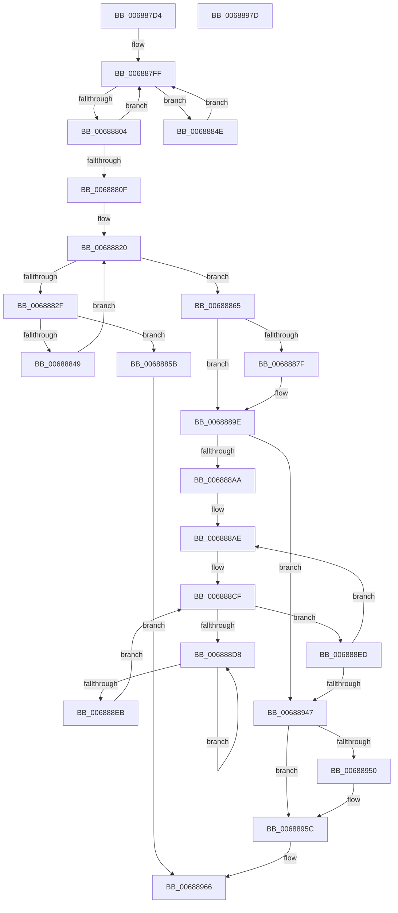

# MiFillUserPhysicalMdl

- RVA: `0x006887D4`–`0x0068897E` (길이 `426` bytes)
- VA: `0x00000001406887D4`
- 실행 섹션: `.text`
- PDB 이름 있음: `예`; PDB Function 태그: `아니요`
- unwind 정보 RVA: `0x0009C52C`
- 디코드: `110`개 명령, `426/426` bytes 표시
- 미해석 바이트: `0` (있으면 어셈블리에 `.byte`로 보존)

> 이 문서는 커널 이미지의 기계어와 PDB 기호를 분석해 생성했습니다. 4번과 5번은 함수 원형과 자료형을 바이너리 사용 방식에서 추정한 C 해석이며 원본 소스 복구 결과는 아닙니다.

## 1. Dependencies

- 직접 호출 지점: **5**; 고유 호출 대상: **5**
- 직접 호출자로 확인된 함수: **1**
- RIP 상대 이미지 참조: **1**

### Outgoing calls
- `0x00688854` → [MiDemotePfnListChain](../69/MiDemotePfnListChain_function_00698B5C.md) (function, `0x00698B5C`)
- `0x00688885` → [KiRaiseIrqlProcessIrqlFlags](../4F/KiRaiseIrqlProcessIrqlFlags_function_004F56FC.md) (function, `0x004F56FC`)
- `0x006888DD` → [KeYieldProcessorEx](../3F/KeYieldProcessorEx_function_003FBD00.md) (function, `0x003FBD00`)
- `0x00688913` → [MiInitializeAwePfn](../4F/MiInitializeAwePfn_function_004F6D94.md) (function, `0x004F6D94`)
- `0x00688957` → [KiLowerIrqlProcessIrqlFlags](../4F/KiLowerIrqlProcessIrqlFlags_function_004F5698.md) (function, `0x004F5698`)

### Direct callers
- [MiAllocateFastAwePages](../../page/80/MiAllocateFastAwePages_function_0080969C.md) at `0x008097CA`

### Static image references
- `0x00688876` → RVA `0x00FC6D20` (`ALMOSTRO`; read)

## 2. Other-region calls and transfers

- 다른 실행 섹션으로 향하는 call: **0**
- 별도 외부 분기/꼬리 이동을 확인하지 못했습니다.

## 3. Assembly (complete function range)

```asm
006887D4  48 89 5C 24 08                  mov qword ptr [rsp + 8], rbx
006887D9  48 89 6C 24 18                  mov qword ptr [rsp + 0x18], rbp
006887DE  56                              push rsi
006887DF  57                              push rdi
006887E0  41 54                           push r12
006887E2  41 56                           push r14
006887E4  41 57                           push r15
006887E6  48 83 EC 20                     sub rsp, 0x20
006887EA  33 FF                           xor edi, edi
006887EC  4D 8B F1                        mov r14, r9
006887EF  4D 8B F8                        mov r15, r8
006887F2  48 8B F2                        mov rsi, rdx
006887F5  48 8B E9                        mov rbp, rcx
006887F8  48 8B DA                        mov rbx, rdx
006887FB  44 8D 67 02                     lea r12d, [rdi + 2]
006887FF  48 39 1B                        cmp qword ptr [rbx], rbx
00688802  75 4A                           jne 0x14068884e
00688804  FF C7                           inc edi
00688806  48 83 C3 18                     add rbx, 0x18
0068880A  41 3B FC                        cmp edi, r12d
0068880D  72 F0                           jb 0x1406887ff
0068880F  48 8D 7E 30                     lea rdi, [rsi + 0x30]
00688813  49 B8 AB AA AA AA AA AA AA AA   movabs r8, 0xaaaaaaaaaaaaaaab
0068881D  48 8B 17                        mov rdx, qword ptr [rdi]
00688820  48 B8 00 00 00 00 00 DE FF FF   movabs rax, 0xffffde0000000000
0068882A  48 3B D7                        cmp rdx, rdi
0068882D  74 36                           je 0x140688865
0068882F  48 8B C0                        mov rax, rax
00688832  48 8B CA                        mov rcx, rdx
00688835  48 2B C8                        sub rcx, rax
00688838  48 C1 F9 04                     sar rcx, 4
0068883C  49 0F AF C8                     imul rcx, r8
00688840  48 83 C1 10                     add rcx, 0x10
00688844  49 3B CF                        cmp rcx, r15
00688847  77 12                           ja 0x14068885b
00688849  48 8B 12                        mov rdx, qword ptr [rdx]
0068884C  EB D2                           jmp 0x140688820
0068884E  41 8B D4                        mov edx, r12d
00688851  48 8B CE                        mov rcx, rsi
00688854  E8 03 03 01 00                  call 0x140698b5c
00688859  EB A4                           jmp 0x1406887ff
0068885B  B8 0D 00 00 C0                  mov eax, 0xc000000d
00688860  E9 01 01 00 00                  jmp 0x140688966
00688865  66 44 09 65 0A                  or word ptr [rbp + 0xa], r12w
0068886A  48 83 C5 30                     add rbp, 0x30
0068886E  44 0F 20 C6                     mov rsi, cr8
00688872  45 0F 22 C4                     mov cr8, r12
00688876  83 3D A3 E4 93 00 00            cmp dword ptr [rip + 0x93e4a3], 0
0068887D  74 1F                           je 0x14068889e
0068887F  41 8A D4                        mov dl, r12b
00688882  40 8A CE                        mov cl, sil
00688885  E8 72 CE E6 FF                  call 0x1404f56fc
0068888A  48 B8 00 00 00 00 00 DE FF FF   movabs rax, 0xffffde0000000000
00688894  49 B8 AB AA AA AA AA AA AA AA   movabs r8, 0xaaaaaaaaaaaaaaab
0068889E  48 8B 1F                        mov rbx, qword ptr [rdi]
006888A1  48 3B DF                        cmp rbx, rdi
006888A4  0F 84 9D 00 00 00               je 0x140688947
006888AA  49 C1 EE 03                     shr r14, 3
006888AE  4C 8B 3B                        mov r15, qword ptr [rbx]
006888B1  48 8B C0                        mov rax, rax
006888B4  48 8B CB                        mov rcx, rbx
006888B7  48 2B C8                        sub rcx, rax
006888BA  48 C1 F9 04                     sar rcx, 4
006888BE  49 0F AF C8                     imul rcx, r8
006888C2  83 64 24 58 00                  and dword ptr [rsp + 0x58], 0
006888C7  48 89 4D 00                     mov qword ptr [rbp], rcx
006888CB  48 8D 6D 08                     lea rbp, [rbp + 8]
006888CF  F0 48 0F BA 6B 18 3F            lock bts qword ptr [rbx + 0x18], 0x3f
006888D6  73 15                           jae 0x1406888ed
006888D8  48 8D 4C 24 58                  lea rcx, [rsp + 0x58]
006888DD  E8 1E 34 D7 FF                  call 0x1403fbd00
006888E2  48 8B 43 18                     mov rax, qword ptr [rbx + 0x18]
006888E6  48 85 C0                        test rax, rax
006888E9  78 ED                           js 0x1406888d8
006888EB  EB E2                           jmp 0x1406888cf
006888ED  48 C7 03 00 00 00 00            mov qword ptr [rbx], 0
006888F4  49 8B CE                        mov rcx, r14
006888F7  48 8B 03                        mov rax, qword ptr [rbx]
006888FA  48 33 C8                        xor rcx, rax
006888FD  48 B8 01 00 00 00 00 F0 FF FF   movabs rax, 0xfffff00000000001
00688907  48 23 C8                        and rcx, rax
0068890A  49 33 CE                        xor rcx, r14
0068890D  48 89 0B                        mov qword ptr [rbx], rcx
00688910  48 8B CB                        mov rcx, rbx
00688913  E8 7C E4 E6 FF                  call 0x1404f6d94
00688918  48 B8 FF FF FF FF FF FF FF 7F   movabs rax, 0x7fffffffffffffff
00688922  F0 48 21 43 18                  lock and qword ptr [rbx + 0x18], rax
00688927  48 B8 00 00 00 00 00 DE FF FF   movabs rax, 0xffffde0000000000
00688931  49 8B DF                        mov rbx, r15
00688934  49 B8 AB AA AA AA AA AA AA AA   movabs r8, 0xaaaaaaaaaaaaaaab
0068893E  4C 3B FF                        cmp r15, rdi
00688941  0F 85 67 FF FF FF               jne 0x1406888ae
00688947  83 3D D2 E3 93 00 00            cmp dword ptr [rip + 0x93e3d2], 0
0068894E  74 0C                           je 0x14068895c
00688950  44 0F 20 C1                     mov rcx, cr8
00688954  40 8A D6                        mov dl, sil
00688957  E8 3C CD E6 FF                  call 0x1404f5698
0068895C  40 0F B6 C6                     movzx eax, sil
00688960  44 0F 22 C0                     mov cr8, rax
00688964  33 C0                           xor eax, eax
00688966  48 8B 5C 24 50                  mov rbx, qword ptr [rsp + 0x50]
0068896B  48 8B 6C 24 60                  mov rbp, qword ptr [rsp + 0x60]
00688970  48 83 C4 20                     add rsp, 0x20
00688974  41 5F                           pop r15
00688976  41 5E                           pop r14
00688978  41 5C                           pop r12
0068897A  5F                              pop rdi
0068897B  5E                              pop rsi
0068897C  C3                              ret
0068897D  CC                              int3
```

## 4. C-style interpretation (structured pseudocode)

```c
__int64 __fastcall MiFillUserPhysicalMdl(__int64 a1, __int64 a2, __int64 a3, __int64 a4)
{
    __int64 result;
    __int64 v_r14;
    __int64 v_rbp;
    __int64 v_rbx;
    __int64 v_rdi;
    __int64 v_rsp;
    unsigned int v_stack_p10;
    unsigned __int64 v_stack_p18;
    unsigned __int64 v_stack_p8;

    v_stack_p8 = v_rbx;
    v_stack_p18 = v_rbp;
    v_rsp = (v_rsp) - (32);
    v_rdi = 0;
loc_006887FF:
    if ((*(unsigned __int64 *)(a2)) != a2) goto loc_0068884E;
    v_rdi = (unsigned int)((v_rdi) + 1);
    v_rbx = (a2) + (24);
    if (((unsigned int)(v_rdi)) < ((unsigned int)(v_rdi + 2))) goto loc_006887FF;
loc_00688820:
    if ((*(unsigned __int64 *)(a2 + 48)) == (a2 + 48)) goto loc_00688865;
    a1 = (*(unsigned __int64 *)(a2 + 48)) - (result);
    a1 = (a1) >> (4);
    a1 = (a1) * (a3);
    a1 = (a1) + (16);
    if (a1 > a3) goto loc_0068885B;
    goto loc_00688820;
loc_0068884E:
    result = MiDemotePfnListChain(a2, (unsigned int)((unsigned int)(v_rdi + 2)), a3, a4);
    goto loc_006887FF;
loc_0068885B:
    goto loc_00688966;
loc_00688865:
    v_rbp = (a1) + (48);
    result = (unsigned int)(0xC000000DULL);
    if ((*(unsigned int *)(v_rip + 9692323)) != 0) {
        a2 = (unsigned __int8)(v_rdi + 2);
        a1 = (unsigned __int8)(v_cr8);
        result = KiRaiseIrqlProcessIrqlFlags(a1, a2, a3, a4);
    }
    if ((*(unsigned __int64 *)(a2 + 48)) == (a2 + 48)) goto loc_00688947;
    v_r14 = (a4) >> (3);
loc_006888AE:
    a1 = (*(unsigned __int64 *)(a2 + 48)) - (result);
    a1 = (a1) >> (4);
    a1 = (a1) * (a3);
    *(unsigned __int64 *)(v_rbp) = a1;
loc_006888CF:
    if (condition_is_above_or_equal) goto loc_006888ED;
loc_006888D8:
    result = KeYieldProcessorEx(v_stack_p10, a2, a3, a4);
    if (sign_flag) goto loc_006888D8;
    goto loc_006888CF;
loc_006888ED:
    *(unsigned __int64 *)(*(unsigned __int64 *)(a2 + 48)) = 0;
    a1 = (v_r14) ^ (*(unsigned __int64 *)(*(unsigned __int64 *)(a2 + 48)));
    a1 = (a1) & (*(unsigned __int64 *)(*(unsigned __int64 *)(a2 + 48)));
    a1 = (a1) ^ (v_r14);
    *(unsigned __int64 *)(*(unsigned __int64 *)(a2 + 48)) = a1;
    result = MiInitializeAwePfn(*(unsigned __int64 *)(a2 + 48), a2, a3, a4);
    if ((*(unsigned __int64 *)(*(unsigned __int64 *)(a2 + 48))) != (a2 + 48)) goto loc_006888AE;
loc_00688947:
    if ((*(unsigned int *)(v_rip + 9692114)) != 0) {
        a1 = v_rdi + 2;
        a2 = (unsigned __int8)(v_cr8);
        result = KiLowerIrqlProcessIrqlFlags(a1, a2, a3, a4);
    }
    result = 0;
loc_00688966:
    v_rsp = (v_rsp) + (32);
    return result;
}
```

## 5. (Beta) C Style

```c
int64_t MiFillUserPhysicalMdl(void *Arg1, void *Arg2, int64_t Arg3, int64_t Arg4)
{
    uint8_t *arg1 = (uint8_t *)Arg1;
    uint8_t *arg2 = (uint8_t *)Arg2;

    int64_t result;
    int64_t local_r14;
    int64_t local_rbp;
    int64_t local_rbx;
    int64_t local_rdi;
    int64_t local_rsp;
    uint32_t v_stack_p10;
    uint64_t v_stack_p18;
    uint64_t v_stack_p8;

    v_stack_p8 = local_rbx;
    v_stack_p18 = local_rbp;
    local_rsp = (local_rsp) - (32);
    local_rdi = 0;
loc_006887FF:
    if ((*(uint64_t *)(arg2)) != Arg2) goto loc_0068884E;
    local_rdi = (uint32_t)((local_rdi) + 1);
    local_rbx = (Arg2) + (24);
    if (((uint32_t)(local_rdi)) < ((uint32_t)(local_rdi + 2))) goto loc_006887FF;
loc_00688820:
    if ((*(uint64_t *)(arg2 + 0x30)) == (Arg2 + 48)) goto loc_00688865;
    Arg1 = (*(uint64_t *)(arg2 + 0x30)) - (result);
    Arg1 = (Arg1) >> (4);
    Arg1 = (Arg1) * (Arg3);
    Arg1 = (Arg1) + (16);
    if (Arg1 > Arg3) goto loc_0068885B;
    goto loc_00688820;
loc_0068884E:
    result = MiDemotePfnListChain(Arg2, (uint32_t)((uint32_t)(local_rdi + 2)), Arg3, Arg4);
    goto loc_006887FF;
loc_0068885B:
    goto loc_00688966;
loc_00688865:
    local_rbp = (Arg1) + (48);
    result = (uint32_t)(0xC000000DULL);
    if ((*(uint32_t *)(v_rip + 0x93E4A3)) != 0) {
        Arg2 = (uint8_t)(local_rdi + 2);
        Arg1 = (uint8_t)(v_cr8);
        result = KiRaiseIrqlProcessIrqlFlags(Arg1, Arg2, Arg3, Arg4);
    }
    if ((*(uint64_t *)(arg2 + 0x30)) == (Arg2 + 48)) goto loc_00688947;
    local_r14 = (Arg4) >> (3);
loc_006888AE:
    Arg1 = (*(uint64_t *)(arg2 + 0x30)) - (result);
    Arg1 = (Arg1) >> (4);
    Arg1 = (Arg1) * (Arg3);
    *(void **)(local_rbp) = Arg1;
loc_006888CF:
    if (condition_is_above_or_equal) goto loc_006888ED;
loc_006888D8:
    result = KeYieldProcessorEx(v_stack_p10, Arg2, Arg3, Arg4);
    if (sign_flag) goto loc_006888D8;
    goto loc_006888CF;
loc_006888ED:
    *(uint64_t *)(*(uint64_t *)(arg2 + 0x30)) = 0;
    Arg1 = (local_r14) ^ (*(uint64_t *)(*(uint64_t *)(arg2 + 0x30)));
    Arg1 = (Arg1) & (*(uint64_t *)(*(uint64_t *)(arg2 + 0x30)));
    Arg1 = (Arg1) ^ (local_r14);
    *(void **)(*(uint64_t *)(arg2 + 0x30)) = Arg1;
    result = MiInitializeAwePfn(*(uint64_t *)(arg2 + 0x30), Arg2, Arg3, Arg4);
    if ((*(uint64_t *)(*(uint64_t *)(arg2 + 0x30))) != (Arg2 + 48)) goto loc_006888AE;
loc_00688947:
    if ((*(uint32_t *)(v_rip + 0x93E3D2)) != 0) {
        Arg1 = local_rdi + 2;
        Arg2 = (uint8_t)(v_cr8);
        result = KiLowerIrqlProcessIrqlFlags(Arg1, Arg2, Arg3, Arg4);
    }
    result = 0;
loc_00688966:
    local_rsp = (local_rsp) + (32);
    return result;
}
```

### 관측된 메모리 오프셋

구조체 형식이 확인되지 않은 접근은 인자 기준의 오프셋으로만 기록했습니다.

| 기준 인자 | 오프셋 표현 | 폭 (bit) | 접근 |
|---|---:|---:|---|
| `Arg1` | `+ 0x0` | `64` | `W` |
| `Arg1` | `+ 0x8` | `64` | `R` |
| `Arg1` | `+ 0xA` | `16` | `R/W` |
| `Arg2` | `+ 0x0` | `64` | `R` |
| `Arg2` | `+ 0x30` | `64` | `R` |

## 6. Execution-region graph

[열기: 2D/3D 그래프와 함수 탐색 컨트롤 패널](../../../control-panel.html?section=text&rva=0x006887D4&view=graph)

- 2D 그래프는 위에서 아래로 흐르고, 3D 그래프는 빈 공간을 드래그해 회전합니다. Shift+드래그는 이동, 휠은 확대·축소, 함수 노드 선택은 대상 보고서 이동입니다.

### Static fallback


