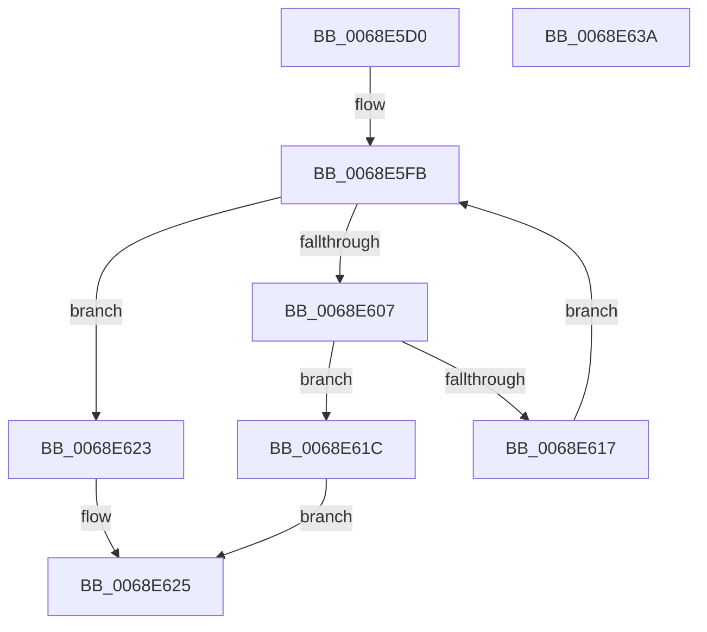

# MiFindDefragmentSlabEntriesHelperByIdentity

- RVA: `0x0068E5D0`–`0x0068E63B` (길이 `107` bytes)
- VA: `0x000000014068E5D0`
- 실행 섹션: `.text`
- PDB 이름 있음: `예`; PDB Function 태그: `아니요`
- unwind 정보 RVA: `0x0005C954`
- 디코드: `32`개 명령, `107/107` bytes 표시
- 미해석 바이트: `0` (있으면 어셈블리에 `.byte`로 보존)

> 이 문서는 커널 이미지의 기계어와 PDB 기호를 분석해 생성했습니다. 4번과 5번은 함수 원형과 자료형을 바이너리 사용 방식에서 추정한 C 해석이며 원본 소스 복구 결과는 아닙니다.

## 1. Dependencies

- 직접 호출 지점: **1**; 고유 호출 대상: **1**
- 직접 호출자로 확인된 함수: **0**
- RIP 상대 이미지 참조: **0**

### Outgoing calls
- `0x0068E60E` → [MiCheckSlabEntryForDefrag](MiCheckSlabEntryForDefrag_function_0068D174.md) (function, `0x0068D174`)

### Direct callers
- 이 함수 시작 RVA로 연결되는 직접 call은 확인되지 않았습니다. 간접 호출은 완전히 역산할 수 없습니다.

### Static image references
- 디코드된 RIP-relative 메모리 참조가 없습니다.

## 2. Other-region calls and transfers

- 다른 실행 섹션으로 향하는 call: **0**
- 별도 외부 분기/꼬리 이동을 확인하지 못했습니다.

## 3. Assembly (complete function range)

```asm
0068E5D0  48 89 5C 24 08                  mov qword ptr [rsp + 8], rbx
0068E5D5  48 89 6C 24 10                  mov qword ptr [rsp + 0x10], rbp
0068E5DA  48 89 74 24 18                  mov qword ptr [rsp + 0x18], rsi
0068E5DF  57                              push rdi
0068E5E0  48 83 EC 20                     sub rsp, 0x20
0068E5E4  41 0F B6 78 58                  movzx edi, byte ptr [r8 + 0x58]
0068E5E9  49 8B E8                        mov rbp, r8
0068E5EC  48 8B 42 58                     mov rax, qword ptr [rdx + 0x58]
0068E5F0  48 8B F2                        mov rsi, rdx
0068E5F3  48 C1 E7 04                     shl rdi, 4
0068E5F7  48 8B 1C 07                     mov rbx, qword ptr [rdi + rax]
0068E5FB  48 8B 4E 58                     mov rcx, qword ptr [rsi + 0x58]
0068E5FF  48 03 CF                        add rcx, rdi
0068E602  48 3B D9                        cmp rbx, rcx
0068E605  74 1C                           je 0x14068e623
0068E607  48 8D 53 E8                     lea rdx, [rbx - 0x18]
0068E60B  48 8B CD                        mov rcx, rbp
0068E60E  E8 61 EB FF FF                  call 0x14068d174
0068E613  85 C0                           test eax, eax
0068E615  75 05                           jne 0x14068e61c
0068E617  48 8B 1B                        mov rbx, qword ptr [rbx]
0068E61A  EB DF                           jmp 0x14068e5fb
0068E61C  B8 01 00 00 00                  mov eax, 1
0068E621  EB 02                           jmp 0x14068e625
0068E623  33 C0                           xor eax, eax
0068E625  48 8B 5C 24 30                  mov rbx, qword ptr [rsp + 0x30]
0068E62A  48 8B 6C 24 38                  mov rbp, qword ptr [rsp + 0x38]
0068E62F  48 8B 74 24 40                  mov rsi, qword ptr [rsp + 0x40]
0068E634  48 83 C4 20                     add rsp, 0x20
0068E638  5F                              pop rdi
0068E639  C3                              ret
0068E63A  CC                              int3
```

## 4. C-style interpretation (structured pseudocode)

```c
__int64 __fastcall MiFindDefragmentSlabEntriesHelperByIdentity(__int64 a1, __int64 a2, __int64 a3)
{
    __int64 result;
    __int64 v_rdi;
    __int64 v_rsp;
    unsigned __int64 v_stack_p10;
    unsigned __int64 v_stack_p18;
    unsigned __int64 v_stack_p8;

    v_stack_p8 = v_rbx;
    v_stack_p10 = v_rbp;
    v_stack_p18 = v_rsi;
    v_rsp = (v_rsp) - (32);
    v_rdi = (*(unsigned __int8 *)(a3 + 88)) << (4);
loc_0068E5FB:
    a1 = (*(unsigned __int64 *)(a2 + 88)) + (v_rdi);
    if ((*(unsigned __int64 *)(v_rdi + *(unsigned __int64 *)(a2 + 88) * 1)) == a1) goto loc_0068E623;
    result = MiCheckSlabEntryForDefrag(a3, *(unsigned __int64 *)(v_rdi + *(unsigned __int64 *)(a2 + 88) * 1) - 24, a3, a4);
    if ((unsigned int)(result) != 0) goto loc_0068E61C;
    goto loc_0068E5FB;
loc_0068E61C:
    goto loc_0068E625;
loc_0068E623:
    result = 0;
loc_0068E625:
    v_rsp = (v_rsp) + (32);
    return result;
}
```

## 5. (Beta) C Style

```c
int64_t MiFindDefragmentSlabEntriesHelperByIdentity(int64_t Arg1, void *Arg2, void *Arg3)
{
    uint8_t *arg2 = (uint8_t *)Arg2;
    uint8_t *arg3 = (uint8_t *)Arg3;

    int64_t result;
    int64_t local_rdi;
    int64_t local_rsp;
    uint64_t v_stack_p10;
    uint64_t v_stack_p18;
    uint64_t v_stack_p8;

    v_stack_p8 = local_rbx;
    v_stack_p10 = local_rbp;
    v_stack_p18 = local_rsi;
    local_rsp = (local_rsp) - (32);
    local_rdi = (*(uint8_t *)(arg3 + 0x58)) << (4);
loc_0068E5FB:
    Arg1 = (*(uint64_t *)(arg2 + 0x58)) + (local_rdi);
    if ((*(uint64_t *)(local_rdi + *(uint64_t *)(arg2 + 0x58) * 1)) == Arg1) goto loc_0068E623;
    result = MiCheckSlabEntryForDefrag(Arg3, *(uint64_t *)(local_rdi + *(uint64_t *)(arg2 + 0x58) * 1) - 24, Arg3, a4);
    if ((uint32_t)(result) != 0) goto loc_0068E61C;
    goto loc_0068E5FB;
loc_0068E61C:
    goto loc_0068E625;
loc_0068E623:
    result = 0;
loc_0068E625:
    local_rsp = (local_rsp) + (32);
    return result;
}
```

### 관측된 메모리 오프셋

구조체 형식이 확인되지 않은 접근은 인자 기준의 오프셋으로만 기록했습니다.

| 기준 인자 | 오프셋 표현 | 폭 (bit) | 접근 |
|---|---:|---:|---|
| `Arg2` | `+ 0x58` | `64` | `R` |
| `Arg3` | `+ 0x58` | `8` | `R` |

## 6. Execution-region graph

[열기: 2D/3D 그래프와 함수 탐색 컨트롤 패널](../../../control-panel.html?section=text&rva=0x0068E5D0&view=graph)

- 2D 그래프는 위에서 아래로 흐르고, 3D 그래프는 빈 공간을 드래그해 회전합니다. Shift+드래그는 이동, 휠은 확대·축소, 함수 노드 선택은 대상 보고서 이동입니다.

### Static fallback


