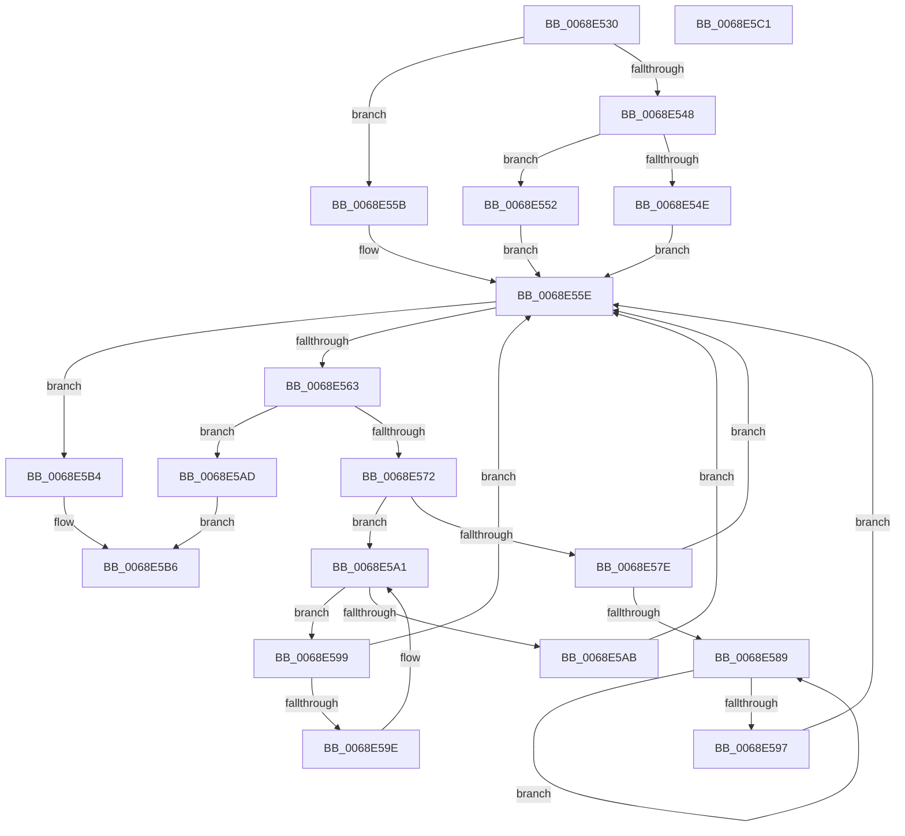

# MiFindDefragmentSlabEntriesHelper

- RVA: `0x0068E530`–`0x0068E5C2` (길이 `146` bytes)
- VA: `0x000000014068E530`
- 실행 섹션: `.text`
- PDB 이름 있음: `예`; PDB Function 태그: `아니요`
- unwind 정보 RVA: `0x0005CAAC`
- 디코드: `52`개 명령, `146/146` bytes 표시
- 미해석 바이트: `0` (있으면 어셈블리에 `.byte`로 보존)

> 이 문서는 커널 이미지의 기계어와 PDB 기호를 분석해 생성했습니다. 4번과 5번은 함수 원형과 자료형을 바이너리 사용 방식에서 추정한 C 해석이며 원본 소스 복구 결과는 아닙니다.

## 1. Dependencies

- 직접 호출 지점: **1**; 고유 호출 대상: **1**
- 직접 호출자로 확인된 함수: **0**
- RIP 상대 이미지 참조: **0**

### Outgoing calls
- `0x0068E569` → [MiCheckSlabEntryForDefrag](MiCheckSlabEntryForDefrag_function_0068D174.md) (function, `0x0068D174`)

### Direct callers
- 이 함수 시작 RVA로 연결되는 직접 call은 확인되지 않았습니다. 간접 호출은 완전히 역산할 수 없습니다.

### Static image references
- 디코드된 RIP-relative 메모리 참조가 없습니다.

## 2. Other-region calls and transfers

- 다른 실행 섹션으로 향하는 call: **0**
- 별도 외부 분기/꼬리 이동을 확인하지 못했습니다.

## 3. Assembly (complete function range)

```asm
0068E530  48 89 5C 24 08                  mov qword ptr [rsp + 8], rbx
0068E535  57                              push rdi
0068E536  48 83 EC 20                     sub rsp, 0x20
0068E53A  48 8B 42 08                     mov rax, qword ptr [rdx + 8]
0068E53E  49 8B F8                        mov rdi, r8
0068E541  48 8B DA                        mov rbx, rdx
0068E544  A8 01                           test al, 1
0068E546  74 13                           je 0x14068e55b
0068E548  48 83 F8 01                     cmp rax, 1
0068E54C  75 04                           jne 0x14068e552
0068E54E  33 DB                           xor ebx, ebx
0068E550  EB 0C                           jmp 0x14068e55e
0068E552  48 83 CB 01                     or rbx, 1
0068E556  48 33 D8                        xor rbx, rax
0068E559  EB 03                           jmp 0x14068e55e
0068E55B  48 8B D8                        mov rbx, rax
0068E55E  48 85 DB                        test rbx, rbx
0068E561  74 51                           je 0x14068e5b4
0068E563  48 8B D3                        mov rdx, rbx
0068E566  48 8B CF                        mov rcx, rdi
0068E569  E8 06 EC FF FF                  call 0x14068d174
0068E56E  85 C0                           test eax, eax
0068E570  75 3B                           jne 0x14068e5ad
0068E572  48 8B 43 08                     mov rax, qword ptr [rbx + 8]
0068E576  48 8B CB                        mov rcx, rbx
0068E579  48 85 C0                        test rax, rax
0068E57C  74 23                           je 0x14068e5a1
0068E57E  48 8B 08                        mov rcx, qword ptr [rax]
0068E581  48 8B D8                        mov rbx, rax
0068E584  48 85 C9                        test rcx, rcx
0068E587  74 D5                           je 0x14068e55e
0068E589  48 8B 01                        mov rax, qword ptr [rcx]
0068E58C  48 8B D9                        mov rbx, rcx
0068E58F  48 8B C8                        mov rcx, rax
0068E592  48 85 C0                        test rax, rax
0068E595  75 F2                           jne 0x14068e589
0068E597  EB C5                           jmp 0x14068e55e
0068E599  48 39 0B                        cmp qword ptr [rbx], rcx
0068E59C  74 C0                           je 0x14068e55e
0068E59E  48 8B CB                        mov rcx, rbx
0068E5A1  48 8B 5B 10                     mov rbx, qword ptr [rbx + 0x10]
0068E5A5  48 83 E3 FC                     and rbx, 0xfffffffffffffffc
0068E5A9  75 EE                           jne 0x14068e599
0068E5AB  EB B1                           jmp 0x14068e55e
0068E5AD  B8 01 00 00 00                  mov eax, 1
0068E5B2  EB 02                           jmp 0x14068e5b6
0068E5B4  33 C0                           xor eax, eax
0068E5B6  48 8B 5C 24 30                  mov rbx, qword ptr [rsp + 0x30]
0068E5BB  48 83 C4 20                     add rsp, 0x20
0068E5BF  5F                              pop rdi
0068E5C0  C3                              ret
0068E5C1  CC                              int3
```

## 4. C-style interpretation (structured pseudocode)

```c
__int64 __fastcall MiFindDefragmentSlabEntriesHelper(__int64 a1, __int64 a2, __int64 a3)
{
    __int64 result;
    __int64 v_rbx;
    __int64 v_rsp;
    unsigned __int64 v_stack_p8;

    v_stack_p8 = v_rbx;
    v_rsp = (v_rsp) - (32);
    if ((((unsigned __int8)(*(unsigned __int64 *)(a2 + 8))) & (1)) == 0) goto loc_0068E55B;
    if ((*(unsigned __int64 *)(a2 + 8)) != 1) goto loc_0068E552;
    v_rbx = 0;
    goto loc_0068E55E;
loc_0068E552:
    v_rbx = (v_rbx) | (1);
    v_rbx = (v_rbx) ^ (*(unsigned __int64 *)(a2 + 8));
    goto loc_0068E55E;
loc_0068E55B:
loc_0068E55E:
    if (*(unsigned __int64 *)(a2 + 8) == 0) goto loc_0068E5B4;
    result = MiCheckSlabEntryForDefrag(a3, *(unsigned __int64 *)(a2 + 8), a3, a4);
    if ((unsigned int)(result) != 0) goto loc_0068E5AD;
    if (*(unsigned __int64 *)(*(unsigned __int64 *)(a2 + 8) + 8) == 0) goto loc_0068E5A1;
    if (*(unsigned __int64 *)(*(unsigned __int64 *)(*(unsigned __int64 *)(a2 + 8) + 8)) == 0) goto loc_0068E55E;
loc_0068E589:
    if (*(unsigned __int64 *)(*(unsigned __int64 *)(*(unsigned __int64 *)(*(unsigned __int64 *)(a2 + 8) + 8))) != 0) goto loc_0068E589;
    goto loc_0068E55E;
loc_0068E599:
    if ((*(unsigned __int64 *)(*(unsigned __int64 *)(*(unsigned __int64 *)(*(unsigned __int64 *)(a2 + 8) + 8)))) == (*(unsigned __int64 *)(*(unsigned __int64 *)(*(unsigned __int64 *)(*(unsigned __int64 *)(a2 + 8) + 8))))) goto loc_0068E55E;
loc_0068E5A1:
    v_rbx = (*(unsigned __int64 *)(*(unsigned __int64 *)(*(unsigned __int64 *)(*(unsigned __int64 *)(a2 + 8) + 8)) + 16)) & (-4);
    if (condition_is_not_equal) goto loc_0068E599;
    goto loc_0068E55E;
loc_0068E5AD:
    goto loc_0068E5B6;
loc_0068E5B4:
    result = 0;
loc_0068E5B6:
    v_rsp = (v_rsp) + (32);
    return result;
}
```

## 5. (Beta) C Style

```c
int64_t MiFindDefragmentSlabEntriesHelper(int64_t Arg1, void *Arg2, int64_t Arg3)
{
    uint8_t *arg2 = (uint8_t *)Arg2;

    int64_t result;
    int64_t local_rbx;
    int64_t local_rsp;
    uint64_t v_stack_p8;

    v_stack_p8 = local_rbx;
    local_rsp = (local_rsp) - (32);
    if ((((uint8_t)(*(uint64_t *)(arg2 + 0x8))) & (1)) == 0) goto loc_0068E55B;
    if ((*(uint64_t *)(arg2 + 0x8)) != 1) goto loc_0068E552;
    local_rbx = 0;
    goto loc_0068E55E;
loc_0068E552:
    local_rbx = (local_rbx) | (1);
    local_rbx = (local_rbx) ^ (*(uint64_t *)(arg2 + 0x8));
    goto loc_0068E55E;
loc_0068E55B:
loc_0068E55E:
    if (*(uint64_t *)(arg2 + 0x8) == 0) goto loc_0068E5B4;
    result = MiCheckSlabEntryForDefrag(Arg3, *(uint64_t *)(arg2 + 0x8), Arg3, a4);
    if ((uint32_t)(result) != 0) goto loc_0068E5AD;
    if (*(uint64_t *)(*(uint64_t *)(arg2 + 0x8) + 0x8) == 0) goto loc_0068E5A1;
    if (*(uint64_t *)(*(uint64_t *)(*(uint64_t *)(arg2 + 0x8) + 0x8)) == 0) goto loc_0068E55E;
loc_0068E589:
    if (*(uint64_t *)(*(uint64_t *)(*(uint64_t *)(*(uint64_t *)(arg2 + 0x8) + 0x8))) != 0) goto loc_0068E589;
    goto loc_0068E55E;
loc_0068E599:
    if ((*(uint64_t *)(*(uint64_t *)(*(uint64_t *)(*(uint64_t *)(arg2 + 0x8) + 0x8)))) == (*(uint64_t *)(*(uint64_t *)(*(uint64_t *)(*(uint64_t *)(arg2 + 0x8) + 0x8))))) goto loc_0068E55E;
loc_0068E5A1:
    local_rbx = (*(uint64_t *)(*(uint64_t *)(*(uint64_t *)(*(uint64_t *)(arg2 + 0x8) + 0x8)) + 0x10)) & (-4);
    if (condition_is_not_equal) goto loc_0068E599;
    goto loc_0068E55E;
loc_0068E5AD:
    goto loc_0068E5B6;
loc_0068E5B4:
    result = 0;
loc_0068E5B6:
    local_rsp = (local_rsp) + (32);
    return result;
}
```

### 관측된 메모리 오프셋

구조체 형식이 확인되지 않은 접근은 인자 기준의 오프셋으로만 기록했습니다.

| 기준 인자 | 오프셋 표현 | 폭 (bit) | 접근 |
|---|---:|---:|---|
| `Arg2` | `+ 0x8` | `64` | `R` |

## 6. Execution-region graph

[열기: 2D/3D 그래프와 함수 탐색 컨트롤 패널](../../../control-panel.html?section=text&rva=0x0068E530&view=graph)

- 2D 그래프는 위에서 아래로 흐르고, 3D 그래프는 빈 공간을 드래그해 회전합니다. Shift+드래그는 이동, 휠은 확대·축소, 함수 노드 선택은 대상 보고서 이동입니다.

### Static fallback


