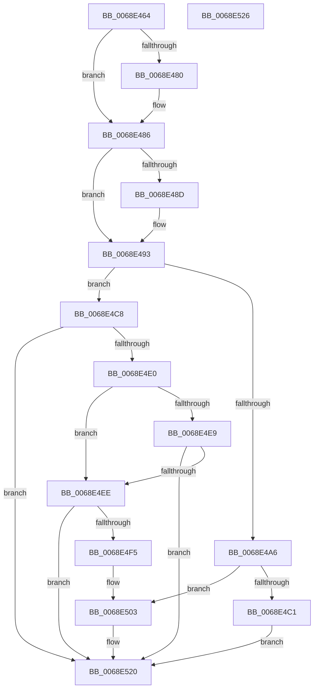

# MiFindDefragmentSlabEntries

- RVA: `0x0068E464`–`0x0068E527` (길이 `195` bytes)
- VA: `0x000000014068E464`
- 실행 섹션: `.text`
- PDB 이름 있음: `예`; PDB Function 태그: `아니요`
- unwind 정보 RVA: `0x00064C80`
- 디코드: `58`개 명령, `195/195` bytes 표시
- 미해석 바이트: `0` (있으면 어셈블리에 `.byte`로 보존)

> 이 문서는 커널 이미지의 기계어와 PDB 기호를 분석해 생성했습니다. 4번과 5번은 함수 원형과 자료형을 바이너리 사용 방식에서 추정한 C 해석이며 원본 소스 복구 결과는 아닙니다.

## 1. Dependencies

- 직접 호출 지점: **3**; 고유 호출 대상: **1**
- 직접 호출자로 확인된 함수: **1**
- RIP 상대 이미지 참조: **3**

### Outgoing calls
- `0x0068E4B2` → [MiEnumerateSlabAllocatorsEx](../47/MiEnumerateSlabAllocatorsEx_function_004746F8.md) (function, `0x004746F8`)
- `0x0068E4D2` → [MiEnumerateSlabAllocatorsEx](../47/MiEnumerateSlabAllocatorsEx_function_004746F8.md) (function, `0x004746F8`)
- `0x0068E51B` → [MiEnumerateSlabAllocatorsEx](../47/MiEnumerateSlabAllocatorsEx_function_004746F8.md) (function, `0x004746F8`)

### Direct callers
- [MiEstablishDefragSlabEntries](MiEstablishDefragSlabEntries_function_0068E0EC.md) at `0x0068E261`

### Static image references
- `0x0068E4AB` → RVA `0x0068D250` (`MiCountSlabContextAvailablePagesForDefrag`; read)
- `0x0068E4CB` → RVA `0x0068E5D0` (`MiFindDefragmentSlabEntriesHelperByIdentity`; read)
- `0x0068E506` → RVA `0x0068E530` (`MiFindDefragmentSlabEntriesHelper`; read)

## 2. Other-region calls and transfers

- 다른 실행 섹션으로 향하는 call: **0**
- 별도 외부 분기/꼬리 이동을 확인하지 못했습니다.

## 3. Assembly (complete function range)

```asm
0068E464  40 53                           push rbx
0068E466  48 83 EC 30                     sub rsp, 0x30
0068E46A  8B 41 54                        mov eax, dword ptr [rcx + 0x54]
0068E46D  48 8B D9                        mov rbx, rcx
0068E470  48 83 64 24 40 00               and qword ptr [rsp + 0x40], 0
0068E476  83 E0 9F                        and eax, 0xffffff9f
0068E479  89 41 54                        mov dword ptr [rcx + 0x54], eax
0068E47C  A8 10                           test al, 0x10
0068E47E  75 06                           jne 0x14068e486
0068E480  83 C8 20                        or eax, 0x20
0068E483  89 41 54                        mov dword ptr [rcx + 0x54], eax
0068E486  48 83 79 38 00                  cmp qword ptr [rcx + 0x38], 0
0068E48B  74 06                           je 0x14068e493
0068E48D  83 C8 40                        or eax, 0x40
0068E490  89 41 54                        mov dword ptr [rcx + 0x54], eax
0068E493  8B 41 48                        mov eax, dword ptr [rcx + 0x48]
0068E496  48 8B 09                        mov rcx, qword ptr [rcx]
0068E499  44 8B 4B 44                     mov r9d, dword ptr [rbx + 0x44]
0068E49D  89 44 24 20                     mov dword ptr [rsp + 0x20], eax
0068E4A1  83 F8 08                        cmp eax, 8
0068E4A4  74 22                           je 0x14068e4c8
0068E4A6  4C 8D 44 24 40                  lea r8, [rsp + 0x40]
0068E4AB  48 8D 15 9E ED FF FF            lea rdx, [rip - 0x1262]
0068E4B2  E8 41 62 DE FF                  call 0x1404746f8
0068E4B7  8B 43 4C                        mov eax, dword ptr [rbx + 0x4c]
0068E4BA  48 39 44 24 40                  cmp qword ptr [rsp + 0x40], rax
0068E4BF  73 42                           jae 0x14068e503
0068E4C1  48 83 63 28 00                  and qword ptr [rbx + 0x28], 0
0068E4C6  EB 58                           jmp 0x14068e520
0068E4C8  4C 8B C3                        mov r8, rbx
0068E4CB  48 8D 15 FE 00 00 00            lea rdx, [rip + 0xfe]
0068E4D2  E8 21 62 DE FF                  call 0x1404746f8
0068E4D7  48 8B 4B 28                     mov rcx, qword ptr [rbx + 0x28]
0068E4DB  48 85 C9                        test rcx, rcx
0068E4DE  74 40                           je 0x14068e520
0068E4E0  48 8B 43 30                     mov rax, qword ptr [rbx + 0x30]
0068E4E4  48 85 C0                        test rax, rax
0068E4E7  74 05                           je 0x14068e4ee
0068E4E9  48 3B C8                        cmp rcx, rax
0068E4EC  75 32                           jne 0x14068e520
0068E4EE  8B 43 54                        mov eax, dword ptr [rbx + 0x54]
0068E4F1  A8 08                           test al, 8
0068E4F3  74 2B                           je 0x14068e520
0068E4F5  83 E0 AF                        and eax, 0xffffffaf
0068E4F8  83 C8 20                        or eax, 0x20
0068E4FB  48 83 63 30 00                  and qword ptr [rbx + 0x30], 0
0068E500  89 43 54                        mov dword ptr [rbx + 0x54], eax
0068E503  8B 43 48                        mov eax, dword ptr [rbx + 0x48]
0068E506  48 8D 15 23 00 00 00            lea rdx, [rip + 0x23]
0068E50D  44 8B 4B 44                     mov r9d, dword ptr [rbx + 0x44]
0068E511  4C 8B C3                        mov r8, rbx
0068E514  48 8B 0B                        mov rcx, qword ptr [rbx]
0068E517  89 44 24 20                     mov dword ptr [rsp + 0x20], eax
0068E51B  E8 D8 61 DE FF                  call 0x1404746f8
0068E520  48 83 C4 30                     add rsp, 0x30
0068E524  5B                              pop rbx
0068E525  C3                              ret
0068E526  CC                              int3
```

## 4. C-style interpretation (structured pseudocode)

```c
__int64 __fastcall MiFindDefragmentSlabEntries(__int64 a1)
{
    __int64 result;
    __int64 v_rsp;
    unsigned int v_stack_m18;
    unsigned __int64 v_stack_p8;

    v_rsp = (v_rsp) - (48);
    result = (unsigned int)(((unsigned int)(*(unsigned int *)(a1 + 84))) & (0xFFFFFF9FULL));
    *(unsigned int *)(a1 + 84) = (unsigned int)(result);
    if ((((unsigned __int8)(result)) & (16)) == 0) {
        result = (unsigned int)((result) | (32));
        *(unsigned int *)(a1 + 84) = (unsigned int)(result);
    }
    if ((*(unsigned __int64 *)(a1 + 56)) != 0) {
        result = (unsigned int)((result) | (64));
        *(unsigned int *)(a1 + 84) = (unsigned int)(result);
    }
    v_stack_m18 = (unsigned int)((unsigned int)(*(unsigned int *)(a1 + 72)));
    if (((unsigned int)((unsigned int)(*(unsigned int *)(a1 + 72)))) == 8) goto loc_0068E4C8;
    result = MiEnumerateSlabAllocatorsEx(*(unsigned __int64 *)(a1), v_rip - 4706, v_stack_p8, (unsigned int)(*(unsigned int *)(a1 + 68)));
    if (v_stack_p8 >= ((unsigned int)(*(unsigned int *)(a1 + 76)))) goto loc_0068E503;
    goto loc_0068E520;
loc_0068E4C8:
    result = MiEnumerateSlabAllocatorsEx(*(unsigned __int64 *)(a1), v_rip + 254, a1, (unsigned int)(*(unsigned int *)(a1 + 68)));
    if (*(unsigned __int64 *)(a1 + 40) == 0) goto loc_0068E520;
    if (*(unsigned __int64 *)(a1 + 48) == 0) goto loc_0068E4EE;
    if ((*(unsigned __int64 *)(a1 + 40)) != (*(unsigned __int64 *)(a1 + 48))) goto loc_0068E520;
loc_0068E4EE:
    if ((((unsigned __int8)((unsigned int)(*(unsigned int *)(a1 + 84)))) & (8)) == 0) goto loc_0068E520;
    result = (unsigned int)(((unsigned int)(*(unsigned int *)(a1 + 84))) & (0xFFFFFFAFULL));
    result = (unsigned int)((result) | (32));
    *(unsigned int *)(a1 + 84) = (unsigned int)(result);
loc_0068E503:
    v_stack_m18 = (unsigned int)((unsigned int)(*(unsigned int *)(a1 + 72)));
    result = MiEnumerateSlabAllocatorsEx(*(unsigned __int64 *)(a1), v_rip + 35, a1, (unsigned int)(*(unsigned int *)(a1 + 68)));
loc_0068E520:
    v_rsp = (v_rsp) + (48);
    return result;
}
```

## 5. (Beta) C Style

```c
int64_t MiFindDefragmentSlabEntries(void *Arg1)
{
    uint8_t *arg1 = (uint8_t *)Arg1;

    int64_t result;
    int64_t local_rsp;
    uint32_t v_stack_m18;
    uint64_t v_stack_p8;

    local_rsp = (local_rsp) - (48);
    result = (uint32_t)(((uint32_t)(*(uint32_t *)(arg1 + 0x54))) & (0xFFFFFF9FULL));
    *(uint32_t *)(arg1 + 0x54) = (uint32_t)(result);
    if ((((uint8_t)(result)) & (16)) == 0) {
        result = (uint32_t)((result) | (32));
        *(uint32_t *)(arg1 + 0x54) = (uint32_t)(result);
    }
    if ((*(uint64_t *)(arg1 + 0x38)) != 0) {
        result = (uint32_t)((result) | (64));
        *(uint32_t *)(arg1 + 0x54) = (uint32_t)(result);
    }
    v_stack_m18 = (uint32_t)((uint32_t)(*(uint32_t *)(arg1 + 0x48)));
    if (((uint32_t)((uint32_t)(*(uint32_t *)(arg1 + 0x48)))) == 8) goto loc_0068E4C8;
    result = MiEnumerateSlabAllocatorsEx(*(uint64_t *)(arg1), v_rip - 4706, v_stack_p8, (uint32_t)(*(uint32_t *)(arg1 + 0x44)));
    if (v_stack_p8 >= ((uint32_t)(*(uint32_t *)(arg1 + 0x4C)))) goto loc_0068E503;
    goto loc_0068E520;
loc_0068E4C8:
    result = MiEnumerateSlabAllocatorsEx(*(uint64_t *)(arg1), v_rip + 254, Arg1, (uint32_t)(*(uint32_t *)(arg1 + 0x44)));
    if (*(uint64_t *)(arg1 + 0x28) == 0) goto loc_0068E520;
    if (*(uint64_t *)(arg1 + 0x30) == 0) goto loc_0068E4EE;
    if ((*(uint64_t *)(arg1 + 0x28)) != (*(uint64_t *)(arg1 + 0x30))) goto loc_0068E520;
loc_0068E4EE:
    if ((((uint8_t)((uint32_t)(*(uint32_t *)(arg1 + 0x54)))) & (8)) == 0) goto loc_0068E520;
    result = (uint32_t)(((uint32_t)(*(uint32_t *)(arg1 + 0x54))) & (0xFFFFFFAFULL));
    result = (uint32_t)((result) | (32));
    *(uint32_t *)(arg1 + 0x54) = (uint32_t)(result);
loc_0068E503:
    v_stack_m18 = (uint32_t)((uint32_t)(*(uint32_t *)(arg1 + 0x48)));
    result = MiEnumerateSlabAllocatorsEx(*(uint64_t *)(arg1), v_rip + 35, Arg1, (uint32_t)(*(uint32_t *)(arg1 + 0x44)));
loc_0068E520:
    local_rsp = (local_rsp) + (48);
    return result;
}
```

### 관측된 메모리 오프셋

구조체 형식이 확인되지 않은 접근은 인자 기준의 오프셋으로만 기록했습니다.

| 기준 인자 | 오프셋 표현 | 폭 (bit) | 접근 |
|---|---:|---:|---|
| `Arg1` | `+ 0x0` | `64` | `R` |
| `Arg1` | `+ 0x28` | `64` | `R` |
| `Arg1` | `+ 0x28` | `64` | `R/W` |
| `Arg1` | `+ 0x30` | `64` | `R` |
| `Arg1` | `+ 0x30` | `64` | `R/W` |
| `Arg1` | `+ 0x38` | `64` | `R` |
| `Arg1` | `+ 0x44` | `32` | `R` |
| `Arg1` | `+ 0x48` | `32` | `R` |
| `Arg1` | `+ 0x4C` | `32` | `R` |
| `Arg1` | `+ 0x54` | `32` | `R` |
| `Arg1` | `+ 0x54` | `32` | `W` |

## 6. Execution-region graph

[열기: 2D/3D 그래프와 함수 탐색 컨트롤 패널](../../../control-panel.html?section=text&rva=0x0068E464&view=graph)

- 2D 그래프는 위에서 아래로 흐르고, 3D 그래프는 빈 공간을 드래그해 회전합니다. Shift+드래그는 이동, 휠은 확대·축소, 함수 노드 선택은 대상 보고서 이동입니다.

### Static fallback


