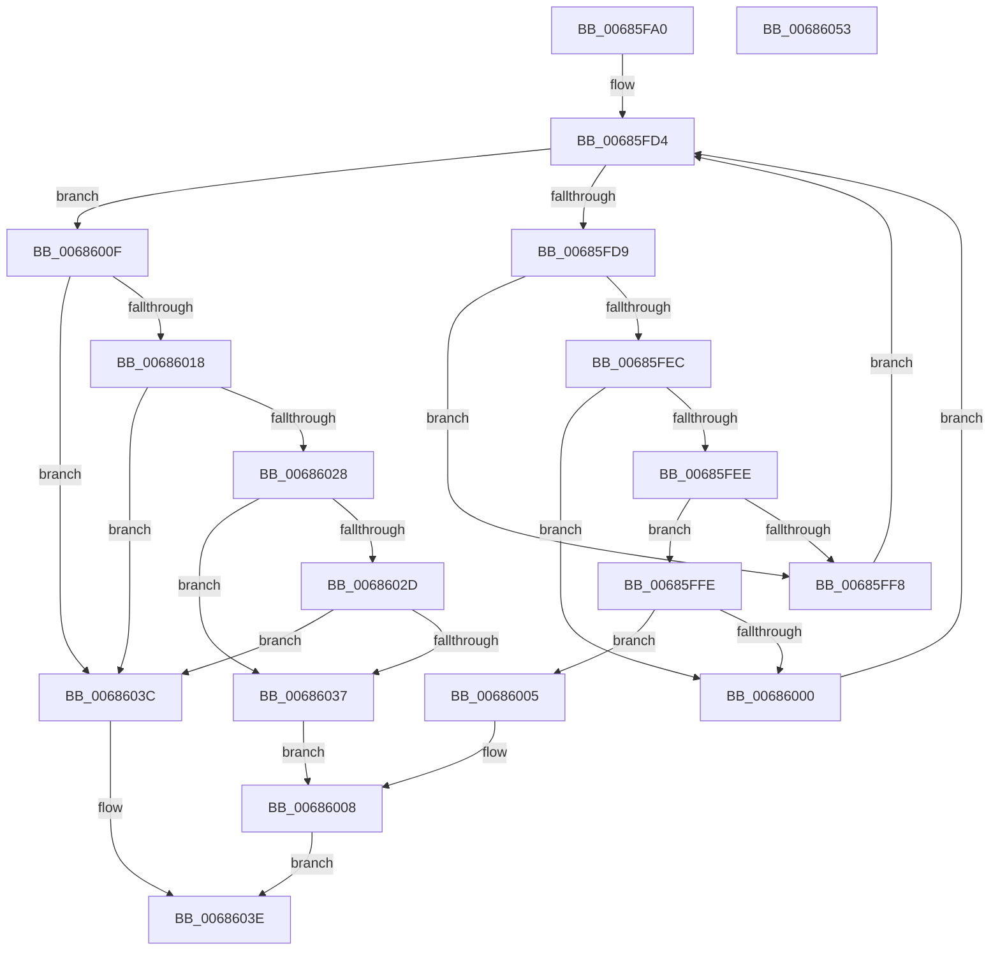

# MiFindFirstDebuggerPatch

- RVA: `0x00685FA0`–`0x00686054` (길이 `180` bytes)
- VA: `0x0000000140685FA0`
- 실행 섹션: `.text`
- PDB 이름 있음: `예`; PDB Function 태그: `아니요`
- unwind 정보 RVA: `0x000A5A38`
- 디코드: `54`개 명령, `180/180` bytes 표시
- 미해석 바이트: `0` (있으면 어셈블리에 `.byte`로 보존)

> 이 문서는 커널 이미지의 기계어와 PDB 기호를 분석해 생성했습니다. 4번과 5번은 함수 원형과 자료형을 바이너리 사용 방식에서 추정한 C 해석이며 원본 소스 복구 결과는 아닙니다.

## 1. Dependencies

- 직접 호출 지점: **0**; 고유 호출 대상: **0**
- 직접 호출자로 확인된 함수: **2**
- RIP 상대 이미지 참조: **2**

### Outgoing calls
- 직접 디코드된 call 명령이 없습니다.

### Direct callers
- [MiApplyDebuggerPatches](../4F/MiApplyDebuggerPatches_function_004F7BE4.md) at `0x004F7C68`
- [sub_006FBD3C](../6F/Unknown_function_006FBD3C.md) at `0x006FBD5F`

### Static image references
- `0x00685FB3` → RVA `0x00E35BF8` (`.data`; read)
- `0x00685FBA` → RVA `0x00E2CB40` (`.data`; read)

## 2. Other-region calls and transfers

- 다른 실행 섹션으로 향하는 call: **0**
- 별도 외부 분기/꼬리 이동을 확인하지 못했습니다.

## 3. Assembly (complete function range)

```asm
00685FA0  48 8B C4                        mov rax, rsp
00685FA3  48 89 58 08                     mov qword ptr [rax + 8], rbx
00685FA7  48 89 68 10                     mov qword ptr [rax + 0x10], rbp
00685FAB  48 89 70 18                     mov qword ptr [rax + 0x18], rsi
00685FAF  48 89 78 20                     mov qword ptr [rax + 0x20], rdi
00685FB3  44 8B 1D 3E FC 7A 00            mov r11d, dword ptr [rip + 0x7afc3e]
00685FBA  48 8D 2D 7F 6B 7A 00            lea rbp, [rip + 0x7a6b7f]
00685FC1  8B DA                           mov ebx, edx
00685FC3  8B F2                           mov esi, edx
00685FC5  81 E3 FF FF 0F 00               and ebx, 0xfffff
00685FCB  48 8B F9                        mov rdi, rcx
00685FCE  C1 E3 0A                        shl ebx, 0xa
00685FD1  45 33 D2                        xor r10d, r10d
00685FD4  45 3B D3                        cmp r10d, r11d
00685FD7  73 36                           jae 0x14068600f
00685FD9  43 8D 0C 1A                     lea ecx, [r10 + r11]
00685FDD  D1 E9                           shr ecx, 1
00685FDF  48 8B 94 CD B0 80 00 00         mov rdx, qword ptr [rbp + rcx*8 + 0x80b0]
00685FE7  48 39 3A                        cmp qword ptr [rdx], rdi
00685FEA  72 0C                           jb 0x140685ff8
00685FEC  77 12                           ja 0x140686000
00685FEE  8B 42 08                        mov eax, dword ptr [rdx + 8]
00685FF1  C1 E8 02                        shr eax, 2
00685FF4  3B C3                           cmp eax, ebx
00685FF6  73 06                           jae 0x140685ffe
00685FF8  44 8D 51 01                     lea r10d, [rcx + 1]
00685FFC  EB D6                           jmp 0x140685fd4
00685FFE  76 05                           jbe 0x140686005
00686000  44 8B D9                        mov r11d, ecx
00686003  EB CF                           jmp 0x140685fd4
00686005  41 89 09                        mov dword ptr [r9], ecx
00686008  B8 01 00 00 00                  mov eax, 1
0068600D  EB 2F                           jmp 0x14068603e
0068600F  44 3B 15 E2 FB 7A 00            cmp r10d, dword ptr [rip + 0x7afbe2]
00686016  73 24                           jae 0x14068603c
00686018  0F AE E8                        lfence
0068601B  4A 8B 84 D5 B0 80 00 00         mov rax, qword ptr [rbp + r10*8 + 0x80b0]
00686023  48 39 38                        cmp qword ptr [rax], rdi
00686026  75 14                           jne 0x14068603c
00686028  45 85 C0                        test r8d, r8d
0068602B  74 0A                           je 0x140686037
0068602D  8B 40 08                        mov eax, dword ptr [rax + 8]
00686030  C1 E8 0C                        shr eax, 0xc
00686033  3B C6                           cmp eax, esi
00686035  75 05                           jne 0x14068603c
00686037  45 89 11                        mov dword ptr [r9], r10d
0068603A  EB CC                           jmp 0x140686008
0068603C  33 C0                           xor eax, eax
0068603E  48 8B 5C 24 08                  mov rbx, qword ptr [rsp + 8]
00686043  48 8B 6C 24 10                  mov rbp, qword ptr [rsp + 0x10]
00686048  48 8B 74 24 18                  mov rsi, qword ptr [rsp + 0x18]
0068604D  48 8B 7C 24 20                  mov rdi, qword ptr [rsp + 0x20]
00686052  C3                              ret
00686053  CC                              int3
```

## 4. C-style interpretation (structured pseudocode)

```c
__int64 __fastcall MiFindFirstDebuggerPatch(__int64 a1, int a2, int a3, __int64 a4)
{
    __int64 result;
    __int64 v_r10;
    __int64 v_rbx;
    unsigned __int64 v_stack_p10;
    unsigned __int64 v_stack_p18;
    unsigned __int64 v_stack_p20;
    unsigned __int64 v_stack_p8;

    *(unsigned __int64 *)(v_rsp + 8) = v_rbx;
    *(unsigned __int64 *)(v_rsp + 16) = v_rbp;
    *(unsigned __int64 *)(v_rsp + 24) = v_rsi;
    *(unsigned __int64 *)(v_rsp + 32) = v_rdi;
    v_rbx = (unsigned int)(((unsigned int)(a2)) & (0xFFFFFULL));
    v_rbx = (unsigned int)((v_rbx) << (10));
    v_r10 = 0;
loc_00685FD4:
    if (0 >= ((unsigned int)((unsigned int)(*(unsigned int *)(v_rip + 8059966))))) goto loc_0068600F;
    a1 = (unsigned int)((v_r10 + (unsigned int)(*(unsigned int *)(v_rip + 8059966)) * 1) >> (1));
    if ((*(unsigned __int64 *)(*(unsigned __int64 *)(v_rip + 8022911 + a1 * 8 + 32944))) < a1) goto loc_00685FF8;
    if ((*(unsigned __int64 *)(*(unsigned __int64 *)(v_rip + 8022911 + a1 * 8 + 32944))) > a1) goto loc_00686000;
    result = (unsigned int)(((unsigned int)(*(unsigned int *)(*(unsigned __int64 *)(v_rip + 8022911 + a1 * 8 + 32944) + 8))) >> (2));
    if (((unsigned int)(result)) >= ((unsigned int)(v_rbx))) goto loc_00685FFE;
loc_00685FF8:
    goto loc_00685FD4;
loc_00685FFE:
    if (((unsigned int)(result)) <= ((unsigned int)(v_rbx))) goto loc_00686005;
loc_00686000:
    goto loc_00685FD4;
loc_00686005:
    *(unsigned int *)(a4) = (unsigned int)(a1);
loc_00686008:
    goto loc_0068603E;
loc_0068600F:
    if (((unsigned int)(a1 + 1)) >= (*(unsigned int *)(v_rip + 8059874))) goto loc_0068603C;
    if ((*(unsigned __int64 *)(*(unsigned __int64 *)(v_rip + 8022911 + a1 + 1 * 8 + 32944))) != a1) goto loc_0068603C;
    if (a3 == 0) goto loc_00686037;
    result = (unsigned int)(((unsigned int)(*(unsigned int *)(*(unsigned __int64 *)(v_rip + 8022911 + a1 + 1 * 8 + 32944) + 8))) >> (12));
    if (((unsigned int)(result)) != ((unsigned int)((unsigned int)(a2)))) goto loc_0068603C;
loc_00686037:
    *(unsigned int *)(a4) = (unsigned int)(a1 + 1);
    goto loc_00686008;
loc_0068603C:
    result = 0;
loc_0068603E:
    return result;
}
```

## 5. (Beta) C Style

```c
int64_t MiFindFirstDebuggerPatch(int64_t Arg1, int32_t Arg2, int32_t Arg3, void *Arg4)
{
    uint8_t *arg4 = (uint8_t *)Arg4;

    int64_t result;
    int64_t local_r10;
    int64_t local_rbx;
    uint64_t v_stack_p10;
    uint64_t v_stack_p18;
    uint64_t v_stack_p20;
    uint64_t v_stack_p8;

    *(uint64_t *)(local_rsp + 0x8) = local_rbx;
    *(uint64_t *)(local_rsp + 0x10) = local_rbp;
    *(uint64_t *)(local_rsp + 0x18) = local_rsi;
    *(uint64_t *)(local_rsp + 0x20) = local_rdi;
    local_rbx = (uint32_t)(((uint32_t)(Arg2)) & (0xFFFFFULL));
    local_rbx = (uint32_t)((local_rbx) << (10));
    local_r10 = 0;
loc_00685FD4:
    if (0 >= ((uint32_t)((uint32_t)(*(uint32_t *)(v_rip + 0x7AFC3E))))) goto loc_0068600F;
    Arg1 = (uint32_t)((local_r10 + (uint32_t)(*(uint32_t *)(v_rip + 0x7AFC3E)) * 1) >> (1));
    if ((*(uint64_t *)(*(uint64_t *)(v_rip + 0x7A6B7F + Arg1 * 8 + 0x80B0))) < Arg1) goto loc_00685FF8;
    if ((*(uint64_t *)(*(uint64_t *)(v_rip + 0x7A6B7F + Arg1 * 8 + 0x80B0))) > Arg1) goto loc_00686000;
    result = (uint32_t)(((uint32_t)(*(uint32_t *)(*(uint64_t *)(v_rip + 0x7A6B7F + Arg1 * 8 + 0x80B0) + 0x8))) >> (2));
    if (((uint32_t)(result)) >= ((uint32_t)(local_rbx))) goto loc_00685FFE;
loc_00685FF8:
    goto loc_00685FD4;
loc_00685FFE:
    if (((uint32_t)(result)) <= ((uint32_t)(local_rbx))) goto loc_00686005;
loc_00686000:
    goto loc_00685FD4;
loc_00686005:
    *(uint32_t *)(arg4) = (uint32_t)(Arg1);
loc_00686008:
    goto loc_0068603E;
loc_0068600F:
    if (((uint32_t)(Arg1 + 1)) >= (*(uint32_t *)(v_rip + 0x7AFBE2))) goto loc_0068603C;
    if ((*(uint64_t *)(*(uint64_t *)(v_rip + 0x7A6B7F + Arg1 + 0x1 * 8 + 0x80B0))) != Arg1) goto loc_0068603C;
    if (Arg3 == 0) goto loc_00686037;
    result = (uint32_t)(((uint32_t)(*(uint32_t *)(*(uint64_t *)(v_rip + 0x7A6B7F + Arg1 + 0x1 * 8 + 0x80B0) + 0x8))) >> (12));
    if (((uint32_t)(result)) != ((uint32_t)((uint32_t)(Arg2)))) goto loc_0068603C;
loc_00686037:
    *(uint32_t *)(arg4) = (uint32_t)(Arg1 + 1);
    goto loc_00686008;
loc_0068603C:
    result = 0;
loc_0068603E:
    return result;
}
```

### 관측된 메모리 오프셋

구조체 형식이 확인되지 않은 접근은 인자 기준의 오프셋으로만 기록했습니다.

| 기준 인자 | 오프셋 표현 | 폭 (bit) | 접근 |
|---|---:|---:|---|
| `Arg4` | `+ 0x0` | `32` | `W` |

## 6. Execution-region graph

[열기: 2D/3D 그래프와 함수 탐색 컨트롤 패널](../../../control-panel.html?section=text&rva=0x00685FA0&view=graph)

- 2D 그래프는 위에서 아래로 흐르고, 3D 그래프는 빈 공간을 드래그해 회전합니다. Shift+드래그는 이동, 휠은 확대·축소, 함수 노드 선택은 대상 보고서 이동입니다.

### Static fallback


