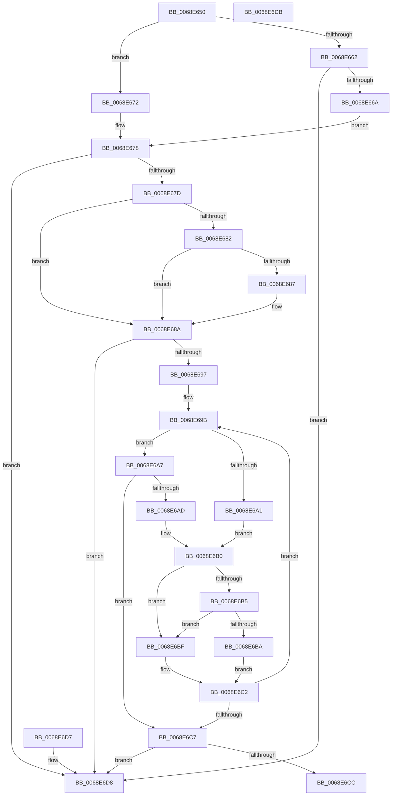

# MiFindSlabEntryForDemoteByPage

- RVA: `0x0068E650`–`0x0068E6DC` (길이 `140` bytes)
- VA: `0x000000014068E650`
- 실행 섹션: `.text`
- PDB 이름 있음: `예`; PDB Function 태그: `아니요`
- unwind 정보 RVA: `0x000DB714`
- 디코드: `51`개 명령, `140/140` bytes 표시
- 미해석 바이트: `0` (있으면 어셈블리에 `.byte`로 보존)

> 이 문서는 커널 이미지의 기계어와 PDB 기호를 분석해 생성했습니다. 4번과 5번은 함수 원형과 자료형을 바이너리 사용 방식에서 추정한 C 해석이며 원본 소스 복구 결과는 아닙니다.

## 1. Dependencies

- 직접 호출 지점: **0**; 고유 호출 대상: **0**
- 직접 호출자로 확인된 함수: **0**
- RIP 상대 이미지 참조: **0**

### Outgoing calls
- 직접 디코드된 call 명령이 없습니다.

### Direct callers
- 이 함수 시작 RVA로 연결되는 직접 call은 확인되지 않았습니다. 간접 호출은 완전히 역산할 수 없습니다.

### Static image references
- 디코드된 RIP-relative 메모리 참조가 없습니다.

## 2. Other-region calls and transfers

- 다른 실행 섹션으로 향하는 call: **0**
- 별도 외부 분기/꼬리 이동을 확인하지 못했습니다.

## 3. Assembly (complete function range)

```asm
0068E650  4C 8B 4A 08                     mov r9, qword ptr [rdx + 8]
0068E654  41 BB 01 00 00 00               mov r11d, 1
0068E65A  4D 8B D0                        mov r10, r8
0068E65D  4D 23 CB                        and r9, r11
0068E660  74 10                           je 0x14068e672
0068E662  48 8B 02                        mov rax, qword ptr [rdx]
0068E665  48 85 C0                        test rax, rax
0068E668  74 6E                           je 0x14068e6d8
0068E66A  48 8B C8                        mov rcx, rax
0068E66D  48 33 CA                        xor rcx, rdx
0068E670  EB 06                           jmp 0x14068e678
0068E672  48 8B 0A                        mov rcx, qword ptr [rdx]
0068E675  48 8B C1                        mov rax, rcx
0068E678  48 85 C9                        test rcx, rcx
0068E67B  74 5B                           je 0x14068e6d8
0068E67D  4D 85 C9                        test r9, r9
0068E680  74 08                           je 0x14068e68a
0068E682  48 85 C0                        test rax, rax
0068E685  74 03                           je 0x14068e68a
0068E687  48 33 C2                        xor rax, rdx
0068E68A  44 0F B6 42 08                  movzx r8d, byte ptr [rdx + 8]
0068E68F  45 23 C3                        and r8d, r11d
0068E692  48 85 C0                        test rax, rax
0068E695  74 41                           je 0x14068e6d8
0068E697  49 8B 52 28                     mov rdx, qword ptr [r10 + 0x28]
0068E69B  48 3B 50 30                     cmp rdx, qword ptr [rax + 0x30]
0068E69F  76 06                           jbe 0x14068e6a7
0068E6A1  48 8B 48 08                     mov rcx, qword ptr [rax + 8]
0068E6A5  EB 09                           jmp 0x14068e6b0
0068E6A7  48 3B 50 28                     cmp rdx, qword ptr [rax + 0x28]
0068E6AB  73 1A                           jae 0x14068e6c7
0068E6AD  48 8B 08                        mov rcx, qword ptr [rax]
0068E6B0  45 85 C0                        test r8d, r8d
0068E6B3  74 0A                           je 0x14068e6bf
0068E6B5  48 85 C9                        test rcx, rcx
0068E6B8  74 05                           je 0x14068e6bf
0068E6BA  48 33 C1                        xor rax, rcx
0068E6BD  EB 03                           jmp 0x14068e6c2
0068E6BF  48 8B C1                        mov rax, rcx
0068E6C2  48 85 C0                        test rax, rax
0068E6C5  75 D4                           jne 0x14068e69b
0068E6C7  48 85 C0                        test rax, rax
0068E6CA  74 0C                           je 0x14068e6d8
0068E6CC  49 89 02                        mov qword ptr [r10], rax
0068E6CF  41 8B C3                        mov eax, r11d
0068E6D2  4D 89 5A 20                     mov qword ptr [r10 + 0x20], r11
0068E6D6  C3                              ret
0068E6D7  CC                              int3
0068E6D8  33 C0                           xor eax, eax
0068E6DA  C3                              ret
0068E6DB  CC                              int3
```

## 4. C-style interpretation (structured pseudocode)

```c
__int64 __fastcall MiFindSlabEntryForDemoteByPage(__int64 a1, __int64 a2, __int64 a3)
{
    __int64 result;

    a4 = (*(unsigned __int64 *)(a2 + 8)) & (1);
    if (condition_is_equal) goto loc_0068E672;
    if (*(unsigned __int64 *)(a2) == 0) goto loc_0068E6D8;
    a1 = (*(unsigned __int64 *)(a2)) ^ (a2);
    goto loc_0068E678;
loc_0068E672:
loc_0068E678:
    if (*(unsigned __int64 *)(a2) == 0) goto loc_0068E6D8;
    if (a4 == 0) goto loc_0068E68A;
    result = *(unsigned __int64 *)(a2);
    if (*(unsigned __int64 *)(a2) != 0) {
        result = (*(unsigned __int64 *)(a2)) ^ (a2);
    }
    a3 = (unsigned int)((*(unsigned __int8 *)(a2 + 8)) & (1));
    if (result == 0) goto loc_0068E6D8;
loc_0068E69B:
    if ((*(unsigned __int64 *)(a3 + 40)) <= (*(unsigned __int64 *)(result + 48))) goto loc_0068E6A7;
    goto loc_0068E6B0;
loc_0068E6A7:
    if ((*(unsigned __int64 *)(a3 + 40)) >= (*(unsigned __int64 *)(result + 40))) goto loc_0068E6C7;
loc_0068E6B0:
    if ((unsigned int)(a3) == 0) goto loc_0068E6BF;
    if (*(unsigned __int64 *)(result) == 0) goto loc_0068E6BF;
    result = (result) ^ (*(unsigned __int64 *)(result));
    goto loc_0068E6C2;
loc_0068E6BF:
loc_0068E6C2:
    if (*(unsigned __int64 *)(result) != 0) goto loc_0068E69B;
loc_0068E6C7:
    if (*(unsigned __int64 *)(result) == 0) goto loc_0068E6D8;
    *(unsigned __int64 *)(a3) = *(unsigned __int64 *)(result);
    *(unsigned __int64 *)(a3 + 32) = 1;
    return 1;
loc_0068E6D8:
    result = 0;
    return result;
}
```

## 5. (Beta) C Style

```c
int64_t MiFindSlabEntryForDemoteByPage(int64_t Arg1, void *Arg2, void *Arg3)
{
    uint8_t *arg2 = (uint8_t *)Arg2;
    uint8_t *arg3 = (uint8_t *)Arg3;

    int64_t result;

    a4 = (*(uint64_t *)(arg2 + 0x8)) & (1);
    if (condition_is_equal) goto loc_0068E672;
    if (*(uint64_t *)(arg2) == 0) goto loc_0068E6D8;
    Arg1 = (*(uint64_t *)(arg2)) ^ (Arg2);
    goto loc_0068E678;
loc_0068E672:
loc_0068E678:
    if (*(uint64_t *)(arg2) == 0) goto loc_0068E6D8;
    if (a4 == 0) goto loc_0068E68A;
    result = *(uint64_t *)(arg2);
    if (*(uint64_t *)(arg2) != 0) {
        result = (*(uint64_t *)(arg2)) ^ (Arg2);
    }
    Arg3 = (uint32_t)((*(uint8_t *)(arg2 + 0x8)) & (1));
    if (result == 0) goto loc_0068E6D8;
loc_0068E69B:
    if ((*(uint64_t *)(arg3 + 0x28)) <= (*(uint64_t *)(result + 0x30))) goto loc_0068E6A7;
    goto loc_0068E6B0;
loc_0068E6A7:
    if ((*(uint64_t *)(arg3 + 0x28)) >= (*(uint64_t *)(result + 0x28))) goto loc_0068E6C7;
loc_0068E6B0:
    if ((uint32_t)(Arg3) == 0) goto loc_0068E6BF;
    if (*(uint64_t *)(result) == 0) goto loc_0068E6BF;
    result = (result) ^ (*(uint64_t *)(result));
    goto loc_0068E6C2;
loc_0068E6BF:
loc_0068E6C2:
    if (*(uint64_t *)(result) != 0) goto loc_0068E69B;
loc_0068E6C7:
    if (*(uint64_t *)(result) == 0) goto loc_0068E6D8;
    *(uint64_t *)(arg3) = *(uint64_t *)(result);
    *(uint64_t *)(arg3 + 0x20) = 1;
    return 1;
loc_0068E6D8:
    result = 0;
    return result;
}
```

### 관측된 메모리 오프셋

구조체 형식이 확인되지 않은 접근은 인자 기준의 오프셋으로만 기록했습니다.

| 기준 인자 | 오프셋 표현 | 폭 (bit) | 접근 |
|---|---:|---:|---|
| `Arg2` | `+ 0x0` | `64` | `R` |
| `Arg2` | `+ 0x8` | `8` | `R` |
| `Arg2` | `+ 0x8` | `64` | `R` |
| `Arg3` | `+ 0x0` | `64` | `W` |
| `Arg3` | `+ 0x20` | `64` | `W` |
| `Arg3` | `+ 0x28` | `64` | `R` |

## 6. Execution-region graph

[열기: 2D/3D 그래프와 함수 탐색 컨트롤 패널](../../../control-panel.html?section=text&rva=0x0068E650&view=graph)

- 2D 그래프는 위에서 아래로 흐르고, 3D 그래프는 빈 공간을 드래그해 회전합니다. Shift+드래그는 이동, 휠은 확대·축소, 함수 노드 선택은 대상 보고서 이동입니다.

### Static fallback


