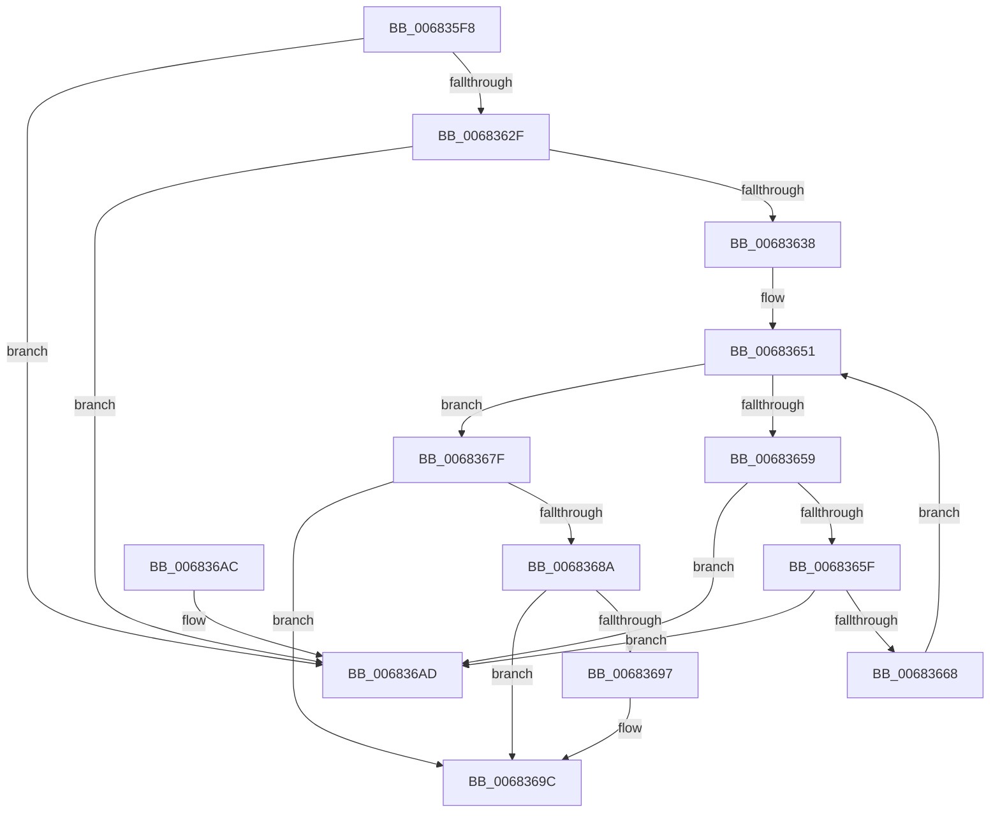

# MiFinishHoldingDirtyFaults

- RVA: `0x006835F8`–`0x006836B4` (길이 `188` bytes)
- VA: `0x00000001406835F8`
- 실행 섹션: `.text`
- PDB 이름 있음: `예`; PDB Function 태그: `아니요`
- unwind 정보 RVA: `0x0006383C`
- 디코드: `52`개 명령, `188/188` bytes 표시
- 미해석 바이트: `0` (있으면 어셈블리에 `.byte`로 보존)

> 이 문서는 커널 이미지의 기계어와 PDB 기호를 분석해 생성했습니다. 4번과 5번은 함수 원형과 자료형을 바이너리 사용 방식에서 추정한 C 해석이며 원본 소스 복구 결과는 아닙니다.

## 1. Dependencies

- 직접 호출 지점: **4**; 고유 호출 대상: **4**
- 직접 호출자로 확인된 함수: **1**
- RIP 상대 이미지 참조: **0**

### Outgoing calls
- `0x00683621` → [MiLockWorkingSetExclusive](../32/MiLockWorkingSetExclusive_function_003238A0.md) (function, `0x003238A0`)
- `0x00683648` → [MiUnlockWorkingSetExclusive](../27/MiUnlockWorkingSetExclusive_function_0027EC70.md) (function, `0x0027EC70`)
- `0x00683678` → [KeSetEvent](../33/KeSetEvent_function_0033F310.md) (function, `0x0033F310`)
- `0x00683697` → [KiCheckForKernelApcDelivery](../2E/KiCheckForKernelApcDelivery_function_002E2C80.md) (function, `0x002E2C80`)

### Direct callers
- [MiReleaseHotPatchResources](../../page/AC/MiReleaseHotPatchResources_function_00ACCD60.md) at `0x00ACCD7B`

### Static image references
- 디코드된 RIP-relative 메모리 참조가 없습니다.

## 2. Other-region calls and transfers

- 다른 실행 섹션으로 향하는 call: **0**
- 별도 외부 분기/꼬리 이동을 확인하지 못했습니다.

## 3. Assembly (complete function range)

```asm
006835F8  48 89 5C 24 08                  mov qword ptr [rsp + 8], rbx
006835FD  48 89 74 24 10                  mov qword ptr [rsp + 0x10], rsi
00683602  57                              push rdi
00683603  48 83 EC 20                     sub rsp, 0x20
00683607  65 48 8B 3C 25 88 01 00 00      mov rdi, qword ptr gs:[0x188]
00683610  48 8B D9                        mov rbx, rcx
00683613  48 8B B7 B8 00 00 00            mov rsi, qword ptr [rdi + 0xb8]
0068361A  48 8D 8E 00 04 00 00            lea rcx, [rsi + 0x400]
00683621  E8 7A 02 CA FF                  call 0x1403238a0
00683626  48 8B 0B                        mov rcx, qword ptr [rbx]
00683629  48 39 59 08                     cmp qword ptr [rcx + 8], rbx
0068362D  75 7E                           jne 0x1406836ad
0068362F  48 8B 53 08                     mov rdx, qword ptr [rbx + 8]
00683633  48 39 1A                        cmp qword ptr [rdx], rbx
00683636  75 75                           jne 0x1406836ad
00683638  48 89 0A                        mov qword ptr [rdx], rcx
0068363B  48 89 51 08                     mov qword ptr [rcx + 8], rdx
0068363F  8A D0                           mov dl, al
00683641  48 8D 8E 00 04 00 00            lea rcx, [rsi + 0x400]
00683648  E8 23 B6 BF FF                  call 0x14027ec70
0068364D  48 83 C3 20                     add rbx, 0x20
00683651  48 8B 0B                        mov rcx, qword ptr [rbx]
00683654  48 3B CB                        cmp rcx, rbx
00683657  74 26                           je 0x14068367f
00683659  48 39 59 08                     cmp qword ptr [rcx + 8], rbx
0068365D  75 4E                           jne 0x1406836ad
0068365F  48 8B 01                        mov rax, qword ptr [rcx]
00683662  48 39 48 08                     cmp qword ptr [rax + 8], rcx
00683666  75 45                           jne 0x1406836ad
00683668  48 89 03                        mov qword ptr [rbx], rax
0068366B  48 83 C1 10                     add rcx, 0x10
0068366F  45 33 C0                        xor r8d, r8d
00683672  48 89 58 08                     mov qword ptr [rax + 8], rbx
00683676  33 D2                           xor edx, edx
00683678  E8 93 BC CB FF                  call 0x14033f310
0068367D  EB D2                           jmp 0x140683651
0068367F  90                              nop
00683680  66 83 87 E6 01 00 00 01         add word ptr [rdi + 0x1e6], 1
00683688  75 12                           jne 0x14068369c
0068368A  48 8D 87 98 00 00 00            lea rax, [rdi + 0x98]
00683691  90                              nop
00683692  48 39 00                        cmp qword ptr [rax], rax
00683695  74 05                           je 0x14068369c
00683697  E8 E4 F5 C5 FF                  call 0x1402e2c80
0068369C  48 8B 5C 24 30                  mov rbx, qword ptr [rsp + 0x30]
006836A1  48 8B 74 24 38                  mov rsi, qword ptr [rsp + 0x38]
006836A6  48 83 C4 20                     add rsp, 0x20
006836AA  5F                              pop rdi
006836AB  C3                              ret
006836AC  CC                              int3
006836AD  B9 03 00 00 00                  mov ecx, 3
006836B2  CD 29                           int 0x29
```

## 4. C-style interpretation (structured pseudocode)

```c
__int64 __fastcall MiFinishHoldingDirtyFaults(__int64 a1, __int64 a2, int a3)
{
    __int64 result;
    __int64 v_rbx;
    __int64 v_rsp;
    unsigned __int64 v_stack_p10;
    unsigned __int64 v_stack_p8;

    v_stack_p8 = v_rbx;
    v_stack_p10 = v_rsi;
    v_rsp = (v_rsp) - (32);
    result = MiLockWorkingSetExclusive(*(unsigned __int64 *)(*(unsigned __int64 *)(gs_base + (0 + 392)) + 184) + 1024, a2, a3, a4);
    if ((*(unsigned __int64 *)(*(unsigned __int64 *)(a1) + 8)) != a1) goto loc_006836AD;
    if ((*(unsigned __int64 *)(*(unsigned __int64 *)(a1 + 8))) != a1) goto loc_006836AD;
    *(unsigned __int64 *)(*(unsigned __int64 *)(a1 + 8)) = *(unsigned __int64 *)(a1);
    *(unsigned __int64 *)(*(unsigned __int64 *)(a1) + 8) = *(unsigned __int64 *)(a1 + 8);
    result = MiUnlockWorkingSetExclusive(*(unsigned __int64 *)(*(unsigned __int64 *)(gs_base + (0 + 392)) + 184) + 1024, (unsigned __int8)(result), a3, a4);
    v_rbx = (a1) + (32);
loc_00683651:
    if ((*(unsigned __int64 *)(v_rbx)) == v_rbx) goto loc_0068367F;
    if ((*(unsigned __int64 *)(*(unsigned __int64 *)(v_rbx) + 8)) != v_rbx) goto loc_006836AD;
    if ((*(unsigned __int64 *)(*(unsigned __int64 *)(*(unsigned __int64 *)(v_rbx)) + 8)) != (*(unsigned __int64 *)(v_rbx))) goto loc_006836AD;
    *(unsigned __int64 *)(v_rbx) = *(unsigned __int64 *)(*(unsigned __int64 *)(v_rbx));
    a1 = (*(unsigned __int64 *)(v_rbx)) + (16);
    a3 = 0;
    *(unsigned __int64 *)(*(unsigned __int64 *)(*(unsigned __int64 *)(v_rbx)) + 8) = v_rbx;
    a2 = 0;
    result = KeSetEvent(a1, a2, a3, a4);
    goto loc_00683651;
loc_0068367F:
    if (condition_is_not_equal) goto loc_0068369C;
    result = *(unsigned __int64 *)(gs_base + (0 + 392)) + 152;
    if ((*(unsigned __int64 *)(*(unsigned __int64 *)(gs_base + (0 + 392)) + 152)) != (*(unsigned __int64 *)(gs_base + (0 + 392)) + 152)) {
        result = KiCheckForKernelApcDelivery(a1, a2, a3, a4);
    }
    v_rsp = (v_rsp) + (32);
    return result;
loc_006836AD:
    return result;
}
```

## 5. (Beta) C Style

```c
int64_t MiFinishHoldingDirtyFaults(void *Arg1, int64_t Arg2, int32_t Arg3)
{
    uint8_t *arg1 = (uint8_t *)Arg1;

    int64_t result;
    int64_t local_rbx;
    int64_t local_rsp;
    uint64_t v_stack_p10;
    uint64_t v_stack_p8;

    v_stack_p8 = local_rbx;
    v_stack_p10 = local_rsi;
    local_rsp = (local_rsp) - (32);
    result = MiLockWorkingSetExclusive(*(uint64_t *)(*(uint64_t *)(gs_base + (0 + 0x188)) + 0xB8) + 1024, Arg2, Arg3, a4);
    if ((*(uint64_t *)(*(uint64_t *)(arg1) + 0x8)) != Arg1) goto loc_006836AD;
    if ((*(uint64_t *)(*(uint64_t *)(arg1 + 0x8))) != Arg1) goto loc_006836AD;
    *(uint64_t *)(*(uint64_t *)(arg1 + 0x8)) = *(uint64_t *)(arg1);
    *(uint64_t *)(*(uint64_t *)(arg1) + 0x8) = *(uint64_t *)(arg1 + 0x8);
    result = MiUnlockWorkingSetExclusive(*(uint64_t *)(*(uint64_t *)(gs_base + (0 + 0x188)) + 0xB8) + 1024, (uint8_t)(result), Arg3, a4);
    local_rbx = (Arg1) + (32);
loc_00683651:
    if ((*(uint64_t *)(local_rbx)) == local_rbx) goto loc_0068367F;
    if ((*(uint64_t *)(*(uint64_t *)(local_rbx) + 0x8)) != local_rbx) goto loc_006836AD;
    if ((*(uint64_t *)(*(uint64_t *)(*(uint64_t *)(local_rbx)) + 0x8)) != (*(uint64_t *)(local_rbx))) goto loc_006836AD;
    *(uint64_t *)(local_rbx) = *(uint64_t *)(*(uint64_t *)(local_rbx));
    Arg1 = (*(uint64_t *)(local_rbx)) + (16);
    Arg3 = 0;
    *(uint64_t *)(*(uint64_t *)(*(uint64_t *)(local_rbx)) + 0x8) = local_rbx;
    Arg2 = 0;
    result = KeSetEvent(Arg1, Arg2, Arg3, a4);
    goto loc_00683651;
loc_0068367F:
    if (condition_is_not_equal) goto loc_0068369C;
    result = *(uint64_t *)(gs_base + (0 + 0x188)) + 152;
    if ((*(uint64_t *)(*(uint64_t *)(gs_base + (0 + 0x188)) + 0x98)) != (*(uint64_t *)(gs_base + (0 + 0x188)) + 152)) {
        result = KiCheckForKernelApcDelivery(Arg1, Arg2, Arg3, a4);
    }
    local_rsp = (local_rsp) + (32);
    return result;
loc_006836AD:
    return result;
}
```

### 관측된 메모리 오프셋

구조체 형식이 확인되지 않은 접근은 인자 기준의 오프셋으로만 기록했습니다.

| 기준 인자 | 오프셋 표현 | 폭 (bit) | 접근 |
|---|---:|---:|---|
| `Arg1` | `+ 0x0` | `64` | `R` |
| `Arg1` | `+ 0x0` | `64` | `W` |
| `Arg1` | `+ 0x8` | `64` | `R` |

## 6. Execution-region graph

[열기: 2D/3D 그래프와 함수 탐색 컨트롤 패널](../../../control-panel.html?section=text&rva=0x006835F8&view=graph)

- 2D 그래프는 위에서 아래로 흐르고, 3D 그래프는 빈 공간을 드래그해 회전합니다. Shift+드래그는 이동, 휠은 확대·축소, 함수 노드 선택은 대상 보고서 이동입니다.

### Static fallback


