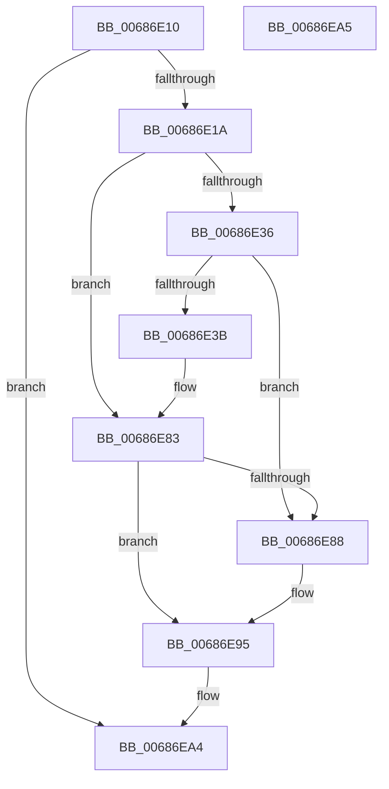

# MiFlushEnclaveTb

- RVA: `0x00686E10`–`0x00686EA6` (길이 `150` bytes)
- VA: `0x0000000140686E10`
- 실행 섹션: `.text`
- PDB 이름 있음: `예`; PDB Function 태그: `아니요`
- unwind 정보 RVA: `0x000D88B8`
- 디코드: `37`개 명령, `150/150` bytes 표시
- 미해석 바이트: `0` (있으면 어셈블리에 `.byte`로 보존)

> 이 문서는 커널 이미지의 기계어와 PDB 기호를 분석해 생성했습니다. 4번과 5번은 함수 원형과 자료형을 바이너리 사용 방식에서 추정한 C 해석이며 원본 소스 복구 결과는 아닙니다.

## 1. Dependencies

- 직접 호출 지점: **5**; 고유 호출 대상: **5**
- 직접 호출자로 확인된 함수: **1**
- RIP 상대 이미지 참조: **0**

### Outgoing calls
- `0x00686E4B` → [MiGetProcessorFlushList](../24/MiGetProcessorFlushList_function_00242C90.md) (function, `0x00242C90`)
- `0x00686E6F` → [MiInitializeTbFlushList](../29/MiInitializeTbFlushList_function_00294F00.md) (function, `0x00294F00`)
- `0x00686E7E` → [MiInsertTbFlushEntry](../29/MiInsertTbFlushEntry_function_00293670.md) (function, `0x00293670`)
- `0x00686E8B` → [MiFlushTbList](../31/MiFlushTbList_function_00311FC0.md) (function, `0x00311FC0`)
- `0x00686E90` → [MiReleaseProcessorFlushList](../31/MiReleaseProcessorFlushList_function_00313C70.md) (function, `0x00313C70`)

### Direct callers
- [MiProtectEnclavePages](../4D/MiProtectEnclavePages_function_004D5528.md) at `0x004D57D4`
- [MiProtectEnclavePages](../4D/MiProtectEnclavePages_function_004D5528.md) at `0x004D582A`
- [MiProtectEnclavePages](../4D/MiProtectEnclavePages_function_004D5528.md) at `0x004D5A23`

### Static image references
- 디코드된 RIP-relative 메모리 참조가 없습니다.

## 2. Other-region calls and transfers

- 다른 실행 섹션으로 향하는 call: **0**
- 별도 외부 분기/꼬리 이동을 확인하지 못했습니다.

## 3. Assembly (complete function range)

```asm
00686E10  48 83 FA FF                     cmp rdx, -1
00686E14  0F 84 8A 00 00 00               je 0x140686ea4
00686E1A  48 89 5C 24 08                  mov qword ptr [rsp + 8], rbx
00686E1F  48 89 74 24 10                  mov qword ptr [rsp + 0x10], rsi
00686E24  57                              push rdi
00686E25  48 83 EC 30                     sub rsp, 0x30
00686E29  48 8B F2                        mov rsi, rdx
00686E2C  48 8B F9                        mov rdi, rcx
00686E2F  41 0F BA E0 1D                  bt r8d, 0x1d
00686E34  72 4D                           jb 0x140686e83
00686E36  48 85 C9                        test rcx, rcx
00686E39  75 4D                           jne 0x140686e88
00686E3B  65 48 8B 04 25 88 01 00 00      mov rax, qword ptr gs:[0x188]
00686E44  48 8B 98 B8 00 00 00            mov rbx, qword ptr [rax + 0xb8]
00686E4B  E8 40 BE BB FF                  call 0x140242c90
00686E50  48 8D 93 00 04 00 00            lea rdx, [rbx + 0x400]
00686E57  C7 44 24 20 20 00 00 00         mov dword ptr [rsp + 0x20], 0x20
00686E5F  41 B9 08 00 00 00               mov r9d, 8
00686E65  48 8B C8                        mov rcx, rax
00686E68  48 8B F8                        mov rdi, rax
00686E6B  44 8B 40 0C                     mov r8d, dword ptr [rax + 0xc]
00686E6F  E8 8C E0 C0 FF                  call 0x140294f00
00686E74  45 33 C9                        xor r9d, r9d
00686E77  48 8B D6                        mov rdx, rsi
00686E7A  45 8D 41 01                     lea r8d, [r9 + 1]
00686E7E  E8 ED C7 C0 FF                  call 0x140293670
00686E83  48 85 FF                        test rdi, rdi
00686E86  74 0D                           je 0x140686e95
00686E88  48 8B CF                        mov rcx, rdi
00686E8B  E8 30 B1 C8 FF                  call 0x140311fc0
00686E90  E8 DB CD C8 FF                  call 0x140313c70
00686E95  48 8B 5C 24 40                  mov rbx, qword ptr [rsp + 0x40]
00686E9A  48 8B 74 24 48                  mov rsi, qword ptr [rsp + 0x48]
00686E9F  48 83 C4 30                     add rsp, 0x30
00686EA3  5F                              pop rdi
00686EA4  C3                              ret
00686EA5  CC                              int3
```

## 4. C-style interpretation (structured pseudocode)

```c
__int64 __fastcall MiFlushEnclaveTb(__int64 a1, __int64 a2, int a3)
{
    __int64 result;
    __int64 v_rsp;
    unsigned int v_stack_m18;
    unsigned __int64 v_stack_p10;
    unsigned __int64 v_stack_p8;

    if (a2 == -1) goto loc_00686EA4;
    v_stack_p8 = v_rbx;
    v_stack_p10 = v_rsi;
    v_rsp = (v_rsp) - (48);
    if (condition_is_below) goto loc_00686E83;
    if (a1 != 0) goto loc_00686E88;
    result = MiGetProcessorFlushList(a1, a2, a3, a4);
    v_stack_m18 = 32;
    result = MiInitializeTbFlushList(result, *(unsigned __int64 *)(*(unsigned __int64 *)(gs_base + (0 + 392)) + 184) + 1024, (unsigned int)(*(unsigned int *)(result + 12)), 8);
    a4 = 0;
    result = MiInsertTbFlushEntry(result, a2, a4 + 1, a4);
loc_00686E83:
    if (result != 0) {
        a1 = result;
        result = MiFlushTbList(a1, a2, a4 + 1, a4);
        result = MiReleaseProcessorFlushList(a1, a2, a4 + 1, a4);
    }
    v_rsp = (v_rsp) + (48);
loc_00686EA4:
    return result;
}
```

## 5. (Beta) C Style

```c
int64_t MiFlushEnclaveTb(int64_t Arg1, int64_t Arg2, int32_t Arg3)
{
    int64_t result;
    int64_t local_rsp;
    uint32_t v_stack_m18;
    uint64_t v_stack_p10;
    uint64_t v_stack_p8;

    if (Arg2 == -1) goto loc_00686EA4;
    v_stack_p8 = local_rbx;
    v_stack_p10 = local_rsi;
    local_rsp = (local_rsp) - (48);
    if (condition_is_below) goto loc_00686E83;
    if (Arg1 != 0) goto loc_00686E88;
    result = MiGetProcessorFlushList(Arg1, Arg2, Arg3, a4);
    v_stack_m18 = 32;
    result = MiInitializeTbFlushList(result, *(uint64_t *)(*(uint64_t *)(gs_base + (0 + 0x188)) + 0xB8) + 1024, (uint32_t)(*(uint32_t *)(result + 0xC)), 8);
    a4 = 0;
    result = MiInsertTbFlushEntry(result, Arg2, a4 + 1, a4);
loc_00686E83:
    if (result != 0) {
        Arg1 = result;
        result = MiFlushTbList(Arg1, Arg2, a4 + 1, a4);
        result = MiReleaseProcessorFlushList(Arg1, Arg2, a4 + 1, a4);
    }
    local_rsp = (local_rsp) + (48);
loc_00686EA4:
    return result;
}
```

## 6. Execution-region graph

[열기: 2D/3D 그래프와 함수 탐색 컨트롤 패널](../../../control-panel.html?section=text&rva=0x00686E10&view=graph)

- 2D 그래프는 위에서 아래로 흐르고, 3D 그래프는 빈 공간을 드래그해 회전합니다. Shift+드래그는 이동, 휠은 확대·축소, 함수 노드 선택은 대상 보고서 이동입니다.

### Static fallback


