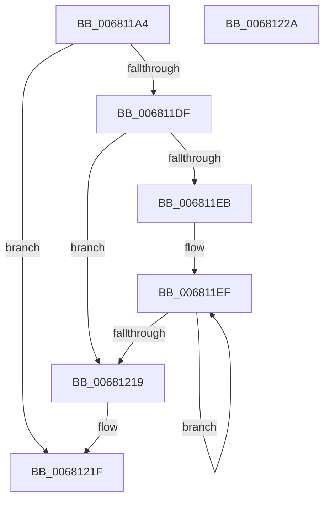

# MiFormCopyExtents

- RVA: `0x006811A4`–`0x0068122B` (길이 `135` bytes)
- VA: `0x00000001406811A4`
- 실행 섹션: `.text`
- PDB 이름 있음: `예`; PDB Function 태그: `아니요`
- unwind 정보 RVA: `0x0005CAAC`
- 디코드: `42`개 명령, `135/135` bytes 표시
- 미해석 바이트: `0` (있으면 어셈블리에 `.byte`로 보존)

> 이 문서는 커널 이미지의 기계어와 PDB 기호를 분석해 생성했습니다. 4번과 5번은 함수 원형과 자료형을 바이너리 사용 방식에서 추정한 C 해석이며 원본 소스 복구 결과는 아닙니다.

## 1. Dependencies

- 직접 호출 지점: **1**; 고유 호출 대상: **1**
- 직접 호출자로 확인된 함수: **2**
- RIP 상대 이미지 참조: **0**

### Outgoing calls
- `0x006811CF` → [MiAllocatePool](../35/MiAllocatePool_function_0035B540.md) (function, `0x0035B540`)

### Direct callers
- [MiInsertCopyExtents](MiInsertCopyExtents_function_00681440.md) at `0x0068145C`
- [MiMergeCopyExtents](MiMergeCopyExtents_function_00681844.md) at `0x0068187B`

### Static image references
- 디코드된 RIP-relative 메모리 참조가 없습니다.

## 2. Other-region calls and transfers

- 다른 실행 섹션으로 향하는 call: **0**
- 별도 외부 분기/꼬리 이동을 확인하지 못했습니다.

## 3. Assembly (complete function range)

```asm
006811A4  48 89 5C 24 08                  mov qword ptr [rsp + 8], rbx
006811A9  57                              push rdi
006811AA  48 83 EC 20                     sub rsp, 0x20
006811AE  8B 41 04                        mov eax, dword ptr [rcx + 4]
006811B1  8B FA                           mov edi, edx
006811B3  FF C8                           dec eax
006811B5  48 8B D9                        mov rbx, rcx
006811B8  B9 40 00 00 00                  mov ecx, 0x40
006811BD  41 B8 4D 69 46 33               mov r8d, 0x3346694d
006811C3  48 8D 14 40                     lea rdx, [rax + rax*2]
006811C7  48 C1 E2 04                     shl rdx, 4
006811CB  48 83 C2 38                     add rdx, 0x38
006811CF  E8 6C A3 CD FF                  call 0x14035b540
006811D4  45 33 C9                        xor r9d, r9d
006811D7  48 8B D0                        mov rdx, rax
006811DA  48 85 C0                        test rax, rax
006811DD  74 40                           je 0x14068121f
006811DF  8B 43 04                        mov eax, dword ptr [rbx + 4]
006811E2  45 8B D1                        mov r10d, r9d
006811E5  89 02                           mov dword ptr [rdx], eax
006811E7  85 C0                           test eax, eax
006811E9  74 2E                           je 0x140681219
006811EB  4C 8D 42 30                     lea r8, [rdx + 0x30]
006811EF  41 8B CA                        mov ecx, r10d
006811F2  41 FF C2                        inc r10d
006811F5  48 03 C9                        add rcx, rcx
006811F8  48 8B 44 CB 08                  mov rax, qword ptr [rbx + rcx*8 + 8]
006811FD  49 89 40 F8                     mov qword ptr [r8 - 8], rax
00681201  48 8B 44 CB 10                  mov rax, qword ptr [rbx + rcx*8 + 0x10]
00681206  45 89 48 F0                     mov dword ptr [r8 - 0x10], r9d
0068120A  4C 03 C8                        add r9, rax
0068120D  49 89 00                        mov qword ptr [r8], rax
00681210  4D 8D 40 30                     lea r8, [r8 + 0x30]
00681214  44 3B 12                        cmp r10d, dword ptr [rdx]
00681217  72 D6                           jb 0x1406811ef
00681219  89 7A 04                        mov dword ptr [rdx + 4], edi
0068121C  48 8B C2                        mov rax, rdx
0068121F  48 8B 5C 24 30                  mov rbx, qword ptr [rsp + 0x30]
00681224  48 83 C4 20                     add rsp, 0x20
00681228  5F                              pop rdi
00681229  C3                              ret
0068122A  CC                              int3
```

## 4. C-style interpretation (structured pseudocode)

```c
__int64 __fastcall MiFormCopyExtents(__int64 a1, int a2, __int64 a3, int a4)
{
    __int64 result;
    __int64 v_r10;
    __int64 v_rsp;
    unsigned __int64 v_stack_p8;

    v_stack_p8 = v_rbx;
    v_rsp = (v_rsp) - (32);
    result = (unsigned int)(((unsigned int)(*(unsigned int *)(a1 + 4))) - 1);
    a2 = (result + result * 2) << (4);
    a2 = (a2) + (56);
    result = MiAllocatePool(64, a2, (unsigned int)(0x3346694DULL), a4);
    a4 = 0;
    if (result == 0) goto loc_0068121F;
    *(unsigned int *)(result) = (unsigned int)((unsigned int)(*(unsigned int *)(a1 + 4)));
    if ((unsigned int)((unsigned int)(*(unsigned int *)(a1 + 4))) == 0) goto loc_00681219;
loc_006811EF:
    v_r10 = (unsigned int)((0) + 1);
    a1 = (0) + (0);
    *(unsigned __int64 *)(result + 48 - 8) = *(unsigned __int64 *)(a1 + a1 * 8 + 8);
    *(unsigned int *)(result + 48 - 16) = 0;
    a4 = (a4) + (*(unsigned __int64 *)(a1 + a1 * 8 + 16));
    *(unsigned __int64 *)(result + 48) = *(unsigned __int64 *)(a1 + a1 * 8 + 16);
    if (((unsigned int)(v_r10)) < (*(unsigned int *)(result))) goto loc_006811EF;
loc_00681219:
    *(unsigned int *)(result + 4) = (unsigned int)((unsigned int)(a2));
loc_0068121F:
    v_rsp = (v_rsp) + (32);
    return result;
}
```

## 5. (Beta) C Style

```c
int64_t MiFormCopyExtents(void *Arg1, int32_t Arg2, int64_t Arg3, int32_t Arg4)
{
    uint8_t *arg1 = (uint8_t *)Arg1;

    int64_t result;
    int64_t local_r10;
    int64_t local_rsp;
    uint64_t v_stack_p8;

    v_stack_p8 = local_rbx;
    local_rsp = (local_rsp) - (32);
    result = (uint32_t)(((uint32_t)(*(uint32_t *)(arg1 + 0x4))) - 1);
    Arg2 = (result + result * 2) << (4);
    Arg2 = (Arg2) + (56);
    result = MiAllocatePool(64, Arg2, (uint32_t)(0x3346694DULL), Arg4);
    Arg4 = 0;
    if (result == 0) goto loc_0068121F;
    *(uint32_t *)(result) = (uint32_t)((uint32_t)(*(uint32_t *)(arg1 + 0x4)));
    if ((uint32_t)((uint32_t)(*(uint32_t *)(arg1 + 0x4))) == 0) goto loc_00681219;
loc_006811EF:
    local_r10 = (uint32_t)((0) + 1);
    Arg1 = (0) + (0);
    *(uint64_t *)(result + 0x30 - 0x8) = *(uint64_t *)(arg1 + arg1 * 8 + 0x8);
    *(uint32_t *)(result + 0x30 - 0x10) = 0;
    Arg4 = (Arg4) + (*(uint64_t *)(arg1 + arg1 * 8 + 0x10));
    *(uint64_t *)(result + 0x30) = *(uint64_t *)(arg1 + arg1 * 8 + 0x10);
    if (((uint32_t)(local_r10)) < (*(uint32_t *)(result))) goto loc_006811EF;
loc_00681219:
    *(uint32_t *)(result + 0x4) = (uint32_t)((uint32_t)(Arg2));
loc_0068121F:
    local_rsp = (local_rsp) + (32);
    return result;
}
```

### 관측된 메모리 오프셋

구조체 형식이 확인되지 않은 접근은 인자 기준의 오프셋으로만 기록했습니다.

| 기준 인자 | 오프셋 표현 | 폭 (bit) | 접근 |
|---|---:|---:|---|
| `Arg1` | `+ 0x4` | `32` | `R` |
| `Arg1` | `+ 0x8 + rcx*8` | `64` | `R` |
| `Arg1` | `+ 0x10 + rcx*8` | `64` | `R` |

## 6. Execution-region graph

[열기: 2D/3D 그래프와 함수 탐색 컨트롤 패널](../../../control-panel.html?section=text&rva=0x006811A4&view=graph)

- 2D 그래프는 위에서 아래로 흐르고, 3D 그래프는 빈 공간을 드래그해 회전합니다. Shift+드래그는 이동, 휠은 확대·축소, 함수 노드 선택은 대상 보고서 이동입니다.

### Static fallback


