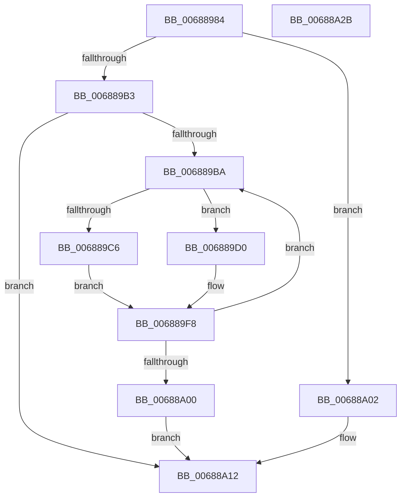

# MiFreeAwePagesFromMdl

- RVA: `0x00688984`–`0x00688A2C` (길이 `168` bytes)
- VA: `0x0000000140688984`
- 실행 섹션: `.text`
- PDB 이름 있음: `예`; PDB Function 태그: `아니요`
- unwind 정보 RVA: `0x00060300`
- 디코드: `51`개 명령, `168/168` bytes 표시
- 미해석 바이트: `0` (있으면 어셈블리에 `.byte`로 보존)

> 이 문서는 커널 이미지의 기계어와 PDB 기호를 분석해 생성했습니다. 4번과 5번은 함수 원형과 자료형을 바이너리 사용 방식에서 추정한 C 해석이며 원본 소스 복구 결과는 아닙니다.

## 1. Dependencies

- 직접 호출 지점: **4**; 고유 호출 대상: **4**
- 직접 호출자로 확인된 함수: **1**
- RIP 상대 이미지 참조: **0**

### Outgoing calls
- `0x006889C9` → [MiFreePhysicalRange](MiFreePhysicalRange_function_00688CD0.md) (function, `0x00688CD0`)
- `0x006889E5` → [MiReadyLargeAwePageForFree](MiReadyLargeAwePageForFree_function_00689258.md) (function, `0x00689258`)
- `0x006889F3` → [MiFreeContiguousLargePageRun](MiFreeContiguousLargePageRun_function_00688A34.md) (function, `0x00688A34`)
- `0x00688A0D` → [MiFreePagesFromMdl](../3F/MiFreePagesFromMdl_function_003F8300.md) (function, `0x003F8300`)

### Direct callers
- [MiAllocateUserPhysicalPages](../../page/80/MiAllocateUserPhysicalPages_function_00809828.md) at `0x0080A42A`
- [MiAllocateUserPhysicalPages](../../page/80/MiAllocateUserPhysicalPages_function_00809828.md) at `0x0080A461`

### Static image references
- 디코드된 RIP-relative 메모리 참조가 없습니다.

## 2. Other-region calls and transfers

- 다른 실행 섹션으로 향하는 call: **0**
- 별도 외부 분기/꼬리 이동을 확인하지 못했습니다.

## 3. Assembly (complete function range)

```asm
00688984  48 89 5C 24 08                  mov qword ptr [rsp + 8], rbx
00688989  48 89 6C 24 10                  mov qword ptr [rsp + 0x10], rbp
0068898E  48 89 74 24 18                  mov qword ptr [rsp + 0x18], rsi
00688993  57                              push rdi
00688994  41 56                           push r14
00688996  41 57                           push r15
00688998  48 83 EC 20                     sub rsp, 0x20
0068899C  8B 7A 28                        mov edi, dword ptr [rdx + 0x28]
0068899F  48 8B EA                        mov rbp, rdx
006889A2  4C 8B 79 10                     mov r15, qword ptr [rcx + 0x10]
006889A6  48 8B F1                        mov rsi, rcx
006889A9  48 C1 EF 0C                     shr rdi, 0xc
006889AD  49 83 FF 01                     cmp r15, 1
006889B1  74 4F                           je 0x140688a02
006889B3  33 DB                           xor ebx, ebx
006889B5  48 85 FF                        test rdi, rdi
006889B8  74 58                           je 0x140688a12
006889BA  8B 46 08                        mov eax, dword ptr [rsi + 8]
006889BD  4C 8B 74 DD 30                  mov r14, qword ptr [rbp + rbx*8 + 0x30]
006889C2  A8 08                           test al, 8
006889C4  74 0A                           je 0x1406889d0
006889C6  49 8B D6                        mov rdx, r14
006889C9  E8 02 03 00 00                  call 0x140688cd0
006889CE  EB 28                           jmp 0x1406889f8
006889D0  4B 8D 0C 76                     lea rcx, [r14 + r14*2]
006889D4  48 C1 E1 04                     shl rcx, 4
006889D8  48 B8 00 00 00 00 00 DE FF FF   movabs rax, 0xffffde0000000000
006889E2  48 03 C8                        add rcx, rax
006889E5  E8 6E 08 00 00                  call 0x140689258
006889EA  4D 8B C7                        mov r8, r15
006889ED  49 8B D6                        mov rdx, r14
006889F0  48 8B CE                        mov rcx, rsi
006889F3  E8 3C 00 00 00                  call 0x140688a34
006889F8  48 FF C3                        inc rbx
006889FB  48 3B DF                        cmp rbx, rdi
006889FE  72 BA                           jb 0x1406889ba
00688A00  EB 10                           jmp 0x140688a12
00688A02  4C 8B CE                        mov r9, rsi
00688A05  45 33 C0                        xor r8d, r8d
00688A08  33 D2                           xor edx, edx
00688A0A  48 8B CD                        mov rcx, rbp
00688A0D  E8 EE F8 D6 FF                  call 0x1403f8300
00688A12  48 8B 5C 24 40                  mov rbx, qword ptr [rsp + 0x40]
00688A17  48 8B 6C 24 48                  mov rbp, qword ptr [rsp + 0x48]
00688A1C  48 8B 74 24 50                  mov rsi, qword ptr [rsp + 0x50]
00688A21  48 83 C4 20                     add rsp, 0x20
00688A25  41 5F                           pop r15
00688A27  41 5E                           pop r14
00688A29  5F                              pop rdi
00688A2A  C3                              ret
00688A2B  CC                              int3
```

## 4. C-style interpretation (structured pseudocode)

```c
__int64 __fastcall MiFreeAwePagesFromMdl(__int64 a1, __int64 a2)
{
    __int64 result;
    __int64 v_rbx;
    __int64 v_rdi;
    __int64 v_rsp;
    unsigned __int64 v_stack_p10;
    unsigned __int64 v_stack_p18;
    unsigned __int64 v_stack_p8;

    v_stack_p8 = v_rbx;
    v_stack_p10 = v_rbp;
    v_stack_p18 = v_rsi;
    v_rsp = (v_rsp) - (32);
    v_rdi = ((unsigned int)(*(unsigned int *)(a2 + 40))) >> (12);
    if ((*(unsigned __int64 *)(a1 + 16)) == 1) goto loc_00688A02;
    v_rbx = 0;
    if (v_rdi == 0) goto loc_00688A12;
loc_006889BA:
    if ((((unsigned __int8)((unsigned int)(*(unsigned int *)(a1 + 8)))) & (8)) == 0) goto loc_006889D0;
    result = MiFreePhysicalRange(a1, *(unsigned __int64 *)(a2 + v_rbx * 8 + 48), a3, a4);
    goto loc_006889F8;
loc_006889D0:
    a1 = (*(unsigned __int64 *)(a2 + v_rbx * 8 + 48) + *(unsigned __int64 *)(a2 + v_rbx * 8 + 48) * 2) << (4);
    a1 = (a1) + (result);
    result = MiReadyLargeAwePageForFree(a1, *(unsigned __int64 *)(a2 + v_rbx * 8 + 48), a3, a4);
    result = MiFreeContiguousLargePageRun(a1, *(unsigned __int64 *)(a2 + v_rbx * 8 + 48), *(unsigned __int64 *)(a1 + 16), a4);
loc_006889F8:
    v_rbx = (v_rbx) + 1;
    if (v_rbx < v_rdi) goto loc_006889BA;
    goto loc_00688A12;
loc_00688A02:
    a3 = 0;
    a2 = 0;
    result = MiFreePagesFromMdl(0, a2, a3, a1);
loc_00688A12:
    v_rsp = (v_rsp) + (32);
    return result;
}
```

## 5. (Beta) C Style

```c
int64_t MiFreeAwePagesFromMdl(void *Arg1, void *Arg2)
{
    uint8_t *arg1 = (uint8_t *)Arg1;
    uint8_t *arg2 = (uint8_t *)Arg2;

    int64_t result;
    int64_t local_rbx;
    int64_t local_rdi;
    int64_t local_rsp;
    uint64_t v_stack_p10;
    uint64_t v_stack_p18;
    uint64_t v_stack_p8;

    v_stack_p8 = local_rbx;
    v_stack_p10 = local_rbp;
    v_stack_p18 = local_rsi;
    local_rsp = (local_rsp) - (32);
    local_rdi = ((uint32_t)(*(uint32_t *)(arg2 + 0x28))) >> (12);
    if ((*(uint64_t *)(arg1 + 0x10)) == 1) goto loc_00688A02;
    local_rbx = 0;
    if (local_rdi == 0) goto loc_00688A12;
loc_006889BA:
    if ((((uint8_t)((uint32_t)(*(uint32_t *)(arg1 + 0x8)))) & (8)) == 0) goto loc_006889D0;
    result = MiFreePhysicalRange(Arg1, *(uint64_t *)(arg2 + local_rbx * 8 + 0x30), a3, a4);
    goto loc_006889F8;
loc_006889D0:
    Arg1 = (*(uint64_t *)(arg2 + local_rbx * 8 + 0x30) + *(uint64_t *)(arg2 + local_rbx * 8 + 0x30) * 2) << (4);
    Arg1 = (Arg1) + (result);
    result = MiReadyLargeAwePageForFree(Arg1, *(uint64_t *)(arg2 + local_rbx * 8 + 0x30), a3, a4);
    result = MiFreeContiguousLargePageRun(Arg1, *(uint64_t *)(arg2 + local_rbx * 8 + 0x30), *(uint64_t *)(arg1 + 0x10), a4);
loc_006889F8:
    local_rbx = (local_rbx) + 1;
    if (local_rbx < local_rdi) goto loc_006889BA;
    goto loc_00688A12;
loc_00688A02:
    a3 = 0;
    Arg2 = 0;
    result = MiFreePagesFromMdl(0, Arg2, a3, Arg1);
loc_00688A12:
    local_rsp = (local_rsp) + (32);
    return result;
}
```

### 관측된 메모리 오프셋

구조체 형식이 확인되지 않은 접근은 인자 기준의 오프셋으로만 기록했습니다.

| 기준 인자 | 오프셋 표현 | 폭 (bit) | 접근 |
|---|---:|---:|---|
| `Arg1` | `+ 0x8` | `32` | `R` |
| `Arg1` | `+ 0x10` | `64` | `R` |
| `Arg2` | `+ 0x28` | `32` | `R` |
| `Arg2` | `+ 0x30 + rbx*8` | `64` | `R` |

## 6. Execution-region graph

[열기: 2D/3D 그래프와 함수 탐색 컨트롤 패널](../../../control-panel.html?section=text&rva=0x00688984&view=graph)

- 2D 그래프는 위에서 아래로 흐르고, 3D 그래프는 빈 공간을 드래그해 회전합니다. Shift+드래그는 이동, 휠은 확대·축소, 함수 노드 선택은 대상 보고서 이동입니다.

### Static fallback


