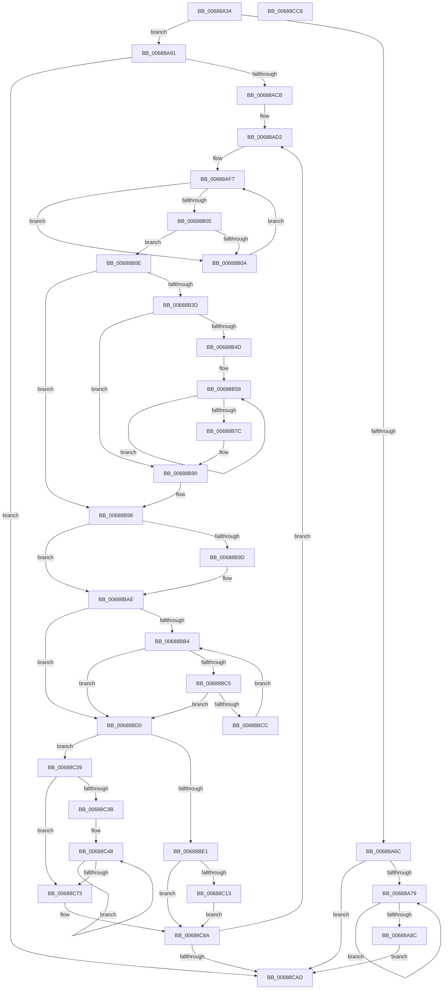

# MiFreeContiguousLargePageRun

- RVA: `0x00688A34`–`0x00688CC9` (길이 `661` bytes)
- VA: `0x0000000140688A34`
- 실행 섹션: `.text`
- PDB 이름 있음: `예`; PDB Function 태그: `아니요`
- unwind 정보 RVA: `0x000D8BEC`
- 디코드: `180`개 명령, `661/661` bytes 표시
- 미해석 바이트: `0` (있으면 어셈블리에 `.byte`로 보존)

> 이 문서는 커널 이미지의 기계어와 PDB 기호를 분석해 생성했습니다. 4번과 5번은 함수 원형과 자료형을 바이너리 사용 방식에서 추정한 C 해석이며 원본 소스 복구 결과는 아닙니다.

## 1. Dependencies

- 직접 호출 지점: **10**; 고유 호출 대상: **10**
- 직접 호출자로 확인된 함수: **3**
- RIP 상대 이미지 참조: **3**

### Outgoing calls
- `0x00688A7C` → [MiFreePhysicalRange](MiFreePhysicalRange_function_00688CD0.md) (function, `0x00688CD0`)
- `0x00688B11` → [MiGetPfnPageSizeIndex](../31/MiGetPfnPageSizeIndex_function_0031C710.md) (function, `0x0031C710`)
- `0x00688B5B` → [MiLockPageInline](../31/MiLockPageInline_function_0031A340.md) (function, `0x0031A340`)
- `0x00688B65` → [MiClearAweLargePageMetadata](MiClearAweLargePageMetadata_function_006880EC.md) (function, `0x006880EC`)
- `0x00688B6F` → [MiUnlockPage](../31/MiUnlockPage_function_0031A3E0.md) (function, `0x0031A3E0`)
- `0x00688BA9` → [MiUpdateLargePageBitMap](../37/MiUpdateLargePageBitMap_function_0037619C.md) (function, `0x0037619C`)
- `0x00688BBA` → [MiCoalesceActivePagesIntoFree](../69/MiCoalesceActivePagesIntoFree_function_00693558.md) (function, `0x00693558`)
- `0x00688BEA` → [MiFreeLargePageCharges](../3F/MiFreeLargePageCharges_function_003F7FF0.md) (function, `0x003F7FF0`)
- `0x00688C22` → [MiReturnCrossPartitionCharges](../28/MiReturnCrossPartitionCharges_function_002867D0.md) (function, `0x002867D0`)
- `0x00688C85` → [MiFreeLargePages](../2A/MiFreeLargePages_function_002A99D0.md) (function, `0x002A99D0`)

### Direct callers
- [MiFreePhysicalPageChain](../2A/MiFreePhysicalPageChain_function_002A9F1C.md) at `0x002AA095`
- [MiFreePhysicalPageChain](../2A/MiFreePhysicalPageChain_function_002A9F1C.md) at `0x002AA0F9`
- [MiFreeAwePagesFromMdl](MiFreeAwePagesFromMdl_function_00688984.md) at `0x006889F3`
- [MiDeleteAweInfoPages](../../page/80/MiDeleteAweInfoPages_function_0080AA40.md) at `0x0080ABF5`
- [MiDeleteAweInfoPages](../../page/80/MiDeleteAweInfoPages_function_0080AA40.md) at `0x0080AC98`

### Static image references
- `0x00688AA6` → RVA `0x00E30088` (`.data`; read)
- `0x00688ACB` → RVA `0x00011C60` (`.rdata`; read)
- `0x00688AE4` → RVA `0x00FC6B30` (`ALMOSTRO`; read)

## 2. Other-region calls and transfers

- 다른 실행 섹션으로 향하는 call: **0**
- 별도 외부 분기/꼬리 이동을 확인하지 못했습니다.

## 3. Assembly (complete function range)

```asm
00688A34  48 8B C4                        mov rax, rsp
00688A37  48 89 58 10                     mov qword ptr [rax + 0x10], rbx
00688A3B  4C 89 40 18                     mov qword ptr [rax + 0x18], r8
00688A3F  55                              push rbp
00688A40  56                              push rsi
00688A41  57                              push rdi
00688A42  41 54                           push r12
00688A44  41 55                           push r13
00688A46  41 56                           push r14
00688A48  41 57                           push r15
00688A4A  48 83 EC 60                     sub rsp, 0x60
00688A4E  48 83 60 C0 00                  and qword ptr [rax - 0x40], 0
00688A53  33 ED                           xor ebp, ebp
00688A55  48 83 60 B8 00                  and qword ptr [rax - 0x48], 0
00688A5A  4D 8B F8                        mov r15, r8
00688A5D  8B 41 08                        mov eax, dword ptr [rcx + 8]
00688A60  48 8B F2                        mov rsi, rdx
00688A63  48 89 6C 24 30                  mov qword ptr [rsp + 0x30], rbp
00688A68  A8 08                           test al, 8
00688A6A  74 25                           je 0x140688a91
00688A6C  48 8B 59 10                     mov rbx, qword ptr [rcx + 0x10]
00688A70  4D 85 C0                        test r8, r8
00688A73  0F 84 34 02 00 00               je 0x140688cad
00688A79  48 8B D6                        mov rdx, rsi
00688A7C  E8 4F 02 00 00                  call 0x140688cd0
00688A81  48 03 F3                        add rsi, rbx
00688A84  48 03 EB                        add rbp, rbx
00688A87  49 3B EF                        cmp rbp, r15
00688A8A  72 ED                           jb 0x140688a79
00688A8C  E9 1C 02 00 00                  jmp 0x140688cad
00688A91  48 8D 04 52                     lea rax, [rdx + rdx*2]
00688A95  48 03 C0                        add rax, rax
00688A98  48 B9 28 00 00 00 00 DE FF FF   movabs rcx, 0xffffde0000000028
00688AA2  48 8B 04 C1                     mov rax, qword ptr [rcx + rax*8]
00688AA6  48 8B 0D DB 75 7A 00            mov rcx, qword ptr [rip + 0x7a75db]
00688AAD  48 C1 E8 2B                     shr rax, 0x2b
00688AB1  25 FF 03 00 00                  and eax, 0x3ff
00688AB6  4C 8B 2C C1                     mov r13, qword ptr [rcx + rax*8]
00688ABA  4C 89 AC 24 B8 00 00 00         mov qword ptr [rsp + 0xb8], r13
00688AC2  4D 85 FF                        test r15, r15
00688AC5  0F 84 E2 01 00 00               je 0x140688cad
00688ACB  48 8D 0D 8E 91 98 FF            lea rcx, [rip - 0x676e72]
00688AD2  4C 8D 34 76                     lea r14, [rsi + rsi*2]
00688AD6  49 C1 E6 04                     shl r14, 4
00688ADA  48 B8 00 00 00 00 00 DE FF FF   movabs rax, 0xffffde0000000000
00688AE4  48 8B 3D 45 E0 93 00            mov rdi, qword ptr [rip + 0x93e045]
00688AEB  4C 03 F0                        add r14, rax
00688AEE  48 C1 EF 25                     shr rdi, 0x25
00688AF2  F7 D7                           not edi
00688AF4  83 E7 01                        and edi, 1
00688AF7  4C 8B 24 F9                     mov r12, qword ptr [rcx + rdi*8]
00688AFB  49 8D 44 24 FF                  lea rax, [r12 - 1]
00688B00  48 85 C6                        test rsi, rax
00688B03  75 05                           jne 0x140688b0a
00688B05  4D 3B FC                        cmp r15, r12
00688B08  73 04                           jae 0x140688b0e
00688B0A  FF C7                           inc edi
00688B0C  EB E9                           jmp 0x140688af7
00688B0E  49 8B CE                        mov rcx, r14
00688B11  E8 FA 3B C9 FF                  call 0x14031c710
00688B16  8B D8                           mov ebx, eax
00688B18  48 8D 0D 41 91 98 FF            lea rcx, [rip - 0x676ebf]
00688B1F  49 8B 46 28                     mov rax, qword ptr [r14 + 0x28]
00688B23  48 C1 E8 3C                     shr rax, 0x3c
00688B27  24 07                           and al, 7
00688B29  89 9C 24 A0 00 00 00            mov dword ptr [rsp + 0xa0], ebx
00688B30  48 8B 0C D9                     mov rcx, qword ptr [rcx + rbx*8]
00688B34  48 89 4C 24 48                  mov qword ptr [rsp + 0x48], rcx
00688B39  3C 01                           cmp al, 1
00688B3B  75 5B                           jne 0x140688b98
00688B3D  4F 8D 2C 64                     lea r13, [r12 + r12*2]
00688B41  49 C1 E5 04                     shl r13, 4
00688B45  4D 03 EE                        add r13, r14
00688B48  4D 3B F5                        cmp r14, r13
00688B4B  73 43                           jae 0x140688b90
00688B4D  4C 8D 3C 49                     lea r15, [rcx + rcx*2]
00688B51  49 8B EE                        mov rbp, r14
00688B54  49 C1 E7 04                     shl r15, 4
00688B58  48 8B CD                        mov rcx, rbp
00688B5B  E8 E0 17 C9 FF                  call 0x14031a340
00688B60  48 8B CD                        mov rcx, rbp
00688B63  8A D8                           mov bl, al
00688B65  E8 82 F5 FF FF                  call 0x1406880ec
00688B6A  8A D3                           mov dl, bl
00688B6C  48 8B CD                        mov rcx, rbp
00688B6F  E8 6C 18 C9 FF                  call 0x14031a3e0
00688B74  49 03 EF                        add rbp, r15
00688B77  49 3B ED                        cmp rbp, r13
00688B7A  72 DC                           jb 0x140688b58
00688B7C  48 8B 6C 24 30                  mov rbp, qword ptr [rsp + 0x30]
00688B81  4C 8B BC 24 B0 00 00 00         mov r15, qword ptr [rsp + 0xb0]
00688B89  8B 9C 24 A0 00 00 00            mov ebx, dword ptr [rsp + 0xa0]
00688B90  4C 8B AC 24 B8 00 00 00         mov r13, qword ptr [rsp + 0xb8]
00688B98  83 FF 01                        cmp edi, 1
00688B9B  77 11                           ja 0x140688bae
00688B9D  45 33 C9                        xor r9d, r9d
00688BA0  4D 8B C4                        mov r8, r12
00688BA3  48 8B D6                        mov rdx, rsi
00688BA6  49 8B CD                        mov rcx, r13
00688BA9  E8 EE D5 CE FF                  call 0x14037619c
00688BAE  33 C9                           xor ecx, ecx
00688BB0  3B DF                           cmp ebx, edi
00688BB2  74 1C                           je 0x140688bd0
00688BB4  44 8B C7                        mov r8d, edi
00688BB7  48 8B D6                        mov rdx, rsi
00688BBA  E8 99 A9 00 00                  call 0x140693558
00688BBF  8B C8                           mov ecx, eax
00688BC1  85 C0                           test eax, eax
00688BC3  75 0B                           jne 0x140688bd0
00688BC5  8D 47 01                        lea eax, [rdi + 1]
00688BC8  3B C3                           cmp eax, ebx
00688BCA  74 04                           je 0x140688bd0
00688BCC  8B F8                           mov edi, eax
00688BCE  EB E4                           jmp 0x140688bb4
00688BD0  8B C7                           mov eax, edi
00688BD2  48 8D 1D 87 90 98 FF            lea rbx, [rip - 0x676f79]
00688BD9  48 8B 1C C3                     mov rbx, qword ptr [rbx + rax*8]
00688BDD  85 C9                           test ecx, ecx
00688BDF  74 48                           je 0x140688c29
00688BE1  45 33 C0                        xor r8d, r8d
00688BE4  48 8B D3                        mov rdx, rbx
00688BE7  49 8B CD                        mov rcx, r13
00688BEA  E8 01 F4 D6 FF                  call 0x1403f7ff0
00688BEF  65 48 8B 04 25 88 01 00 00      mov rax, qword ptr gs:[0x188]
00688BF8  48 8B 88 B8 00 00 00            mov rcx, qword ptr [rax + 0xb8]
00688BFF  48 8B 05 82 74 7A 00            mov rax, qword ptr [rip + 0x7a7482]
00688C06  0F B7 91 AE 04 00 00            movzx edx, word ptr [rcx + 0x4ae]
00688C0D  4C 3B 2C D0                     cmp r13, qword ptr [rax + rdx*8]
00688C11  74 77                           je 0x140688c8a
00688C13  BA 02 00 00 00                  mov edx, 2
00688C18  4C 8B CB                        mov r9, rbx
00688C1B  49 8B CD                        mov rcx, r13
00688C1E  44 8D 42 FF                     lea r8d, [rdx - 1]
00688C22  E8 A9 DB BF FF                  call 0x1402867d0
00688C27  EB 61                           jmp 0x140688c8a
00688C29  4C 8D 04 5B                     lea r8, [rbx + rbx*2]
00688C2D  33 D2                           xor edx, edx
00688C2F  49 C1 E0 04                     shl r8, 4
00688C33  4D 03 C6                        add r8, r14
00688C36  4D 3B F0                        cmp r14, r8
00688C39  73 38                           jae 0x140688c73
00688C3B  48 8B 44 24 48                  mov rax, qword ptr [rsp + 0x48]
00688C40  4C 8D 0C 40                     lea r9, [rax + rax*2]
00688C44  49 C1 E1 04                     shl r9, 4
00688C48  49 8B 06                        mov rax, qword ptr [r14]
00688C4B  48 C1 EA 03                     shr rdx, 3
00688C4F  48 8B CA                        mov rcx, rdx
00688C52  48 33 C8                        xor rcx, rax
00688C55  48 B8 01 00 00 00 00 F0 FF FF   movabs rax, 0xfffff00000000001
00688C5F  48 23 C8                        and rcx, rax
00688C62  48 33 CA                        xor rcx, rdx
00688C65  49 8B D6                        mov rdx, r14
00688C68  49 89 0E                        mov qword ptr [r14], rcx
00688C6B  4D 03 F1                        add r14, r9
00688C6E  4D 3B F0                        cmp r14, r8
00688C71  72 D5                           jb 0x140688c48
00688C73  83 64 24 20 00                  and dword ptr [rsp + 0x20], 0
00688C78  4C 8D 4C 24 50                  lea r9, [rsp + 0x50]
00688C7D  4C 8D 44 24 58                  lea r8, [rsp + 0x58]
00688C82  49 8B CD                        mov rcx, r13
00688C85  E8 46 0D C2 FF                  call 0x1402a99d0
00688C8A  48 03 EB                        add rbp, rbx
00688C8D  48 8D 0D CC 8F 98 FF            lea rcx, [rip - 0x677034]
00688C94  48 03 F3                        add rsi, rbx
00688C97  48 89 6C 24 30                  mov qword ptr [rsp + 0x30], rbp
00688C9C  4C 2B FB                        sub r15, rbx
00688C9F  4C 89 BC 24 B0 00 00 00         mov qword ptr [rsp + 0xb0], r15
00688CA7  0F 85 25 FE FF FF               jne 0x140688ad2
00688CAD  48 8B 9C 24 A8 00 00 00         mov rbx, qword ptr [rsp + 0xa8]
00688CB5  48 8B C5                        mov rax, rbp
00688CB8  48 83 C4 60                     add rsp, 0x60
00688CBC  41 5F                           pop r15
00688CBE  41 5E                           pop r14
00688CC0  41 5D                           pop r13
00688CC2  41 5C                           pop r12
00688CC4  5F                              pop rdi
00688CC5  5E                              pop rsi
00688CC6  5D                              pop rbp
00688CC7  C3                              ret
00688CC8  CC                              int3
```

## 4. C-style interpretation (structured pseudocode)

```c
__int64 __fastcall MiFreeContiguousLargePageRun(__int64 a1, __int64 a2, __int64 a3, int a4)
{
    __int64 result;
    __int64 v_r13;
    __int64 v_r14;
    __int64 v_r15;
    __int64 v_rbp;
    __int64 v_rdi;
    __int64 v_rsi;
    __int64 v_rsp;
    unsigned __int64 v_stack_m40;
    unsigned __int64 v_stack_m48;
    unsigned __int64 v_stack_m50;
    unsigned __int64 v_stack_m68;
    unsigned int v_stack_m78;
    unsigned __int64 v_stack_p10;
    unsigned __int64 v_stack_p18;
    unsigned __int64 v_stack_p20;
    unsigned int v_stack_p8;

    *(unsigned __int64 *)(v_rsp + 16) = v_rbx;
    *(unsigned __int64 *)(v_rsp + 24) = a3;
    v_rsp = (v_rsp) - (96);
    v_rbp = 0;
    v_stack_m68 = 0;
    if ((((unsigned __int8)((unsigned int)(*(unsigned int *)(a1 + 8)))) & (8)) == 0) goto loc_00688A91;
    if (a3 == 0) goto loc_00688CAD;
loc_00688A79:
    result = MiFreePhysicalRange(a1, a2, a3, a4);
    v_rsi = (a2) + (*(unsigned __int64 *)(a1 + 16));
    v_rbp = (v_rbp) + (*(unsigned __int64 *)(a1 + 16));
    if (v_rbp < a3) goto loc_00688A79;
    goto loc_00688CAD;
loc_00688A91:
    result = (a2 + a2 * 2) + (a2 + a2 * 2);
    result = (*(unsigned __int64 *)(a1 + result * 8)) >> (43);
    result = (unsigned int)((result) & (0x3FFULL));
    v_stack_p20 = *(unsigned __int64 *)(*(unsigned __int64 *)(v_rip + 8025563) + result * 8);
    if (a3 == 0) goto loc_00688CAD;
loc_00688AD2:
    v_r14 = (v_rsi + v_rsi * 2) << (4);
    v_r14 = (v_r14) + (result);
    v_rdi = (*(unsigned __int64 *)(v_rip + 9691205)) >> (37);
    v_rdi = (unsigned int)(~(v_rdi));
    v_rdi = (unsigned int)((v_rdi) & (1));
loc_00688AF7:
    if (((v_rsi) & (*(unsigned __int64 *)(v_rip - 6778482 + v_rdi * 8) - 1)) != 0) goto loc_00688B0A;
    if (a3 >= (*(unsigned __int64 *)(v_rip - 6778482 + v_rdi * 8))) goto loc_00688B0E;
loc_00688B0A:
    v_rdi = (unsigned int)((v_rdi) + 1);
    goto loc_00688AF7;
loc_00688B0E:
    result = MiGetPfnPageSizeIndex(v_r14, a2, a3, a4);
    result = (*(unsigned __int64 *)(v_r14 + 40)) >> (60);
    result = (unsigned __int8)((result) & (7));
    v_stack_p8 = (unsigned int)((unsigned int)((unsigned int)(result)));
    v_stack_m50 = *(unsigned __int64 *)(v_rip - 6778559 + (unsigned int)((unsigned int)(result)) * 8);
    if (((unsigned __int8)(result)) != 1) goto loc_00688B98;
    v_r13 = (*(unsigned __int64 *)(v_rip - 6778482 + v_rdi * 8) + *(unsigned __int64 *)(v_rip - 6778482 + v_rdi * 8) * 2) << (4);
    v_r13 = (v_r13) + (v_r14);
    if (v_r14 >= v_r13) goto loc_00688B90;
    v_r15 = (*(unsigned __int64 *)(v_rip - 6778559 + (unsigned int)((unsigned int)(result)) * 8) + *(unsigned __int64 *)(v_rip - 6778559 + (unsigned int)((unsigned int)(result)) * 8) * 2) << (4);
loc_00688B58:
    result = MiLockPageInline(v_r14, a2, a3, a4);
    result = MiClearAweLargePageMetadata(v_r14, a2, a3, a4);
    result = MiUnlockPage(v_r14, (unsigned __int8)((unsigned __int8)(result)), a3, a4);
    v_rbp = (v_r14) + (v_r15);
    if (v_rbp < v_r13) goto loc_00688B58;
loc_00688B90:
loc_00688B98:
    if (((unsigned int)(v_rdi)) <= 1) {
        a4 = 0;
        a3 = *(unsigned __int64 *)(v_rip - 6778482 + v_rdi * 8);
        a2 = v_rsi;
        a1 = v_stack_p20;
        result = MiUpdateLargePageBitMap(a1, a2, a3, a4);
    }
    a1 = 0;
    if (((unsigned int)((unsigned int)(v_stack_p8))) == ((unsigned int)(v_rdi))) goto loc_00688BD0;
loc_00688BB4:
    result = MiCoalesceActivePagesIntoFree(a1, v_rsi, (unsigned int)((unsigned int)(v_rdi)), a4);
    if ((unsigned int)(result) != 0) goto loc_00688BD0;
    if (((unsigned int)(v_rdi + 1)) == ((unsigned int)((unsigned int)(v_stack_p8)))) goto loc_00688BD0;
    goto loc_00688BB4;
loc_00688BD0:
    if ((unsigned int)((unsigned int)((unsigned int)(result))) == 0) goto loc_00688C29;
    a3 = 0;
    result = MiFreeLargePageCharges(v_stack_p20, *(unsigned __int64 *)(v_rip - 6778745 + (unsigned int)((unsigned int)((unsigned int)((unsigned int)(v_rdi + 1)))) * 8), a3, a4);
    if (v_stack_p20 == (*(unsigned __int64 *)(*(unsigned __int64 *)(v_rip + 8025218) + *(unsigned __int16 *)(*(unsigned __int64 *)(*(unsigned __int64 *)(gs_base + (0 + 392)) + 184) + 1198) * 8))) goto loc_00688C8A;
    result = MiReturnCrossPartitionCharges(v_stack_p20, 2, 2 - 1, *(unsigned __int64 *)(v_rip - 6778745 + (unsigned int)((unsigned int)((unsigned int)((unsigned int)(v_rdi + 1)))) * 8));
    goto loc_00688C8A;
loc_00688C29:
    a2 = 0;
    a3 = (*(unsigned __int64 *)(v_rip - 6778745 + (unsigned int)((unsigned int)((unsigned int)((unsigned int)(v_rdi + 1)))) * 8) + *(unsigned __int64 *)(v_rip - 6778745 + (unsigned int)((unsigned int)((unsigned int)((unsigned int)(v_rdi + 1)))) * 8) * 2) << (4);
    a3 = (a3) + (v_r14);
    if (v_r14 >= a3) goto loc_00688C73;
    a4 = (v_stack_m50 + v_stack_m50 * 2) << (4);
loc_00688C48:
    a2 = (a2) >> (3);
    a1 = (a2) ^ (*(unsigned __int64 *)(v_r14));
    a1 = (a1) & (*(unsigned __int64 *)(v_r14));
    a1 = (a1) ^ (a2);
    *(unsigned __int64 *)(v_r14) = a1;
    v_r14 = (v_r14) + (a4);
    if (v_r14 < a3) goto loc_00688C48;
loc_00688C73:
    result = MiFreeLargePages(v_stack_p20, v_r14, v_stack_m40, v_stack_m48);
loc_00688C8A:
    v_rbp = (v_stack_m68) + (*(unsigned __int64 *)(v_rip - 6778745 + (unsigned int)((unsigned int)((unsigned int)((unsigned int)(v_rdi + 1)))) * 8));
    v_rsi = (v_rsi) + (*(unsigned __int64 *)(v_rip - 6778745 + (unsigned int)((unsigned int)((unsigned int)((unsigned int)(v_rdi + 1)))) * 8));
    v_stack_m68 = v_rbp;
    v_r15 = (v_stack_p18) - (*(unsigned __int64 *)(v_rip - 6778745 + (unsigned int)((unsigned int)((unsigned int)((unsigned int)(v_rdi + 1)))) * 8));
    v_stack_p18 = v_r15;
    if (condition_is_not_equal) goto loc_00688AD2;
loc_00688CAD:
    v_rsp = (v_rsp) + (96);
    return v_rbp;
}
```

## 5. (Beta) C Style

```c
int64_t MiFreeContiguousLargePageRun(void *Arg1, void *Arg2, int64_t Arg3, int32_t Arg4)
{
    uint8_t *arg1 = (uint8_t *)Arg1;
    uint8_t *arg2 = (uint8_t *)Arg2;

    int64_t result;
    int64_t local_r13;
    int64_t local_r14;
    int64_t local_r15;
    int64_t local_rbp;
    int64_t local_rdi;
    int64_t local_rsi;
    int64_t local_rsp;
    uint64_t v_stack_m40;
    uint64_t v_stack_m48;
    uint64_t v_stack_m50;
    uint64_t v_stack_m68;
    uint32_t v_stack_m78;
    uint64_t v_stack_p10;
    uint64_t v_stack_p18;
    uint64_t v_stack_p20;
    uint32_t v_stack_p8;

    *(uint64_t *)(local_rsp + 0x10) = local_rbx;
    *(uint64_t *)(local_rsp + 0x18) = Arg3;
    local_rsp = (local_rsp) - (96);
    local_rbp = 0;
    v_stack_m68 = 0;
    if ((((uint8_t)((uint32_t)(*(uint32_t *)(arg1 + 0x8)))) & (8)) == 0) goto loc_00688A91;
    if (Arg3 == 0) goto loc_00688CAD;
loc_00688A79:
    result = MiFreePhysicalRange(Arg1, Arg2, Arg3, Arg4);
    local_rsi = (Arg2) + (*(uint64_t *)(arg1 + 0x10));
    local_rbp = (local_rbp) + (*(uint64_t *)(arg1 + 0x10));
    if (local_rbp < Arg3) goto loc_00688A79;
    goto loc_00688CAD;
loc_00688A91:
    result = (Arg2 + Arg2 * 2) + (Arg2 + Arg2 * 2);
    result = (*(uint64_t *)(arg1 + result * 8)) >> (43);
    result = (uint32_t)((result) & (0x3FFULL));
    v_stack_p20 = *(uint64_t *)(*(uint64_t *)(v_rip + 0x7A75DB) + result * 8);
    if (Arg3 == 0) goto loc_00688CAD;
loc_00688AD2:
    local_r14 = (local_rsi + local_rsi * 2) << (4);
    local_r14 = (local_r14) + (result);
    local_rdi = (*(uint64_t *)(v_rip + 0x93E045)) >> (37);
    local_rdi = (uint32_t)(~(local_rdi));
    local_rdi = (uint32_t)((local_rdi) & (1));
loc_00688AF7:
    if (((local_rsi) & (*(uint64_t *)(v_rip - 0x676E72 + local_rdi * 8) - 1)) != 0) goto loc_00688B0A;
    if (Arg3 >= (*(uint64_t *)(v_rip - 0x676E72 + local_rdi * 8))) goto loc_00688B0E;
loc_00688B0A:
    local_rdi = (uint32_t)((local_rdi) + 1);
    goto loc_00688AF7;
loc_00688B0E:
    result = MiGetPfnPageSizeIndex(local_r14, Arg2, Arg3, Arg4);
    result = (*(uint64_t *)(local_r14 + 0x28)) >> (60);
    result = (uint8_t)((result) & (7));
    v_stack_p8 = (uint32_t)((uint32_t)((uint32_t)(result)));
    v_stack_m50 = *(uint64_t *)(v_rip - 0x676EBF + (uint32_t)((uint32_t)(result)) * 8);
    if (((uint8_t)(result)) != 1) goto loc_00688B98;
    local_r13 = (*(uint64_t *)(v_rip - 0x676E72 + local_rdi * 8) + *(uint64_t *)(v_rip - 0x676E72 + local_rdi * 8) * 2) << (4);
    local_r13 = (local_r13) + (local_r14);
    if (local_r14 >= local_r13) goto loc_00688B90;
    local_r15 = (*(uint64_t *)(v_rip - 0x676EBF + (uint32_t)((uint32_t)(result)) * 8) + *(uint64_t *)(v_rip - 0x676EBF + (uint32_t)((uint32_t)(result)) * 8) * 2) << (4);
loc_00688B58:
    result = MiLockPageInline(local_r14, Arg2, Arg3, Arg4);
    result = MiClearAweLargePageMetadata(local_r14, Arg2, Arg3, Arg4);
    result = MiUnlockPage(local_r14, (uint8_t)((uint8_t)(result)), Arg3, Arg4);
    local_rbp = (local_r14) + (local_r15);
    if (local_rbp < local_r13) goto loc_00688B58;
loc_00688B90:
loc_00688B98:
    if (((uint32_t)(local_rdi)) <= 1) {
        Arg4 = 0;
        Arg3 = *(uint64_t *)(v_rip - 0x676E72 + local_rdi * 8);
        Arg2 = local_rsi;
        Arg1 = v_stack_p20;
        result = MiUpdateLargePageBitMap(Arg1, Arg2, Arg3, Arg4);
    }
    Arg1 = 0;
    if (((uint32_t)((uint32_t)(v_stack_p8))) == ((uint32_t)(local_rdi))) goto loc_00688BD0;
loc_00688BB4:
    result = MiCoalesceActivePagesIntoFree(Arg1, local_rsi, (uint32_t)((uint32_t)(local_rdi)), Arg4);
    if ((uint32_t)(result) != 0) goto loc_00688BD0;
    if (((uint32_t)(local_rdi + 1)) == ((uint32_t)((uint32_t)(v_stack_p8)))) goto loc_00688BD0;
    goto loc_00688BB4;
loc_00688BD0:
    if ((uint32_t)((uint32_t)((uint32_t)(result))) == 0) goto loc_00688C29;
    Arg3 = 0;
    result = MiFreeLargePageCharges(v_stack_p20, *(uint64_t *)(v_rip - 0x676F79 + (uint32_t)((uint32_t)((uint32_t)((uint32_t)(local_rdi + 0x1)))) * 8), Arg3, Arg4);
    if (v_stack_p20 == (*(uint64_t *)(*(uint64_t *)(v_rip + 0x7A7482) + *(uint16_t *)(*(uint64_t *)(*(uint64_t *)(gs_base + (0 + 0x188)) + 0xB8) + 0x4AE) * 8))) goto loc_00688C8A;
    result = MiReturnCrossPartitionCharges(v_stack_p20, 2, 2 - 1, *(uint64_t *)(v_rip - 0x676F79 + (uint32_t)((uint32_t)((uint32_t)((uint32_t)(local_rdi + 0x1)))) * 8));
    goto loc_00688C8A;
loc_00688C29:
    Arg2 = 0;
    Arg3 = (*(uint64_t *)(v_rip - 0x676F79 + (uint32_t)((uint32_t)((uint32_t)((uint32_t)(local_rdi + 0x1)))) * 8) + *(uint64_t *)(v_rip - 0x676F79 + (uint32_t)((uint32_t)((uint32_t)((uint32_t)(local_rdi + 0x1)))) * 8) * 2) << (4);
    Arg3 = (Arg3) + (local_r14);
    if (local_r14 >= Arg3) goto loc_00688C73;
    Arg4 = (v_stack_m50 + v_stack_m50 * 2) << (4);
loc_00688C48:
    Arg2 = (Arg2) >> (3);
    Arg1 = (Arg2) ^ (*(uint64_t *)(local_r14));
    Arg1 = (Arg1) & (*(uint64_t *)(local_r14));
    Arg1 = (Arg1) ^ (Arg2);
    *(void **)(local_r14) = Arg1;
    local_r14 = (local_r14) + (Arg4);
    if (local_r14 < Arg3) goto loc_00688C48;
loc_00688C73:
    result = MiFreeLargePages(v_stack_p20, local_r14, v_stack_m40, v_stack_m48);
loc_00688C8A:
    local_rbp = (v_stack_m68) + (*(uint64_t *)(v_rip - 0x676F79 + (uint32_t)((uint32_t)((uint32_t)((uint32_t)(local_rdi + 0x1)))) * 8));
    local_rsi = (local_rsi) + (*(uint64_t *)(v_rip - 0x676F79 + (uint32_t)((uint32_t)((uint32_t)((uint32_t)(local_rdi + 0x1)))) * 8));
    v_stack_m68 = local_rbp;
    local_r15 = (v_stack_p18) - (*(uint64_t *)(v_rip - 0x676F79 + (uint32_t)((uint32_t)((uint32_t)((uint32_t)(local_rdi + 0x1)))) * 8));
    v_stack_p18 = local_r15;
    if (condition_is_not_equal) goto loc_00688AD2;
loc_00688CAD:
    local_rsp = (local_rsp) + (96);
    return local_rbp;
}
```

### 관측된 메모리 오프셋

구조체 형식이 확인되지 않은 접근은 인자 기준의 오프셋으로만 기록했습니다.

| 기준 인자 | 오프셋 표현 | 폭 (bit) | 접근 |
|---|---:|---:|---|
| `Arg1` | `+ 0x8` | `32` | `R` |
| `Arg1` | `+ 0x10` | `64` | `R` |
| `Arg2` | `+ 0x0 + rdx*2` | `64` | `R` |

## 6. Execution-region graph

[열기: 2D/3D 그래프와 함수 탐색 컨트롤 패널](../../../control-panel.html?section=text&rva=0x00688A34&view=graph)

- 2D 그래프는 위에서 아래로 흐르고, 3D 그래프는 빈 공간을 드래그해 회전합니다. Shift+드래그는 이동, 휠은 확대·축소, 함수 노드 선택은 대상 보고서 이동입니다.

### Static fallback


