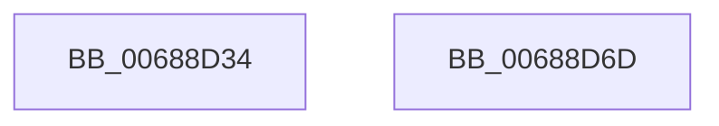

# MiGetAweFlushList

- RVA: `0x00688D34`–`0x00688D6E` (길이 `58` bytes)
- VA: `0x0000000140688D34`
- 실행 섹션: `.text`
- PDB 이름 있음: `예`; PDB Function 태그: `아니요`
- unwind 정보 RVA: `0x0006E5F8`
- 디코드: `18`개 명령, `58/58` bytes 표시
- 미해석 바이트: `0` (있으면 어셈블리에 `.byte`로 보존)

> 이 문서는 커널 이미지의 기계어와 PDB 기호를 분석해 생성했습니다. 4번과 5번은 함수 원형과 자료형을 바이너리 사용 방식에서 추정한 C 해석이며 원본 소스 복구 결과는 아닙니다.

## 1. Dependencies

- 직접 호출 지점: **2**; 고유 호출 대상: **2**
- 직접 호출자로 확인된 함수: **2**
- RIP 상대 이미지 참조: **0**

### Outgoing calls
- `0x00688D43` → [MiGetProcessorFlushList](../24/MiGetProcessorFlushList_function_00242C90.md) (function, `0x00242C90`)
- `0x00688D5A` → [MiInitializeTbFlushList](../29/MiInitializeTbFlushList_function_00294F00.md) (function, `0x00294F00`)

### Direct callers
- [MiWriteAwePtes](../4C/MiWriteAwePtes_function_004C51E0.md) at `0x004C5947`
- [MiZeroAndFlushAweLazyPtes](MiZeroAndFlushAweLazyPtes_function_00689B1C.md) at `0x00689C11`

### Static image references
- 디코드된 RIP-relative 메모리 참조가 없습니다.

## 2. Other-region calls and transfers

- 다른 실행 섹션으로 향하는 call: **0**
- 별도 외부 분기/꼬리 이동을 확인하지 못했습니다.

## 3. Assembly (complete function range)

```asm
00688D34  48 89 5C 24 08                  mov qword ptr [rsp + 8], rbx
00688D39  57                              push rdi
00688D3A  48 83 EC 30                     sub rsp, 0x30
00688D3E  8B DA                           mov ebx, edx
00688D40  48 8B F9                        mov rdi, rcx
00688D43  E8 48 9F BB FF                  call 0x140242c90
00688D48  48 8B 57 28                     mov rdx, qword ptr [rdi + 0x28]
00688D4C  48 8B C8                        mov rcx, rax
00688D4F  45 33 C9                        xor r9d, r9d
00688D52  89 5C 24 20                     mov dword ptr [rsp + 0x20], ebx
00688D56  44 8B 40 0C                     mov r8d, dword ptr [rax + 0xc]
00688D5A  E8 A1 C1 C0 FF                  call 0x140294f00
00688D5F  48 8B 5C 24 40                  mov rbx, qword ptr [rsp + 0x40]
00688D64  48 8B C1                        mov rax, rcx
00688D67  48 83 C4 30                     add rsp, 0x30
00688D6B  5F                              pop rdi
00688D6C  C3                              ret
00688D6D  CC                              int3
```

## 4. C-style interpretation (structured pseudocode)

```c
__int64 __fastcall MiGetAweFlushList(__int64 a1, int a2, __int64 a3, int a4)
{
    __int64 result;
    __int64 v_rsp;
    unsigned int v_stack_m18;
    unsigned __int64 v_stack_p8;

    v_stack_p8 = v_rbx;
    v_rsp = (v_rsp) - (48);
    result = MiGetProcessorFlushList(a1, a2, a3, a4);
    a4 = 0;
    v_stack_m18 = (unsigned int)((unsigned int)(a2));
    result = MiInitializeTbFlushList(result, *(unsigned __int64 *)(a1 + 40), (unsigned int)(*(unsigned int *)(result + 12)), a4);
    v_rsp = (v_rsp) + (48);
    return result;
}
```

## 5. (Beta) C Style

```c
int64_t MiGetAweFlushList(void *Arg1, int32_t Arg2, int64_t Arg3, int32_t Arg4)
{
    uint8_t *arg1 = (uint8_t *)Arg1;

    int64_t result;
    int64_t local_rsp;
    uint32_t v_stack_m18;
    uint64_t v_stack_p8;

    v_stack_p8 = local_rbx;
    local_rsp = (local_rsp) - (48);
    result = MiGetProcessorFlushList(Arg1, Arg2, Arg3, Arg4);
    Arg4 = 0;
    v_stack_m18 = (uint32_t)((uint32_t)(Arg2));
    result = MiInitializeTbFlushList(result, *(uint64_t *)(arg1 + 0x28), (uint32_t)(*(uint32_t *)(result + 0xC)), Arg4);
    local_rsp = (local_rsp) + (48);
    return result;
}
```

### 관측된 메모리 오프셋

구조체 형식이 확인되지 않은 접근은 인자 기준의 오프셋으로만 기록했습니다.

| 기준 인자 | 오프셋 표현 | 폭 (bit) | 접근 |
|---|---:|---:|---|
| `Arg1` | `+ 0x28` | `64` | `R` |

## 6. Execution-region graph

[열기: 2D/3D 그래프와 함수 탐색 컨트롤 패널](../../../control-panel.html?section=text&rva=0x00688D34&view=graph)

- 2D 그래프는 위에서 아래로 흐르고, 3D 그래프는 빈 공간을 드래그해 회전합니다. Shift+드래그는 이동, 휠은 확대·축소, 함수 노드 선택은 대상 보고서 이동입니다.

### Static fallback


