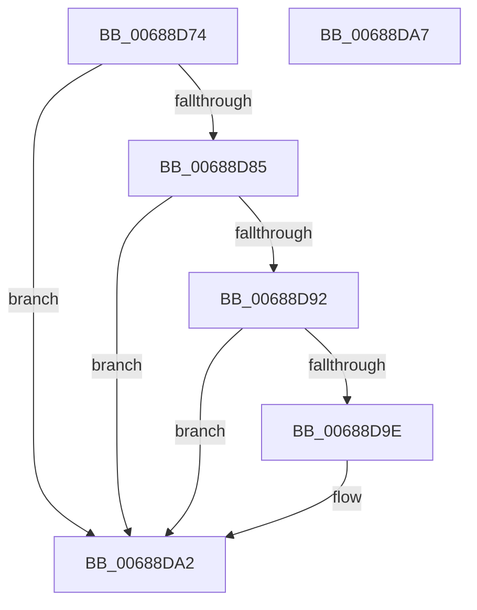

# MiGetAwePageSizeFromVa

- RVA: `0x00688D74`–`0x00688DA8` (길이 `52` bytes)
- VA: `0x0000000140688D74`
- 실행 섹션: `.text`
- PDB 이름 있음: `예`; PDB Function 태그: `아니요`
- unwind 정보 RVA: `0x0005C788`
- 디코드: `17`개 명령, `52/52` bytes 표시
- 미해석 바이트: `0` (있으면 어셈블리에 `.byte`로 보존)

> 이 문서는 커널 이미지의 기계어와 PDB 기호를 분석해 생성했습니다. 4번과 5번은 함수 원형과 자료형을 바이너리 사용 방식에서 추정한 C 해석이며 원본 소스 복구 결과는 아닙니다.

## 1. Dependencies

- 직접 호출 지점: **2**; 고유 호출 대상: **2**
- 직접 호출자로 확인된 함수: **1**
- RIP 상대 이미지 참조: **0**

### Outgoing calls
- `0x00688D78` → [MiGetAweNode](../4F/MiGetAweNode_function_004F600C.md) (function, `0x004F600C`)
- `0x00688D88` → [MiGetAweViewPageSize](../4C/MiGetAweViewPageSize_function_004C51AC.md) (function, `0x004C51AC`)

### Direct callers
- [MmSetGraphicsPtes](../../page/7F/MmSetGraphicsPtes_function_007FC8B0.md) at `0x007FC9D8`

### Static image references
- 디코드된 RIP-relative 메모리 참조가 없습니다.

## 2. Other-region calls and transfers

- 다른 실행 섹션으로 향하는 call: **0**
- 별도 외부 분기/꼬리 이동을 확인하지 못했습니다.

## 3. Assembly (complete function range)

```asm
00688D74  48 83 EC 28                     sub rsp, 0x28
00688D78  E8 8F D2 E6 FF                  call 0x1404f600c
00688D7D  4C 8B D8                        mov r11, rax
00688D80  48 85 C0                        test rax, rax
00688D83  74 1D                           je 0x140688da2
00688D85  49 8B CB                        mov rcx, r11
00688D88  E8 1F C4 E3 FF                  call 0x1404c51ac
00688D8D  48 85 C0                        test rax, rax
00688D90  75 10                           jne 0x140688da2
00688D92  49 8B 53 20                     mov rdx, qword ptr [r11 + 0x20]
00688D96  8B 4A 08                        mov ecx, dword ptr [rdx + 8]
00688D99  F6 C1 01                        test cl, 1
00688D9C  75 04                           jne 0x140688da2
00688D9E  48 8B 42 10                     mov rax, qword ptr [rdx + 0x10]
00688DA2  48 83 C4 28                     add rsp, 0x28
00688DA6  C3                              ret
00688DA7  CC                              int3
```

## 4. C-style interpretation (structured pseudocode)

```c
__int64 __fastcall MiGetAwePageSizeFromVa(void)
{
    __int64 result;
    __int64 v_rsp;

    v_rsp = (v_rsp) - (40);
    result = MiGetAweNode(a1, a2, a3, a4);
    if (result == 0) goto loc_00688DA2;
    result = MiGetAweViewPageSize(result, a2, a3, a4);
    if (result != 0) goto loc_00688DA2;
    if ((((unsigned __int8)((unsigned int)(*(unsigned int *)(*(unsigned __int64 *)(result + 32) + 8)))) & (1)) == 0) {
        result = *(unsigned __int64 *)(*(unsigned __int64 *)(result + 32) + 16);
    }
    v_rsp = (v_rsp) + (40);
    return result;
}
```

## 5. (Beta) C Style

```c
void MiGetAwePageSizeFromVa(void)
{
    int64_t result;
    int64_t local_rsp;

    local_rsp = (local_rsp) - (40);
    result = MiGetAweNode(a1, a2, a3, a4);
    if (result == 0) goto loc_00688DA2;
    result = MiGetAweViewPageSize(result, a2, a3, a4);
    if (result != 0) goto loc_00688DA2;
    if ((((uint8_t)((uint32_t)(*(uint32_t *)(*(uint64_t *)(result + 0x20) + 0x8)))) & (1)) == 0) {
        result = *(uint64_t *)(*(uint64_t *)(result + 0x20) + 0x10);
    }
    local_rsp = (local_rsp) + (40);
    return result;
}
```

## 6. Execution-region graph

[열기: 2D/3D 그래프와 함수 탐색 컨트롤 패널](../../../control-panel.html?section=text&rva=0x00688D74&view=graph)

- 2D 그래프는 위에서 아래로 흐르고, 3D 그래프는 빈 공간을 드래그해 회전합니다. Shift+드래그는 이동, 휠은 확대·축소, 함수 노드 선택은 대상 보고서 이동입니다.

### Static fallback


