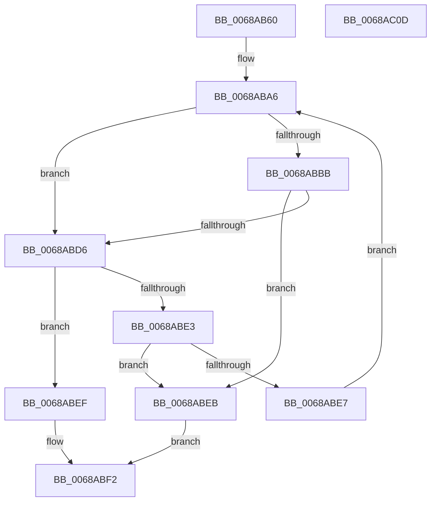

# MiGetBaseResidentPageForBugCheck

- RVA: `0x0068AB60`–`0x0068AC0E` (길이 `174` bytes)
- VA: `0x000000014068AB60`
- 실행 섹션: `.text`
- PDB 이름 있음: `예`; PDB Function 태그: `아니요`
- unwind 정보 RVA: `0x0005E6B4`
- 디코드: `51`개 명령, `174/174` bytes 표시
- 미해석 바이트: `0` (있으면 어셈블리에 `.byte`로 보존)

> 이 문서는 커널 이미지의 기계어와 PDB 기호를 분석해 생성했습니다. 4번과 5번은 함수 원형과 자료형을 바이너리 사용 방식에서 추정한 C 해석이며 원본 소스 복구 결과는 아닙니다.

## 1. Dependencies

- 직접 호출 지점: **1**; 고유 호출 대상: **1**
- 직접 호출자로 확인된 함수: **2**
- RIP 상대 이미지 참조: **1**

### Outgoing calls
- `0x0068ABD9` → [MiGetPfnPageSizeIndex](../31/MiGetPfnPageSizeIndex_function_0031C710.md) (function, `0x0031C710`)

### Direct callers
- [MiMirrorRemoveInactivePages](../4A/MiMirrorRemoveInactivePages_function_004AC24C.md) at `0x004AC2DE`
- [MiGetPagesRemainingInResidentPage](MiGetPagesRemainingInResidentPage_function_0068AC14.md) at `0x0068AC69`

### Static image references
- `0x0068ABA8` → RVA `0x00011C60` (`.rdata`; read)

## 2. Other-region calls and transfers

- 다른 실행 섹션으로 향하는 call: **0**
- 별도 외부 분기/꼬리 이동을 확인하지 못했습니다.

## 3. Assembly (complete function range)

```asm
0068AB60  48 8B C4                        mov rax, rsp
0068AB63  48 89 58 08                     mov qword ptr [rax + 8], rbx
0068AB67  48 89 68 10                     mov qword ptr [rax + 0x10], rbp
0068AB6B  48 89 70 18                     mov qword ptr [rax + 0x18], rsi
0068AB6F  48 89 78 20                     mov qword ptr [rax + 0x20], rdi
0068AB73  41 56                           push r14
0068AB75  48 83 EC 20                     sub rsp, 0x20
0068AB79  48 8B D9                        mov rbx, rcx
0068AB7C  49 BE 00 00 00 00 00 DE FF FF   movabs r14, 0xffffde0000000000
0068AB86  49 8B C6                        mov rax, r14
0068AB89  48 8B F9                        mov rdi, rcx
0068AB8C  48 2B F8                        sub rdi, rax
0068AB8F  48 B8 AB AA AA AA AA AA AA AA   movabs rax, 0xaaaaaaaaaaaaaaab
0068AB99  48 C1 FF 04                     sar rdi, 4
0068AB9D  48 0F AF F8                     imul rdi, rax
0068ABA1  33 ED                           xor ebp, ebp
0068ABA3  8D 75 02                        lea esi, [rbp + 2]
0068ABA6  8B C6                           mov eax, esi
0068ABA8  48 8D 0D B1 70 98 FF            lea rcx, [rip - 0x678f4f]
0068ABAF  48 8B 04 C1                     mov rax, qword ptr [rcx + rax*8]
0068ABB3  48 FF C8                        dec rax
0068ABB6  48 85 C7                        test rdi, rax
0068ABB9  74 1B                           je 0x14068abd6
0068ABBB  48 F7 D0                        not rax
0068ABBE  48 23 F8                        and rdi, rax
0068ABC1  48 8D 1C 7F                     lea rbx, [rdi + rdi*2]
0068ABC5  48 C1 E3 04                     shl rbx, 4
0068ABC9  49 8B C6                        mov rax, r14
0068ABCC  48 03 D8                        add rbx, rax
0068ABCF  FF C5                           inc ebp
0068ABD1  83 FD 03                        cmp ebp, 3
0068ABD4  77 15                           ja 0x14068abeb
0068ABD6  48 8B CB                        mov rcx, rbx
0068ABD9  E8 32 1B C9 FF                  call 0x14031c710
0068ABDE  83 F8 03                        cmp eax, 3
0068ABE1  75 0C                           jne 0x14068abef
0068ABE3  85 F6                           test esi, esi
0068ABE5  74 04                           je 0x14068abeb
0068ABE7  FF CE                           dec esi
0068ABE9  EB BB                           jmp 0x14068aba6
0068ABEB  33 C0                           xor eax, eax
0068ABED  EB 03                           jmp 0x14068abf2
0068ABEF  48 8B C3                        mov rax, rbx
0068ABF2  48 8B 5C 24 30                  mov rbx, qword ptr [rsp + 0x30]
0068ABF7  48 8B 6C 24 38                  mov rbp, qword ptr [rsp + 0x38]
0068ABFC  48 8B 74 24 40                  mov rsi, qword ptr [rsp + 0x40]
0068AC01  48 8B 7C 24 48                  mov rdi, qword ptr [rsp + 0x48]
0068AC06  48 83 C4 20                     add rsp, 0x20
0068AC0A  41 5E                           pop r14
0068AC0C  C3                              ret
0068AC0D  CC                              int3
```

## 4. C-style interpretation (structured pseudocode)

```c
__int64 __fastcall MiGetBaseResidentPageForBugCheck(__int64 a1)
{
    __int64 result;
    __int64 v_rbp;
    __int64 v_rbx;
    __int64 v_rdi;
    __int64 v_rsi;
    __int64 v_rsp;
    unsigned __int64 v_stack_p10;
    unsigned __int64 v_stack_p18;
    unsigned __int64 v_stack_p20;
    unsigned __int64 v_stack_p8;

    *(unsigned __int64 *)(v_rsp + 8) = v_rbx;
    *(unsigned __int64 *)(v_rsp + 16) = v_rbp;
    *(unsigned __int64 *)(v_rsp + 24) = v_rsi;
    *(unsigned __int64 *)(v_rsp + 32) = v_rdi;
    v_rsp = (v_rsp) - (32);
    v_rdi = (a1) - (v_r14);
    v_rdi = (v_rdi) >> (4);
    v_rdi = (v_rdi) * (v_r14);
    v_rbp = 0;
loc_0068ABA6:
    result = (*(unsigned __int64 *)(v_rip - 6786895 + (unsigned int)((unsigned int)(v_rbp + 2)) * 8)) - 1;
    if (((v_rdi) & (result)) == 0) goto loc_0068ABD6;
    result = ~(result);
    v_rdi = (v_rdi) & (result);
    v_rbx = (v_rdi + v_rdi * 2) << (4);
    v_rbx = (v_rbx) + (v_r14);
    v_rbp = (unsigned int)((v_rbp) + 1);
    if (((unsigned int)(v_rbp)) > 3) goto loc_0068ABEB;
loc_0068ABD6:
    result = MiGetPfnPageSizeIndex(v_rbx, a2, a3, a4);
    if (((unsigned int)(result)) != 3) goto loc_0068ABEF;
    if ((unsigned int)(v_rbp + 2) == 0) goto loc_0068ABEB;
    v_rsi = (unsigned int)((v_rbp + 2) - 1);
    goto loc_0068ABA6;
loc_0068ABEB:
    result = 0;
    goto loc_0068ABF2;
loc_0068ABEF:
loc_0068ABF2:
    v_rsp = (v_rsp) + (32);
    return v_rbx;
}
```

## 5. (Beta) C Style

```c
int64_t MiGetBaseResidentPageForBugCheck(int64_t Arg1)
{
    int64_t result;
    int64_t local_rbp;
    int64_t local_rbx;
    int64_t local_rdi;
    int64_t local_rsi;
    int64_t local_rsp;
    uint64_t v_stack_p10;
    uint64_t v_stack_p18;
    uint64_t v_stack_p20;
    uint64_t v_stack_p8;

    *(uint64_t *)(local_rsp + 0x8) = local_rbx;
    *(uint64_t *)(local_rsp + 0x10) = local_rbp;
    *(uint64_t *)(local_rsp + 0x18) = local_rsi;
    *(uint64_t *)(local_rsp + 0x20) = local_rdi;
    local_rsp = (local_rsp) - (32);
    local_rdi = (Arg1) - (local_r14);
    local_rdi = (local_rdi) >> (4);
    local_rdi = (local_rdi) * (local_r14);
    local_rbp = 0;
loc_0068ABA6:
    result = (*(uint64_t *)(v_rip - 0x678F4F + (uint32_t)((uint32_t)(local_rbp + 0x2)) * 8)) - 1;
    if (((local_rdi) & (result)) == 0) goto loc_0068ABD6;
    result = ~(result);
    local_rdi = (local_rdi) & (result);
    local_rbx = (local_rdi + local_rdi * 2) << (4);
    local_rbx = (local_rbx) + (local_r14);
    local_rbp = (uint32_t)((local_rbp) + 1);
    if (((uint32_t)(local_rbp)) > 3) goto loc_0068ABEB;
loc_0068ABD6:
    result = MiGetPfnPageSizeIndex(local_rbx, a2, a3, a4);
    if (((uint32_t)(result)) != 3) goto loc_0068ABEF;
    if ((uint32_t)(local_rbp + 2) == 0) goto loc_0068ABEB;
    local_rsi = (uint32_t)((local_rbp + 2) - 1);
    goto loc_0068ABA6;
loc_0068ABEB:
    result = 0;
    goto loc_0068ABF2;
loc_0068ABEF:
loc_0068ABF2:
    local_rsp = (local_rsp) + (32);
    return local_rbx;
}
```

## 6. Execution-region graph

[열기: 2D/3D 그래프와 함수 탐색 컨트롤 패널](../../../control-panel.html?section=text&rva=0x0068AB60&view=graph)

- 2D 그래프는 위에서 아래로 흐르고, 3D 그래프는 빈 공간을 드래그해 회전합니다. Shift+드래그는 이동, 휠은 확대·축소, 함수 노드 선택은 대상 보고서 이동입니다.

### Static fallback


