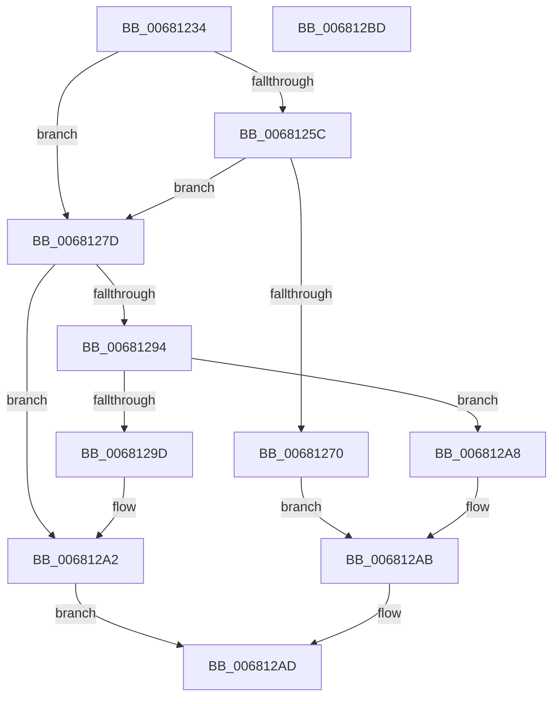

# MiGetCachedExtentWalkerNextPage

- RVA: `0x00681234`–`0x006812BE` (길이 `138` bytes)
- VA: `0x0000000140681234`
- 실행 섹션: `.text`
- PDB 이름 있음: `예`; PDB Function 태그: `아니요`
- unwind 정보 RVA: `0x00060BC4`
- 디코드: `40`개 명령, `138/138` bytes 표시
- 미해석 바이트: `0` (있으면 어셈블리에 `.byte`로 보존)

> 이 문서는 커널 이미지의 기계어와 PDB 기호를 분석해 생성했습니다. 4번과 5번은 함수 원형과 자료형을 바이너리 사용 방식에서 추정한 C 해석이며 원본 소스 복구 결과는 아닙니다.

## 1. Dependencies

- 직접 호출 지점: **1**; 고유 호출 대상: **1**
- 직접 호출자로 확인된 함수: **1**
- RIP 상대 이미지 참조: **0**

### Outgoing calls
- `0x0068128B` → [MiInitializeCachedExtentWalker](../4C/MiInitializeCachedExtentWalker_function_004CAC6C.md) (function, `0x004CAC6C`)

### Direct callers
- [MiTransferFileExtent](../4C/MiTransferFileExtent_function_004CAADC.md) at `0x004CABE8`

### Static image references
- 디코드된 RIP-relative 메모리 참조가 없습니다.

## 2. Other-region calls and transfers

- 다른 실행 섹션으로 향하는 call: **0**
- 별도 외부 분기/꼬리 이동을 확인하지 못했습니다.

## 3. Assembly (complete function range)

```asm
00681234  48 89 5C 24 08                  mov qword ptr [rsp + 8], rbx
00681239  48 89 74 24 10                  mov qword ptr [rsp + 0x10], rsi
0068123E  57                              push rdi
0068123F  48 83 EC 20                     sub rsp, 0x20
00681243  48 8B D9                        mov rbx, rcx
00681246  48 BE 00 00 00 00 00 00 00 80   movabs rsi, 0x8000000000000000
00681250  48 8B 49 10                     mov rcx, qword ptr [rcx + 0x10]
00681254  48 8B FA                        mov rdi, rdx
00681257  48 3B CE                        cmp rcx, rsi
0068125A  74 21                           je 0x14068127d
0068125C  48 8B 43 18                     mov rax, qword ptr [rbx + 0x18]
00681260  48 81 43 08 00 10 00 00         add qword ptr [rbx + 8], 0x1000
00681268  48 FF C8                        dec rax
0068126B  48 3B C8                        cmp rcx, rax
0068126E  73 0D                           jae 0x14068127d
00681270  48 8D 41 01                     lea rax, [rcx + 1]
00681274  48 89 43 10                     mov qword ptr [rbx + 0x10], rax
00681278  48 89 02                        mov qword ptr [rdx], rax
0068127B  EB 2E                           jmp 0x1406812ab
0068127D  44 8B 4B 20                     mov r9d, dword ptr [rbx + 0x20]
00681281  48 8B CB                        mov rcx, rbx
00681284  4C 8B 43 08                     mov r8, qword ptr [rbx + 8]
00681288  48 8B 13                        mov rdx, qword ptr [rbx]
0068128B  E8 DC 99 E4 FF                  call 0x1404cac6c
00681290  85 C0                           test eax, eax
00681292  78 0E                           js 0x1406812a2
00681294  48 8B 43 10                     mov rax, qword ptr [rbx + 0x10]
00681298  48 3B C6                        cmp rax, rsi
0068129B  75 0B                           jne 0x1406812a8
0068129D  B8 09 07 00 C0                  mov eax, 0xc0000709
006812A2  48 83 0F FF                     or qword ptr [rdi], 0xffffffffffffffff
006812A6  EB 05                           jmp 0x1406812ad
006812A8  48 89 07                        mov qword ptr [rdi], rax
006812AB  33 C0                           xor eax, eax
006812AD  48 8B 5C 24 30                  mov rbx, qword ptr [rsp + 0x30]
006812B2  48 8B 74 24 38                  mov rsi, qword ptr [rsp + 0x38]
006812B7  48 83 C4 20                     add rsp, 0x20
006812BB  5F                              pop rdi
006812BC  C3                              ret
006812BD  CC                              int3
```

## 4. C-style interpretation (structured pseudocode)

```c
__int64 __fastcall MiGetCachedExtentWalkerNextPage(__int64 a1, __int64 a2)
{
    __int64 result;
    __int64 v_rsp;
    unsigned __int64 v_stack_p10;
    unsigned __int64 v_stack_p8;

    v_stack_p8 = v_rbx;
    v_stack_p10 = v_rsi;
    v_rsp = (v_rsp) - (32);
    if ((*(unsigned __int64 *)(a1 + 16)) == v_rsi) goto loc_0068127D;
    result = (*(unsigned __int64 *)(a1 + 24)) - 1;
    if ((*(unsigned __int64 *)(a1 + 16)) >= result) goto loc_0068127D;
    *(unsigned __int64 *)(a1 + 16) = *(unsigned __int64 *)(a1 + 16) + 1;
    *(unsigned __int64 *)(a2) = *(unsigned __int64 *)(a1 + 16) + 1;
    goto loc_006812AB;
loc_0068127D:
    result = MiInitializeCachedExtentWalker(a1, *(unsigned __int64 *)(a1), *(unsigned __int64 *)(a1 + 8), (unsigned int)(*(unsigned int *)(a1 + 32)));
    if (sign_flag) goto loc_006812A2;
    if ((*(unsigned __int64 *)(a1 + 16)) != v_rsi) goto loc_006812A8;
loc_006812A2:
    goto loc_006812AD;
loc_006812A8:
    *(unsigned __int64 *)(a2) = (unsigned int)(0xC0000709ULL);
loc_006812AB:
    result = 0;
loc_006812AD:
    v_rsp = (v_rsp) + (32);
    return result;
}
```

## 5. (Beta) C Style

```c
int64_t MiGetCachedExtentWalkerNextPage(void *Arg1, void *Arg2)
{
    uint8_t *arg1 = (uint8_t *)Arg1;
    uint8_t *arg2 = (uint8_t *)Arg2;

    int64_t result;
    int64_t local_rsp;
    uint64_t v_stack_p10;
    uint64_t v_stack_p8;

    v_stack_p8 = local_rbx;
    v_stack_p10 = local_rsi;
    local_rsp = (local_rsp) - (32);
    if ((*(uint64_t *)(arg1 + 0x10)) == local_rsi) goto loc_0068127D;
    result = (*(uint64_t *)(arg1 + 0x18)) - 1;
    if ((*(uint64_t *)(arg1 + 0x10)) >= result) goto loc_0068127D;
    *(uint64_t *)(arg1 + 0x10) = *(uint64_t *)(arg1 + 0x10) + 1;
    *(uint64_t *)(arg2) = *(uint64_t *)(arg1 + 0x10) + 1;
    goto loc_006812AB;
loc_0068127D:
    result = MiInitializeCachedExtentWalker(Arg1, *(uint64_t *)(arg1), *(uint64_t *)(arg1 + 0x8), (uint32_t)(*(uint32_t *)(arg1 + 0x20)));
    if (sign_flag) goto loc_006812A2;
    if ((*(uint64_t *)(arg1 + 0x10)) != local_rsi) goto loc_006812A8;
loc_006812A2:
    goto loc_006812AD;
loc_006812A8:
    *(uint64_t *)(arg2) = (uint32_t)(0xC0000709ULL);
loc_006812AB:
    result = 0;
loc_006812AD:
    local_rsp = (local_rsp) + (32);
    return result;
}
```

### 관측된 메모리 오프셋

구조체 형식이 확인되지 않은 접근은 인자 기준의 오프셋으로만 기록했습니다.

| 기준 인자 | 오프셋 표현 | 폭 (bit) | 접근 |
|---|---:|---:|---|
| `Arg1` | `+ 0x0` | `64` | `R` |
| `Arg1` | `+ 0x8` | `64` | `R` |
| `Arg1` | `+ 0x8` | `64` | `R/W` |
| `Arg1` | `+ 0x10` | `64` | `R` |
| `Arg1` | `+ 0x10` | `64` | `W` |
| `Arg1` | `+ 0x18` | `64` | `R` |
| `Arg1` | `+ 0x20` | `32` | `R` |
| `Arg2` | `+ 0x0` | `64` | `R/W` |
| `Arg2` | `+ 0x0` | `64` | `W` |

## 6. Execution-region graph

[열기: 2D/3D 그래프와 함수 탐색 컨트롤 패널](../../../control-panel.html?section=text&rva=0x00681234&view=graph)

- 2D 그래프는 위에서 아래로 흐르고, 3D 그래프는 빈 공간을 드래그해 회전합니다. Shift+드래그는 이동, 휠은 확대·축소, 함수 노드 선택은 대상 보고서 이동입니다.

### Static fallback


