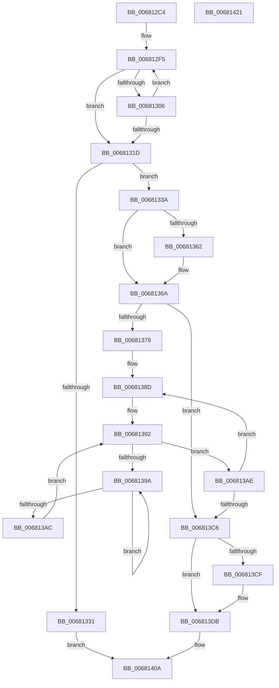

# MiGetDanglingExtent

- RVA: `0x006812C4`–`0x00681422` (길이 `350` bytes)
- VA: `0x00000001406812C4`
- 실행 섹션: `.text`
- PDB 이름 있음: `예`; PDB Function 태그: `아니요`
- unwind 정보 RVA: `0x00083688`
- 디코드: `91`개 명령, `350/350` bytes 표시
- 미해석 바이트: `0` (있으면 어셈블리에 `.byte`로 보존)

> 이 문서는 커널 이미지의 기계어와 PDB 기호를 분석해 생성했습니다. 4번과 5번은 함수 원형과 자료형을 바이너리 사용 방식에서 추정한 C 해석이며 원본 소스 복구 결과는 아닙니다.

## 1. Dependencies

- 직접 호출 지점: **6**; 고유 호출 대상: **6**
- 직접 호출자로 확인된 함수: **1**
- RIP 상대 이미지 참조: **3**

### Outgoing calls
- `0x006812ED` → [ExAcquireSpinLockExclusive](../24/ExAcquireSpinLockExclusive_function_00248690.md) (function, `0x00248690`)
- `0x006812FC` → [MiUnlinkPageChainHead](../36/MiUnlinkPageChainHead_function_00365C40.md) (function, `0x00365C40`)
- `0x00681327` → [MiReleaseSpinLockExclusive](../24/MiReleaseSpinLockExclusive_function_002482C0.md) (function, `0x002482C0`)
- `0x00681365` → [KiRaiseIrqlProcessIrqlFlags](../4F/KiRaiseIrqlProcessIrqlFlags_function_004F56FC.md) (function, `0x004F56FC`)
- `0x0068139F` → [KeYieldProcessorEx](../3F/KeYieldProcessorEx_function_003FBD00.md) (function, `0x003FBD00`)
- `0x006813D6` → [KiLowerIrqlProcessIrqlFlags](../4F/KiLowerIrqlProcessIrqlFlags_function_004F5698.md) (function, `0x004F5698`)

### Direct callers
- [MiRemovePhysicalMemory](../../page/7F/MiRemovePhysicalMemory_function_007FAD3C.md) at `0x007FAE3D`

### Static image references
- `0x006812E1` → RVA `0x00E3A8A0` (`.data`; read)
- `0x006812F5` → RVA `0x00E2D6A8` (`.data`; read)
- `0x00681359` → RVA `0x00FC6D20` (`ALMOSTRO`; read)

## 2. Other-region calls and transfers

- 다른 실행 섹션으로 향하는 call: **0**
- 별도 외부 분기/꼬리 이동을 확인하지 못했습니다.

## 3. Assembly (complete function range)

```asm
006812C4  48 89 5C 24 10                  mov qword ptr [rsp + 0x10], rbx
006812C9  48 89 6C 24 18                  mov qword ptr [rsp + 0x18], rbp
006812CE  56                              push rsi
006812CF  57                              push rdi
006812D0  41 54                           push r12
006812D2  41 56                           push r14
006812D4  41 57                           push r15
006812D6  48 83 EC 20                     sub rsp, 0x20
006812DA  48 83 21 00                     and qword ptr [rcx], 0
006812DE  4C 8B E1                        mov r12, rcx
006812E1  48 8D 0D B8 95 7B 00            lea rcx, [rip + 0x7b95b8]
006812E8  45 33 F6                        xor r14d, r14d
006812EB  33 FF                           xor edi, edi
006812ED  E8 9E 73 BC FF                  call 0x140248690
006812F2  44 8A C0                        mov r8b, al
006812F5  48 8D 0D AC C3 7A 00            lea rcx, [rip + 0x7ac3ac]
006812FC  E8 3F 49 CE FF                  call 0x140365c40
00681301  48 85 C0                        test rax, rax
00681304  74 17                           je 0x14068131d
00681306  4D 85 F6                        test r14, r14
00681309  48 0F 44 F8                     cmove rdi, rax
0068130D  49 FF C6                        inc r14
00681310  48 83 C0 D0                     add rax, -0x30
00681314  48 39 05 8D C3 7A 00            cmp qword ptr [rip + 0x7ac38d], rax
0068131B  74 D8                           je 0x1406812f5
0068131D  41 8A D0                        mov dl, r8b
00681320  48 8D 0D 79 95 7B 00            lea rcx, [rip + 0x7b9579]
00681327  E8 94 6F BC FF                  call 0x1402482c0
0068132C  4D 85 F6                        test r14, r14
0068132F  75 09                           jne 0x14068133a
00681331  48 83 C8 FF                     or rax, 0xffffffffffffffff
00681335  E9 D0 00 00 00                  jmp 0x14068140a
0068133A  4B 8D 04 76                     lea rax, [r14 + r14*2]
0068133E  48 8B DF                        mov rbx, rdi
00681341  48 C1 E0 04                     shl rax, 4
00681345  48 2B D8                        sub rbx, rax
00681348  48 8D 6B 30                     lea rbp, [rbx + 0x30]
0068134C  45 0F 20 C7                     mov r15, cr8
00681350  BA 02 00 00 00                  mov edx, 2
00681355  44 0F 22 C2                     mov cr8, rdx
00681359  83 3D C0 59 94 00 00            cmp dword ptr [rip + 0x9459c0], 0
00681360  74 08                           je 0x14068136a
00681362  41 8A CF                        mov cl, r15b
00681365  E8 92 43 E7 FF                  call 0x1404f56fc
0068136A  48 B8 AB AA AA AA AA AA AA AA   movabs rax, 0xaaaaaaaaaaaaaaab
00681374  48 3B EF                        cmp rbp, rdi
00681377  77 4D                           ja 0x1406813c6
00681379  48 2B FD                        sub rdi, rbp
0068137C  48 8D 75 18                     lea rsi, [rbp + 0x18]
00681380  48 F7 E7                        mul rdi
00681383  48 8B FA                        mov rdi, rdx
00681386  48 C1 EF 05                     shr rdi, 5
0068138A  48 FF C7                        inc rdi
0068138D  83 64 24 50 00                  and dword ptr [rsp + 0x50], 0
00681392  F0 48 0F BA 2E 3F               lock bts qword ptr [rsi], 0x3f
00681398  73 14                           jae 0x1406813ae
0068139A  48 8D 4C 24 50                  lea rcx, [rsp + 0x50]
0068139F  E8 5C A9 D7 FF                  call 0x1403fbd00
006813A4  48 8B 06                        mov rax, qword ptr [rsi]
006813A7  48 85 C0                        test rax, rax
006813AA  78 EE                           js 0x14068139a
006813AC  EB E4                           jmp 0x140681392
006813AE  48 B8 FF FF FF FF FF FF FF 7F   movabs rax, 0x7fffffffffffffff
006813B8  F0 48 21 06                     lock and qword ptr [rsi], rax
006813BC  48 83 C6 30                     add rsi, 0x30
006813C0  48 83 EF 01                     sub rdi, 1
006813C4  75 C7                           jne 0x14068138d
006813C6  83 3D 53 59 94 00 00            cmp dword ptr [rip + 0x945953], 0
006813CD  74 0C                           je 0x1406813db
006813CF  44 0F 20 C1                     mov rcx, cr8
006813D3  41 8A D7                        mov dl, r15b
006813D6  E8 BD 42 E7 FF                  call 0x1404f5698
006813DB  41 0F B6 CF                     movzx ecx, r15b
006813DF  44 0F 22 C1                     mov cr8, rcx
006813E3  4D 89 34 24                     mov qword ptr [r12], r14
006813E7  48 B8 00 00 00 00 00 DE FF FF   movabs rax, 0xffffde0000000000
006813F1  48 2B D8                        sub rbx, rax
006813F4  48 B8 AB AA AA AA AA AA AA AA   movabs rax, 0xaaaaaaaaaaaaaaab
006813FE  48 83 C3 30                     add rbx, 0x30
00681402  48 C1 FB 04                     sar rbx, 4
00681406  48 0F AF C3                     imul rax, rbx
0068140A  48 8B 5C 24 58                  mov rbx, qword ptr [rsp + 0x58]
0068140F  48 8B 6C 24 60                  mov rbp, qword ptr [rsp + 0x60]
00681414  48 83 C4 20                     add rsp, 0x20
00681418  41 5F                           pop r15
0068141A  41 5E                           pop r14
0068141C  41 5C                           pop r12
0068141E  5F                              pop rdi
0068141F  5E                              pop rsi
00681420  C3                              ret
00681421  CC                              int3
```

## 4. C-style interpretation (structured pseudocode)

```c
__int64 __fastcall MiGetDanglingExtent(__int64 a1)
{
    __int64 result;
    __int64 v_r14;
    __int64 v_rbx;
    __int64 v_rdi;
    __int64 v_rsi;
    __int64 v_rsp;
    unsigned __int64 v_stack_p10;
    unsigned __int64 v_stack_p18;
    unsigned int v_stack_p8;

    v_stack_p10 = v_rbx;
    v_stack_p18 = v_rbp;
    v_rsp = (v_rsp) - (32);
    v_r14 = 0;
    v_rdi = 0;
    result = ExAcquireSpinLockExclusive(v_rip + 8099256, a2, a3, a4);
loc_006812F5:
    result = MiUnlinkPageChainHead(v_rip + 8045484, a2, (unsigned __int8)(result), a4);
    if (result == 0) goto loc_0068131D;
    if (0 == 0) { v_rdi = result; }
    v_r14 = (v_r14) + 1;
    result = (result) + (-48);
    if ((*(unsigned __int64 *)(v_rip + 8045453)) == result) goto loc_006812F5;
loc_0068131D:
    result = MiReleaseSpinLockExclusive(v_rip + 8099193, (unsigned __int8)((unsigned __int8)(result)), (unsigned __int8)(result), a4);
    if (v_r14 != 0) goto loc_0068133A;
    result = (result) | (-1);
    goto loc_0068140A;
loc_0068133A:
    result = (v_r14 + v_r14 * 2) << (4);
    v_rbx = (v_rdi) - (result);
    if ((*(unsigned int *)(v_rip + 9722304)) != 0) {
        a1 = (unsigned __int8)(v_cr8);
        result = KiRaiseIrqlProcessIrqlFlags(a1, 2, (unsigned __int8)(result), a4);
    }
    if ((v_rbx + 48) > v_rdi) goto loc_006813C6;
    v_rdi = (v_rdi) - (v_rbx + 48);
    v_rdi = (2) >> (5);
    v_rdi = (v_rdi) + 1;
loc_0068138D:
loc_00681392:
    if (condition_is_above_or_equal) goto loc_006813AE;
loc_0068139A:
    result = KeYieldProcessorEx(v_stack_p8, 2, (unsigned __int8)(result), a4);
    if (sign_flag) goto loc_0068139A;
    goto loc_00681392;
loc_006813AE:
    v_rsi = (v_rbx + 48 + 24) + (48);
    v_rdi = (v_rdi) - (1);
    if (condition_is_not_equal) goto loc_0068138D;
loc_006813C6:
    result = *(unsigned __int64 *)(v_rbx + 48 + 24);
    if ((*(unsigned int *)(v_rip + 9722195)) != 0) {
        a1 = 2;
        a2 = (unsigned __int8)(v_cr8);
        result = KiLowerIrqlProcessIrqlFlags(a1, a2, (unsigned __int8)(result), a4);
    }
    *(unsigned __int64 *)(a1) = v_r14;
    v_rbx = (v_rbx) - (result);
    v_rbx = (v_rbx) + (48);
    v_rbx = (v_rbx) >> (4);
    result = (result) * (v_rbx);
loc_0068140A:
    v_rsp = (v_rsp) + (32);
    return result;
}
```

## 5. (Beta) C Style

```c
int64_t MiGetDanglingExtent(void *Arg1)
{
    uint8_t *arg1 = (uint8_t *)Arg1;

    int64_t result;
    int64_t local_r14;
    int64_t local_rbx;
    int64_t local_rdi;
    int64_t local_rsi;
    int64_t local_rsp;
    uint64_t v_stack_p10;
    uint64_t v_stack_p18;
    uint32_t v_stack_p8;

    v_stack_p10 = local_rbx;
    v_stack_p18 = local_rbp;
    local_rsp = (local_rsp) - (32);
    local_r14 = 0;
    local_rdi = 0;
    result = ExAcquireSpinLockExclusive(v_rip + 8099256, a2, a3, a4);
loc_006812F5:
    result = MiUnlinkPageChainHead(v_rip + 8045484, a2, (uint8_t)(result), a4);
    if (result == 0) goto loc_0068131D;
    if (0 == 0) { local_rdi = result; }
    local_r14 = (local_r14) + 1;
    result = (result) + (-48);
    if ((*(uint64_t *)(v_rip + 0x7AC38D)) == result) goto loc_006812F5;
loc_0068131D:
    result = MiReleaseSpinLockExclusive(v_rip + 8099193, (uint8_t)((uint8_t)(result)), (uint8_t)(result), a4);
    if (local_r14 != 0) goto loc_0068133A;
    result = (result) | (-1);
    goto loc_0068140A;
loc_0068133A:
    result = (local_r14 + local_r14 * 2) << (4);
    local_rbx = (local_rdi) - (result);
    if ((*(uint32_t *)(v_rip + 0x9459C0)) != 0) {
        Arg1 = (uint8_t)(v_cr8);
        result = KiRaiseIrqlProcessIrqlFlags(Arg1, 2, (uint8_t)(result), a4);
    }
    if ((local_rbx + 48) > local_rdi) goto loc_006813C6;
    local_rdi = (local_rdi) - (local_rbx + 48);
    local_rdi = (2) >> (5);
    local_rdi = (local_rdi) + 1;
loc_0068138D:
loc_00681392:
    if (condition_is_above_or_equal) goto loc_006813AE;
loc_0068139A:
    result = KeYieldProcessorEx(v_stack_p8, 2, (uint8_t)(result), a4);
    if (sign_flag) goto loc_0068139A;
    goto loc_00681392;
loc_006813AE:
    local_rsi = (local_rbx + 48 + 24) + (48);
    local_rdi = (local_rdi) - (1);
    if (condition_is_not_equal) goto loc_0068138D;
loc_006813C6:
    result = *(uint64_t *)(local_rbx + 0x30 + 0x18);
    if ((*(uint32_t *)(v_rip + 0x945953)) != 0) {
        Arg1 = 2;
        a2 = (uint8_t)(v_cr8);
        result = KiLowerIrqlProcessIrqlFlags(Arg1, a2, (uint8_t)(result), a4);
    }
    *(uint64_t *)(arg1) = local_r14;
    local_rbx = (local_rbx) - (result);
    local_rbx = (local_rbx) + (48);
    local_rbx = (local_rbx) >> (4);
    result = (result) * (local_rbx);
loc_0068140A:
    local_rsp = (local_rsp) + (32);
    return result;
}
```

### 관측된 메모리 오프셋

구조체 형식이 확인되지 않은 접근은 인자 기준의 오프셋으로만 기록했습니다.

| 기준 인자 | 오프셋 표현 | 폭 (bit) | 접근 |
|---|---:|---:|---|
| `Arg1` | `+ 0x0` | `64` | `R/W` |
| `Arg1` | `+ 0x0` | `64` | `W` |

## 6. Execution-region graph

[열기: 2D/3D 그래프와 함수 탐색 컨트롤 패널](../../../control-panel.html?section=text&rva=0x006812C4&view=graph)

- 2D 그래프는 위에서 아래로 흐르고, 3D 그래프는 빈 공간을 드래그해 회전합니다. Shift+드래그는 이동, 휠은 확대·축소, 함수 노드 선택은 대상 보고서 이동입니다.

### Static fallback


