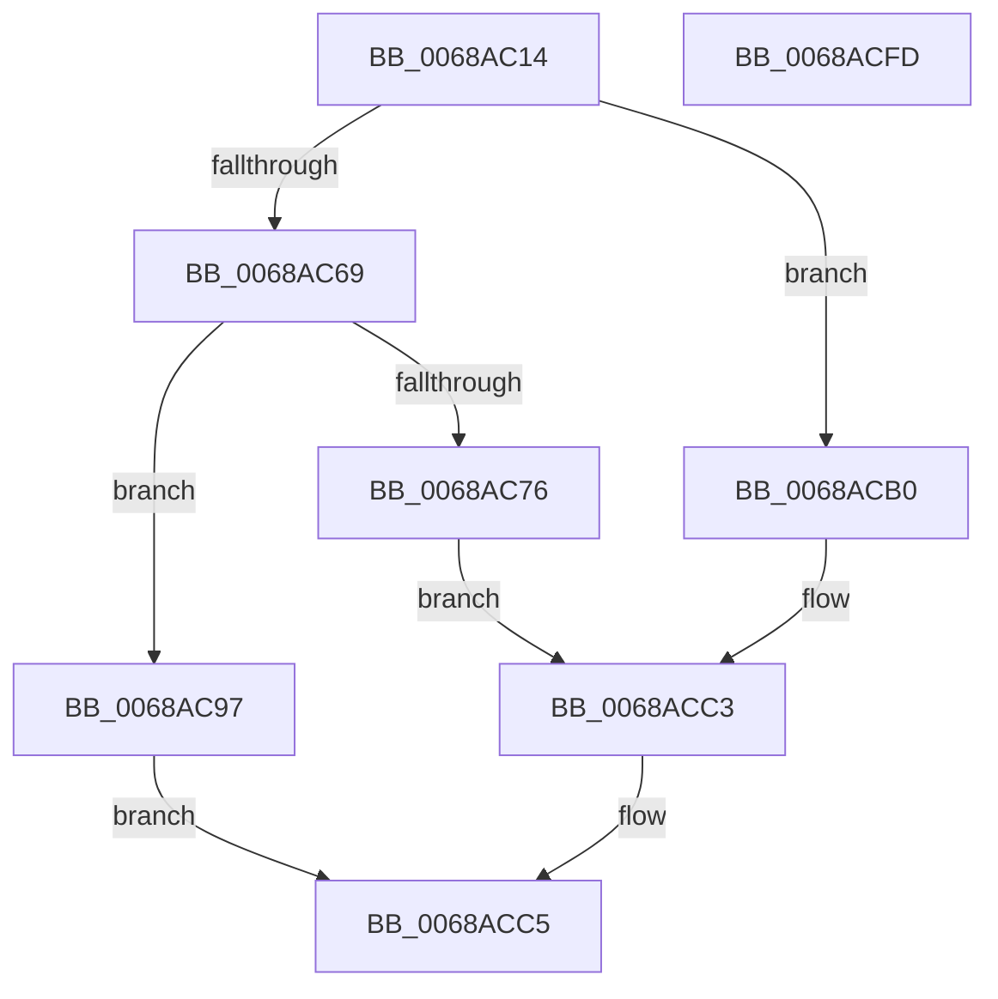

# MiGetPagesRemainingInResidentPage

- RVA: `0x0068AC14`–`0x0068ACFE` (길이 `234` bytes)
- VA: `0x000000014068AC14`
- 실행 섹션: `.text`
- PDB 이름 있음: `예`; PDB Function 태그: `아니요`
- unwind 정보 RVA: `0x00099F10`
- 디코드: `69`개 명령, `234/234` bytes 표시
- 미해석 바이트: `0` (있으면 어셈블리에 `.byte`로 보존)

> 이 문서는 커널 이미지의 기계어와 PDB 기호를 분석해 생성했습니다. 4번과 5번은 함수 원형과 자료형을 바이너리 사용 방식에서 추정한 C 해석이며 원본 소스 복구 결과는 아닙니다.

## 1. Dependencies

- 직접 호출 지점: **3**; 고유 호출 대상: **3**
- 직접 호출자로 확인된 함수: **1**
- RIP 상대 이미지 참조: **2**

### Outgoing calls
- `0x0068AC69` → [MiGetBaseResidentPageForBugCheck](MiGetBaseResidentPageForBugCheck_function_0068AB60.md) (function, `0x0068AB60`)
- `0x0068AC84` → [MiGetPfnPageSizeIndex](../31/MiGetPfnPageSizeIndex_function_0031C710.md) (function, `0x0031C710`)
- `0x0068ACBA` → [MiGetPfnPageSizeIndexUnsynchronized](../46/MiGetPfnPageSizeIndexUnsynchronized_function_0046C008.md) (function, `0x0046C008`)

### Direct callers
- [MiAddPhysicalPagesToCrashDump](../67/MiAddPhysicalPagesToCrashDump_function_0067D1B4.md) at `0x0067D229`

### Static image references
- `0x0068AC5E` → RVA `0x00F4754C` (`.data`; read)
- `0x0068ACCA` → RVA `0x00011C60` (`.rdata`; read)

## 2. Other-region calls and transfers

- 다른 실행 섹션으로 향하는 call: **0**
- 별도 외부 분기/꼬리 이동을 확인하지 못했습니다.

## 3. Assembly (complete function range)

```asm
0068AC14  48 89 5C 24 18                  mov qword ptr [rsp + 0x18], rbx
0068AC19  55                              push rbp
0068AC1A  56                              push rsi
0068AC1B  57                              push rdi
0068AC1C  41 56                           push r14
0068AC1E  41 57                           push r15
0068AC20  48 83 EC 20                     sub rsp, 0x20
0068AC24  83 64 24 50 00                  and dword ptr [rsp + 0x50], 0
0068AC29  4D 8B F0                        mov r14, r8
0068AC2C  83 64 24 58 00                  and dword ptr [rsp + 0x58], 0
0068AC31  4C 8B FA                        mov r15, rdx
0068AC34  48 8B D9                        mov rbx, rcx
0068AC37  48 B8 00 00 00 00 00 DE FF FF   movabs rax, 0xffffde0000000000
0068AC41  48 8B F1                        mov rsi, rcx
0068AC44  BD 03 00 00 00                  mov ebp, 3
0068AC49  48 2B F0                        sub rsi, rax
0068AC4C  48 B8 AB AA AA AA AA AA AA AA   movabs rax, 0xaaaaaaaaaaaaaaab
0068AC56  48 C1 FE 04                     sar rsi, 4
0068AC5A  48 0F AF F0                     imul rsi, rax
0068AC5E  8B 05 E8 C8 8B 00               mov eax, dword ptr [rip + 0x8bc8e8]
0068AC64  40 84 C5                        test bpl, al
0068AC67  74 47                           je 0x14068acb0
0068AC69  E8 F2 FE FF FF                  call 0x14068ab60
0068AC6E  48 8B F8                        mov rdi, rax
0068AC71  48 85 C0                        test rax, rax
0068AC74  74 21                           je 0x14068ac97
0068AC76  0F B6 48 22                     movzx ecx, byte ptr [rax + 0x22]
0068AC7A  83 E1 07                        and ecx, 7
0068AC7D  89 4C 24 50                     mov dword ptr [rsp + 0x50], ecx
0068AC81  48 8B C8                        mov rcx, rax
0068AC84  E8 87 1A C9 FF                  call 0x14031c710
0068AC89  8B 4F 20                        mov ecx, dword ptr [rdi + 0x20]
0068AC8C  C1 E9 10                        shr ecx, 0x10
0068AC8F  0F B6 D1                        movzx edx, cl
0068AC92  C1 EA 06                        shr edx, 6
0068AC95  EB 2C                           jmp 0x14068acc3
0068AC97  0F B6 43 22                     movzx eax, byte ptr [rbx + 0x22]
0068AC9B  83 E0 07                        and eax, 7
0068AC9E  89 44 24 50                     mov dword ptr [rsp + 0x50], eax
0068ACA2  8B 43 20                        mov eax, dword ptr [rbx + 0x20]
0068ACA5  C1 E8 10                        shr eax, 0x10
0068ACA8  0F B6 D0                        movzx edx, al
0068ACAB  C1 EA 06                        shr edx, 6
0068ACAE  EB 15                           jmp 0x14068acc5
0068ACB0  4C 8D 44 24 58                  lea r8, [rsp + 0x58]
0068ACB5  48 8D 54 24 50                  lea rdx, [rsp + 0x50]
0068ACBA  E8 49 13 DE FF                  call 0x14046c008
0068ACBF  8B 54 24 58                     mov edx, dword ptr [rsp + 0x58]
0068ACC3  8B E8                           mov ebp, eax
0068ACC5  48 8B 5C 24 60                  mov rbx, qword ptr [rsp + 0x60]
0068ACCA  48 8D 0D 8F 6F 98 FF            lea rcx, [rip - 0x679071]
0068ACD1  8B C5                           mov eax, ebp
0068ACD3  41 89 16                        mov dword ptr [r14], edx
0068ACD6  48 8B 0C C1                     mov rcx, qword ptr [rcx + rax*8]
0068ACDA  8B 44 24 50                     mov eax, dword ptr [rsp + 0x50]
0068ACDE  41 89 07                        mov dword ptr [r15], eax
0068ACE1  48 8D 41 FF                     lea rax, [rcx - 1]
0068ACE5  48 F7 D0                        not rax
0068ACE8  48 23 C6                        and rax, rsi
0068ACEB  48 2B C6                        sub rax, rsi
0068ACEE  48 03 C1                        add rax, rcx
0068ACF1  48 83 C4 20                     add rsp, 0x20
0068ACF5  41 5F                           pop r15
0068ACF7  41 5E                           pop r14
0068ACF9  5F                              pop rdi
0068ACFA  5E                              pop rsi
0068ACFB  5D                              pop rbp
0068ACFC  C3                              ret
0068ACFD  CC                              int3
```

## 4. C-style interpretation (structured pseudocode)

```c
__int64 __fastcall MiGetPagesRemainingInResidentPage(__int64 a1, __int64 a2, __int64 a3)
{
    __int64 result;
    __int64 v_rsi;
    __int64 v_rsp;
    unsigned int v_stack_p10;
    unsigned __int64 v_stack_p18;
    unsigned int v_stack_p8;

    v_stack_p18 = v_rbx;
    v_rsp = (v_rsp) - (32);
    v_rsi = (a1) - (result);
    v_rsi = (v_rsi) >> (4);
    v_rsi = (v_rsi) * (result);
    if (((3) & ((unsigned __int8)((unsigned int)(*(unsigned int *)(v_rip + 9160936))))) == 0) goto loc_0068ACB0;
    result = MiGetBaseResidentPageForBugCheck(a1, a2, a3, a4);
    if (result == 0) goto loc_0068AC97;
    a1 = (unsigned int)((*(unsigned __int8 *)(result + 34)) & (7));
    v_stack_p8 = (unsigned int)(a1);
    result = MiGetPfnPageSizeIndex(result, a2, a3, a4);
    a1 = (unsigned int)(((unsigned int)(*(unsigned int *)(result + 32))) >> (16));
    a2 = (unsigned int)(((unsigned __int8)(a1)) >> (6));
    goto loc_0068ACC3;
loc_0068AC97:
    result = (unsigned int)((*(unsigned __int8 *)(a1 + 34)) & (7));
    v_stack_p8 = (unsigned int)(result);
    result = (unsigned int)(((unsigned int)(*(unsigned int *)(a1 + 32))) >> (16));
    a2 = (unsigned int)(((unsigned __int8)(result)) >> (6));
    goto loc_0068ACC5;
loc_0068ACB0:
    result = MiGetPfnPageSizeIndexUnsynchronized(a1, v_stack_p8, v_stack_p10, a4);
loc_0068ACC3:
loc_0068ACC5:
    *(unsigned int *)(a3) = (unsigned int)((unsigned int)(v_stack_p10));
    *(unsigned int *)(a2) = (unsigned int)((unsigned int)(v_stack_p8));
    result = ~(*(unsigned __int64 *)(v_rip - 6787185 + (unsigned int)((unsigned int)((unsigned int)((unsigned int)(result)))) * 8) - 1);
    result = (result) & (v_rsi);
    result = (result) - (v_rsi);
    result = (result) + (*(unsigned __int64 *)(v_rip - 6787185 + (unsigned int)((unsigned int)((unsigned int)((unsigned int)(result)))) * 8));
    v_rsp = (v_rsp) + (32);
    return result;
}
```

## 5. (Beta) C Style

```c
int64_t MiGetPagesRemainingInResidentPage(void *Arg1, void *Arg2, void *Arg3)
{
    uint8_t *arg1 = (uint8_t *)Arg1;
    uint8_t *arg2 = (uint8_t *)Arg2;
    uint8_t *arg3 = (uint8_t *)Arg3;

    int64_t result;
    int64_t local_rsi;
    int64_t local_rsp;
    uint32_t v_stack_p10;
    uint64_t v_stack_p18;
    uint32_t v_stack_p8;

    v_stack_p18 = local_rbx;
    local_rsp = (local_rsp) - (32);
    local_rsi = (Arg1) - (result);
    local_rsi = (local_rsi) >> (4);
    local_rsi = (local_rsi) * (result);
    if (((3) & ((uint8_t)((uint32_t)(*(uint32_t *)(v_rip + 0x8BC8E8))))) == 0) goto loc_0068ACB0;
    result = MiGetBaseResidentPageForBugCheck(Arg1, Arg2, Arg3, a4);
    if (result == 0) goto loc_0068AC97;
    Arg1 = (uint32_t)((*(uint8_t *)(result + 0x22)) & (7));
    v_stack_p8 = (uint32_t)(Arg1);
    result = MiGetPfnPageSizeIndex(result, Arg2, Arg3, a4);
    Arg1 = (uint32_t)(((uint32_t)(*(uint32_t *)(result + 0x20))) >> (16));
    Arg2 = (uint32_t)(((uint8_t)(Arg1)) >> (6));
    goto loc_0068ACC3;
loc_0068AC97:
    result = (uint32_t)((*(uint8_t *)(arg1 + 0x22)) & (7));
    v_stack_p8 = (uint32_t)(result);
    result = (uint32_t)(((uint32_t)(*(uint32_t *)(arg1 + 0x20))) >> (16));
    Arg2 = (uint32_t)(((uint8_t)(result)) >> (6));
    goto loc_0068ACC5;
loc_0068ACB0:
    result = MiGetPfnPageSizeIndexUnsynchronized(Arg1, v_stack_p8, v_stack_p10, a4);
loc_0068ACC3:
loc_0068ACC5:
    *(uint32_t *)(arg3) = (uint32_t)((uint32_t)(v_stack_p10));
    *(uint32_t *)(arg2) = (uint32_t)((uint32_t)(v_stack_p8));
    result = ~(*(uint64_t *)(v_rip - 0x679071 + (uint32_t)((uint32_t)((uint32_t)((uint32_t)(result)))) * 8) - 1);
    result = (result) & (local_rsi);
    result = (result) - (local_rsi);
    result = (result) + (*(uint64_t *)(v_rip - 0x679071 + (uint32_t)((uint32_t)((uint32_t)((uint32_t)(result)))) * 8));
    local_rsp = (local_rsp) + (32);
    return result;
}
```

### 관측된 메모리 오프셋

구조체 형식이 확인되지 않은 접근은 인자 기준의 오프셋으로만 기록했습니다.

| 기준 인자 | 오프셋 표현 | 폭 (bit) | 접근 |
|---|---:|---:|---|
| `Arg1` | `+ 0x20` | `32` | `R` |
| `Arg1` | `+ 0x22` | `8` | `R` |
| `Arg2` | `+ 0x0` | `32` | `W` |
| `Arg3` | `+ 0x0` | `32` | `W` |

## 6. Execution-region graph

[열기: 2D/3D 그래프와 함수 탐색 컨트롤 패널](../../../control-panel.html?section=text&rva=0x0068AC14&view=graph)

- 2D 그래프는 위에서 아래로 흐르고, 3D 그래프는 빈 공간을 드래그해 회전합니다. Shift+드래그는 이동, 휠은 확대·축소, 함수 노드 선택은 대상 보고서 이동입니다.

### Static fallback


