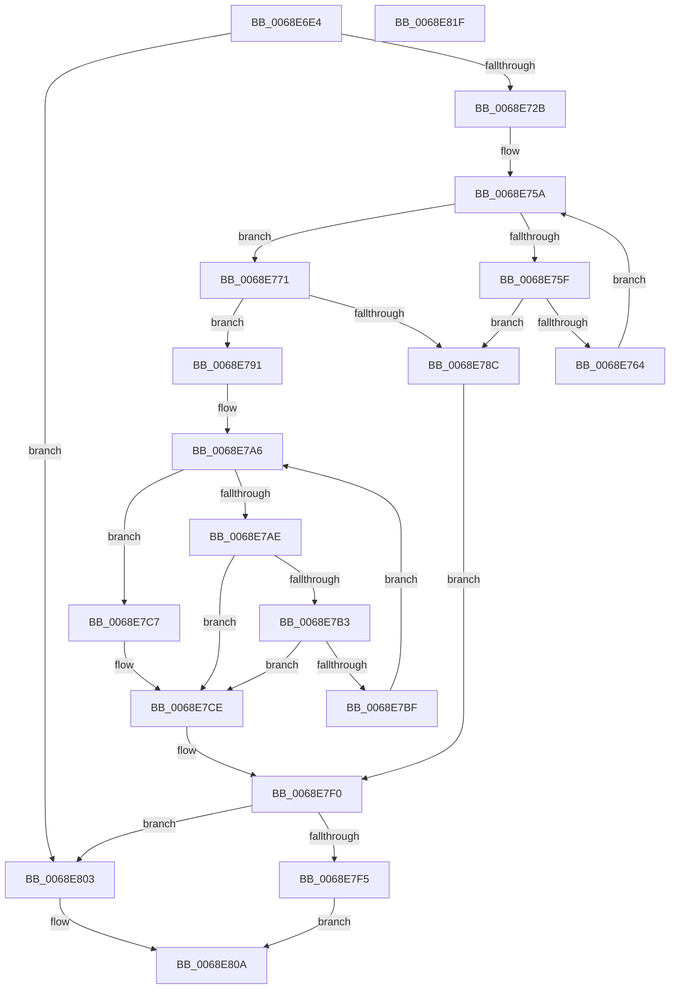

# MiGetSourcePageForDefrag

- RVA: `0x0068E6E4`–`0x0068E820` (길이 `316` bytes)
- VA: `0x000000014068E6E4`
- 실행 섹션: `.text`
- PDB 이름 있음: `예`; PDB Function 태그: `아니요`
- unwind 정보 RVA: `0x000D8F58`
- 디코드: `98`개 명령, `316/316` bytes 표시
- 미해석 바이트: `0` (있으면 어셈블리에 `.byte`로 보존)

> 이 문서는 커널 이미지의 기계어와 PDB 기호를 분석해 생성했습니다. 4번과 5번은 함수 원형과 자료형을 바이너리 사용 방식에서 추정한 C 해석이며 원본 소스 복구 결과는 아닙니다.

## 1. Dependencies

- 직접 호출 지점: **0**; 고유 호출 대상: **0**
- 직접 호출자로 확인된 함수: **1**
- RIP 상대 이미지 참조: **1**

### Outgoing calls
- 직접 디코드된 call 명령이 없습니다.

### Direct callers
- [MiDefragmentSlabWorker](MiDefragmentSlabWorker_function_0068D730.md) at `0x0068D866`

### Static image references
- `0x0068E6FC` → RVA `0x00011C60` (`.rdata`; read)

## 2. Other-region calls and transfers

- 다른 실행 섹션으로 향하는 call: **0**
- 별도 외부 분기/꼬리 이동을 확인하지 못했습니다.

## 3. Assembly (complete function range)

```asm
0068E6E4  48 89 5C 24 10                  mov qword ptr [rsp + 0x10], rbx
0068E6E9  48 89 6C 24 18                  mov qword ptr [rsp + 0x18], rbp
0068E6EE  48 89 74 24 20                  mov qword ptr [rsp + 0x20], rsi
0068E6F3  57                              push rdi
0068E6F4  41 56                           push r14
0068E6F6  41 57                           push r15
0068E6F8  48 8B 41 18                     mov rax, qword ptr [rcx + 0x18]
0068E6FC  48 8D 2D 5D 35 98 FF            lea rbp, [rip - 0x67caa3]
0068E703  48 8B 79 28                     mov rdi, qword ptr [rcx + 0x28]
0068E707  48 8B D9                        mov rbx, rcx
0068E70A  8B 49 40                        mov ecx, dword ptr [rcx + 0x40]
0068E70D  8B 90 88 00 00 00               mov edx, dword ptr [rax + 0x88]
0068E713  44 8B 5F 40                     mov r11d, dword ptr [rdi + 0x40]
0068E717  48 C1 EA 04                     shr rdx, 4
0068E71B  83 E2 03                        and edx, 3
0068E71E  8B 6C D5 00                     mov ebp, dword ptr [rbp + rdx*8]
0068E722  44 3B D9                        cmp r11d, ecx
0068E725  0F 86 D8 00 00 00               jbe 0x14068e803
0068E72B  4C 8B 77 48                     mov r14, qword ptr [rdi + 0x48]
0068E72F  41 8D 53 FF                     lea edx, [r11 - 1]
0068E733  8B C1                           mov eax, ecx
0068E735  48 C1 EA 05                     shr rdx, 5
0068E739  48 C1 E8 05                     shr rax, 5
0068E73D  83 E1 1F                        and ecx, 0x1f
0068E740  45 33 D2                        xor r10d, r10d
0068E743  49 8D 34 96                     lea rsi, [r14 + rdx*4]
0068E747  4D 8D 0C 86                     lea r9, [r14 + rax*4]
0068E74B  83 C8 FF                        or eax, 0xffffffff
0068E74E  45 8B 01                        mov r8d, dword ptr [r9]
0068E751  D3 E0                           shl eax, cl
0068E753  44 23 C0                        and r8d, eax
0068E756  49 8D 41 04                     lea rax, [r9 + 4]
0068E75A  45 85 C0                        test r8d, r8d
0068E75D  75 12                           jne 0x14068e771
0068E75F  48 3B C6                        cmp rax, rsi
0068E762  77 28                           ja 0x14068e78c
0068E764  49 83 C1 04                     add r9, 4
0068E768  48 83 C0 04                     add rax, 4
0068E76C  45 8B 01                        mov r8d, dword ptr [r9]
0068E76F  EB E9                           jmp 0x14068e75a
0068E771  41 8B C0                        mov eax, r8d
0068E774  49 8B D1                        mov rdx, r9
0068E777  49 2B D6                        sub rdx, r14
0068E77A  48 C1 FA 02                     sar rdx, 2
0068E77E  48 0F BC C8                     bsf rcx, rax
0068E782  C1 E2 05                        shl edx, 5
0068E785  03 D1                           add edx, ecx
0068E787  41 3B D3                        cmp edx, r11d
0068E78A  76 05                           jbe 0x14068e791
0068E78C  41 8B D3                        mov edx, r11d
0068E78F  EB 5F                           jmp 0x14068e7f0
0068E791  41 BF 01 00 00 00               mov r15d, 1
0068E797  41 8B C7                        mov eax, r15d
0068E79A  D3 E0                           shl eax, cl
0068E79C  41 2B C7                        sub eax, r15d
0068E79F  44 0B C0                        or r8d, eax
0068E7A2  41 8D 4F 1F                     lea ecx, [r15 + 0x1f]
0068E7A6  41 F7 D0                        not r8d
0068E7A9  45 85 C0                        test r8d, r8d
0068E7AC  75 19                           jne 0x14068e7c7
0068E7AE  45 3B D7                        cmp r10d, r15d
0068E7B1  77 1B                           ja 0x14068e7ce
0068E7B3  44 03 D1                        add r10d, ecx
0068E7B6  49 8D 41 04                     lea rax, [r9 + 4]
0068E7BA  48 3B C6                        cmp rax, rsi
0068E7BD  77 0F                           ja 0x14068e7ce
0068E7BF  44 8B 00                        mov r8d, dword ptr [rax]
0068E7C2  4C 8B C8                        mov r9, rax
0068E7C5  EB DF                           jmp 0x14068e7a6
0068E7C7  41 8B C0                        mov eax, r8d
0068E7CA  48 0F BC C8                     bsf rcx, rax
0068E7CE  4D 2B CE                        sub r9, r14
0068E7D1  4D 8B D1                        mov r10, r9
0068E7D4  49 C1 FA 02                     sar r10, 2
0068E7D8  41 C1 E2 05                     shl r10d, 5
0068E7DC  44 03 D1                        add r10d, ecx
0068E7DF  45 3B D3                        cmp r10d, r11d
0068E7E2  45 0F 47 D3                     cmova r10d, r11d
0068E7E6  44 2B D2                        sub r10d, edx
0068E7E9  45 3B D7                        cmp r10d, r15d
0068E7EC  45 0F 47 D7                     cmova r10d, r15d
0068E7F0  45 85 D2                        test r10d, r10d
0068E7F3  74 0E                           je 0x14068e803
0068E7F5  8D 42 01                        lea eax, [rdx + 1]
0068E7F8  89 43 40                        mov dword ptr [rbx + 0x40], eax
0068E7FB  8B C2                           mov eax, edx
0068E7FD  48 03 47 28                     add rax, qword ptr [rdi + 0x28]
0068E801  EB 07                           jmp 0x14068e80a
0068E803  89 6B 40                        mov dword ptr [rbx + 0x40], ebp
0068E806  48 83 C8 FF                     or rax, 0xffffffffffffffff
0068E80A  48 8B 5C 24 28                  mov rbx, qword ptr [rsp + 0x28]
0068E80F  48 8B 6C 24 30                  mov rbp, qword ptr [rsp + 0x30]
0068E814  48 8B 74 24 38                  mov rsi, qword ptr [rsp + 0x38]
0068E819  41 5F                           pop r15
0068E81B  41 5E                           pop r14
0068E81D  5F                              pop rdi
0068E81E  C3                              ret
0068E81F  CC                              int3
```

## 4. C-style interpretation (structured pseudocode)

```c
__int64 __fastcall MiGetSourcePageForDefrag(__int64 a1)
{
    __int64 result;
    __int64 v_r10;
    unsigned __int64 v_stack_p10;
    unsigned __int64 v_stack_p18;
    unsigned __int64 v_stack_p20;

    v_stack_p10 = v_rbx;
    v_stack_p18 = v_rbp;
    v_stack_p20 = v_rsi;
    a2 = ((unsigned int)(*(unsigned int *)(*(unsigned __int64 *)(a1 + 24) + 136))) >> (4);
    a2 = (unsigned int)((a2) & (3));
    if (((unsigned int)((unsigned int)(*(unsigned int *)(*(unsigned __int64 *)(a1 + 40) + 64)))) <= ((unsigned int)((unsigned int)(*(unsigned int *)(a1 + 64))))) goto loc_0068E803;
    a2 = ((unsigned int)(*(unsigned int *)(*(unsigned __int64 *)(a1 + 40) + 64)) - 1) >> (5);
    result = ((unsigned int)((unsigned int)((unsigned int)(*(unsigned int *)(a1 + 64))))) >> (5);
    a1 = (unsigned int)(((unsigned int)(*(unsigned int *)(a1 + 64))) & (31));
    v_r10 = 0;
    result = (unsigned int)((result) | (0xFFFFFFFFULL));
    result = (unsigned int)((result) << ((unsigned __int8)(a1)));
    a3 = (unsigned int)(((unsigned int)(*(unsigned int *)(*(unsigned __int64 *)(*(unsigned __int64 *)(a1 + 40) + 72) + result * 4))) & ((unsigned int)(result)));
loc_0068E75A:
    if ((unsigned int)(a3) != 0) goto loc_0068E771;
    if ((*(unsigned __int64 *)(*(unsigned __int64 *)(a1 + 40) + 72) + result * 4 + 4) > (*(unsigned __int64 *)(*(unsigned __int64 *)(a1 + 40) + 72) + a2 * 4)) goto loc_0068E78C;
    a4 = (*(unsigned __int64 *)(*(unsigned __int64 *)(a1 + 40) + 72) + result * 4) + (4);
    result = (*(unsigned __int64 *)(*(unsigned __int64 *)(a1 + 40) + 72) + result * 4 + 4) + (4);
    goto loc_0068E75A;
loc_0068E771:
    a2 = (a4) - (*(unsigned __int64 *)(*(unsigned __int64 *)(a1 + 40) + 72));
    a2 = (a2) >> (2);
    a2 = (unsigned int)((a2) << (5));
    a2 = (unsigned int)((a2) + ((unsigned int)(a1)));
    if (((unsigned int)(a2)) <= ((unsigned int)((unsigned int)(*(unsigned int *)(*(unsigned __int64 *)(a1 + 40) + 64))))) goto loc_0068E791;
loc_0068E78C:
    goto loc_0068E7F0;
loc_0068E791:
    result = (unsigned int)((1) << ((unsigned __int8)(a1)));
    result = (unsigned int)((result) - (1));
    a3 = (unsigned int)(((unsigned int)(*(unsigned int *)(a4))) | ((unsigned int)(result)));
loc_0068E7A6:
    a3 = (unsigned int)(~(a3));
    if ((unsigned int)(a3) != 0) goto loc_0068E7C7;
    if (0 > 1) goto loc_0068E7CE;
    v_r10 = (unsigned int)((v_r10) + ((unsigned int)(1 + 31)));
    if ((a4 + 4) > (*(unsigned __int64 *)(*(unsigned __int64 *)(a1 + 40) + 72) + a2 * 4)) goto loc_0068E7CE;
    goto loc_0068E7A6;
loc_0068E7C7:
loc_0068E7CE:
    a4 = (a4 + 4) - (*(unsigned __int64 *)(*(unsigned __int64 *)(a1 + 40) + 72));
    v_r10 = (a4) >> (2);
    v_r10 = (unsigned int)((v_r10) << (5));
    v_r10 = (unsigned int)((v_r10) + ((unsigned int)(1 + 31)));
    if (((unsigned int)(v_r10)) > ((unsigned int)((unsigned int)(*(unsigned int *)(*(unsigned __int64 *)(a1 + 40) + 64))))) { v_r10 = (unsigned int)((unsigned int)(*(unsigned int *)(*(unsigned __int64 *)(a1 + 40) + 64))); }
    v_r10 = (unsigned int)((v_r10) - ((unsigned int)((unsigned int)((unsigned int)((unsigned int)(*(unsigned int *)(*(unsigned __int64 *)(a1 + 40) + 64)))))));
    if (((unsigned int)(v_r10)) > 1) { v_r10 = 1; }
loc_0068E7F0:
    if ((unsigned int)(v_r10) == 0) goto loc_0068E803;
    *(unsigned int *)(a1 + 64) = (unsigned int)((unsigned int)((unsigned int)((unsigned int)(*(unsigned int *)(*(unsigned __int64 *)(a1 + 40) + 64)))) + 1);
    result = ((unsigned int)((unsigned int)((unsigned int)((unsigned int)((unsigned int)(*(unsigned int *)(*(unsigned __int64 *)(a1 + 40) + 64))))))) + (*(unsigned __int64 *)(*(unsigned __int64 *)(a1 + 40) + 40));
    goto loc_0068E80A;
loc_0068E803:
    *(unsigned int *)(a1 + 64) = (unsigned int)((unsigned int)(*(unsigned int *)(v_rip - 6802083 + a2 * 8)));
    result = (result) | (-1);
loc_0068E80A:
    return result;
}
```

## 5. (Beta) C Style

```c
int64_t MiGetSourcePageForDefrag(void *Arg1)
{
    uint8_t *arg1 = (uint8_t *)Arg1;

    int64_t result;
    int64_t local_r10;
    uint64_t v_stack_p10;
    uint64_t v_stack_p18;
    uint64_t v_stack_p20;

    v_stack_p10 = local_rbx;
    v_stack_p18 = local_rbp;
    v_stack_p20 = local_rsi;
    a2 = ((uint32_t)(*(uint32_t *)(*(uint64_t *)(arg1 + 0x18) + 0x88))) >> (4);
    a2 = (uint32_t)((a2) & (3));
    if (((uint32_t)((uint32_t)(*(uint32_t *)(*(uint64_t *)(arg1 + 0x28) + 0x40)))) <= ((uint32_t)((uint32_t)(*(uint32_t *)(arg1 + 0x40))))) goto loc_0068E803;
    a2 = ((uint32_t)(*(uint32_t *)(*(uint64_t *)(arg1 + 0x28) + 0x40)) - 1) >> (5);
    result = ((uint32_t)((uint32_t)((uint32_t)(*(uint32_t *)(arg1 + 0x40))))) >> (5);
    Arg1 = (uint32_t)(((uint32_t)(*(uint32_t *)(arg1 + 0x40))) & (31));
    local_r10 = 0;
    result = (uint32_t)((result) | (0xFFFFFFFFULL));
    result = (uint32_t)((result) << ((uint8_t)(Arg1)));
    a3 = (uint32_t)(((uint32_t)(*(uint32_t *)(*(uint64_t *)(*(uint64_t *)(arg1 + 0x28) + 0x48) + result * 4))) & ((uint32_t)(result)));
loc_0068E75A:
    if ((uint32_t)(a3) != 0) goto loc_0068E771;
    if ((*(uint64_t *)(*(uint64_t *)(arg1 + 0x28) + 0x48) + result * 4 + 4) > (*(uint64_t *)(*(uint64_t *)(arg1 + 0x28) + 0x48) + a2 * 4)) goto loc_0068E78C;
    a4 = (*(uint64_t *)(*(uint64_t *)(arg1 + 0x28) + 0x48) + result * 4) + (4);
    result = (*(uint64_t *)(*(uint64_t *)(arg1 + 0x28) + 0x48) + result * 4 + 4) + (4);
    goto loc_0068E75A;
loc_0068E771:
    a2 = (a4) - (*(uint64_t *)(*(uint64_t *)(arg1 + 0x28) + 0x48));
    a2 = (a2) >> (2);
    a2 = (uint32_t)((a2) << (5));
    a2 = (uint32_t)((a2) + ((uint32_t)(Arg1)));
    if (((uint32_t)(a2)) <= ((uint32_t)((uint32_t)(*(uint32_t *)(*(uint64_t *)(arg1 + 0x28) + 0x40))))) goto loc_0068E791;
loc_0068E78C:
    goto loc_0068E7F0;
loc_0068E791:
    result = (uint32_t)((1) << ((uint8_t)(Arg1)));
    result = (uint32_t)((result) - (1));
    a3 = (uint32_t)(((uint32_t)(*(uint32_t *)(a4))) | ((uint32_t)(result)));
loc_0068E7A6:
    a3 = (uint32_t)(~(a3));
    if ((uint32_t)(a3) != 0) goto loc_0068E7C7;
    if (0 > 1) goto loc_0068E7CE;
    local_r10 = (uint32_t)((local_r10) + ((uint32_t)(1 + 31)));
    if ((a4 + 4) > (*(uint64_t *)(*(uint64_t *)(arg1 + 0x28) + 0x48) + a2 * 4)) goto loc_0068E7CE;
    goto loc_0068E7A6;
loc_0068E7C7:
loc_0068E7CE:
    a4 = (a4 + 4) - (*(uint64_t *)(*(uint64_t *)(arg1 + 0x28) + 0x48));
    local_r10 = (a4) >> (2);
    local_r10 = (uint32_t)((local_r10) << (5));
    local_r10 = (uint32_t)((local_r10) + ((uint32_t)(1 + 31)));
    if (((uint32_t)(local_r10)) > ((uint32_t)((uint32_t)(*(uint32_t *)(*(uint64_t *)(arg1 + 0x28) + 0x40))))) { local_r10 = (uint32_t)((uint32_t)(*(uint32_t *)(*(uint64_t *)(arg1 + 0x28) + 0x40))); }
    local_r10 = (uint32_t)((local_r10) - ((uint32_t)((uint32_t)((uint32_t)((uint32_t)(*(uint32_t *)(*(uint64_t *)(arg1 + 0x28) + 0x40)))))));
    if (((uint32_t)(local_r10)) > 1) { local_r10 = 1; }
loc_0068E7F0:
    if ((uint32_t)(local_r10) == 0) goto loc_0068E803;
    *(uint32_t *)(arg1 + 0x40) = (uint32_t)((uint32_t)((uint32_t)((uint32_t)(*(uint32_t *)(*(uint64_t *)(arg1 + 0x28) + 0x40)))) + 1);
    result = ((uint32_t)((uint32_t)((uint32_t)((uint32_t)((uint32_t)(*(uint32_t *)(*(uint64_t *)(arg1 + 0x28) + 0x40))))))) + (*(uint64_t *)(*(uint64_t *)(arg1 + 0x28) + 0x28));
    goto loc_0068E80A;
loc_0068E803:
    *(uint32_t *)(arg1 + 0x40) = (uint32_t)((uint32_t)(*(uint32_t *)(v_rip - 0x67CAA3 + a2 * 8)));
    result = (result) | (-1);
loc_0068E80A:
    return result;
}
```

### 관측된 메모리 오프셋

구조체 형식이 확인되지 않은 접근은 인자 기준의 오프셋으로만 기록했습니다.

| 기준 인자 | 오프셋 표현 | 폭 (bit) | 접근 |
|---|---:|---:|---|
| `Arg1` | `+ 0x18` | `64` | `R` |
| `Arg1` | `+ 0x28` | `64` | `R` |
| `Arg1` | `+ 0x40` | `32` | `R` |
| `Arg1` | `+ 0x40` | `32` | `W` |

## 6. Execution-region graph

[열기: 2D/3D 그래프와 함수 탐색 컨트롤 패널](../../../control-panel.html?section=text&rva=0x0068E6E4&view=graph)

- 2D 그래프는 위에서 아래로 흐르고, 3D 그래프는 빈 공간을 드래그해 회전합니다. Shift+드래그는 이동, 휠은 확대·축소, 함수 노드 선택은 대상 보고서 이동입니다.

### Static fallback


