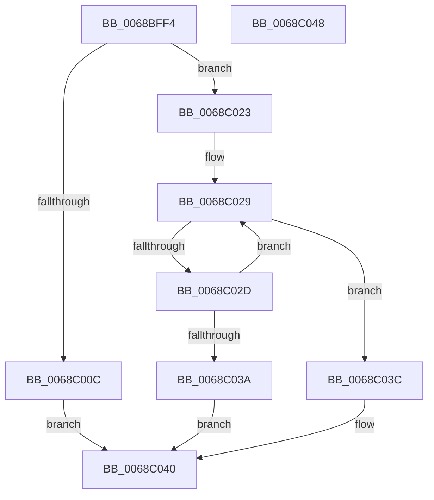

# MiGetTransitionPageHeatList

- RVA: `0x0068BFF4`–`0x0068C049` (길이 `85` bytes)
- VA: `0x000000014068BFF4`
- 실행 섹션: `.text`
- PDB 이름 있음: `예`; PDB Function 태그: `아니요`
- unwind 정보 RVA: `0x0005C788`
- 디코드: `24`개 명령, `85/85` bytes 표시
- 미해석 바이트: `0` (있으면 어셈블리에 `.byte`로 보존)

> 이 문서는 커널 이미지의 기계어와 PDB 기호를 분석해 생성했습니다. 4번과 5번은 함수 원형과 자료형을 바이너리 사용 방식에서 추정한 C 해석이며 원본 소스 복구 결과는 아닙니다.

## 1. Dependencies

- 직접 호출 지점: **2**; 고유 호출 대상: **2**
- 직접 호출자로 확인된 함수: **1**
- RIP 상대 이미지 참조: **2**

### Outgoing calls
- `0x0068BFFF` → [ExpInterlockedPopEntrySList](../6B/ExpInterlockedPopEntrySList_function_006BA570.md) (function, `0x006BA570`)
- `0x0068C01C` → [MiInitializePageHeatList](../44/MiInitializePageHeatList_function_00446000.md) (function, `0x00446000`)

### Direct callers
- [MiMakeTransitionHeatBatch](../40/MiMakeTransitionHeatBatch_function_00409A94.md) at `0x00409C2A`

### Static image references
- `0x0068BFF8` → RVA `0x00E35D40` (`.data`; read)
- `0x0068C023` → RVA `0x00E35D50` (`.data`; read)

## 2. Other-region calls and transfers

- 다른 실행 섹션으로 향하는 call: **0**
- 별도 외부 분기/꼬리 이동을 확인하지 못했습니다.

## 3. Assembly (complete function range)

```asm
0068BFF4  48 83 EC 28                     sub rsp, 0x28
0068BFF8  48 8D 0D 41 9D 7A 00            lea rcx, [rip + 0x7a9d41]
0068BFFF  E8 6C E5 02 00                  call 0x1406ba570
0068C004  4C 8B D8                        mov r11, rax
0068C007  48 85 C0                        test rax, rax
0068C00A  74 17                           je 0x14068c023
0068C00C  41 B9 10 00 00 00               mov r9d, 0x10
0068C012  45 33 C0                        xor r8d, r8d
0068C015  48 8B C8                        mov rcx, rax
0068C018  41 8D 51 F1                     lea edx, [r9 - 0xf]
0068C01C  E8 DF 9F DB FF                  call 0x140446000
0068C021  EB 1D                           jmp 0x14068c040
0068C023  8B 05 27 9D 7A 00               mov eax, dword ptr [rip + 0x7a9d27]
0068C029  85 C0                           test eax, eax
0068C02B  74 0F                           je 0x14068c03c
0068C02D  8D 48 FF                        lea ecx, [rax - 1]
0068C030  F0 0F B1 0D 18 9D 7A 00         lock cmpxchg dword ptr [rip + 0x7a9d18], ecx
0068C038  75 EF                           jne 0x14068c029
0068C03A  EB 04                           jmp 0x14068c040
0068C03C  49 83 CB FF                     or r11, 0xffffffffffffffff
0068C040  49 8B C3                        mov rax, r11
0068C043  48 83 C4 28                     add rsp, 0x28
0068C047  C3                              ret
0068C048  CC                              int3
```

## 4. C-style interpretation (structured pseudocode)

```c
__int64 __fastcall MiGetTransitionPageHeatList(__int64 a1, __int64 a2, int a3)
{
    __int64 result;
    __int64 v_r11;
    __int64 v_rsp;

    v_rsp = (v_rsp) - (40);
    result = ExpInterlockedPopEntrySList(v_rip + 8035649, a2, a3, a4);
    if (result == 0) goto loc_0068C023;
    a3 = 0;
    result = MiInitializePageHeatList(result, 16 - 15, a3, 16);
    goto loc_0068C040;
loc_0068C023:
loc_0068C029:
    if ((unsigned int)((unsigned int)(*(unsigned int *)(v_rip + 8035623))) == 0) goto loc_0068C03C;
    if ((unsigned int)((unsigned int)(*(unsigned int *)(v_rip + 8035623))) != 0) goto loc_0068C029;
    goto loc_0068C040;
loc_0068C03C:
    v_r11 = (result) | (-1);
loc_0068C040:
    v_rsp = (v_rsp) + (40);
    return v_r11;
}
```

## 5. (Beta) C Style

```c
int64_t MiGetTransitionPageHeatList(int64_t Arg1, int64_t Arg2, int32_t Arg3)
{
    int64_t result;
    int64_t local_r11;
    int64_t local_rsp;

    local_rsp = (local_rsp) - (40);
    result = ExpInterlockedPopEntrySList(v_rip + 8035649, Arg2, Arg3, a4);
    if (result == 0) goto loc_0068C023;
    Arg3 = 0;
    result = MiInitializePageHeatList(result, 16 - 15, Arg3, 16);
    goto loc_0068C040;
loc_0068C023:
loc_0068C029:
    if ((uint32_t)((uint32_t)(*(uint32_t *)(v_rip + 0x7A9D27))) == 0) goto loc_0068C03C;
    if ((uint32_t)((uint32_t)(*(uint32_t *)(v_rip + 0x7A9D27))) != 0) goto loc_0068C029;
    goto loc_0068C040;
loc_0068C03C:
    local_r11 = (result) | (-1);
loc_0068C040:
    local_rsp = (local_rsp) + (40);
    return local_r11;
}
```

## 6. Execution-region graph

[열기: 2D/3D 그래프와 함수 탐색 컨트롤 패널](../../../control-panel.html?section=text&rva=0x0068BFF4&view=graph)

- 2D 그래프는 위에서 아래로 흐르고, 3D 그래프는 빈 공간을 드래그해 회전합니다. Shift+드래그는 이동, 휠은 확대·축소, 함수 노드 선택은 대상 보고서 이동입니다.

### Static fallback


