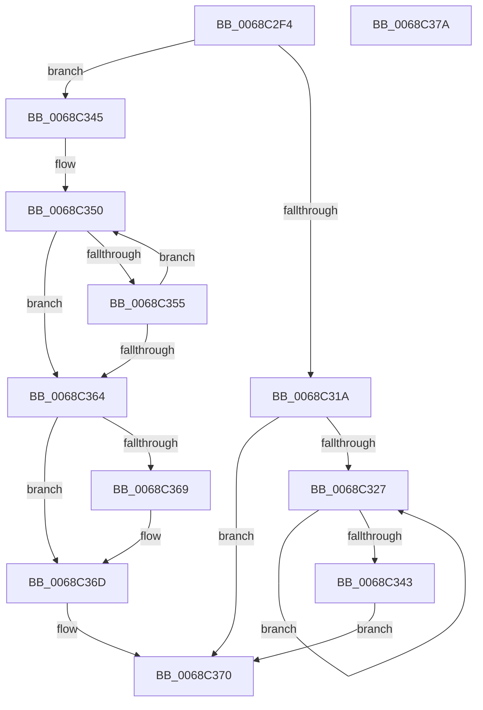

# MiGetZeroingDescriptors

- RVA: `0x0068C2F4`–`0x0068C37B` (길이 `135` bytes)
- VA: `0x000000014068C2F4`
- 실행 섹션: `.text`
- PDB 이름 있음: `예`; PDB Function 태그: `아니요`
- unwind 정보 RVA: `0x0005CF00`
- 디코드: `44`개 명령, `135/135` bytes 표시
- 미해석 바이트: `0` (있으면 어셈블리에 `.byte`로 보존)

> 이 문서는 커널 이미지의 기계어와 PDB 기호를 분석해 생성했습니다. 4번과 5번은 함수 원형과 자료형을 바이너리 사용 방식에서 추정한 C 해석이며 원본 소스 복구 결과는 아닙니다.

## 1. Dependencies

- 직접 호출 지점: **1**; 고유 호출 대상: **1**
- 직접 호출자로 확인된 함수: **1**
- RIP 상대 이미지 참조: **0**

### Outgoing calls
- `0x0068C311` → [MiAllocateAcceleratorDescriptor](../69/MiAllocateAcceleratorDescriptor_function_00697124.md) (function, `0x00697124`)

### Direct callers
- [MiInitializeZeroGroup](../2C/MiInitializeZeroGroup_function_002CA00C.md) at `0x002CA263`

### Static image references
- 디코드된 RIP-relative 메모리 참조가 없습니다.

## 2. Other-region calls and transfers

- 다른 실행 섹션으로 향하는 call: **0**
- 별도 외부 분기/꼬리 이동을 확인하지 못했습니다.

## 3. Assembly (complete function range)

```asm
0068C2F4  40 53                           push rbx
0068C2F6  48 83 EC 20                     sub rsp, 0x20
0068C2FA  44 8B 41 60                     mov r8d, dword ptr [rcx + 0x60]
0068C2FE  4C 8D 4C 24 30                  lea r9, [rsp + 0x30]
0068C303  8B 51 58                        mov edx, dword ptr [rcx + 0x58]
0068C306  48 8B D9                        mov rbx, rcx
0068C309  48 83 64 24 30 00               and qword ptr [rsp + 0x30], 0
0068C30F  33 C9                           xor ecx, ecx
0068C311  E8 0E AE 00 00                  call 0x140697124
0068C316  85 C0                           test eax, eax
0068C318  74 2B                           je 0x14068c345
0068C31A  4C 8B 4C 24 30                  mov r9, qword ptr [rsp + 0x30]
0068C31F  45 33 C0                        xor r8d, r8d
0068C322  4D 85 C9                        test r9, r9
0068C325  74 49                           je 0x14068c370
0068C327  49 8B 11                        mov rdx, qword ptr [r9]
0068C32A  49 8B C9                        mov rcx, r9
0068C32D  48 8B 43 50                     mov rax, qword ptr [rbx + 0x50]
0068C331  41 FF C0                        inc r8d
0068C334  4C 8B CA                        mov r9, rdx
0068C337  48 89 01                        mov qword ptr [rcx], rax
0068C33A  48 89 4B 50                     mov qword ptr [rbx + 0x50], rcx
0068C33E  48 85 D2                        test rdx, rdx
0068C341  75 E4                           jne 0x14068c327
0068C343  EB 2B                           jmp 0x14068c370
0068C345  B8 01 00 00 00                  mov eax, 1
0068C34A  48 8D 4B 64                     lea rcx, [rbx + 0x64]
0068C34E  8B D0                           mov edx, eax
0068C350  83 39 00                        cmp dword ptr [rcx], 0
0068C353  75 0F                           jne 0x14068c364
0068C355  FF C0                           inc eax
0068C357  48 FF C2                        inc rdx
0068C35A  48 83 C1 04                     add rcx, 4
0068C35E  48 83 FA 03                     cmp rdx, 3
0068C362  7C EC                           jl 0x14068c350
0068C364  83 F8 03                        cmp eax, 3
0068C367  75 04                           jne 0x14068c36d
0068C369  83 4B 10 10                     or dword ptr [rbx + 0x10], 0x10
0068C36D  45 33 C0                        xor r8d, r8d
0068C370  44 89 43 60                     mov dword ptr [rbx + 0x60], r8d
0068C374  48 83 C4 20                     add rsp, 0x20
0068C378  5B                              pop rbx
0068C379  C3                              ret
0068C37A  CC                              int3
```

## 4. C-style interpretation (structured pseudocode)

```c
__int64 __fastcall MiGetZeroingDescriptors(__int64 a1)
{
    __int64 result;
    __int64 v_rsp;
    unsigned __int64 v_stack_p8;

    v_rsp = (v_rsp) - (32);
    a1 = 0;
    result = MiAllocateAcceleratorDescriptor(a1, (unsigned int)(*(unsigned int *)(a1 + 88)), (unsigned int)(*(unsigned int *)(a1 + 96)), v_stack_p8);
    if ((unsigned int)(result) == 0) goto loc_0068C345;
    a3 = 0;
    if (v_stack_p8 == 0) goto loc_0068C370;
loc_0068C327:
    a3 = (unsigned int)((a3) + 1);
    *(unsigned __int64 *)(v_stack_p8) = *(unsigned __int64 *)(a1 + 80);
    *(unsigned __int64 *)(a1 + 80) = v_stack_p8;
    if (*(unsigned __int64 *)(v_stack_p8) != 0) goto loc_0068C327;
    goto loc_0068C370;
loc_0068C345:
loc_0068C350:
    if ((*(unsigned int *)(a1 + 100)) != 0) goto loc_0068C364;
    result = (unsigned int)((1) + 1);
    a2 = (1) + 1;
    a1 = (a1 + 100) + (4);
    if (a2 < 3) goto loc_0068C350;
loc_0068C364:
    if (((unsigned int)(result)) == 3) {
    }
    a3 = 0;
loc_0068C370:
    *(unsigned int *)(a1 + 96) = 0;
    v_rsp = (v_rsp) + (32);
    return result;
}
```

## 5. (Beta) C Style

```c
int64_t MiGetZeroingDescriptors(void *Arg1)
{
    uint8_t *arg1 = (uint8_t *)Arg1;

    int64_t result;
    int64_t local_rsp;
    uint64_t v_stack_p8;

    local_rsp = (local_rsp) - (32);
    Arg1 = 0;
    result = MiAllocateAcceleratorDescriptor(Arg1, (uint32_t)(*(uint32_t *)(arg1 + 0x58)), (uint32_t)(*(uint32_t *)(arg1 + 0x60)), v_stack_p8);
    if ((uint32_t)(result) == 0) goto loc_0068C345;
    a3 = 0;
    if (v_stack_p8 == 0) goto loc_0068C370;
loc_0068C327:
    a3 = (uint32_t)((a3) + 1);
    *(uint64_t *)(v_stack_p8) = *(uint64_t *)(arg1 + 0x50);
    *(uint64_t *)(arg1 + 0x50) = v_stack_p8;
    if (*(uint64_t *)(v_stack_p8) != 0) goto loc_0068C327;
    goto loc_0068C370;
loc_0068C345:
loc_0068C350:
    if ((*(uint32_t *)(arg1 + 0x64)) != 0) goto loc_0068C364;
    result = (uint32_t)((1) + 1);
    a2 = (1) + 1;
    Arg1 = (Arg1 + 100) + (4);
    if (a2 < 3) goto loc_0068C350;
loc_0068C364:
    if (((uint32_t)(result)) == 3) {
    }
    a3 = 0;
loc_0068C370:
    *(uint32_t *)(arg1 + 0x60) = 0;
    local_rsp = (local_rsp) + (32);
    return result;
}
```

### 관측된 메모리 오프셋

구조체 형식이 확인되지 않은 접근은 인자 기준의 오프셋으로만 기록했습니다.

| 기준 인자 | 오프셋 표현 | 폭 (bit) | 접근 |
|---|---:|---:|---|
| `Arg1` | `+ 0x0` | `32` | `R` |
| `Arg1` | `+ 0x10` | `32` | `R/W` |
| `Arg1` | `+ 0x50` | `64` | `R` |
| `Arg1` | `+ 0x50` | `64` | `W` |
| `Arg1` | `+ 0x58` | `32` | `R` |
| `Arg1` | `+ 0x60` | `32` | `R` |
| `Arg1` | `+ 0x60` | `32` | `W` |
| `Arg1` | `+ 0x64` | `64` | `R` |

## 6. Execution-region graph

[열기: 2D/3D 그래프와 함수 탐색 컨트롤 패널](../../../control-panel.html?section=text&rva=0x0068C2F4&view=graph)

- 2D 그래프는 위에서 아래로 흐르고, 3D 그래프는 빈 공간을 드래그해 회전합니다. Shift+드래그는 이동, 휠은 확대·축소, 함수 노드 선택은 대상 보고서 이동입니다.

### Static fallback


