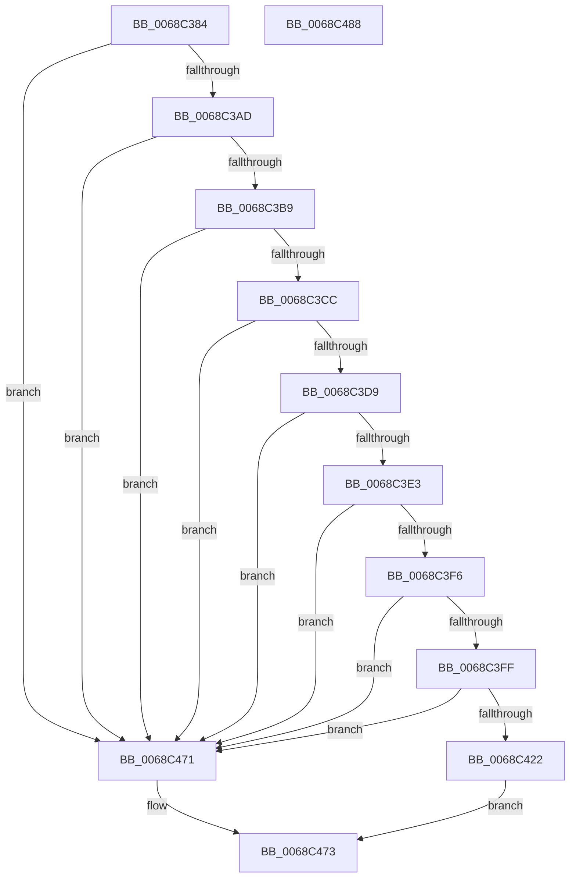

# MiGroupZeroHugeRange

- RVA: `0x0068C384`–`0x0068C489` (길이 `261` bytes)
- VA: `0x000000014068C384`
- 실행 섹션: `.text`
- PDB 이름 있음: `예`; PDB Function 태그: `아니요`
- unwind 정보 RVA: `0x00066400`
- 디코드: `64`개 명령, `261/261` bytes 표시
- 미해석 바이트: `0` (있으면 어셈블리에 `.byte`로 보존)

> 이 문서는 커널 이미지의 기계어와 PDB 기호를 분석해 생성했습니다. 4번과 5번은 함수 원형과 자료형을 바이너리 사용 방식에서 추정한 C 해석이며 원본 소스 복구 결과는 아닙니다.

## 1. Dependencies

- 직접 호출 지점: **5**; 고유 호출 대상: **5**
- 직접 호출자로 확인된 함수: **1**
- RIP 상대 이미지 참조: **1**

### Outgoing calls
- `0x0068C3F6` → [KeIsThreadedDpcThread](../45/KeIsThreadedDpcThread_function_0045265C.md) (function, `0x0045265C`)
- `0x0068C402` → [MiPageToNode](../33/MiPageToNode_function_00338CD0.md) (function, `0x00338CD0`)
- `0x0068C415` → [MiCreatePageChains](../49/MiCreatePageChains_function_0049ECD0.md) (function, `0x0049ECD0`)
- `0x0068C45D` → [MiZeroInParallel](../2C/MiZeroInParallel_function_002C9F78.md) (function, `0x002C9F78`)
- `0x0068C465` → [MiDereferencePageChains](../2C/MiDereferencePageChains_function_002C75E4.md) (function, `0x002C75E4`)

### Direct callers
- [MiHugePageOperation](MiHugePageOperation_function_0068C490.md) at `0x0068C5FE`

### Static image references
- `0x0068C3CC` → RVA `0x00FC6A88` (`ALMOSTRO`; read)

## 2. Other-region calls and transfers

- 다른 실행 섹션으로 향하는 call: **0**
- 별도 외부 분기/꼬리 이동을 확인하지 못했습니다.

## 3. Assembly (complete function range)

```asm
0068C384  48 89 5C 24 08                  mov qword ptr [rsp + 8], rbx
0068C389  48 89 6C 24 10                  mov qword ptr [rsp + 0x10], rbp
0068C38E  48 89 74 24 18                  mov qword ptr [rsp + 0x18], rsi
0068C393  57                              push rdi
0068C394  48 83 EC 30                     sub rsp, 0x30
0068C398  49 63 F1                        movsxd rsi, r9d
0068C39B  49 8B E8                        mov rbp, r8
0068C39E  48 8B FA                        mov rdi, rdx
0068C3A1  48 8B D9                        mov rbx, rcx
0068C3A4  48 85 D2                        test rdx, rdx
0068C3A7  0F 84 C4 00 00 00               je 0x14068c471
0068C3AD  44 0F 20 C0                     mov rax, cr8
0068C3B1  3C 02                           cmp al, 2
0068C3B3  0F 84 B8 00 00 00               je 0x14068c471
0068C3B9  65 8B 04 25 3C 3A 00 00         mov eax, dword ptr gs:[0x3a3c]
0068C3C1  A9 01 00 01 00                  test eax, 0x10001
0068C3C6  0F 85 A5 00 00 00               jne 0x14068c471
0068C3CC  F6 05 B5 A6 93 00 30            test byte ptr [rip + 0x93a6b5], 0x30
0068C3D3  0F 84 98 00 00 00               je 0x14068c471
0068C3D9  83 79 5C 00                     cmp dword ptr [rcx + 0x5c], 0
0068C3DD  0F 85 8E 00 00 00               jne 0x14068c471
0068C3E3  65 48 8B 0C 25 88 01 00 00      mov rcx, qword ptr gs:[0x188]
0068C3EC  8B 81 A4 05 00 00               mov eax, dword ptr [rcx + 0x5a4]
0068C3F2  A8 02                           test al, 2
0068C3F4  75 7B                           jne 0x14068c471
0068C3F6  E8 61 62 DC FF                  call 0x14045265c
0068C3FB  84 C0                           test al, al
0068C3FD  75 72                           jne 0x14068c471
0068C3FF  48 8B CD                        mov rcx, rbp
0068C402  E8 C9 C8 CA FF                  call 0x140338cd0
0068C407  41 B9 70 00 00 00               mov r9d, 0x70
0068C40D  44 8B C6                        mov r8d, esi
0068C410  8B D0                           mov edx, eax
0068C412  48 8B CB                        mov rcx, rbx
0068C415  E8 B6 28 E1 FF                  call 0x14049ecd0
0068C41A  48 8B D8                        mov rbx, rax
0068C41D  48 85 C0                        test rax, rax
0068C420  74 4F                           je 0x14068c471
0068C422  48 8B 90 98 00 00 00            mov rdx, qword ptr [rax + 0x98]
0068C429  C7 02 00 02 00 00               mov dword ptr [rdx], 0x200
0068C42F  48 8D 4A 10                     lea rcx, [rdx + 0x10]
0068C433  48 89 4A 08                     mov qword ptr [rdx + 8], rcx
0068C437  8B 4C 24 60                     mov ecx, dword ptr [rsp + 0x60]
0068C43B  89 4A 68                        mov dword ptr [rdx + 0x68], ecx
0068C43E  48 8B CB                        mov rcx, rbx
0068C441  48 89 7A 50                     mov qword ptr [rdx + 0x50], rdi
0068C445  48 89 6A 58                     mov qword ptr [rdx + 0x58], rbp
0068C449  0F BA 68 10 0B                  bts dword ptr [rax + 0x10], 0xb
0068C44E  48 C7 44 F0 30 00 00 04 00      mov qword ptr [rax + rsi*8 + 0x30], 0x40000
0068C457  8B 40 18                        mov eax, dword ptr [rax + 0x18]
0068C45A  89 43 28                        mov dword ptr [rbx + 0x28], eax
0068C45D  E8 16 DB C3 FF                  call 0x1402c9f78
0068C462  48 8B CB                        mov rcx, rbx
0068C465  E8 7A B1 C3 FF                  call 0x1402c75e4
0068C46A  B8 01 00 00 00                  mov eax, 1
0068C46F  EB 02                           jmp 0x14068c473
0068C471  33 C0                           xor eax, eax
0068C473  48 8B 5C 24 40                  mov rbx, qword ptr [rsp + 0x40]
0068C478  48 8B 6C 24 48                  mov rbp, qword ptr [rsp + 0x48]
0068C47D  48 8B 74 24 50                  mov rsi, qword ptr [rsp + 0x50]
0068C482  48 83 C4 30                     add rsp, 0x30
0068C486  5F                              pop rdi
0068C487  C3                              ret
0068C488  CC                              int3
```

## 4. C-style interpretation (structured pseudocode)

```c
__int64 __fastcall MiGroupZeroHugeRange(__int64 a1, __int64 a2, __int64 a3, int a4, unsigned int a5)
{
    __int64 result;
    __int64 v_rsp;
    unsigned __int64 v_stack_p10;
    unsigned __int64 v_stack_p18;
    unsigned __int64 v_stack_p8;

    v_stack_p8 = v_rbx;
    v_stack_p10 = v_rbp;
    v_stack_p18 = v_rsi;
    v_rsp = (v_rsp) - (48);
    if (a2 == 0) goto loc_0068C471;
    if (((unsigned __int8)(v_cr8)) == 2) goto loc_0068C471;
    if ((((unsigned int)((unsigned int)(*(unsigned int *)(gs_base + (0 + 14908))))) & (0x10001ULL)) != 0) goto loc_0068C471;
    if (((*(unsigned __int8 *)(v_rip + 9676469)) & (48)) == 0) goto loc_0068C471;
    if ((*(unsigned int *)(a1 + 92)) != 0) goto loc_0068C471;
    if ((((unsigned __int8)((unsigned int)(*(unsigned int *)(*(unsigned __int64 *)(gs_base + (0 + 392)) + 1444)))) & (2)) != 0) goto loc_0068C471;
    result = KeIsThreadedDpcThread(*(unsigned __int64 *)(gs_base + (0 + 392)), a2, a3, a4);
    if ((unsigned __int8)(result) != 0) goto loc_0068C471;
    result = MiPageToNode(a3, a2, a3, a4);
    result = MiCreatePageChains(a1, (unsigned int)((unsigned int)(result)), (unsigned int)((unsigned int)((int)(a4))), 112);
    if (result == 0) goto loc_0068C471;
    *(unsigned int *)(*(unsigned __int64 *)(result + 152)) = 512;
    *(unsigned __int64 *)(*(unsigned __int64 *)(result + 152) + 8) = *(unsigned __int64 *)(result + 152) + 16;
    *(unsigned int *)(*(unsigned __int64 *)(result + 152) + 104) = (unsigned int)((unsigned int)(a5));
    *(unsigned __int64 *)(*(unsigned __int64 *)(result + 152) + 80) = a2;
    *(unsigned __int64 *)(*(unsigned __int64 *)(result + 152) + 88) = a3;
    *(unsigned __int64 *)(result + (int)(a4) * 8 + 48) = 0x40000ULL;
    *(unsigned int *)(result + 40) = (unsigned int)((unsigned int)(*(unsigned int *)(result + 24)));
    result = MiZeroInParallel(result, *(unsigned __int64 *)(result + 152), (unsigned int)((unsigned int)((int)(a4))), 112);
    result = MiDereferencePageChains(result, *(unsigned __int64 *)(result + 152), (unsigned int)((unsigned int)((int)(a4))), 112);
    goto loc_0068C473;
loc_0068C471:
    result = 0;
loc_0068C473:
    v_rsp = (v_rsp) + (48);
    return result;
}
```

## 5. (Beta) C Style

```c
int64_t MiGroupZeroHugeRange(void *Arg1, int64_t Arg2, int64_t Arg3, int32_t Arg4, uint32_t Arg5)
{
    uint8_t *arg1 = (uint8_t *)Arg1;

    int64_t result;
    int64_t local_rsp;
    uint64_t v_stack_p10;
    uint64_t v_stack_p18;
    uint64_t v_stack_p8;

    v_stack_p8 = local_rbx;
    v_stack_p10 = local_rbp;
    v_stack_p18 = local_rsi;
    local_rsp = (local_rsp) - (48);
    if (Arg2 == 0) goto loc_0068C471;
    if (((uint8_t)(v_cr8)) == 2) goto loc_0068C471;
    if ((((uint32_t)((uint32_t)(*(uint32_t *)(gs_base + (0 + 0x3A3C))))) & (0x10001ULL)) != 0) goto loc_0068C471;
    if (((*(uint8_t *)(v_rip + 0x93A6B5)) & (48)) == 0) goto loc_0068C471;
    if ((*(uint32_t *)(arg1 + 0x5C)) != 0) goto loc_0068C471;
    if ((((uint8_t)((uint32_t)(*(uint32_t *)(*(uint64_t *)(gs_base + (0 + 0x188)) + 0x5A4)))) & (2)) != 0) goto loc_0068C471;
    result = KeIsThreadedDpcThread(*(uint64_t *)(gs_base + (0 + 0x188)), Arg2, Arg3, Arg4);
    if ((uint8_t)(result) != 0) goto loc_0068C471;
    result = MiPageToNode(Arg3, Arg2, Arg3, Arg4);
    result = MiCreatePageChains(Arg1, (uint32_t)((uint32_t)(result)), (uint32_t)((uint32_t)((int32_t)(Arg4))), 112);
    if (result == 0) goto loc_0068C471;
    *(uint32_t *)(*(uint64_t *)(result + 0x98)) = 512;
    *(uint64_t *)(*(uint64_t *)(result + 0x98) + 0x8) = *(uint64_t *)(result + 0x98) + 16;
    *(uint32_t *)(*(uint64_t *)(result + 0x98) + 0x68) = (uint32_t)((uint32_t)(Arg5));
    *(uint64_t *)(*(uint64_t *)(result + 0x98) + 0x50) = Arg2;
    *(uint64_t *)(*(uint64_t *)(result + 0x98) + 0x58) = Arg3;
    *(uint64_t *)(result + (int32_t)(Arg4) * 8 + 0x30) = 0x40000ULL;
    *(uint32_t *)(result + 0x28) = (uint32_t)((uint32_t)(*(uint32_t *)(result + 0x18)));
    result = MiZeroInParallel(result, *(uint64_t *)(result + 0x98), (uint32_t)((uint32_t)((int32_t)(Arg4))), 112);
    result = MiDereferencePageChains(result, *(uint64_t *)(result + 0x98), (uint32_t)((uint32_t)((int32_t)(Arg4))), 112);
    goto loc_0068C473;
loc_0068C471:
    result = 0;
loc_0068C473:
    local_rsp = (local_rsp) + (48);
    return result;
}
```

### 관측된 메모리 오프셋

구조체 형식이 확인되지 않은 접근은 인자 기준의 오프셋으로만 기록했습니다.

| 기준 인자 | 오프셋 표현 | 폭 (bit) | 접근 |
|---|---:|---:|---|
| `Arg1` | `+ 0x5C` | `32` | `R` |

## 6. Execution-region graph

[열기: 2D/3D 그래프와 함수 탐색 컨트롤 패널](../../../control-panel.html?section=text&rva=0x0068C384&view=graph)

- 2D 그래프는 위에서 아래로 흐르고, 3D 그래프는 빈 공간을 드래그해 회전합니다. Shift+드래그는 이동, 휠은 확대·축소, 함수 노드 선택은 대상 보고서 이동입니다.

### Static fallback


