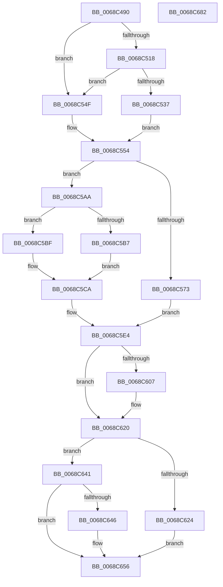

# MiHugePageOperation

- RVA: `0x0068C490`–`0x0068C683` (길이 `499` bytes)
- VA: `0x000000014068C490`
- 실행 섹션: `.text`
- PDB 이름 있음: `예`; PDB Function 태그: `아니요`
- unwind 정보 RVA: `0x000D8E84`
- 디코드: `133`개 명령, `499/499` bytes 표시
- 미해석 바이트: `0` (있으면 어셈블리에 `.byte`로 보존)

> 이 문서는 커널 이미지의 기계어와 PDB 기호를 분석해 생성했습니다. 4번과 5번은 함수 원형과 자료형을 바이너리 사용 방식에서 추정한 C 해석이며 원본 소스 복구 결과는 아닙니다.

## 1. Dependencies

- 직접 호출 지점: **14**; 고유 호출 대상: **13**
- 직접 호출자로 확인된 함수: **3**
- RIP 상대 이미지 참조: **2**

### Outgoing calls
- `0x0068C4D6` → [memset](../6C/memset_function_006C6C40.md) (function, `0x006C6C40`)
- `0x0068C4DE` → [MiPageToNode](../33/MiPageToNode_function_00338CD0.md) (function, `0x00338CD0`)
- `0x0068C50A` → [MiInitializePageColorBase](../32/MiInitializePageColorBase_function_00320410.md) (function, `0x00320410`)
- `0x0068C567` → [MiCreateUltraThreadContext](../28/MiCreateUltraThreadContext_function_00288200.md) (function, `0x00288200`)
- `0x0068C583` → [MiGetUltraMapping](../32/MiGetUltraMapping_function_00323270.md) (function, `0x00323270`)
- `0x0068C592` → [MiUpdateProtectionMask](../28/MiUpdateProtectionMask_function_002845DC.md) (function, `0x002845DC`)
- `0x0068C5A3` → [MiWriteLargePte](../2C/MiWriteLargePte_function_002C6DE0.md) (function, `0x002C6DE0`)
- `0x0068C5D6` → [MmMapIoSpaceEx](../32/MmMapIoSpaceEx_function_00327830.md) (function, `0x00327830`)
- `0x0068C5FE` → [MiGroupZeroHugeRange](MiGroupZeroHugeRange_function_0068C384.md) (function, `0x0068C384`)
- `0x0068C61B` → [MiSoloZeroHugeRange](MiSoloZeroHugeRange_function_0068C6E4.md) (function, `0x0068C6E4`)
- `0x0068C630` → [MiWriteLargePte](../2C/MiWriteLargePte_function_002C6DE0.md) (function, `0x002C6DE0`)
- `0x0068C63A` → [MiDeleteUltraThreadContext](../32/MiDeleteUltraThreadContext_function_00322C90.md) (function, `0x00322C90`)
- `0x0068C651` → [MiUnmapContiguousMemory](../3F/MiUnmapContiguousMemory_function_003F7908.md) (function, `0x003F7908`)
- `0x0068C661` → [_security_check_cookie](../6A/_security_check_cookie_function_006AC640.md) (function, `0x006AC640`)

### Direct callers
- [MiGetHugeRange](../67/MiGetHugeRange_function_00675954.md) at `0x00675A78`
- [MiHotAddHugeRange](../../page/7F/MiHotAddHugeRange_function_007FBF6C.md) at `0x007FBFC5`
- [MiAllocatePartitionPhysicalPages](../../page/80/MiAllocatePartitionPhysicalPages_function_0080C9D4.md) at `0x0080CD4F`

### Static image references
- `0x0068C4A9` → RVA `0x00E0A740` (`.data`; read)
- `0x0068C50F` → RVA `0x00E2DCE0` (`.data`; read)

## 2. Other-region calls and transfers

- 다른 실행 섹션으로 향하는 call: **0**
- 별도 외부 분기/꼬리 이동을 확인하지 못했습니다.

## 3. Assembly (complete function range)

```asm
0068C490  48 89 5C 24 18                  mov qword ptr [rsp + 0x18], rbx
0068C495  48 89 6C 24 20                  mov qword ptr [rsp + 0x20], rbp
0068C49A  56                              push rsi
0068C49B  57                              push rdi
0068C49C  41 54                           push r12
0068C49E  41 56                           push r14
0068C4A0  41 57                           push r15
0068C4A2  48 81 EC E0 00 00 00            sub rsp, 0xe0
0068C4A9  48 8B 05 90 E2 77 00            mov rax, qword ptr [rip + 0x77e290]
0068C4B0  48 33 C4                        xor rax, rsp
0068C4B3  48 89 84 24 D0 00 00 00         mov qword ptr [rsp + 0xd0], rax
0068C4BB  4C 8B F2                        mov r14, rdx
0068C4BE  4C 8B E1                        mov r12, rcx
0068C4C1  0F 57 C0                        xorps xmm0, xmm0
0068C4C4  48 8D 4C 24 50                  lea rcx, [rsp + 0x50]
0068C4C9  33 D2                           xor edx, edx
0068C4CB  41 B8 80 00 00 00               mov r8d, 0x80
0068C4D1  0F 11 44 24 38                  movups xmmword ptr [rsp + 0x38], xmm0
0068C4D6  E8 65 A7 03 00                  call 0x1406c6c40
0068C4DB  49 8B CE                        mov rcx, r14
0068C4DE  E8 ED C7 CA FF                  call 0x140338cd0
0068C4E3  8B D8                           mov ebx, eax
0068C4E5  4C 8D 4C 24 38                  lea r9, [rsp + 0x38]
0068C4EA  BA 03 00 00 00                  mov edx, 3
0068C4EF  44 8D 40 01                     lea r8d, [rax + 1]
0068C4F3  65 48 8B 04 25 88 01 00 00      mov rax, qword ptr gs:[0x188]
0068C4FC  48 8B 88 B8 00 00 00            mov rcx, qword ptr [rax + 0xb8]
0068C503  48 81 C1 00 04 00 00            add rcx, 0x400
0068C50A  E8 01 3F C9 FF                  call 0x140320410
0068C50F  4C 3B 35 CA 17 7A 00            cmp r14, qword ptr [rip + 0x7a17ca]
0068C516  77 37                           ja 0x14068c54f
0068C518  4B 8D 0C 76                     lea rcx, [r14 + r14*2]
0068C51C  48 03 C9                        add rcx, rcx
0068C51F  48 B8 28 00 00 00 00 DE FF FF   movabs rax, 0xffffde0000000028
0068C529  48 8B 04 C8                     mov rax, qword ptr [rax + rcx*8]
0068C52D  48 C1 E8 36                     shr rax, 0x36
0068C531  0F BA E0 00                     bt eax, 0
0068C535  73 18                           jae 0x14068c54f
0068C537  48 B8 20 00 00 00 00 DE FF FF   movabs rax, 0xffffde0000000020
0068C541  8B 04 C8                        mov eax, dword ptr [rax + rcx*8]
0068C544  C1 E8 10                        shr eax, 0x10
0068C547  0F B6 F8                        movzx edi, al
0068C54A  C1 EF 06                        shr edi, 6
0068C54D  EB 05                           jmp 0x14068c554
0068C54F  BF 01 00 00 00                  mov edi, 1
0068C554  33 F6                           xor esi, esi
0068C556  48 8D 54 24 38                  lea rdx, [rsp + 0x38]
0068C55B  45 33 C9                        xor r9d, r9d
0068C55E  48 8D 4C 24 50                  lea rcx, [rsp + 0x50]
0068C563  44 8D 46 01                     lea r8d, [rsi + 1]
0068C567  E8 94 BC BF FF                  call 0x140288200
0068C56C  8D 6E 02                        lea ebp, [rsi + 2]
0068C56F  85 C0                           test eax, eax
0068C571  74 37                           je 0x14068c5aa
0068C573  45 33 C9                        xor r9d, r9d
0068C576  48 8D 4C 24 50                  lea rcx, [rsp + 0x50]
0068C57B  33 D2                           xor edx, edx
0068C57D  41 B8 00 00 04 00               mov r8d, 0x40000
0068C583  E8 E8 6C C9 FF                  call 0x140323270
0068C588  8B D7                           mov edx, edi
0068C58A  B9 04 00 00 84                  mov ecx, 0x84000004
0068C58F  4C 8B F8                        mov r15, rax
0068C592  E8 45 80 BF FF                  call 0x1402845dc
0068C597  44 8B C8                        mov r9d, eax
0068C59A  49 8B CF                        mov rcx, r15
0068C59D  45 33 C0                        xor r8d, r8d
0068C5A0  49 8B D6                        mov rdx, r14
0068C5A3  E8 38 A8 C3 FF                  call 0x1402c6de0
0068C5A8  EB 3A                           jmp 0x14068c5e4
0068C5AA  BE 01 00 00 00                  mov esi, 1
0068C5AF  44 8D 46 03                     lea r8d, [rsi + 3]
0068C5B3  85 FF                           test edi, edi
0068C5B5  75 08                           jne 0x14068c5bf
0068C5B7  41 B8 04 02 00 00               mov r8d, 0x204
0068C5BD  EB 0B                           jmp 0x14068c5ca
0068C5BF  3B FD                           cmp edi, ebp
0068C5C1  B8 04 04 00 00                  mov eax, 0x404
0068C5C6  44 0F 44 C0                     cmove r8d, eax
0068C5CA  49 8B CE                        mov rcx, r14
0068C5CD  BA 00 00 00 40                  mov edx, 0x40000000
0068C5D2  48 C1 E1 0C                     shl rcx, 0xc
0068C5D6  E8 55 B2 C9 FF                  call 0x140327830
0068C5DB  48 85 C0                        test rax, rax
0068C5DE  4C 8B F8                        mov r15, rax
0068C5E1  0F 44 F5                        cmove esi, ebp
0068C5E4  33 ED                           xor ebp, ebp
0068C5E6  44 8B CF                        mov r9d, edi
0068C5E9  83 FE 02                        cmp esi, 2
0068C5EC  4D 8B C6                        mov r8, r14
0068C5EF  49 8B CC                        mov rcx, r12
0068C5F2  49 0F 45 EF                     cmovne rbp, r15
0068C5F6  83 64 24 20 00                  and dword ptr [rsp + 0x20], 0
0068C5FB  48 8B D5                        mov rdx, rbp
0068C5FE  E8 81 FD FF FF                  call 0x14068c384
0068C603  85 C0                           test eax, eax
0068C605  75 19                           jne 0x14068c620
0068C607  21 44 24 28                     and dword ptr [rsp + 0x28], eax
0068C60B  44 8B CF                        mov r9d, edi
0068C60E  44 8B C6                        mov r8d, esi
0068C611  89 5C 24 20                     mov dword ptr [rsp + 0x20], ebx
0068C615  49 8B D6                        mov rdx, r14
0068C618  48 8B CD                        mov rcx, rbp
0068C61B  E8 C4 00 00 00                  call 0x14068c6e4
0068C620  85 F6                           test esi, esi
0068C622  75 1D                           jne 0x14068c641
0068C624  45 33 C9                        xor r9d, r9d
0068C627  45 33 C0                        xor r8d, r8d
0068C62A  49 8B D6                        mov rdx, r14
0068C62D  48 8B CD                        mov rcx, rbp
0068C630  E8 AB A7 C3 FF                  call 0x1402c6de0
0068C635  48 8D 4C 24 50                  lea rcx, [rsp + 0x50]
0068C63A  E8 51 66 C9 FF                  call 0x140322c90
0068C63F  EB 15                           jmp 0x14068c656
0068C641  83 FE 01                        cmp esi, 1
0068C644  75 10                           jne 0x14068c656
0068C646  44 8A C6                        mov r8b, sil
0068C649  BA 00 00 00 40                  mov edx, 0x40000000
0068C64E  48 8B CD                        mov rcx, rbp
0068C651  E8 B2 B2 D6 FF                  call 0x1403f7908
0068C656  48 8B 8C 24 D0 00 00 00         mov rcx, qword ptr [rsp + 0xd0]
0068C65E  48 33 CC                        xor rcx, rsp
0068C661  E8 DA FF 01 00                  call 0x1406ac640
0068C666  4C 8D 9C 24 E0 00 00 00         lea r11, [rsp + 0xe0]
0068C66E  49 8B 5B 40                     mov rbx, qword ptr [r11 + 0x40]
0068C672  49 8B 6B 48                     mov rbp, qword ptr [r11 + 0x48]
0068C676  49 8B E3                        mov rsp, r11
0068C679  41 5F                           pop r15
0068C67B  41 5E                           pop r14
0068C67D  41 5C                           pop r12
0068C67F  5F                              pop rdi
0068C680  5E                              pop rsi
0068C681  C3                              ret
0068C682  CC                              int3
```

## 4. C-style interpretation (structured pseudocode)

```c
__int64 __fastcall MiHugePageOperation(__int64 a1, __int64 a2)
{
    __int64 result;
    __int64 v_rbp;
    __int64 v_rdi;
    __int64 v_rsi;
    __int64 v_rsp;
    unsigned __int64 v_stack_m28;
    unsigned __int64 v_stack_m38;
    unsigned __int64 v_stack_mB8;
    unsigned __int64 v_stack_mD0;
    unsigned int v_stack_mE0;
    unsigned int v_stack_mE8;
    unsigned __int64 v_stack_p18;
    unsigned __int64 v_stack_p20;

    v_stack_p18 = v_rbx;
    v_stack_p20 = v_rbp;
    v_rsp = (v_rsp) - (224);
    result = (*(unsigned __int64 *)(v_rip + 7856784)) ^ (v_rsp);
    v_stack_m38 = result;
    a2 = 0;
    v_stack_mD0 = v_xmm0;
    result = memset(v_stack_mB8, a2, 128, a4);
    result = MiPageToNode(0, a2, 128, a4);
    a1 = (*(unsigned __int64 *)(*(unsigned __int64 *)(gs_base + (0 + 392)) + 184)) + (0x400ULL);
    result = MiInitializePageColorBase(a1, 3, result + 1, v_stack_mD0);
    if (0 > (*(unsigned __int64 *)(v_rip + 8001482))) goto loc_0068C54F;
    a1 = (a2 + a2 * 2) + (a2 + a2 * 2);
    result = (*(unsigned __int64 *)(result + a1 * 8)) >> (54);
    if (condition_is_above_or_equal) goto loc_0068C54F;
    result = (unsigned int)(((unsigned int)(*(unsigned int *)(result + a1 * 8))) >> (16));
    v_rdi = (unsigned int)(((unsigned __int8)(result)) >> (6));
    goto loc_0068C554;
loc_0068C54F:
loc_0068C554:
    v_rsi = 0;
    a4 = 0;
    result = MiCreateUltraThreadContext(v_stack_mB8, v_stack_mD0, v_rsi + 1, a4);
    if ((unsigned int)(result) == 0) goto loc_0068C5AA;
    a4 = 0;
    a2 = 0;
    result = MiGetUltraMapping(v_stack_mB8, a2, (unsigned int)(0x40000ULL), a4);
    result = MiUpdateProtectionMask((unsigned int)(0x84000004ULL), 1, (unsigned int)(0x40000ULL), a4);
    a3 = 0;
    result = MiWriteLargePte(result, 0, a3, (unsigned int)((unsigned int)(result)));
    goto loc_0068C5E4;
loc_0068C5AA:
    if (1 != 0) goto loc_0068C5BF;
    goto loc_0068C5CA;
loc_0068C5BF:
    a3 = 516;
    if (1 == ((unsigned int)(v_rsi + 2))) { a3 = (unsigned int)((unsigned int)(0x404ULL)); }
loc_0068C5CA:
    a1 = (0) << (12);
    result = MmMapIoSpaceEx(a1, (unsigned int)(0x40000000ULL), a3, (unsigned int)((unsigned int)(result)));
    v_rsi = 1;
    if (result == 0) { v_rsi = (unsigned int)(v_rsi + 2); }
loc_0068C5E4:
    v_rbp = 0;
    if (((unsigned int)(v_rsi)) != 2) { v_rbp = result; }
    result = MiGroupZeroHugeRange(a1, v_rbp, 0, 1);
    if ((unsigned int)(result) == 0) {
        a4 = 1;
        a3 = (unsigned int)(v_rsi);
        v_stack_mE8 = (unsigned int)((unsigned int)((unsigned int)(result)));
        a2 = 0;
        a1 = v_rbp;
        result = MiSoloZeroHugeRange(a1, a2, a3, a4);
    }
    if ((unsigned int)(v_rsi) != 0) goto loc_0068C641;
    a4 = 0;
    a3 = 0;
    result = MiWriteLargePte(v_rbp, a2, a3, a4);
    result = MiDeleteUltraThreadContext(v_stack_mB8, a2, a3, a4);
    goto loc_0068C656;
loc_0068C641:
    if (((unsigned int)(v_rsi)) == 1) {
        a3 = (unsigned __int8)(v_rsi);
        a2 = 0x40000000ULL;
        a1 = v_rbp;
        result = MiUnmapContiguousMemory(a1, a2, a3, a4);
    }
    a1 = (v_stack_m38) ^ (v_rsp);
    result = _security_check_cookie(a1, a2, a3, a4);
    return result;
}
```

## 5. (Beta) C Style

```c
int64_t MiHugePageOperation(int64_t Arg1, int64_t Arg2)
{
    int64_t result;
    int64_t local_rbp;
    int64_t local_rdi;
    int64_t local_rsi;
    int64_t local_rsp;
    uint64_t v_stack_m28;
    uint64_t v_stack_m38;
    uint64_t v_stack_mB8;
    uint64_t v_stack_mD0;
    uint32_t v_stack_mE0;
    uint32_t v_stack_mE8;
    uint64_t v_stack_p18;
    uint64_t v_stack_p20;

    v_stack_p18 = local_rbx;
    v_stack_p20 = local_rbp;
    local_rsp = (local_rsp) - (224);
    result = (*(uint64_t *)(v_rip + 0x77E290)) ^ (local_rsp);
    v_stack_m38 = result;
    Arg2 = 0;
    v_stack_mD0 = v_xmm0;
    result = memset(v_stack_mB8, Arg2, 128, a4);
    result = MiPageToNode(0, Arg2, 128, a4);
    Arg1 = (*(uint64_t *)(*(uint64_t *)(gs_base + (0 + 0x188)) + 0xB8)) + (0x400ULL);
    result = MiInitializePageColorBase(Arg1, 3, result + 1, v_stack_mD0);
    if (0 > (*(uint64_t *)(v_rip + 0x7A17CA))) goto loc_0068C54F;
    Arg1 = (Arg2 + Arg2 * 2) + (Arg2 + Arg2 * 2);
    result = (*(uint64_t *)(result + Arg1 * 8)) >> (54);
    if (condition_is_above_or_equal) goto loc_0068C54F;
    result = (uint32_t)(((uint32_t)(*(uint32_t *)(result + Arg1 * 8))) >> (16));
    local_rdi = (uint32_t)(((uint8_t)(result)) >> (6));
    goto loc_0068C554;
loc_0068C54F:
loc_0068C554:
    local_rsi = 0;
    a4 = 0;
    result = MiCreateUltraThreadContext(v_stack_mB8, v_stack_mD0, local_rsi + 1, a4);
    if ((uint32_t)(result) == 0) goto loc_0068C5AA;
    a4 = 0;
    Arg2 = 0;
    result = MiGetUltraMapping(v_stack_mB8, Arg2, (uint32_t)(0x40000ULL), a4);
    result = MiUpdateProtectionMask((uint32_t)(0x84000004ULL), 1, (uint32_t)(0x40000ULL), a4);
    a3 = 0;
    result = MiWriteLargePte(result, 0, a3, (uint32_t)((uint32_t)(result)));
    goto loc_0068C5E4;
loc_0068C5AA:
    if (1 != 0) goto loc_0068C5BF;
    goto loc_0068C5CA;
loc_0068C5BF:
    a3 = 516;
    if (1 == ((uint32_t)(local_rsi + 2))) { a3 = (uint32_t)((uint32_t)(0x404ULL)); }
loc_0068C5CA:
    Arg1 = (0) << (12);
    result = MmMapIoSpaceEx(Arg1, (uint32_t)(0x40000000ULL), a3, (uint32_t)((uint32_t)(result)));
    local_rsi = 1;
    if (result == 0) { local_rsi = (uint32_t)(local_rsi + 2); }
loc_0068C5E4:
    local_rbp = 0;
    if (((uint32_t)(local_rsi)) != 2) { local_rbp = result; }
    result = MiGroupZeroHugeRange(Arg1, local_rbp, 0, 1);
    if ((uint32_t)(result) == 0) {
        a4 = 1;
        a3 = (uint32_t)(local_rsi);
        v_stack_mE8 = (uint32_t)((uint32_t)((uint32_t)(result)));
        Arg2 = 0;
        Arg1 = local_rbp;
        result = MiSoloZeroHugeRange(Arg1, Arg2, a3, a4);
    }
    if ((uint32_t)(local_rsi) != 0) goto loc_0068C641;
    a4 = 0;
    a3 = 0;
    result = MiWriteLargePte(local_rbp, Arg2, a3, a4);
    result = MiDeleteUltraThreadContext(v_stack_mB8, Arg2, a3, a4);
    goto loc_0068C656;
loc_0068C641:
    if (((uint32_t)(local_rsi)) == 1) {
        a3 = (uint8_t)(local_rsi);
        Arg2 = 0x40000000ULL;
        Arg1 = local_rbp;
        result = MiUnmapContiguousMemory(Arg1, Arg2, a3, a4);
    }
    Arg1 = (v_stack_m38) ^ (local_rsp);
    result = _security_check_cookie(Arg1, Arg2, a3, a4);
    return result;
}
```

## 6. Execution-region graph

[열기: 2D/3D 그래프와 함수 탐색 컨트롤 패널](../../../control-panel.html?section=text&rva=0x0068C490&view=graph)

- 2D 그래프는 위에서 아래로 흐르고, 3D 그래프는 빈 공간을 드래그해 회전합니다. Shift+드래그는 이동, 휠은 확대·축소, 함수 노드 선택은 대상 보고서 이동입니다.

### Static fallback


