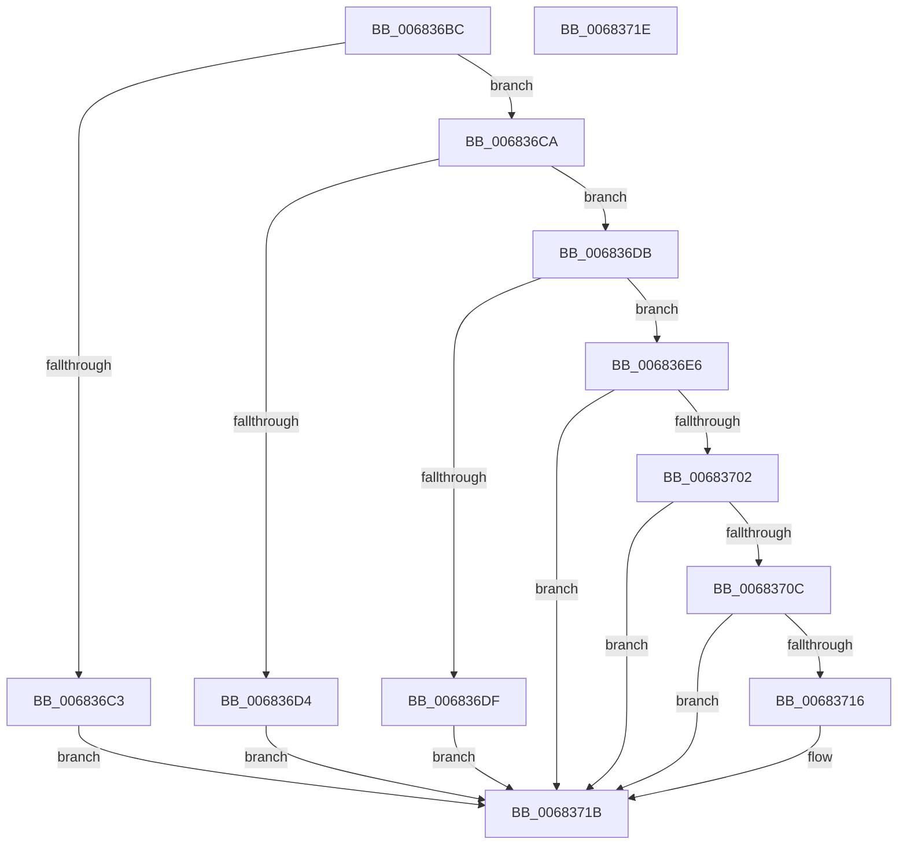

# MiImageVadHotPatchEligibleEx

- RVA: `0x006836BC`–`0x0068371F` (길이 `99` bytes)
- VA: `0x00000001406836BC`
- 실행 섹션: `.text`
- PDB 이름 있음: `예`; PDB Function 태그: `아니요`
- unwind 정보 RVA: `0x000DB714`
- 디코드: `32`개 명령, `99/99` bytes 표시
- 미해석 바이트: `0` (있으면 어셈블리에 `.byte`로 보존)

> 이 문서는 커널 이미지의 기계어와 PDB 기호를 분석해 생성했습니다. 4번과 5번은 함수 원형과 자료형을 바이너리 사용 방식에서 추정한 C 해석이며 원본 소스 복구 결과는 아닙니다.

## 1. Dependencies

- 직접 호출 지점: **0**; 고유 호출 대상: **0**
- 직접 호출자로 확인된 함수: **2**
- RIP 상대 이미지 참조: **1**

### Outgoing calls
- 직접 디코드된 call 명령이 없습니다.

### Direct callers
- [MiHotPatchProcess](../../page/80/MiHotPatchProcess_function_00803B78.md) at `0x00803C80`
- [MiImageVadHotPatchEligible](../../page/80/MiImageVadHotPatchEligible_function_00803FB8.md) at `0x00803FBC`

### Static image references
- `0x006836CC` → RVA `0x00E375AC` (`.data`; read)

## 2. Other-region calls and transfers

- 다른 실행 섹션으로 향하는 call: **0**
- 별도 외부 분기/꼬리 이동을 확인하지 못했습니다.

## 3. Assembly (complete function range)

```asm
006836BC  8B 41 40                        mov eax, dword ptr [rcx + 0x40]
006836BF  A8 20                           test al, 0x20
006836C1  75 07                           jne 0x1406836ca
006836C3  BA 0A 00 00 00                  mov edx, 0xa
006836C8  EB 51                           jmp 0x14068371b
006836CA  33 D2                           xor edx, edx
006836CC  39 15 DA 3E 7B 00               cmp dword ptr [rip + 0x7b3eda], edx
006836D2  75 07                           jne 0x1406836db
006836D4  BA 14 00 00 00                  mov edx, 0x14
006836D9  EB 40                           jmp 0x14068371b
006836DB  A8 01                           test al, 1
006836DD  74 07                           je 0x1406836e6
006836DF  BA 1E 00 00 00                  mov edx, 0x1e
006836E4  EB 35                           jmp 0x14068371b
006836E6  48 8B 41 48                     mov rax, qword ptr [rcx + 0x48]
006836EA  48 8B 08                        mov rcx, qword ptr [rax]
006836ED  48 8B 01                        mov rax, qword ptr [rcx]
006836F0  48 8B 48 38                     mov rcx, qword ptr [rax + 0x38]
006836F4  0F B7 41 30                     movzx eax, word ptr [rcx + 0x30]
006836F8  B9 64 86 00 00                  mov ecx, 0x8664
006836FD  66 3B C1                        cmp ax, cx
00683700  74 19                           je 0x14068371b
00683702  B9 4C 01 00 00                  mov ecx, 0x14c
00683707  66 3B C1                        cmp ax, cx
0068370A  74 0F                           je 0x14068371b
0068370C  B9 64 AA 00 00                  mov ecx, 0xaa64
00683711  66 3B C1                        cmp ax, cx
00683714  74 05                           je 0x14068371b
00683716  BA 28 00 00 00                  mov edx, 0x28
0068371B  8B C2                           mov eax, edx
0068371D  C3                              ret
0068371E  CC                              int3
```

## 4. C-style interpretation (structured pseudocode)

```c
__int64 __fastcall MiImageVadHotPatchEligibleEx(__int64 a1)
{
    if ((((unsigned __int8)((unsigned int)(*(unsigned int *)(a1 + 64)))) & (32)) != 0) goto loc_006836CA;
    goto loc_0068371B;
loc_006836CA:
    a2 = 0;
    if ((*(unsigned int *)(v_rip + 8077018)) != 0) goto loc_006836DB;
    goto loc_0068371B;
loc_006836DB:
    if ((((unsigned __int8)((unsigned int)(*(unsigned int *)(a1 + 64)))) & (1)) == 0) goto loc_006836E6;
    goto loc_0068371B;
loc_006836E6:
    if (((unsigned __int16)(*(unsigned __int16 *)(*(unsigned __int64 *)(*(unsigned __int64 *)(*(unsigned __int64 *)(*(unsigned __int64 *)(a1 + 72))) + 56) + 48))) == ((unsigned __int16)((unsigned int)(0x8664ULL)))) goto loc_0068371B;
    if (((unsigned __int16)(*(unsigned __int16 *)(*(unsigned __int64 *)(*(unsigned __int64 *)(*(unsigned __int64 *)(*(unsigned __int64 *)(a1 + 72))) + 56) + 48))) == 332) goto loc_0068371B;
    if (((unsigned __int16)(*(unsigned __int16 *)(*(unsigned __int64 *)(*(unsigned __int64 *)(*(unsigned __int64 *)(*(unsigned __int64 *)(a1 + 72))) + 56) + 48))) != ((unsigned __int16)((unsigned int)(0xAA64ULL)))) {
        a2 = 40;
    }
    return (unsigned int)((unsigned int)(a2));
}
```

## 5. (Beta) C Style

```c
int64_t MiImageVadHotPatchEligibleEx(void *Arg1)
{
    uint8_t *arg1 = (uint8_t *)Arg1;

    if ((((uint8_t)((uint32_t)(*(uint32_t *)(arg1 + 0x40)))) & (32)) != 0) goto loc_006836CA;
    goto loc_0068371B;
loc_006836CA:
    a2 = 0;
    if ((*(uint32_t *)(v_rip + 0x7B3EDA)) != 0) goto loc_006836DB;
    goto loc_0068371B;
loc_006836DB:
    if ((((uint8_t)((uint32_t)(*(uint32_t *)(arg1 + 0x40)))) & (1)) == 0) goto loc_006836E6;
    goto loc_0068371B;
loc_006836E6:
    if (((uint16_t)(*(uint16_t *)(*(uint64_t *)(*(uint64_t *)(*(uint64_t *)(*(uint64_t *)(arg1 + 0x48))) + 0x38) + 0x30))) == ((uint16_t)((uint32_t)(0x8664ULL)))) goto loc_0068371B;
    if (((uint16_t)(*(uint16_t *)(*(uint64_t *)(*(uint64_t *)(*(uint64_t *)(*(uint64_t *)(arg1 + 0x48))) + 0x38) + 0x30))) == 332) goto loc_0068371B;
    if (((uint16_t)(*(uint16_t *)(*(uint64_t *)(*(uint64_t *)(*(uint64_t *)(*(uint64_t *)(arg1 + 0x48))) + 0x38) + 0x30))) != ((uint16_t)((uint32_t)(0xAA64ULL)))) {
        a2 = 40;
    }
    return (uint32_t)((uint32_t)(a2));
}
```

### 관측된 메모리 오프셋

구조체 형식이 확인되지 않은 접근은 인자 기준의 오프셋으로만 기록했습니다.

| 기준 인자 | 오프셋 표현 | 폭 (bit) | 접근 |
|---|---:|---:|---|
| `Arg1` | `+ 0x40` | `32` | `R` |
| `Arg1` | `+ 0x48` | `64` | `R` |

## 6. Execution-region graph

[열기: 2D/3D 그래프와 함수 탐색 컨트롤 패널](../../../control-panel.html?section=text&rva=0x006836BC&view=graph)

- 2D 그래프는 위에서 아래로 흐르고, 3D 그래프는 빈 공간을 드래그해 회전합니다. Shift+드래그는 이동, 휠은 확대·축소, 함수 노드 선택은 대상 보고서 이동입니다.

### Static fallback


