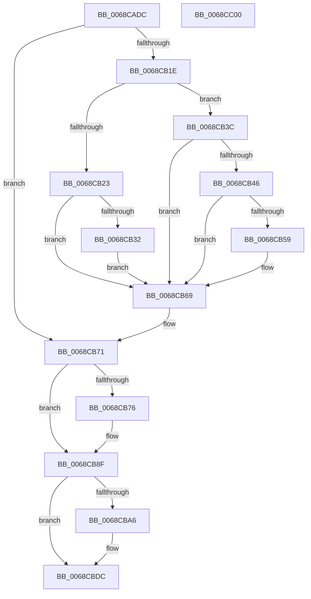

# MiIncreaseCommitLimits

- RVA: `0x0068CADC`–`0x0068CC01` (길이 `293` bytes)
- VA: `0x000000014068CADC`
- 실행 섹션: `.text`
- PDB 이름 있음: `예`; PDB Function 태그: `아니요`
- unwind 정보 RVA: `0x00060300`
- 디코드: `70`개 명령, `293/293` bytes 표시
- 미해석 바이트: `0` (있으면 어셈블리에 `.byte`로 보존)

> 이 문서는 커널 이미지의 기계어와 PDB 기호를 분석해 생성했습니다. 4번과 5번은 함수 원형과 자료형을 바이너리 사용 방식에서 추정한 C 해석이며 원본 소스 복구 결과는 아닙니다.

## 1. Dependencies

- 직접 호출 지점: **6**; 고유 호출 대상: **6**
- 직접 호출자로 확인된 함수: **8**
- RIP 상대 이미지 참조: **0**

### Outgoing calls
- `0x0068CB0A` → [ExAcquireSpinLockExclusive](../24/ExAcquireSpinLockExclusive_function_00248690.md) (function, `0x00248690`)
- `0x0068CB4C` → [MiRestockOverCommit](../40/MiRestockOverCommit_function_00407D94.md) (function, `0x00407D94`)
- `0x0068CB8A` → [KeSetEvent](../33/KeSetEvent_function_0033F310.md) (function, `0x0033F310`)
- `0x0068CB97` → [MiComputeCommitThresholds](../47/MiComputeCommitThresholds_function_0047C904.md) (function, `0x0047C904`)
- `0x0068CBAE` → [MiUpdatePageFileList](MiUpdatePageFileList_function_006803AC.md) (function, `0x006803AC`)
- `0x0068CBE2` → [MiReleaseSpinLockExclusive](../24/MiReleaseSpinLockExclusive_function_002482C0.md) (function, `0x002482C0`)

### Direct callers
- [MiEnableNewPfns](../67/MiEnableNewPfns_function_00671DD0.md) at `0x00672014`
- [MiEnableNewPfns](../67/MiEnableNewPfns_function_00671DD0.md) at `0x00672034`
- [MiInitializeCommitment](MiInitializeCommitment_function_0068CC08.md) at `0x0068CD3E`
- [MiInsertPartitionPageNodes](../69/MiInsertPartitionPageNodes_function_00690F94.md) at `0x00691053`
- [MiCompleteMemoryAddition](../../page/7F/MiCompleteMemoryAddition_function_007F9FAC.md) at `0x007FA0AE`
- [MiCompleteMemoryAddition](../../page/7F/MiCompleteMemoryAddition_function_007F9FAC.md) at `0x007FA0DD`
- [MiCreatePagingFile](../../page/7F/MiCreatePagingFile_function_007FEFF4.md) at `0x007FFAB9`
- [MiExtendPagingFiles](../../page/7F/MiExtendPagingFiles_function_007FFDD8.md) at `0x007FFF55`
- [MiInsertPageFileInList](../../page/7F/MiInsertPageFileInList_function_007FFF80.md) at `0x008002CF`
- [MiFreePartitionPhysicalPages](../../page/80/MiFreePartitionPhysicalPages_function_0080D42C.md) at `0x0080D596`

### Static image references
- 디코드된 RIP-relative 메모리 참조가 없습니다.

## 2. Other-region calls and transfers

- 다른 실행 섹션으로 향하는 call: **0**
- 별도 외부 분기/꼬리 이동을 확인하지 못했습니다.

## 3. Assembly (complete function range)

```asm
0068CADC  48 89 5C 24 08                  mov qword ptr [rsp + 8], rbx
0068CAE1  48 89 6C 24 10                  mov qword ptr [rsp + 0x10], rbp
0068CAE6  48 89 74 24 18                  mov qword ptr [rsp + 0x18], rsi
0068CAEB  57                              push rdi
0068CAEC  41 56                           push r14
0068CAEE  41 57                           push r15
0068CAF0  48 83 EC 20                     sub rsp, 0x20
0068CAF4  4C 8D B1 F8 41 00 00            lea r14, [rcx + 0x41f8]
0068CAFB  48 8B D9                        mov rbx, rcx
0068CAFE  49 8B CE                        mov rcx, r14
0068CB01  49 8B F9                        mov rdi, r9
0068CB04  49 8B E8                        mov rbp, r8
0068CB07  48 8B F2                        mov rsi, rdx
0068CB0A  E8 81 BB BB FF                  call 0x140248690
0068CB0F  4C 8B 93 C8 41 00 00            mov r10, qword ptr [rbx + 0x41c8]
0068CB16  44 8A F8                        mov r15b, al
0068CB19  48 85 F6                        test rsi, rsi
0068CB1C  74 53                           je 0x14068cb71
0068CB1E  48 85 FF                        test rdi, rdi
0068CB21  74 19                           je 0x14068cb3c
0068CB23  F0 48 01 BB 40 4B 00 00         lock add qword ptr [rbx + 0x4b40], rdi
0068CB2B  83 7C 24 60 00                  cmp dword ptr [rsp + 0x60], 0
0068CB30  74 37                           je 0x14068cb69
0068CB32  F0 48 01 BB 80 4B 00 00         lock add qword ptr [rbx + 0x4b80], rdi
0068CB3A  EB 2D                           jmp 0x14068cb69
0068CB3C  48 83 BB 08 42 00 00 00         cmp qword ptr [rbx + 0x4208], 0
0068CB44  74 23                           je 0x14068cb69
0068CB46  48 8B D6                        mov rdx, rsi
0068CB49  48 8B CB                        mov rcx, rbx
0068CB4C  E8 43 B2 D7 FF                  call 0x140407d94
0068CB51  48 8B CE                        mov rcx, rsi
0068CB54  48 2B C8                        sub rcx, rax
0068CB57  74 10                           je 0x14068cb69
0068CB59  F0 48 01 8B 40 4B 00 00         lock add qword ptr [rbx + 0x4b40], rcx
0068CB61  F0 48 01 8B 80 4B 00 00         lock add qword ptr [rbx + 0x4b80], rcx
0068CB69  F0 48 01 B3 98 4C 00 00         lock add qword ptr [rbx + 0x4c98], rsi
0068CB71  48 85 ED                        test rbp, rbp
0068CB74  74 19                           je 0x14068cb8f
0068CB76  F0 48 01 AB C8 41 00 00         lock add qword ptr [rbx + 0x41c8], rbp
0068CB7E  48 8D 8B A0 03 00 00            lea rcx, [rbx + 0x3a0]
0068CB85  45 33 C0                        xor r8d, r8d
0068CB88  33 D2                           xor edx, edx
0068CB8A  E8 81 27 CB FF                  call 0x14033f310
0068CB8F  BA 01 00 00 00                  mov edx, 1
0068CB94  48 8B CB                        mov rcx, rbx
0068CB97  E8 68 FD DE FF                  call 0x14047c904
0068CB9C  48 8B 7C 24 68                  mov rdi, qword ptr [rsp + 0x68]
0068CBA1  48 85 FF                        test rdi, rdi
0068CBA4  74 36                           je 0x14068cbdc
0068CBA6  BA 03 00 00 00                  mov edx, 3
0068CBAB  48 8B CF                        mov rcx, rdi
0068CBAE  E8 F9 37 FF FF                  call 0x1406803ac
0068CBB3  F0 48 83 83 40 4B 00 00 02      lock add qword ptr [rbx + 0x4b40], 2
0068CBBC  F0 48 83 83 80 4B 00 00 02      lock add qword ptr [rbx + 0x4b80], 2
0068CBC5  8B 93 58 48 00 00               mov edx, dword ptr [rbx + 0x4858]
0068CBCB  8D 42 01                        lea eax, [rdx + 1]
0068CBCE  48 89 BC D3 60 48 00 00         mov qword ptr [rbx + rdx*8 + 0x4860], rdi
0068CBD6  89 83 58 48 00 00               mov dword ptr [rbx + 0x4858], eax
0068CBDC  41 8A D7                        mov dl, r15b
0068CBDF  49 8B CE                        mov rcx, r14
0068CBE2  E8 D9 B6 BB FF                  call 0x1402482c0
0068CBE7  48 8B 5C 24 40                  mov rbx, qword ptr [rsp + 0x40]
0068CBEC  48 8B 6C 24 48                  mov rbp, qword ptr [rsp + 0x48]
0068CBF1  48 8B 74 24 50                  mov rsi, qword ptr [rsp + 0x50]
0068CBF6  48 83 C4 20                     add rsp, 0x20
0068CBFA  41 5F                           pop r15
0068CBFC  41 5E                           pop r14
0068CBFE  5F                              pop rdi
0068CBFF  C3                              ret
0068CC00  CC                              int3
```

## 4. C-style interpretation (structured pseudocode)

```c
__int64 __fastcall MiIncreaseCommitLimits(__int64 a1, __int64 a2, __int64 a3, __int64 a4, unsigned int a5, __int64 a6)
{
    __int64 result;
    __int64 v_rsp;
    unsigned __int64 v_stack_p10;
    unsigned __int64 v_stack_p18;
    unsigned __int64 v_stack_p8;

    v_stack_p8 = v_rbx;
    v_stack_p10 = v_rbp;
    v_stack_p18 = v_rsi;
    v_rsp = (v_rsp) - (32);
    result = ExAcquireSpinLockExclusive(a1 + 16888, a2, a3, a4);
    if (a2 == 0) goto loc_0068CB71;
    if (a4 == 0) goto loc_0068CB3C;
    if (a5 == 0) goto loc_0068CB69;
    goto loc_0068CB69;
loc_0068CB3C:
    if ((*(unsigned __int64 *)(a1 + 16904)) == 0) goto loc_0068CB69;
    result = MiRestockOverCommit(a1, a2, a3, a4);
    a1 = (a2) - (result);
    if (!(condition_is_equal)) {
    }
loc_0068CB71:
    if (a3 != 0) {
        a1 = a1 + 928;
        a3 = 0;
        a2 = 0;
        result = KeSetEvent(a1, a2, a3, a4);
    }
    result = MiComputeCommitThresholds(a1, 1, a3, a4);
    if (a6 != 0) {
        a2 = 3;
        a1 = a6;
        result = MiUpdatePageFileList(a1, a2, a3, a4);
        a2 = *(unsigned int *)(a1 + 18520);
        result = a2 + 1;
        *(unsigned __int64 *)(a1 + a2 * 8 + 18528) = a6;
        *(unsigned int *)(a1 + 18520) = (unsigned int)(result);
    }
    result = MiReleaseSpinLockExclusive(a1 + 16888, (unsigned __int8)((unsigned __int8)(result)), a3, a4);
    v_rsp = (v_rsp) + (32);
    return result;
}
```

## 5. (Beta) C Style

```c
int64_t MiIncreaseCommitLimits(void *Arg1, int64_t Arg2, int64_t Arg3, int64_t Arg4, uint32_t Arg5, int64_t Arg6)
{
    uint8_t *arg1 = (uint8_t *)Arg1;

    int64_t result;
    int64_t local_rsp;
    uint64_t v_stack_p10;
    uint64_t v_stack_p18;
    uint64_t v_stack_p8;

    v_stack_p8 = local_rbx;
    v_stack_p10 = local_rbp;
    v_stack_p18 = local_rsi;
    local_rsp = (local_rsp) - (32);
    result = ExAcquireSpinLockExclusive(Arg1 + 16888, Arg2, Arg3, Arg4);
    if (Arg2 == 0) goto loc_0068CB71;
    if (Arg4 == 0) goto loc_0068CB3C;
    if (Arg5 == 0) goto loc_0068CB69;
    goto loc_0068CB69;
loc_0068CB3C:
    if ((*(uint64_t *)(arg1 + 0x4208)) == 0) goto loc_0068CB69;
    result = MiRestockOverCommit(Arg1, Arg2, Arg3, Arg4);
    Arg1 = (Arg2) - (result);
    if (!(condition_is_equal)) {
    }
loc_0068CB71:
    if (Arg3 != 0) {
        Arg1 = Arg1 + 928;
        Arg3 = 0;
        Arg2 = 0;
        result = KeSetEvent(Arg1, Arg2, Arg3, Arg4);
    }
    result = MiComputeCommitThresholds(Arg1, 1, Arg3, Arg4);
    if (Arg6 != 0) {
        Arg2 = 3;
        Arg1 = Arg6;
        result = MiUpdatePageFileList(Arg1, Arg2, Arg3, Arg4);
        Arg2 = *(uint32_t *)(arg1 + 0x4858);
        result = Arg2 + 1;
        *(uint64_t *)(arg1 + Arg2 * 8 + 0x4860) = Arg6;
        *(uint32_t *)(arg1 + 0x4858) = (uint32_t)(result);
    }
    result = MiReleaseSpinLockExclusive(Arg1 + 16888, (uint8_t)((uint8_t)(result)), Arg3, Arg4);
    local_rsp = (local_rsp) + (32);
    return result;
}
```

### 관측된 메모리 오프셋

구조체 형식이 확인되지 않은 접근은 인자 기준의 오프셋으로만 기록했습니다.

| 기준 인자 | 오프셋 표현 | 폭 (bit) | 접근 |
|---|---:|---:|---|
| `Arg1` | `+ 0x3A0` | `64` | `R` |
| `Arg1` | `+ 0x41C8` | `64` | `R` |
| `Arg1` | `+ 0x41C8` | `64` | `R/W` |
| `Arg1` | `+ 0x41F8` | `64` | `R` |
| `Arg1` | `+ 0x4208` | `64` | `R` |
| `Arg1` | `+ 0x4858` | `32` | `R` |
| `Arg1` | `+ 0x4858` | `32` | `W` |
| `Arg1` | `+ 0x4860 + rdx*8` | `64` | `W` |
| `Arg1` | `+ 0x4B40` | `64` | `R/W` |
| `Arg1` | `+ 0x4B80` | `64` | `R/W` |
| `Arg1` | `+ 0x4C98` | `64` | `R/W` |

## 6. Execution-region graph

[열기: 2D/3D 그래프와 함수 탐색 컨트롤 패널](../../../control-panel.html?section=text&rva=0x0068CADC&view=graph)

- 2D 그래프는 위에서 아래로 흐르고, 3D 그래프는 빈 공간을 드래그해 회전합니다. Shift+드래그는 이동, 휠은 확대·축소, 함수 노드 선택은 대상 보고서 이동입니다.

### Static fallback


