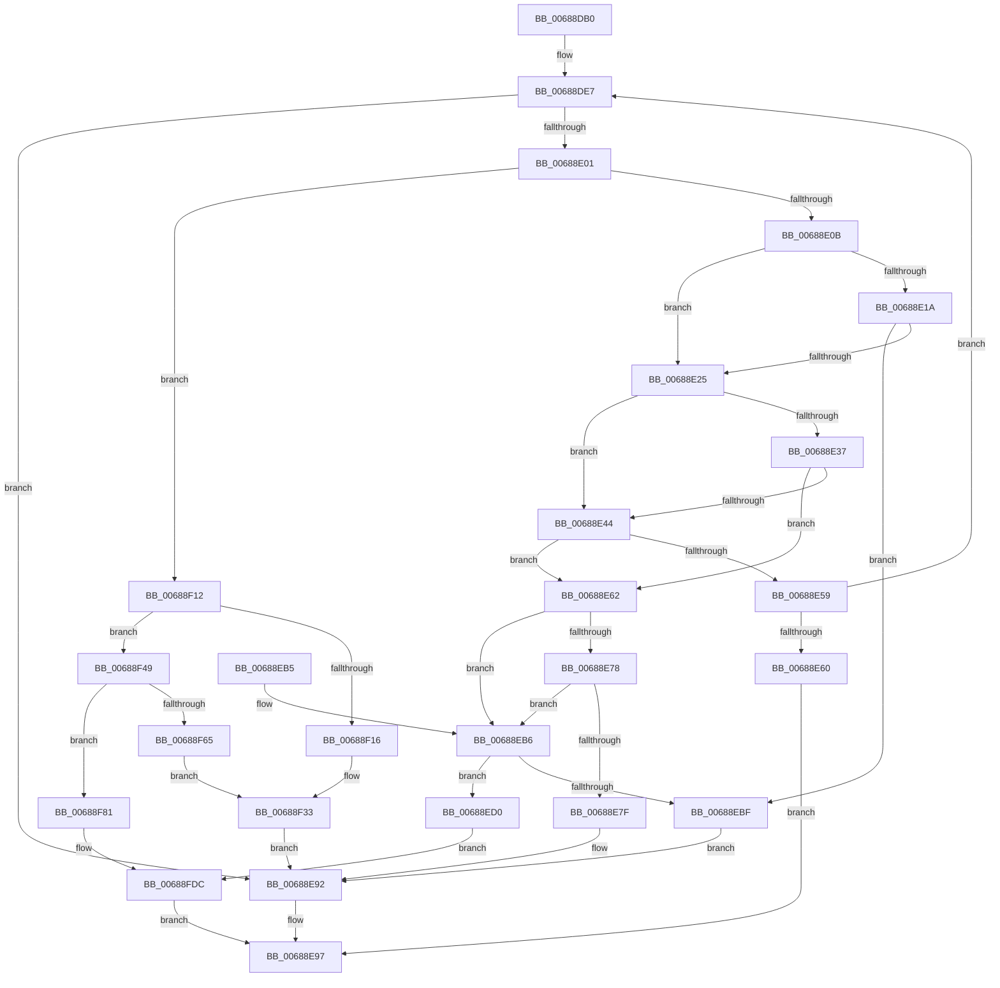

# MiIncrementAweMapCount

- RVA: `0x00688DB0`–`0x00688FE3` (길이 `563` bytes)
- VA: `0x0000000140688DB0`
- 실행 섹션: `.text`
- PDB 이름 있음: `예`; PDB Function 태그: `아니요`
- unwind 정보 RVA: `0x000D8C08`
- 디코드: `148`개 명령, `563/563` bytes 표시
- 미해석 바이트: `0` (있으면 어셈블리에 `.byte`로 보존)

> 이 문서는 커널 이미지의 기계어와 PDB 기호를 분석해 생성했습니다. 4번과 5번은 함수 원형과 자료형을 바이너리 사용 방식에서 추정한 C 해석이며 원본 소스 복구 결과는 아닙니다.

## 1. Dependencies

- 직접 호출 지점: **2**; 고유 호출 대상: **2**
- 직접 호출자로 확인된 함수: **1**
- RIP 상대 이미지 참조: **2**

### Outgoing calls
- `0x00688DF4` → [MiValidateAndLockAweMapCountPage](../4B/MiValidateAndLockAweMapCountPage_function_004BD8F4.md) (function, `0x004BD8F4`)
- `0x00688E50` → [MiResolveAwePageConflict](MiResolveAwePageConflict_function_00689758.md) (function, `0x00689758`)

### Direct callers
- [MiReferenceIncomingPhysicalPages](MiReferenceIncomingPhysicalPages_function_006892C0.md) at `0x0068957B`

### Static image references
- `0x00688F1A` → RVA `0x00E300C0` (`.data`; read)
- `0x00688F33` → RVA `0x00E300C8` (`.data`; read)

## 2. Other-region calls and transfers

- 다른 실행 섹션으로 향하는 call: **0**
- 별도 외부 분기/꼬리 이동을 확인하지 못했습니다.

## 3. Assembly (complete function range)

```asm
00688DB0  48 8B C4                        mov rax, rsp
00688DB3  48 89 58 08                     mov qword ptr [rax + 8], rbx
00688DB7  48 89 70 10                     mov qword ptr [rax + 0x10], rsi
00688DBB  48 89 78 18                     mov qword ptr [rax + 0x18], rdi
00688DBF  4C 89 60 20                     mov qword ptr [rax + 0x20], r12
00688DC3  55                              push rbp
00688DC4  41 56                           push r14
00688DC6  41 57                           push r15
00688DC8  48 8B EC                        mov rbp, rsp
00688DCB  48 83 EC 30                     sub rsp, 0x30
00688DCF  0F 57 C0                        xorps xmm0, xmm0
00688DD2  41 8B F1                        mov esi, r9d
00688DD5  0F 11 45 F0                     movups xmmword ptr [rbp - 0x10], xmm0
00688DD9  45 8A E0                        mov r12b, r8b
00688DDC  4C 8B FA                        mov r15, rdx
00688DDF  48 8B F9                        mov rdi, rcx
00688DE2  BB 01 00 00 00                  mov ebx, 1
00688DE7  4C 8D 4D F0                     lea r9, [rbp - 0x10]
00688DEB  44 8B C3                        mov r8d, ebx
00688DEE  49 8B D7                        mov rdx, r15
00688DF1  48 8B CF                        mov rcx, rdi
00688DF4  E8 FB 4A E3 FF                  call 0x1404bd8f4
00688DF9  85 C0                           test eax, eax
00688DFB  0F 84 91 00 00 00               je 0x140688e92
00688E01  83 7D F8 00                     cmp dword ptr [rbp - 8], 0
00688E05  0F 84 07 01 00 00               je 0x140688f12
00688E0B  48 8B 55 F0                     mov rdx, qword ptr [rbp - 0x10]
00688E0F  48 8B 42 18                     mov rax, qword ptr [rdx + 0x18]
00688E13  48 0F BA E0 3E                  bt rax, 0x3e
00688E18  73 0B                           jae 0x140688e25
00688E1A  8B 47 08                        mov eax, dword ptr [rdi + 8]
00688E1D  84 C3                           test bl, al
00688E1F  0F 85 9A 00 00 00               jne 0x140688ebf
00688E25  48 8B 45 F0                     mov rax, qword ptr [rbp - 0x10]
00688E29  8B 48 20                        mov ecx, dword ptr [rax + 0x20]
00688E2C  4C 8B 75 F0                     mov r14, qword ptr [rbp - 0x10]
00688E30  41 F6 46 22 20                  test byte ptr [r14 + 0x22], 0x20
00688E35  75 0D                           jne 0x140688e44
00688E37  C1 E9 10                        shr ecx, 0x10
00688E3A  0F B6 C1                        movzx eax, cl
00688E3D  C1 E8 06                        shr eax, 6
00688E40  3B C6                           cmp eax, esi
00688E42  74 1E                           je 0x140688e62
00688E44  45 8A CC                        mov r9b, r12b
00688E47  44 8B C6                        mov r8d, esi
00688E4A  49 8B D6                        mov rdx, r14
00688E4D  48 8B CF                        mov rcx, rdi
00688E50  E8 03 09 00 00                  call 0x140689758
00688E55  85 C0                           test eax, eax
00688E57  79 09                           jns 0x140688e62
00688E59  3D 2D 02 00 C0                  cmp eax, 0xc000022d
00688E5E  74 87                           je 0x140688de7
00688E60  EB 35                           jmp 0x140688e97
00688E62  49 8B 4E 18                     mov rcx, qword ptr [r14 + 0x18]
00688E66  49 B8 FF FF FF FF FF FF FF 3F   movabs r8, 0x3fffffffffffffff
00688E70  49 23 C8                        and rcx, r8
00688E73  48 3B CB                        cmp rcx, rbx
00688E76  76 3E                           jbe 0x140688eb6
00688E78  8B 47 08                        mov eax, dword ptr [rdi + 8]
00688E7B  84 C3                           test bl, al
00688E7D  74 37                           je 0x140688eb6
00688E7F  48 8B 45 F0                     mov rax, qword ptr [rbp - 0x10]
00688E83  48 B9 FF FF FF FF FF FF FF 7F   movabs rcx, 0x7fffffffffffffff
00688E8D  F0 48 21 48 18                  lock and qword ptr [rax + 0x18], rcx
00688E92  B8 18 00 00 C0                  mov eax, 0xc0000018
00688E97  48 8B 5C 24 50                  mov rbx, qword ptr [rsp + 0x50]
00688E9C  48 8B 74 24 58                  mov rsi, qword ptr [rsp + 0x58]
00688EA1  48 8B 7C 24 60                  mov rdi, qword ptr [rsp + 0x60]
00688EA6  4C 8B 64 24 68                  mov r12, qword ptr [rsp + 0x68]
00688EAB  48 83 C4 30                     add rsp, 0x30
00688EAF  41 5F                           pop r15
00688EB1  41 5E                           pop r14
00688EB3  5D                              pop rbp
00688EB4  C3                              ret
00688EB5  CC                              int3
00688EB6  48 8B 55 F0                     mov rdx, qword ptr [rbp - 0x10]
00688EBA  49 3B C8                        cmp rcx, r8
00688EBD  72 11                           jb 0x140688ed0
00688EBF  48 B9 FF FF FF FF FF FF FF 7F   movabs rcx, 0x7fffffffffffffff
00688EC9  F0 48 21 4A 18                  lock and qword ptr [rdx + 0x18], rcx
00688ECE  EB C2                           jmp 0x140688e92
00688ED0  48 8B 45 40                     mov rax, qword ptr [rbp + 0x40]
00688ED4  48 89 42 08                     mov qword ptr [rdx + 8], rax
00688ED8  48 8B 42 18                     mov rax, qword ptr [rdx + 0x18]
00688EDC  48 8D 48 01                     lea rcx, [rax + 1]
00688EE0  48 8B D1                        mov rdx, rcx
00688EE3  48 33 D0                        xor rdx, rax
00688EE6  48 B8 00 00 00 00 00 00 00 C0   movabs rax, 0xc000000000000000
00688EF0  48 23 D0                        and rdx, rax
00688EF3  48 8B 45 F0                     mov rax, qword ptr [rbp - 0x10]
00688EF7  48 33 D1                        xor rdx, rcx
00688EFA  48 B9 FF FF FF FF FF FF FF 7F   movabs rcx, 0x7fffffffffffffff
00688F04  48 89 50 18                     mov qword ptr [rax + 0x18], rdx
00688F08  F0 48 21 48 18                  lock and qword ptr [rax + 0x18], rcx
00688F0D  E9 CA 00 00 00                  jmp 0x140688fdc
00688F12  3B F3                           cmp esi, ebx
00688F14  74 33                           je 0x140688f49
00688F16  48 8B 45 F0                     mov rax, qword ptr [rbp - 0x10]
00688F1A  48 2B 05 9F 71 7A 00            sub rax, qword ptr [rip + 0x7a719f]
00688F21  48 C1 F8 03                     sar rax, 3
00688F25  25 FF FF 3F 00                  and eax, 0x3fffff
00688F2A  8B C8                           mov ecx, eax
00688F2C  83 E1 1F                        and ecx, 0x1f
00688F2F  D3 E3                           shl ebx, cl
00688F31  8B C8                           mov ecx, eax
00688F33  48 8B 05 8E 71 7A 00            mov rax, qword ptr [rip + 0x7a718e]
00688F3A  F7 D3                           not ebx
00688F3C  48 C1 E9 05                     shr rcx, 5
00688F40  F0 21 1C 88                     lock and dword ptr [rax + rcx*4], ebx
00688F44  E9 49 FF FF FF                  jmp 0x140688e92
00688F49  48 8B 55 F0                     mov rdx, qword ptr [rbp - 0x10]
00688F4D  48 B9 00 00 FE FF 7F 00 00 00   movabs rcx, 0x7ffffe0000
00688F57  48 8B 02                        mov rax, qword ptr [rdx]
00688F5A  48 23 C1                        and rax, rcx
00688F5D  48 3D 00 00 0E 00               cmp rax, 0xe0000
00688F63  72 1C                           jb 0x140688f81
00688F65  48 2B 15 54 71 7A 00            sub rdx, qword ptr [rip + 0x7a7154]
00688F6C  48 C1 FA 03                     sar rdx, 3
00688F70  81 E2 FF FF 3F 00               and edx, 0x3fffff
00688F76  8B CA                           mov ecx, edx
00688F78  83 E1 1F                        and ecx, 0x1f
00688F7B  D3 E3                           shl ebx, cl
00688F7D  8B CA                           mov ecx, edx
00688F7F  EB B2                           jmp 0x140688f33
00688F81  48 8B 02                        mov rax, qword ptr [rdx]
00688F84  48 8B C8                        mov rcx, rax
00688F87  48 81 E1 00 00 FE FF            and rcx, 0xfffffffffffe0000
00688F8E  48 81 C1 00 00 02 00            add rcx, 0x20000
00688F95  48 8B D1                        mov rdx, rcx
00688F98  48 33 D0                        xor rdx, rax
00688F9B  48 B8 FF FF 01 00 80 FF FF FF   movabs rax, 0xffffff800001ffff
00688FA5  48 23 D0                        and rdx, rax
00688FA8  48 8B 45 F0                     mov rax, qword ptr [rbp - 0x10]
00688FAC  48 33 D1                        xor rdx, rcx
00688FAF  48 89 10                        mov qword ptr [rax], rdx
00688FB2  48 2B 05 07 71 7A 00            sub rax, qword ptr [rip + 0x7a7107]
00688FB9  48 C1 F8 03                     sar rax, 3
00688FBD  25 FF FF 3F 00                  and eax, 0x3fffff
00688FC2  8B C8                           mov ecx, eax
00688FC4  83 E1 1F                        and ecx, 0x1f
00688FC7  D3 E3                           shl ebx, cl
00688FC9  8B C8                           mov ecx, eax
00688FCB  F7 D3                           not ebx
00688FCD  48 8B 05 F4 70 7A 00            mov rax, qword ptr [rip + 0x7a70f4]
00688FD4  48 C1 E9 05                     shr rcx, 5
00688FD8  F0 21 1C 88                     lock and dword ptr [rax + rcx*4], ebx
00688FDC  33 C0                           xor eax, eax
00688FDE  E9 B4 FE FF FF                  jmp 0x140688e97
```

## 4. C-style interpretation (structured pseudocode)

```c
__int64 __fastcall MiIncrementAweMapCount(__int64 a1, __int64 a2, unsigned __int8 a3, int a4, __int64 a5)
{
    __int64 result;
    __int64 v_rbx;
    __int64 v_rsp;
    unsigned int v_stack_m20;
    unsigned __int64 v_stack_m28;
    unsigned __int64 v_stack_p10;
    unsigned __int64 v_stack_p18;
    unsigned __int64 v_stack_p20;
    unsigned __int64 v_stack_p8;

    *(unsigned __int64 *)(v_rsp + 8) = v_rbx;
    *(unsigned __int64 *)(v_rsp + 16) = v_rsi;
    *(unsigned __int64 *)(v_rsp + 24) = v_rdi;
    *(unsigned __int64 *)(v_rsp + 32) = v_r12;
    v_rsp = (v_rsp) - (48);
    v_stack_m28 = v_xmm0;
loc_00688DE7:
    result = MiValidateAndLockAweMapCountPage(a1, a2, 1, v_stack_m28);
    if ((unsigned int)(result) == 0) goto loc_00688E92;
    if (v_stack_m20 == 0) goto loc_00688F12;
    if (v_stack_m20 >= 0) goto loc_00688E25;
    if (((1) & ((unsigned __int8)((unsigned int)(*(unsigned int *)(a1 + 8))))) != 0) goto loc_00688EBF;
loc_00688E25:
    if (((*(unsigned __int8 *)(v_stack_m28 + 34)) & (32)) != 0) goto loc_00688E44;
    a1 = (unsigned int)(((unsigned int)(*(unsigned int *)(v_stack_m28 + 32))) >> (16));
    result = (unsigned int)(((unsigned __int8)(a1)) >> (6));
    if (((unsigned int)(result)) == ((unsigned int)((unsigned int)(a4)))) goto loc_00688E62;
loc_00688E44:
    result = MiResolveAwePageConflict(a1, v_stack_m28, (unsigned int)((unsigned int)((unsigned int)(a4))), a3);
    if (!sign_flag) goto loc_00688E62;
    if (((unsigned int)(result)) == 0xC000022DULL) goto loc_00688DE7;
    goto loc_00688E97;
loc_00688E62:
    a1 = (*(unsigned __int64 *)(v_stack_m28 + 24)) & ((unsigned int)((unsigned int)((unsigned int)(a4))));
    if (a1 <= 1) goto loc_00688EB6;
    if (((1) & ((unsigned __int8)((unsigned int)(*(unsigned int *)(a1 + 8))))) == 0) goto loc_00688EB6;
loc_00688E92:
loc_00688E97:
    v_rsp = (v_rsp) + (48);
    return (unsigned int)(0xC0000018ULL);
loc_00688EB6:
    if (a1 < ((unsigned int)((unsigned int)((unsigned int)(a4))))) goto loc_00688ED0;
loc_00688EBF:
    goto loc_00688E92;
loc_00688ED0:
    *(unsigned __int64 *)(v_stack_m28 + 8) = a5;
    a2 = (*(unsigned __int64 *)(v_stack_m28 + 24) + 1) ^ (*(unsigned __int64 *)(v_stack_m28 + 24));
    a2 = (a2) & (*(unsigned __int64 *)(v_stack_m28 + 24));
    a2 = (a2) ^ (*(unsigned __int64 *)(v_stack_m28 + 24) + 1);
    *(unsigned __int64 *)(v_stack_m28 + 24) = a2;
    goto loc_00688FDC;
loc_00688F12:
    if (((unsigned int)(v_stack_p10)) == ((unsigned int)(v_stack_p8))) goto loc_00688F49;
    result = (v_stack_m28) - (*(unsigned __int64 *)(v_rip + 8024479));
    result = (result) >> (3);
    result = (unsigned int)((result) & (0x3FFFFFULL));
    a1 = (unsigned int)(((unsigned int)((unsigned int)(result))) & (31));
    v_rbx = (unsigned int)((v_stack_p8) << ((unsigned __int8)(a1)));
loc_00688F33:
    v_rbx = (unsigned int)(~(v_rbx));
    a1 = ((unsigned int)((unsigned int)(result))) >> (5);
    goto loc_00688E92;
loc_00688F49:
    result = (*(unsigned __int64 *)(v_stack_m28)) & (a1);
    if (result < 0xE0000ULL) goto loc_00688F81;
    a2 = (v_stack_m28) - (*(unsigned __int64 *)(v_rip + 8024404));
    a2 = (a2) >> (3);
    a2 = (unsigned int)((a2) & (0x3FFFFFULL));
    a1 = (unsigned int)(((unsigned int)((unsigned int)(a2))) & (31));
    v_rbx = (unsigned int)((v_rbx) << ((unsigned __int8)(a1)));
    goto loc_00688F33;
loc_00688F81:
    a1 = (*(unsigned __int64 *)(a2)) & (0xFFFFFFFFFFFE0000ULL);
    a1 = (a1) + (0x20000ULL);
    a2 = (a1) ^ (*(unsigned __int64 *)(a2));
    a2 = (a2) & (*(unsigned __int64 *)(a2));
    a2 = (a2) ^ (a1);
    *(unsigned __int64 *)(v_stack_m28) = a2;
    result = (v_stack_m28) - (*(unsigned __int64 *)(v_rip + 8024327));
    result = (result) >> (3);
    result = (unsigned int)((result) & (0x3FFFFFULL));
    a1 = (unsigned int)(((unsigned int)((unsigned int)(result))) & (31));
    v_rbx = (unsigned int)((v_rbx) << ((unsigned __int8)(a1)));
    v_rbx = (unsigned int)(~(v_rbx));
    a1 = ((unsigned int)((unsigned int)(result))) >> (5);
loc_00688FDC:
    result = 0;
    goto loc_00688E97;
}
```

## 5. (Beta) C Style

```c
int64_t MiIncrementAweMapCount(void *Arg1, int64_t Arg2, uint8_t Arg3, int32_t Arg4, int64_t Arg5)
{
    uint8_t *arg1 = (uint8_t *)Arg1;

    int64_t result;
    int64_t local_rbx;
    int64_t local_rsp;
    uint32_t v_stack_m20;
    uint64_t v_stack_m28;
    uint64_t v_stack_p10;
    uint64_t v_stack_p18;
    uint64_t v_stack_p20;
    uint64_t v_stack_p8;

    *(uint64_t *)(local_rsp + 0x8) = local_rbx;
    *(uint64_t *)(local_rsp + 0x10) = local_rsi;
    *(uint64_t *)(local_rsp + 0x18) = local_rdi;
    *(uint64_t *)(local_rsp + 0x20) = local_r12;
    local_rsp = (local_rsp) - (48);
    v_stack_m28 = v_xmm0;
loc_00688DE7:
    result = MiValidateAndLockAweMapCountPage(Arg1, Arg2, 1, v_stack_m28);
    if ((uint32_t)(result) == 0) goto loc_00688E92;
    if (v_stack_m20 == 0) goto loc_00688F12;
    if (v_stack_m20 >= 0) goto loc_00688E25;
    if (((1) & ((uint8_t)((uint32_t)(*(uint32_t *)(arg1 + 0x8))))) != 0) goto loc_00688EBF;
loc_00688E25:
    if (((*(uint8_t *)(v_stack_m28 + 0x22)) & (32)) != 0) goto loc_00688E44;
    Arg1 = (uint32_t)(((uint32_t)(*(uint32_t *)(v_stack_m28 + 0x20))) >> (16));
    result = (uint32_t)(((uint8_t)(Arg1)) >> (6));
    if (((uint32_t)(result)) == ((uint32_t)((uint32_t)(Arg4)))) goto loc_00688E62;
loc_00688E44:
    result = MiResolveAwePageConflict(Arg1, v_stack_m28, (uint32_t)((uint32_t)((uint32_t)(Arg4))), Arg3);
    if (!sign_flag) goto loc_00688E62;
    if (((uint32_t)(result)) == 0xC000022DULL) goto loc_00688DE7;
    goto loc_00688E97;
loc_00688E62:
    Arg1 = (*(uint64_t *)(v_stack_m28 + 0x18)) & ((uint32_t)((uint32_t)((uint32_t)(Arg4))));
    if (Arg1 <= 1) goto loc_00688EB6;
    if (((1) & ((uint8_t)((uint32_t)(*(uint32_t *)(arg1 + 0x8))))) == 0) goto loc_00688EB6;
loc_00688E92:
loc_00688E97:
    local_rsp = (local_rsp) + (48);
    return (uint32_t)(0xC0000018ULL);
loc_00688EB6:
    if (Arg1 < ((uint32_t)((uint32_t)((uint32_t)(Arg4))))) goto loc_00688ED0;
loc_00688EBF:
    goto loc_00688E92;
loc_00688ED0:
    *(uint64_t *)(v_stack_m28 + 0x8) = Arg5;
    Arg2 = (*(uint64_t *)(v_stack_m28 + 0x18) + 1) ^ (*(uint64_t *)(v_stack_m28 + 0x18));
    Arg2 = (Arg2) & (*(uint64_t *)(v_stack_m28 + 0x18));
    Arg2 = (Arg2) ^ (*(uint64_t *)(v_stack_m28 + 0x18) + 1);
    *(uint64_t *)(v_stack_m28 + 0x18) = Arg2;
    goto loc_00688FDC;
loc_00688F12:
    if (((uint32_t)(v_stack_p10)) == ((uint32_t)(v_stack_p8))) goto loc_00688F49;
    result = (v_stack_m28) - (*(uint64_t *)(v_rip + 0x7A719F));
    result = (result) >> (3);
    result = (uint32_t)((result) & (0x3FFFFFULL));
    Arg1 = (uint32_t)(((uint32_t)((uint32_t)(result))) & (31));
    local_rbx = (uint32_t)((v_stack_p8) << ((uint8_t)(Arg1)));
loc_00688F33:
    local_rbx = (uint32_t)(~(local_rbx));
    Arg1 = ((uint32_t)((uint32_t)(result))) >> (5);
    goto loc_00688E92;
loc_00688F49:
    result = (*(uint64_t *)(v_stack_m28)) & (Arg1);
    if (result < 0xE0000ULL) goto loc_00688F81;
    Arg2 = (v_stack_m28) - (*(uint64_t *)(v_rip + 0x7A7154));
    Arg2 = (Arg2) >> (3);
    Arg2 = (uint32_t)((Arg2) & (0x3FFFFFULL));
    Arg1 = (uint32_t)(((uint32_t)((uint32_t)(Arg2))) & (31));
    local_rbx = (uint32_t)((local_rbx) << ((uint8_t)(Arg1)));
    goto loc_00688F33;
loc_00688F81:
    Arg1 = (*(uint64_t *)(Arg2)) & (0xFFFFFFFFFFFE0000ULL);
    Arg1 = (Arg1) + (0x20000ULL);
    Arg2 = (Arg1) ^ (*(uint64_t *)(Arg2));
    Arg2 = (Arg2) & (*(uint64_t *)(Arg2));
    Arg2 = (Arg2) ^ (Arg1);
    *(uint64_t *)(v_stack_m28) = Arg2;
    result = (v_stack_m28) - (*(uint64_t *)(v_rip + 0x7A7107));
    result = (result) >> (3);
    result = (uint32_t)((result) & (0x3FFFFFULL));
    Arg1 = (uint32_t)(((uint32_t)((uint32_t)(result))) & (31));
    local_rbx = (uint32_t)((local_rbx) << ((uint8_t)(Arg1)));
    local_rbx = (uint32_t)(~(local_rbx));
    Arg1 = ((uint32_t)((uint32_t)(result))) >> (5);
loc_00688FDC:
    result = 0;
    goto loc_00688E97;
}
```

### 관측된 메모리 오프셋

구조체 형식이 확인되지 않은 접근은 인자 기준의 오프셋으로만 기록했습니다.

| 기준 인자 | 오프셋 표현 | 폭 (bit) | 접근 |
|---|---:|---:|---|
| `Arg1` | `+ 0x8` | `32` | `R` |

## 6. Execution-region graph

[열기: 2D/3D 그래프와 함수 탐색 컨트롤 패널](../../../control-panel.html?section=text&rva=0x00688DB0&view=graph)

- 2D 그래프는 위에서 아래로 흐르고, 3D 그래프는 빈 공간을 드래그해 회전합니다. Shift+드래그는 이동, 휠은 확대·축소, 함수 노드 선택은 대상 보고서 이동입니다.

### Static fallback


