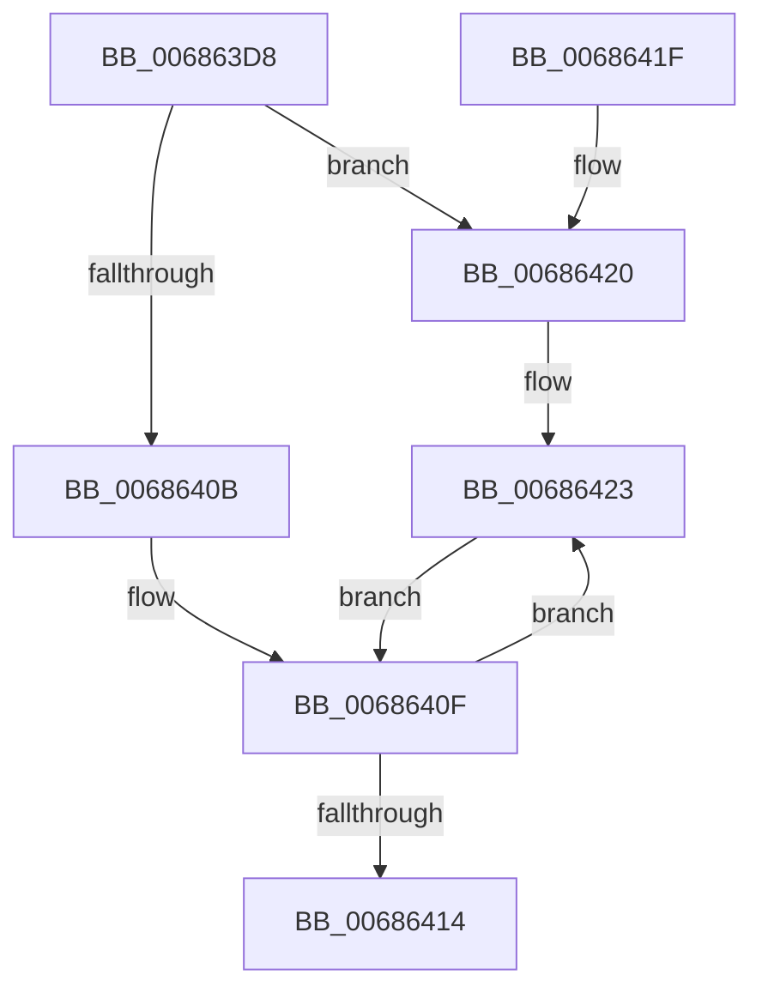

# MiInitializeBootKernelShadowStack

- RVA: `0x006863D8`–`0x00686433` (길이 `91` bytes)
- VA: `0x00000001406863D8`
- 실행 섹션: `.text`
- PDB 이름 있음: `예`; PDB Function 태그: `아니요`
- unwind 정보 RVA: `0x00065624`
- 디코드: `25`개 명령, `91/91` bytes 표시
- 미해석 바이트: `0` (있으면 어셈블리에 `.byte`로 보존)

> 이 문서는 커널 이미지의 기계어와 PDB 기호를 분석해 생성했습니다. 4번과 5번은 함수 원형과 자료형을 바이너리 사용 방식에서 추정한 C 해석이며 원본 소스 복구 결과는 아닙니다.

## 1. Dependencies

- 직접 호출 지점: **1**; 고유 호출 대상: **1**
- 직접 호출자로 확인된 함수: **1**
- RIP 상대 이미지 참조: **0**

### Outgoing calls
- `0x00686428` → [MiInitializeBootShadowStackPage](../../init/C6/MiInitializeBootShadowStackPage_function_00C67D8C.md) (function, `0x00C67D8C`)

### Direct callers
- [MiInitializeBootKernelShadowStacks](../../init/C6/MiInitializeBootKernelShadowStacks_function_00C67CA8.md) at `0x00C67D00`
- [MiInitializeBootKernelShadowStacks](../../init/C6/MiInitializeBootKernelShadowStacks_function_00C67CA8.md) at `0x00C67D13`
- [MiInitializeBootKernelShadowStacks](../../init/C6/MiInitializeBootKernelShadowStacks_function_00C67CA8.md) at `0x00C67D32`

### Static image references
- 디코드된 RIP-relative 메모리 참조가 없습니다.

## 2. Other-region calls and transfers

- 다른 실행 섹션으로 향하는 call: **1**
  - `0x00686428` → [MiInitializeBootShadowStackPage](../../init/C6/MiInitializeBootShadowStackPage_function_00C67D8C.md) (`.text` → `INIT`)
- 별도 외부 분기/꼬리 이동을 확인하지 못했습니다.

## 3. Assembly (complete function range)

```asm
006863D8  48 89 5C 24 08                  mov qword ptr [rsp + 8], rbx
006863DD  57                              push rdi
006863DE  48 83 EC 20                     sub rsp, 0x20
006863E2  48 8B D9                        mov rbx, rcx
006863E5  48 B8 F8 FF FF FF 7F 00 00 00   movabs rax, 0x7ffffffff8
006863EF  48 C1 EB 09                     shr rbx, 9
006863F3  48 23 D8                        and rbx, rax
006863F6  48 B8 00 00 00 00 80 F6 FF FF   movabs rax, 0xfffff68000000000
00686400  48 03 D8                        add rbx, rax
00686403  F7 C1 FF 0F 00 00               test ecx, 0xfff
00686409  75 15                           jne 0x140686420
0068640B  48 8D 7B 10                     lea rdi, [rbx + 0x10]
0068640F  48 3B DF                        cmp rbx, rdi
00686412  76 0F                           jbe 0x140686423
00686414  48 8B 5C 24 30                  mov rbx, qword ptr [rsp + 0x30]
00686419  48 83 C4 20                     add rsp, 0x20
0068641D  5F                              pop rdi
0068641E  C3                              ret
0068641F  CC                              int3
00686420  48 8B FB                        mov rdi, rbx
00686423  33 D2                           xor edx, edx
00686425  48 8B CB                        mov rcx, rbx
00686428  E8 5F 19 5E 00                  call 0x140c67d8c
0068642D  48 83 C3 08                     add rbx, 8
00686431  EB DC                           jmp 0x14068640f
```

## 4. C-style interpretation (structured pseudocode)

```c
__int64 __fastcall MiInitializeBootKernelShadowStack(__int64 a1, int a2)
{
    __int64 result;
    __int64 v_rbx;
    __int64 v_rsp;
    unsigned __int64 v_stack_p8;

    v_stack_p8 = v_rbx;
    v_rsp = (v_rsp) - (32);
    v_rbx = (a1) >> (9);
    v_rbx = (v_rbx) & (result);
    v_rbx = (v_rbx) + (result);
    if ((((unsigned int)(a1)) & (0xFFFULL)) != 0) goto loc_00686420;
loc_0068640F:
    if (v_rbx <= (v_rbx + 16)) goto loc_00686423;
    v_rsp = (v_rsp) + (32);
    return result;
loc_00686420:
loc_00686423:
    a2 = 0;
    result = MiInitializeBootShadowStackPage(v_stack_p8, a2, a3, a4);
    v_rbx = (v_stack_p8) + (8);
    goto loc_0068640F;
}
```

## 5. (Beta) C Style

```c
int64_t MiInitializeBootKernelShadowStack(int64_t Arg1, int32_t Arg2)
{
    int64_t result;
    int64_t local_rbx;
    int64_t local_rsp;
    uint64_t v_stack_p8;

    v_stack_p8 = local_rbx;
    local_rsp = (local_rsp) - (32);
    local_rbx = (Arg1) >> (9);
    local_rbx = (local_rbx) & (result);
    local_rbx = (local_rbx) + (result);
    if ((((uint32_t)(Arg1)) & (0xFFFULL)) != 0) goto loc_00686420;
loc_0068640F:
    if (local_rbx <= (local_rbx + 16)) goto loc_00686423;
    local_rsp = (local_rsp) + (32);
    return result;
loc_00686420:
loc_00686423:
    Arg2 = 0;
    result = MiInitializeBootShadowStackPage(v_stack_p8, Arg2, a3, a4);
    local_rbx = (v_stack_p8) + (8);
    goto loc_0068640F;
}
```

## 6. Execution-region graph

[열기: 2D/3D 그래프와 함수 탐색 컨트롤 패널](../../../control-panel.html?section=text&rva=0x006863D8&view=graph)

- 2D 그래프는 위에서 아래로 흐르고, 3D 그래프는 빈 공간을 드래그해 회전합니다. Shift+드래그는 이동, 휠은 확대·축소, 함수 노드 선택은 대상 보고서 이동입니다.

### Static fallback


