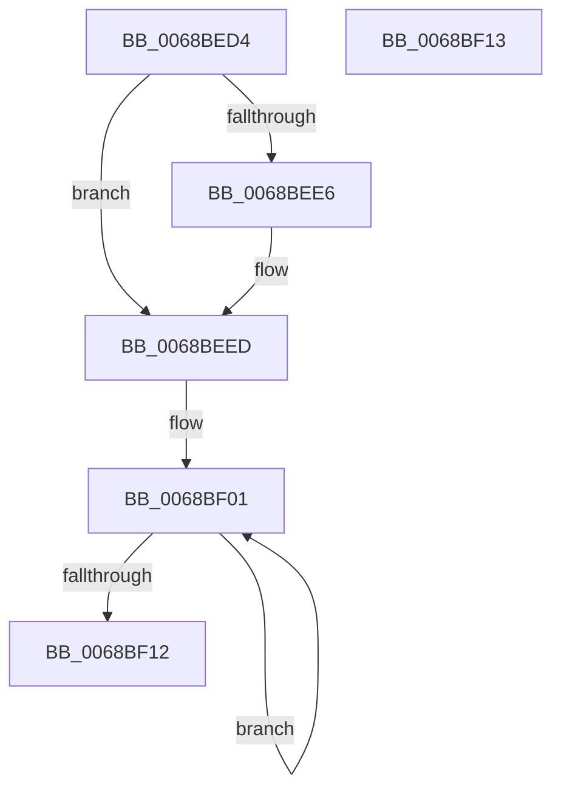

# MiInitializeCombining

- RVA: `0x0068BED4`–`0x0068BF14` (길이 `64` bytes)
- VA: `0x000000014068BED4`
- 실행 섹션: `.text`
- PDB 이름 있음: `예`; PDB Function 태그: `아니요`
- unwind 정보 RVA: `0x000DB714`
- 디코드: `19`개 명령, `64/64` bytes 표시
- 미해석 바이트: `0` (있으면 어셈블리에 `.byte`로 보존)

> 이 문서는 커널 이미지의 기계어와 PDB 기호를 분석해 생성했습니다. 4번과 5번은 함수 원형과 자료형을 바이너리 사용 방식에서 추정한 C 해석이며 원본 소스 복구 결과는 아닙니다.

## 1. Dependencies

- 직접 호출 지점: **0**; 고유 호출 대상: **0**
- 직접 호출자로 확인된 함수: **1**
- RIP 상대 이미지 참조: **0**

### Outgoing calls
- 직접 디코드된 call 명령이 없습니다.

### Direct callers
- [MiInitializePartition](../../page/7F/MiInitializePartition_function_007FD3E8.md) at `0x007FD90E`

### Static image references
- 디코드된 RIP-relative 메모리 참조가 없습니다.

## 2. Other-region calls and transfers

- 다른 실행 섹션으로 향하는 call: **0**
- 별도 외부 분기/꼬리 이동을 확인하지 못했습니다.

## 3. Assembly (complete function range)

```asm
0068BED4  48 89 0A                        mov qword ptr [rdx], rcx
0068BED7  45 33 C0                        xor r8d, r8d
0068BEDA  48 81 C1 60 42 00 00            add rcx, 0x4260
0068BEE1  4C 39 01                        cmp qword ptr [rcx], r8
0068BEE4  75 07                           jne 0x14068beed
0068BEE6  48 89 49 08                     mov qword ptr [rcx + 8], rcx
0068BEEA  48 89 09                        mov qword ptr [rcx], rcx
0068BEED  48 8D 42 48                     lea rax, [rdx + 0x48]
0068BEF1  B9 10 00 00 00                  mov ecx, 0x10
0068BEF6  48 89 40 08                     mov qword ptr [rax + 8], rax
0068BEFA  48 89 00                        mov qword ptr [rax], rax
0068BEFD  48 8D 42 68                     lea rax, [rdx + 0x68]
0068BF01  4C 89 40 F8                     mov qword ptr [rax - 8], r8
0068BF05  44 89 00                        mov dword ptr [rax], r8d
0068BF08  48 8D 40 10                     lea rax, [rax + 0x10]
0068BF0C  48 83 E9 01                     sub rcx, 1
0068BF10  75 EF                           jne 0x14068bf01
0068BF12  C3                              ret
0068BF13  CC                              int3
```

## 4. C-style interpretation (structured pseudocode)

```c
__int64 __fastcall MiInitializeCombining(__int64 a1, __int64 a2, int a3)
{
    *(unsigned __int64 *)(a2) = a1;
    a3 = 0;
    a1 = (a1) + (0x4260ULL);
    if ((*(unsigned __int64 *)(a1)) == 0) {
        *(unsigned __int64 *)(a1 + 8) = a1;
        *(unsigned __int64 *)(a1) = a1;
    }
    *(unsigned __int64 *)(a2 + 72 + 8) = a2 + 72;
    *(unsigned __int64 *)(a2 + 72) = a2 + 72;
loc_0068BF01:
    *(unsigned __int64 *)(a2 + 104 - 8) = 0;
    *(unsigned int *)(a2 + 104) = 0;
    a1 = (16) - (1);
    if (condition_is_not_equal) goto loc_0068BF01;
    return a2 + 104 + 16;
}
```

## 5. (Beta) C Style

```c
int64_t MiInitializeCombining(void *Arg1, void *Arg2, int32_t Arg3)
{
    uint8_t *arg1 = (uint8_t *)Arg1;
    uint8_t *arg2 = (uint8_t *)Arg2;

    *(void **)(arg2) = Arg1;
    Arg3 = 0;
    Arg1 = (Arg1) + (0x4260ULL);
    if ((*(uint64_t *)(arg1)) == 0) {
        *(void **)(arg1 + 0x8) = Arg1;
        *(void **)(arg1) = Arg1;
    }
    *(void **)(arg2 + 0x48 + 0x8) = Arg2 + 72;
    *(void **)(arg2 + 0x48) = Arg2 + 72;
loc_0068BF01:
    *(uint64_t *)(arg2 + 0x68 - 0x8) = 0;
    *(uint32_t *)(arg2 + 0x68) = 0;
    Arg1 = (16) - (1);
    if (condition_is_not_equal) goto loc_0068BF01;
    return Arg2 + 104 + 16;
}
```

### 관측된 메모리 오프셋

구조체 형식이 확인되지 않은 접근은 인자 기준의 오프셋으로만 기록했습니다.

| 기준 인자 | 오프셋 표현 | 폭 (bit) | 접근 |
|---|---:|---:|---|
| `Arg1` | `+ 0x0` | `64` | `R` |
| `Arg1` | `+ 0x0` | `64` | `W` |
| `Arg1` | `+ 0x8` | `64` | `W` |
| `Arg2` | `- 0x8` | `64` | `W` |
| `Arg2` | `+ 0x0` | `32` | `W` |
| `Arg2` | `+ 0x0` | `64` | `W` |
| `Arg2` | `+ 0x8` | `64` | `W` |
| `Arg2` | `+ 0x10` | `64` | `R` |
| `Arg2` | `+ 0x48` | `64` | `R` |
| `Arg2` | `+ 0x68` | `64` | `R` |

## 6. Execution-region graph

[열기: 2D/3D 그래프와 함수 탐색 컨트롤 패널](../../../control-panel.html?section=text&rva=0x0068BED4&view=graph)

- 2D 그래프는 위에서 아래로 흐르고, 3D 그래프는 빈 공간을 드래그해 회전합니다. Shift+드래그는 이동, 휠은 확대·축소, 함수 노드 선택은 대상 보고서 이동입니다.

### Static fallback


