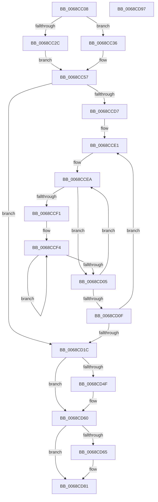

# MiInitializeCommitment

- RVA: `0x0068CC08`–`0x0068CD98` (길이 `400` bytes)
- VA: `0x000000014068CC08`
- 실행 섹션: `.text`
- PDB 이름 있음: `예`; PDB Function 태그: `아니요`
- unwind 정보 RVA: `0x0009B270`
- 디코드: `85`개 명령, `400/400` bytes 표시
- 미해석 바이트: `0` (있으면 어셈블리에 `.byte`로 보존)

> 이 문서는 커널 이미지의 기계어와 PDB 기호를 분석해 생성했습니다. 4번과 5번은 함수 원형과 자료형을 바이너리 사용 방식에서 추정한 C 해석이며 원본 소스 복구 결과는 아닙니다.

## 1. Dependencies

- 직접 호출 지점: **2**; 고유 호출 대상: **2**
- 직접 호출자로 확인된 함수: **2**
- RIP 상대 이미지 참조: **6**

### Outgoing calls
- `0x0068CD3E` → [MiIncreaseCommitLimits](MiIncreaseCommitLimits_function_0068CADC.md) (function, `0x0068CADC`)
- `0x0068CD5B` → [MiChargeCommit](../28/MiChargeCommit_function_00286EB0.md) (function, `0x00286EB0`)

### Direct callers
- [MiInitializePartition](../../page/7F/MiInitializePartition_function_007FD3E8.md) at `0x007FD827`
- [MiInitNucleus](../../init/C5/MiInitNucleus_function_00C5FD38.md) at `0x00C60165`

### Static image references
- `0x0068CC1D` → RVA `0x00E38D00` (`.data`; read)
- `0x0068CCBB` → RVA `0x00FC5000` (`ALMOSTRO`; read)
- `0x0068CCC9` → RVA `0x00E2DCCC` (`.data`; read)
- `0x0068CD6C` → RVA `0x00E376F8` (`.data`; read)
- `0x0068CD73` → RVA `0x00E3D9C0` (`.data`; read)
- `0x0068CD7A` → RVA `0x00E376D8` (`.data`; write)

## 2. Other-region calls and transfers

- 다른 실행 섹션으로 향하는 call: **0**
- 별도 외부 분기/꼬리 이동을 확인하지 못했습니다.

## 3. Assembly (complete function range)

```asm
0068CC08  48 89 5C 24 08                  mov qword ptr [rsp + 8], rbx
0068CC0D  48 89 74 24 10                  mov qword ptr [rsp + 0x10], rsi
0068CC12  48 89 7C 24 18                  mov qword ptr [rsp + 0x18], rdi
0068CC17  41 56                           push r14
0068CC19  48 83 EC 30                     sub rsp, 0x30
0068CC1D  4C 8D 35 DC C0 7A 00            lea r14, [rip + 0x7ac0dc]
0068CC24  48 8B D9                        mov rbx, rcx
0068CC27  49 3B CE                        cmp rcx, r14
0068CC2A  74 0A                           je 0x14068cc36
0068CC2C  48 83 A1 00 42 00 00 00         and qword ptr [rcx + 0x4200], 0
0068CC34  EB 21                           jmp 0x14068cc57
0068CC36  48 81 B9 50 48 00 00 00 40 00 00  cmp qword ptr [rcx + 0x4850], 0x4000
0068CC41  48 1B C0                        sbb rax, rax
0068CC44  48 25 00 FC FF FF               and rax, 0xfffffffffffffc00
0068CC4A  48 05 00 05 00 00               add rax, 0x500
0068CC50  48 89 81 00 42 00 00            mov qword ptr [rcx + 0x4200], rax
0068CC57  48 83 A1 E0 01 00 00 00         and qword ptr [rcx + 0x1e0], 0
0068CC5F  48 83 A1 08 02 00 00 00         and qword ptr [rcx + 0x208], 0
0068CC67  83 A1 28 02 00 00 00            and dword ptr [rcx + 0x228], 0
0068CC6E  8A 81 2F 02 00 00               mov al, byte ptr [rcx + 0x22f]
0068CC74  48 C7 81 00 02 00 00 01 00 00 00  mov qword ptr [rcx + 0x200], 1
0068CC7F  24 FD                           and al, 0xfd
0068CC81  48 89 99 F8 01 00 00            mov qword ptr [rcx + 0x1f8], rbx
0068CC88  0C 04                           or al, 4
0068CC8A  88 81 2F 02 00 00               mov byte ptr [rcx + 0x22f], al
0068CC90  48 8D 81 18 02 00 00            lea rax, [rcx + 0x218]
0068CC97  C6 81 2C 02 00 00 FF            mov byte ptr [rcx + 0x22c], 0xff
0068CC9E  66 83 A1 10 02 00 00 00         and word ptr [rcx + 0x210], 0
0068CCA6  83 A1 14 02 00 00 00            and dword ptr [rcx + 0x214], 0
0068CCAD  C6 81 12 02 00 00 06            mov byte ptr [rcx + 0x212], 6
0068CCB4  48 89 40 08                     mov qword ptr [rax + 8], rax
0068CCB8  48 89 00                        mov qword ptr [rax], rax
0068CCBB  0F B7 05 3E 83 93 00            movzx eax, word ptr [rip + 0x93833e]
0068CCC2  48 8B B9 00 49 00 00            mov rdi, qword ptr [rcx + 0x4900]
0068CCC9  8B 35 FD 0F 7A 00               mov esi, dword ptr [rip + 0x7a0ffd]
0068CCCF  48 8B 51 10                     mov rdx, qword ptr [rcx + 0x10]
0068CCD3  85 C0                           test eax, eax
0068CCD5  74 45                           je 0x14068cd1c
0068CCD7  48 81 C2 60 3A 00 00            add rdx, 0x3a60
0068CCDE  44 8B D0                        mov r10d, eax
0068CCE1  48 8B CA                        mov rcx, rdx
0068CCE4  41 B9 02 00 00 00               mov r9d, 2
0068CCEA  4C 8B 01                        mov r8, qword ptr [rcx]
0068CCED  85 F6                           test esi, esi
0068CCEF  74 14                           je 0x14068cd05
0068CCF1  4C 8B DE                        mov r11, rsi
0068CCF4  41 0F B7 00                     movzx eax, word ptr [r8]
0068CCF8  4D 8D 40 10                     lea r8, [r8 + 0x10]
0068CCFC  48 03 F8                        add rdi, rax
0068CCFF  49 83 EB 01                     sub r11, 1
0068CD03  75 EF                           jne 0x14068ccf4
0068CD05  48 83 C1 08                     add rcx, 8
0068CD09  49 83 E9 01                     sub r9, 1
0068CD0D  75 DB                           jne 0x14068ccea
0068CD0F  48 81 C2 80 DF 00 00            add rdx, 0xdf80
0068CD16  49 83 EA 01                     sub r10, 1
0068CD1A  75 C5                           jne 0x14068cce1
0068CD1C  48 83 64 24 28 00               and qword ptr [rsp + 0x28], 0
0068CD22  45 33 C9                        xor r9d, r9d
0068CD25  83 64 24 20 00                  and dword ptr [rsp + 0x20], 0
0068CD2A  48 8B CB                        mov rcx, rbx
0068CD2D  48 89 BB 40 49 00 00            mov qword ptr [rbx + 0x4940], rdi
0068CD34  48 8B 93 50 48 00 00            mov rdx, qword ptr [rbx + 0x4850]
0068CD3B  4C 8B C2                        mov r8, rdx
0068CD3E  E8 99 FD FF FF                  call 0x14068cadc
0068CD43  48 8B 93 50 48 00 00            mov rdx, qword ptr [rbx + 0x4850]
0068CD4A  48 3B D7                        cmp rdx, rdi
0068CD4D  74 11                           je 0x14068cd60
0068CD4F  48 2B D7                        sub rdx, rdi
0068CD52  41 B8 02 00 00 00               mov r8d, 2
0068CD58  48 8B CB                        mov rcx, rbx
0068CD5B  E8 50 A1 BF FF                  call 0x140286eb0
0068CD60  49 3B DE                        cmp rbx, r14
0068CD63  75 1C                           jne 0x14068cd81
0068CD65  48 8B 83 40 4B 00 00            mov rax, qword ptr [rbx + 0x4b40]
0068CD6C  48 2B 05 85 A9 7A 00            sub rax, qword ptr [rip + 0x7aa985]
0068CD73  48 2B 05 46 0C 7B 00            sub rax, qword ptr [rip + 0x7b0c46]
0068CD7A  48 89 05 57 A9 7A 00            mov qword ptr [rip + 0x7aa957], rax
0068CD81  48 8B 5C 24 40                  mov rbx, qword ptr [rsp + 0x40]
0068CD86  48 8B 74 24 48                  mov rsi, qword ptr [rsp + 0x48]
0068CD8B  48 8B 7C 24 50                  mov rdi, qword ptr [rsp + 0x50]
0068CD90  48 83 C4 30                     add rsp, 0x30
0068CD94  41 5E                           pop r14
0068CD96  C3                              ret
0068CD97  CC                              int3
```

## 4. C-style interpretation (structured pseudocode)

```c
__int64 __fastcall MiInitializeCommitment(__int64 a1)
{
    __int64 result;
    __int64 v_r10;
    __int64 v_r11;
    __int64 v_rdi;
    __int64 v_rsp;
    unsigned __int64 v_stack_m10;
    unsigned int v_stack_m18;
    unsigned __int64 v_stack_p10;
    unsigned __int64 v_stack_p18;
    unsigned __int64 v_stack_p8;

    v_stack_p8 = v_rbx;
    v_stack_p10 = v_rsi;
    v_stack_p18 = v_rdi;
    v_rsp = (v_rsp) - (48);
    if (a1 == (v_rip + 8044764)) goto loc_0068CC36;
    goto loc_0068CC57;
loc_0068CC36:
    result = (result) & (0xFFFFFFFFFFFFFC00ULL);
    result = (result) + (0x500ULL);
    *(unsigned __int64 *)(a1 + 16896) = result;
loc_0068CC57:
    *(unsigned __int64 *)(a1 + 512) = 1;
    result = (unsigned __int8)((*(unsigned __int8 *)(a1 + 559)) & (253));
    *(unsigned __int64 *)(a1 + 504) = a1;
    result = (unsigned __int8)((result) | (4));
    *(unsigned __int8 *)(a1 + 559) = (unsigned __int8)(result);
    *(unsigned __int8 *)(a1 + 556) = 255;
    *(unsigned __int8 *)(a1 + 530) = 6;
    *(unsigned __int64 *)(a1 + 536 + 8) = a1 + 536;
    *(unsigned __int64 *)(a1 + 536) = a1 + 536;
    if ((unsigned int)(*(unsigned __int16 *)(v_rip + 9667390)) == 0) goto loc_0068CD1C;
    a2 = (*(unsigned __int64 *)(a1 + 16)) + (0x3A60ULL);
loc_0068CCE1:
loc_0068CCEA:
    if ((unsigned int)((unsigned int)(*(unsigned int *)(v_rip + 7999485))) == 0) goto loc_0068CD05;
loc_0068CCF4:
    v_rdi = (*(unsigned __int64 *)(a1 + 18688)) + (*(unsigned __int16 *)(*(unsigned __int64 *)(a2)));
    v_r11 = ((unsigned int)(*(unsigned int *)(v_rip + 7999485))) - (1);
    if (condition_is_not_equal) goto loc_0068CCF4;
loc_0068CD05:
    a1 = (a2) + (8);
    a4 = (2) - (1);
    if (condition_is_not_equal) goto loc_0068CCEA;
    a2 = (a2) + (0xDF80ULL);
    v_r10 = ((unsigned int)((unsigned int)(*(unsigned __int16 *)(v_rip + 9667390)))) - (1);
    if (condition_is_not_equal) goto loc_0068CCE1;
loc_0068CD1C:
    a4 = 0;
    *(unsigned __int64 *)(a1 + 18752) = v_rdi;
    result = MiIncreaseCommitLimits(a1, *(unsigned __int64 *)(a1 + 18512), *(unsigned __int64 *)(a1 + 18512), a4);
    if ((*(unsigned __int64 *)(a1 + 18512)) != v_rdi) {
        a2 = (*(unsigned __int64 *)(a1 + 18512)) - (v_rdi);
        a3 = 2;
        a1 = a1;
        result = MiChargeCommit(a1, a2, a3, a4);
    }
    if (a1 == (v_rip + 8044764)) {
        result = *(unsigned __int64 *)(a1 + 19264);
        result = (result) - (*(unsigned __int64 *)(v_rip + 8038789));
        result = (result) - (*(unsigned __int64 *)(v_rip + 8064070));
        *(unsigned __int64 *)(v_rip + 8038743) = result;
    }
    v_rsp = (v_rsp) + (48);
    return result;
}
```

## 5. (Beta) C Style

```c
int64_t MiInitializeCommitment(void *Arg1)
{
    uint8_t *arg1 = (uint8_t *)Arg1;

    int64_t result;
    int64_t local_r10;
    int64_t local_r11;
    int64_t local_rdi;
    int64_t local_rsp;
    uint64_t v_stack_m10;
    uint32_t v_stack_m18;
    uint64_t v_stack_p10;
    uint64_t v_stack_p18;
    uint64_t v_stack_p8;

    v_stack_p8 = local_rbx;
    v_stack_p10 = local_rsi;
    v_stack_p18 = local_rdi;
    local_rsp = (local_rsp) - (48);
    if (Arg1 == (v_rip + 8044764)) goto loc_0068CC36;
    goto loc_0068CC57;
loc_0068CC36:
    result = (result) & (0xFFFFFFFFFFFFFC00ULL);
    result = (result) + (0x500ULL);
    *(uint64_t *)(arg1 + 0x4200) = result;
loc_0068CC57:
    *(uint64_t *)(arg1 + 0x200) = 1;
    result = (uint8_t)((*(uint8_t *)(arg1 + 0x22F)) & (253));
    *(void **)(arg1 + 0x1F8) = Arg1;
    result = (uint8_t)((result) | (4));
    *(uint8_t *)(arg1 + 0x22F) = (uint8_t)(result);
    *(uint8_t *)(arg1 + 0x22C) = 255;
    *(uint8_t *)(arg1 + 0x212) = 6;
    *(void **)(arg1 + 0x218 + 0x8) = Arg1 + 536;
    *(void **)(arg1 + 0x218) = Arg1 + 536;
    if ((uint32_t)(*(uint16_t *)(v_rip + 0x93833E)) == 0) goto loc_0068CD1C;
    a2 = (*(uint64_t *)(arg1 + 0x10)) + (0x3A60ULL);
loc_0068CCE1:
loc_0068CCEA:
    if ((uint32_t)((uint32_t)(*(uint32_t *)(v_rip + 0x7A0FFD))) == 0) goto loc_0068CD05;
loc_0068CCF4:
    local_rdi = (*(uint64_t *)(arg1 + 0x4900)) + (*(uint16_t *)(*(uint64_t *)(a2)));
    local_r11 = ((uint32_t)(*(uint32_t *)(v_rip + 0x7A0FFD))) - (1);
    if (condition_is_not_equal) goto loc_0068CCF4;
loc_0068CD05:
    Arg1 = (a2) + (8);
    a4 = (2) - (1);
    if (condition_is_not_equal) goto loc_0068CCEA;
    a2 = (a2) + (0xDF80ULL);
    local_r10 = ((uint32_t)((uint32_t)(*(uint16_t *)(v_rip + 0x93833E)))) - (1);
    if (condition_is_not_equal) goto loc_0068CCE1;
loc_0068CD1C:
    a4 = 0;
    *(uint64_t *)(arg1 + 0x4940) = local_rdi;
    result = MiIncreaseCommitLimits(Arg1, *(uint64_t *)(arg1 + 0x4850), *(uint64_t *)(arg1 + 0x4850), a4);
    if ((*(uint64_t *)(arg1 + 0x4850)) != local_rdi) {
        a2 = (*(uint64_t *)(arg1 + 0x4850)) - (local_rdi);
        a3 = 2;
        Arg1 = Arg1;
        result = MiChargeCommit(Arg1, a2, a3, a4);
    }
    if (Arg1 == (v_rip + 8044764)) {
        result = *(uint64_t *)(arg1 + 0x4B40);
        result = (result) - (*(uint64_t *)(v_rip + 0x7AA985));
        result = (result) - (*(uint64_t *)(v_rip + 0x7B0C46));
        *(uint64_t *)(v_rip + 0x7AA957) = result;
    }
    local_rsp = (local_rsp) + (48);
    return result;
}
```

### 관측된 메모리 오프셋

구조체 형식이 확인되지 않은 접근은 인자 기준의 오프셋으로만 기록했습니다.

| 기준 인자 | 오프셋 표현 | 폭 (bit) | 접근 |
|---|---:|---:|---|
| `Arg1` | `+ 0x4850` | `64` | `R` |
| `Arg1` | `+ 0x4940` | `64` | `W` |

## 6. Execution-region graph

[열기: 2D/3D 그래프와 함수 탐색 컨트롤 패널](../../../control-panel.html?section=text&rva=0x0068CC08&view=graph)

- 2D 그래프는 위에서 아래로 흐르고, 3D 그래프는 빈 공간을 드래그해 회전합니다. Shift+드래그는 이동, 휠은 확대·축소, 함수 노드 선택은 대상 보고서 이동입니다.

### Static fallback


