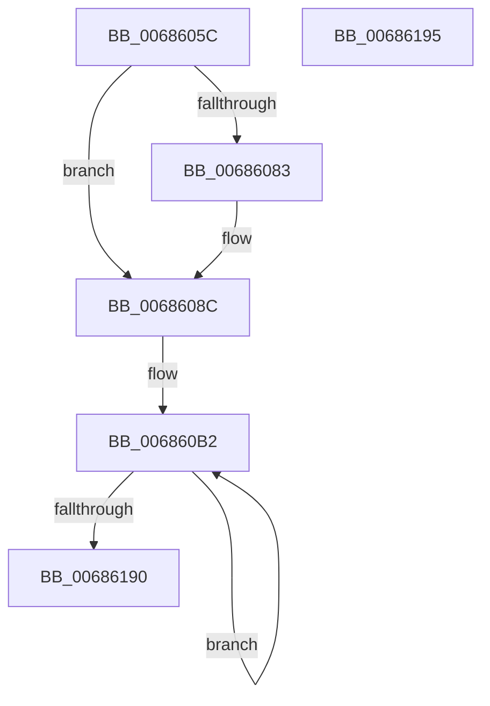

# MiInitializeDebuggerSupport

- RVA: `0x0068605C`–`0x00686196` (길이 `314` bytes)
- VA: `0x000000014068605C`
- 실행 섹션: `.text`
- PDB 이름 있음: `예`; PDB Function 태그: `아니요`
- unwind 정보 RVA: `0x0005C788`
- 디코드: `66`개 명령, `314/314` bytes 표시
- 미해석 바이트: `0` (있으면 어셈블리에 `.byte`로 보존)

> 이 문서는 커널 이미지의 기계어와 PDB 기호를 분석해 생성했습니다. 4번과 5번은 함수 원형과 자료형을 바이너리 사용 방식에서 추정한 C 해석이며 원본 소스 복구 결과는 아닙니다.

## 1. Dependencies

- 직접 호출 지점: **2**; 고유 호출 대상: **2**
- 직접 호출자로 확인된 함수: **1**
- RIP 상대 이미지 참조: **11**

### Outgoing calls
- `0x0068606C` → [MiReservePtes](../31/MiReservePtes_function_00318D20.md) (function, `0x00318D20`)
- `0x00686086` → [MxInstallMoreMemory](../67/MxInstallMoreMemory_function_00671A04.md) (function, `0x00671A04`)

### Direct callers
- [MiInitNucleus](../../init/C5/MiInitNucleus_function_00C5FD38.md) at `0x00C60180`

### Static image references
- `0x00686065` → RVA `0x00E37668` (`.data`; read)
- `0x00686074` → RVA `0x00E302D0` (`.data`; write)
- `0x0068608C` → RVA `0x00010880` (`.rdata`; read)
- `0x00686093` → RVA `0x00E31C28` (`.data`; read)
- `0x0068609D` → RVA `0x00E302D0` (`.data`; read)
- `0x006860A8` → RVA `0x00E302D8` (`.data`; write)
- `0x006860D5` → RVA `0x00042E70` (`.rdata`; read)
- `0x006860EA` → RVA `0x00012290` (`.rdata`; read)
- `0x006860F7` → RVA `0x0001A390` (`.rdata`; read)
- `0x006860FF` → RVA `0x00042F50` (`.rdata`; read)
- `0x00686152` → RVA `0x0001A380` (`.rdata`; read)

## 2. Other-region calls and transfers

- 다른 실행 섹션으로 향하는 call: **0**
- 별도 외부 분기/꼬리 이동을 확인하지 못했습니다.

## 3. Assembly (complete function range)

```asm
0068605C  48 83 EC 28                     sub rsp, 0x28
00686060  BA 02 00 00 00                  mov edx, 2
00686065  48 8D 0D FC 15 7B 00            lea rcx, [rip + 0x7b15fc]
0068606C  E8 AF 2C C9 FF                  call 0x140318d20
00686071  45 33 C9                        xor r9d, r9d
00686074  48 89 05 55 A2 7A 00            mov qword ptr [rip + 0x7aa255], rax
0068607B  48 8B C8                        mov rcx, rax
0068607E  48 85 C0                        test rax, rax
00686081  75 09                           jne 0x14068608c
00686083  8D 48 03                        lea ecx, [rax + 3]
00686086  E8 79 B9 FE FF                  call 0x140671a04
0068608B  CC                              int3
0068608C  48 8B 05 ED A7 98 FF            mov rax, qword ptr [rip - 0x675813]
00686093  4C 8D 15 8E BB 7A 00            lea r10, [rip + 0x7abb8e]
0068609A  48 89 01                        mov qword ptr [rcx], rax
0068609D  48 8B 0D 2C A2 7A 00            mov rcx, qword ptr [rip + 0x7aa22c]
006860A4  48 83 C1 08                     add rcx, 8
006860A8  48 89 0D 29 A2 7A 00            mov qword ptr [rip + 0x7aa229], rcx
006860AF  48 89 01                        mov qword ptr [rcx], rax
006860B2  66 41 0F 6E 4A 18               movd xmm1, dword ptr [r10 + 0x18]
006860B8  66 41 0F 6E 42 E8               movd xmm0, dword ptr [r10 - 0x18]
006860BE  66 41 0F 6E 12                  movd xmm2, dword ptr [r10]
006860C3  66 41 0F 6E 5A D0               movd xmm3, dword ptr [r10 - 0x30]
006860C9  66 0F 62 D8                     punpckldq xmm3, xmm0
006860CD  66 0F 62 D1                     punpckldq xmm2, xmm1
006860D1  66 0F 6C DA                     punpcklqdq xmm3, xmm2
006860D5  0F 54 1D 94 CD 9B FF            andps xmm3, xmmword ptr [rip - 0x64326c]
006860DC  66 41 0F 6E E1                  movd xmm4, r9d
006860E1  41 83 C1 04                     add r9d, 4
006860E5  66 0F 70 E4 00                  pshufd xmm4, xmm4, 0
006860EA  66 0F FE 25 9E C1 98 FF         paddd xmm4, xmmword ptr [rip - 0x673e62]
006860F2  66 0F 72 F4 02                  pslld xmm4, 2
006860F7  66 0F FE 25 91 42 99 FF         paddd xmm4, xmmword ptr [rip - 0x66bd6f]
006860FF  0F 54 25 4A CE 9B FF            andps xmm4, xmmword ptr [rip - 0x6431b6]
00686106  0F 56 E3                        orps xmm4, xmm3
00686109  66 41 0F 7E E0                  movd r8d, xmm4
0068610E  66 0F 6F D4                     movdqa xmm2, xmm4
00686112  66 0F 73 DA 04                  psrldq xmm2, 4
00686117  66 0F 7E D2                     movd edx, xmm2
0068611B  66 0F 6F CA                     movdqa xmm1, xmm2
0068611F  66 0F 73 D9 04                  psrldq xmm1, 4
00686124  66 0F 7E C9                     movd ecx, xmm1
00686128  66 0F 6F C1                     movdqa xmm0, xmm1
0068612C  66 0F 73 D8 04                  psrldq xmm0, 4
00686131  66 0F 7E C0                     movd eax, xmm0
00686135  66 41 0F 6E D8                  movd xmm3, r8d
0068613A  66 0F 6E C2                     movd xmm0, edx
0068613E  66 0F 62 D8                     punpckldq xmm3, xmm0
00686142  66 0F 6E D1                     movd xmm2, ecx
00686146  66 0F 6E C8                     movd xmm1, eax
0068614A  66 0F 62 D1                     punpckldq xmm2, xmm1
0068614E  66 0F 6C DA                     punpcklqdq xmm3, xmm2
00686152  0F 56 1D 27 42 99 FF            orps xmm3, xmmword ptr [rip - 0x66bdd9]
00686159  66 41 0F 7E 5A D0               movd dword ptr [r10 - 0x30], xmm3
0068615F  66 0F 73 DB 04                  psrldq xmm3, 4
00686164  66 41 0F 7E 5A E8               movd dword ptr [r10 - 0x18], xmm3
0068616A  66 0F 73 DB 04                  psrldq xmm3, 4
0068616F  66 41 0F 7E 1A                  movd dword ptr [r10], xmm3
00686174  4D 8D 52 60                     lea r10, [r10 + 0x60]
00686178  66 0F 73 DB 04                  psrldq xmm3, 4
0068617D  66 41 0F 7E 5A B8               movd dword ptr [r10 - 0x48], xmm3
00686183  41 81 F9 00 02 00 00            cmp r9d, 0x200
0068618A  0F 82 22 FF FF FF               jb 0x1406860b2
00686190  48 83 C4 28                     add rsp, 0x28
00686194  C3                              ret
00686195  CC                              int3
```

## 4. C-style interpretation (structured pseudocode)

```c
__int64 __fastcall MiInitializeDebuggerSupport(__int64 a1, __int64 a2, __int64 a3, int a4)
{
    __int64 result;
    __int64 v_rsp;

    v_rsp = (v_rsp) - (40);
    result = MiReservePtes(v_rip + 8066556, 2, a3, a4);
    a4 = 0;
    *(unsigned __int64 *)(v_rip + 8036949) = result;
    if (result == 0) {
        a1 = result + 3;
        result = MxInstallMoreMemory(a1, 2, a3, a4);
    }
    *(unsigned __int64 *)(a1) = *(unsigned __int64 *)(v_rip - 6772755);
    a1 = (*(unsigned __int64 *)(v_rip + 8036908)) + (8);
    *(unsigned __int64 *)(v_rip + 8036905) = a1;
    *(unsigned __int64 *)(a1) = *(unsigned __int64 *)(v_rip - 6772755);
loc_006860B2:
    a4 = (unsigned int)((a4) + (4));
    *(unsigned int *)(v_rip + 8043406 - 48) = v_xmm3;
    *(unsigned int *)(v_rip + 8043406 - 24) = v_xmm3;
    *(unsigned int *)(v_rip + 8043406) = v_xmm3;
    *(unsigned int *)(v_rip + 8043406 + 96 - 72) = v_xmm3;
    if (a4 < 512) goto loc_006860B2;
    v_rsp = (v_rsp) + (40);
    return *(unsigned __int64 *)(v_rip - 6772755);
}
```

## 5. (Beta) C Style

```c
int64_t MiInitializeDebuggerSupport(int64_t Arg1, int64_t Arg2, int64_t Arg3, int32_t Arg4)
{
    int64_t result;
    int64_t local_rsp;

    local_rsp = (local_rsp) - (40);
    result = MiReservePtes(v_rip + 8066556, 2, Arg3, Arg4);
    Arg4 = 0;
    *(uint64_t *)(v_rip + 0x7AA255) = result;
    if (result == 0) {
        Arg1 = result + 3;
        result = MxInstallMoreMemory(Arg1, 2, Arg3, Arg4);
    }
    *(uint64_t *)(Arg1) = *(uint64_t *)(v_rip - 0x675813);
    Arg1 = (*(uint64_t *)(v_rip + 0x7AA22C)) + (8);
    *(uint64_t *)(v_rip + 0x7AA229) = Arg1;
    *(uint64_t *)(Arg1) = *(uint64_t *)(v_rip - 0x675813);
loc_006860B2:
    Arg4 = (uint32_t)((Arg4) + (4));
    *(uint32_t *)(v_rip + 0x7ABB8E - 0x30) = v_xmm3;
    *(uint32_t *)(v_rip + 0x7ABB8E - 0x18) = v_xmm3;
    *(uint32_t *)(v_rip + 0x7ABB8E) = v_xmm3;
    *(uint32_t *)(v_rip + 0x7ABB8E + 0x60 - 0x48) = v_xmm3;
    if (Arg4 < 512) goto loc_006860B2;
    local_rsp = (local_rsp) + (40);
    return *(uint64_t *)(v_rip - 0x675813);
}
```

## 6. Execution-region graph

[열기: 2D/3D 그래프와 함수 탐색 컨트롤 패널](../../../control-panel.html?section=text&rva=0x0068605C&view=graph)

- 2D 그래프는 위에서 아래로 흐르고, 3D 그래프는 빈 공간을 드래그해 회전합니다. Shift+드래그는 이동, 휠은 확대·축소, 함수 노드 선택은 대상 보고서 이동입니다.

### Static fallback


