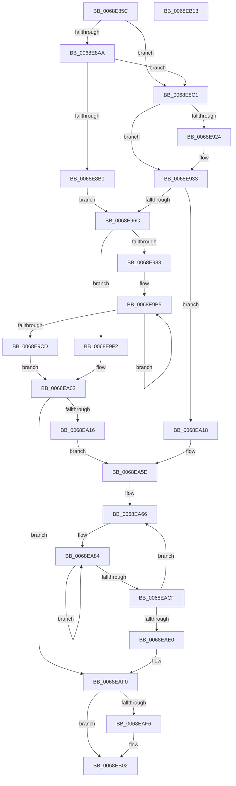

# MiInitializeSlabAllocator

- RVA: `0x0068E85C`–`0x0068EB14` (길이 `696` bytes)
- VA: `0x000000014068E85C`
- 실행 섹션: `.text`
- PDB 이름 있음: `예`; PDB Function 태그: `아니요`
- unwind 정보 RVA: `0x000A3178`
- 디코드: `161`개 명령, `696/696` bytes 표시
- 미해석 바이트: `0` (있으면 어셈블리에 `.byte`로 보존)

> 이 문서는 커널 이미지의 기계어와 PDB 기호를 분석해 생성했습니다. 4번과 5번은 함수 원형과 자료형을 바이너리 사용 방식에서 추정한 C 해석이며 원본 소스 복구 결과는 아닙니다.

## 1. Dependencies

- 직접 호출 지점: **4**; 고유 호출 대상: **3**
- 직접 호출자로 확인된 함수: **2**
- RIP 상대 이미지 참조: **1**

### Outgoing calls
- `0x0068E8B4` → [ExAcquireSpinLockExclusive](../24/ExAcquireSpinLockExclusive_function_00248690.md) (function, `0x00248690`)
- `0x0068E8C9` → [memset](../6C/memset_function_006C6C40.md) (function, `0x006C6C40`)
- `0x0068EA98` → [memset](../6C/memset_function_006C6C40.md) (function, `0x006C6C40`)
- `0x0068EAFD` → [MiReleaseSpinLockExclusive](../24/MiReleaseSpinLockExclusive_function_002482C0.md) (function, `0x002482C0`)

### Direct callers
- [MiInitializeNuma](../66/MiInitializeNuma_function_0066E0E0.md) at `0x0066E2B9`
- [MiInitializeSlabIdentities](MiInitializeSlabIdentities_function_0068EBD8.md) at `0x0068ECFB`

### Static image references
- `0x0068E900` → RVA `0x004A7A90` (`MiReplenishSlabAllocatorWorker`; read)

## 2. Other-region calls and transfers

- 다른 실행 섹션으로 향하는 call: **0**
- 별도 외부 분기/꼬리 이동을 확인하지 못했습니다.

## 3. Assembly (complete function range)

```asm
0068E85C  48 89 4C 24 08                  mov qword ptr [rsp + 8], rcx
0068E861  53                              push rbx
0068E862  55                              push rbp
0068E863  56                              push rsi
0068E864  57                              push rdi
0068E865  41 54                           push r12
0068E867  41 55                           push r13
0068E869  41 56                           push r14
0068E86B  41 57                           push r15
0068E86D  48 83 EC 38                     sub rsp, 0x38
0068E871  45 8B E0                        mov r12d, r8d
0068E874  40 B6 11                        mov sil, 0x11
0068E877  49 69 EC 80 DF 00 00            imul rbp, r12, 0xdf80
0068E87E  4C 63 F2                        movsxd r14, edx
0068E881  4D 8B F9                        mov r15, r9
0068E884  49 03 69 10                     add rbp, qword ptr [r9 + 0x10]
0068E888  48 8B F9                        mov rdi, rcx
0068E88B  40 88 B4 24 88 00 00 00         mov byte ptr [rsp + 0x88], sil
0068E893  49 BD FF FF FF FF 3F 00 00 00   movabs r13, 0x3fffffffff
0068E89D  48 8D 9D B0 DE 00 00            lea rbx, [rbp + 0xdeb0]
0068E8A4  41 83 FE 08                     cmp r14d, 8
0068E8A8  75 17                           jne 0x14068e8c1
0068E8AA  48 83 3B 00                     cmp qword ptr [rbx], 0
0068E8AE  74 11                           je 0x14068e8c1
0068E8B0  48 83 C1 10                     add rcx, 0x10
0068E8B4  E8 D7 9D BB FF                  call 0x140248690
0068E8B9  40 8A F0                        mov sil, al
0068E8BC  E9 AB 00 00 00                  jmp 0x14068e96c
0068E8C1  33 D2                           xor edx, edx
0068E8C3  41 B8 E8 00 00 00               mov r8d, 0xe8
0068E8C9  E8 72 83 03 00                  call 0x1406c6c40
0068E8CE  8B 87 88 00 00 00               mov eax, dword ptr [rdi + 0x88]
0068E8D4  4C 89 7F 18                     mov qword ptr [rdi + 0x18], r15
0068E8D8  83 E0 DF                        and eax, 0xffffffdf
0068E8DB  44 89 B7 80 00 00 00            mov dword ptr [rdi + 0x80], r14d
0068E8E2  83 C8 10                        or eax, 0x10
0068E8E5  89 87 88 00 00 00               mov dword ptr [rdi + 0x88], eax
0068E8EB  48 8D 87 D8 00 00 00            lea rax, [rdi + 0xd8]
0068E8F2  44 89 A7 84 00 00 00            mov dword ptr [rdi + 0x84], r12d
0068E8F9  48 89 40 08                     mov qword ptr [rax + 8], rax
0068E8FD  48 89 00                        mov qword ptr [rax], rax
0068E900  48 8D 05 89 91 E1 FF            lea rax, [rip - 0x1e6e77]
0068E907  48 83 A7 D0 00 00 00 00         and qword ptr [rdi + 0xd0], 0
0068E90F  48 83 A7 B8 00 00 00 00         and qword ptr [rdi + 0xb8], 0
0068E917  48 89 87 C8 00 00 00            mov qword ptr [rdi + 0xc8], rax
0068E91E  41 83 FE 07                     cmp r14d, 7
0068E922  75 0F                           jne 0x14068e933
0068E924  83 8F 88 00 00 00 0C            or dword ptr [rdi + 0x88], 0xc
0068E92B  48 C7 47 68 00 02 00 00         mov qword ptr [rdi + 0x68], 0x200
0068E933  49 6B CE 58                     imul rcx, r14, 0x58
0068E937  4D 8B CE                        mov r9, r14
0068E93A  48 81 C1 80 DB 00 00            add rcx, 0xdb80
0068E941  48 03 CD                        add rcx, rbp
0068E944  48 89 4F 50                     mov qword ptr [rdi + 0x50], rcx
0068E948  48 83 21 00                     and qword ptr [rcx], 0
0068E94C  C7 41 0C 02 00 00 00            mov dword ptr [rcx + 0xc], 2
0068E953  4C 89 69 10                     mov qword ptr [rcx + 0x10], r13
0068E957  4C 89 69 18                     mov qword ptr [rcx + 0x18], r13
0068E95B  C7 41 20 00 00 00 00            mov dword ptr [rcx + 0x20], 0
0068E962  41 83 FE 08                     cmp r14d, 8
0068E966  0F 85 AC 00 00 00               jne 0x14068ea18
0068E96C  83 8F 88 00 00 00 04            or dword ptr [rdi + 0x88], 4
0068E973  48 8B 03                        mov rax, qword ptr [rbx]
0068E976  40 88 B4 24 88 00 00 00         mov byte ptr [rsp + 0x88], sil
0068E97E  48 85 C0                        test rax, rax
0068E981  74 6F                           je 0x14068e9f2
0068E983  48 05 C0 C2 04 00               add rax, 0x4c2c0
0068E989  48 89 47 20                     mov qword ptr [rdi + 0x20], rax
0068E98D  48 8B 03                        mov rax, qword ptr [rbx]
0068E990  48 05 C0 C4 04 00               add rax, 0x4c4c0
0068E996  48 89 47 28                     mov qword ptr [rdi + 0x28], rax
0068E99A  48 8B 03                        mov rax, qword ptr [rbx]
0068E99D  48 05 C0 C6 04 00               add rax, 0x4c6c0
0068E9A3  33 D2                           xor edx, edx
0068E9A5  48 89 47 58                     mov qword ptr [rdi + 0x58], rax
0068E9A9  44 8D 62 41                     lea r12d, [rdx + 0x41]
0068E9AD  4C 89 64 24 20                  mov qword ptr [rsp + 0x20], r12
0068E9B2  45 8B C4                        mov r8d, r12d
0068E9B5  48 8B 4F 58                     mov rcx, qword ptr [rdi + 0x58]
0068E9B9  48 03 CA                        add rcx, rdx
0068E9BC  48 83 C2 10                     add rdx, 0x10
0068E9C0  48 89 49 08                     mov qword ptr [rcx + 8], rcx
0068E9C4  48 89 09                        mov qword ptr [rcx], rcx
0068E9C7  49 83 E8 01                     sub r8, 1
0068E9CB  75 E8                           jne 0x14068e9b5
0068E9CD  48 8B 85 B0 DE 00 00            mov rax, qword ptr [rbp + 0xdeb0]
0068E9D4  4C 8D 47 40                     lea r8, [rdi + 0x40]
0068E9D8  49 89 00                        mov qword ptr [r8], rax
0068E9DB  4C 8D 6F 48                     lea r13, [rdi + 0x48]
0068E9DF  48 8B 85 B0 DE 00 00            mov rax, qword ptr [rbp + 0xdeb0]
0068E9E6  48 05 00 10 04 00               add rax, 0x41000
0068E9EC  49 89 45 00                     mov qword ptr [r13], rax
0068E9F0  EB 10                           jmp 0x14068ea02
0068E9F2  45 33 E4                        xor r12d, r12d
0068E9F5  4C 8D 6F 48                     lea r13, [rdi + 0x48]
0068E9F9  4C 89 64 24 20                  mov qword ptr [rsp + 0x20], r12
0068E9FE  4C 8D 47 40                     lea r8, [rdi + 0x40]
0068EA02  40 32 ED                        xor bpl, bpl
0068EA05  4C 89 84 24 98 00 00 00         mov qword ptr [rsp + 0x98], r8
0068EA0D  45 85 E4                        test r12d, r12d
0068EA10  0F 84 DA 00 00 00               je 0x14068eaf0
0068EA16  EB 46                           jmp 0x14068ea5e
0068EA18  49 69 C9 C0 02 00 00            imul rcx, r9, 0x2c0
0068EA1F  4C 8D 47 40                     lea r8, [rdi + 0x40]
0068EA23  49 8B C1                        mov rax, r9
0068EA26  48 C1 E0 0C                     shl rax, 0xc
0068EA2A  4C 8D 6F 48                     lea r13, [rdi + 0x48]
0068EA2E  48 81 C1 80 C5 00 00            add rcx, 0xc580
0068EA35  4C 89 84 24 98 00 00 00         mov qword ptr [rsp + 0x98], r8
0068EA3D  48 05 80 45 00 00               add rax, 0x4580
0068EA43  48 03 CD                        add rcx, rbp
0068EA46  48 03 C5                        add rax, rbp
0068EA49  48 89 4F 48                     mov qword ptr [rdi + 0x48], rcx
0068EA4D  41 BC 01 00 00 00               mov r12d, 1
0068EA53  49 89 00                        mov qword ptr [r8], rax
0068EA56  40 32 ED                        xor bpl, bpl
0068EA59  4C 89 64 24 20                  mov qword ptr [rsp + 0x20], r12
0068EA5E  48 8B BC 24 98 00 00 00         mov rdi, qword ptr [rsp + 0x98]
0068EA66  44 0F B6 F5                     movzx r14d, bpl
0068EA6A  BE 08 00 00 00                  mov esi, 8
0068EA6F  4D 69 FE C0 02 00 00            imul r15, r14, 0x2c0
0068EA76  49 C1 E6 0C                     shl r14, 0xc
0068EA7A  49 BC FF FF FF FF 3F 00 00 00   movabs r12, 0x3fffffffff
0068EA84  48 8B 0F                        mov rcx, qword ptr [rdi]
0068EA87  41 B8 00 02 00 00               mov r8d, 0x200
0068EA8D  49 8B 5D 00                     mov rbx, qword ptr [r13]
0068EA91  49 03 CE                        add rcx, r14
0068EA94  48 83 CA FF                     or rdx, 0xffffffffffffffff
0068EA98  E8 A3 81 03 00                  call 0x1406c6c40
0068EA9D  49 83 24 1F 00                  and qword ptr [r15 + rbx], 0
0068EAA2  49 81 C6 00 02 00 00            add r14, 0x200
0068EAA9  41 C7 44 1F 0C 02 00 00 00      mov dword ptr [r15 + rbx + 0xc], 2
0068EAB2  4D 89 64 1F 10                  mov qword ptr [r15 + rbx + 0x10], r12
0068EAB7  4D 89 64 1F 18                  mov qword ptr [r15 + rbx + 0x18], r12
0068EABC  41 C7 44 1F 20 00 00 00 00      mov dword ptr [r15 + rbx + 0x20], 0
0068EAC5  4D 8D 7F 58                     lea r15, [r15 + 0x58]
0068EAC9  48 83 EE 01                     sub rsi, 1
0068EACD  75 B5                           jne 0x14068ea84
0068EACF  4C 8B 64 24 20                  mov r12, qword ptr [rsp + 0x20]
0068EAD4  40 FE C5                        inc bpl
0068EAD7  40 0F B6 C5                     movzx eax, bpl
0068EADB  41 3B C4                        cmp eax, r12d
0068EADE  72 86                           jb 0x14068ea66
0068EAE0  48 8B BC 24 80 00 00 00         mov rdi, qword ptr [rsp + 0x80]
0068EAE8  40 8A B4 24 88 00 00 00         mov sil, byte ptr [rsp + 0x88]
0068EAF0  40 80 FE 11                     cmp sil, 0x11
0068EAF4  74 0C                           je 0x14068eb02
0068EAF6  48 8D 4F 10                     lea rcx, [rdi + 0x10]
0068EAFA  40 8A D6                        mov dl, sil
0068EAFD  E8 BE 97 BB FF                  call 0x1402482c0
0068EB02  48 83 C4 38                     add rsp, 0x38
0068EB06  41 5F                           pop r15
0068EB08  41 5E                           pop r14
0068EB0A  41 5D                           pop r13
0068EB0C  41 5C                           pop r12
0068EB0E  5F                              pop rdi
0068EB0F  5E                              pop rsi
0068EB10  5D                              pop rbp
0068EB11  5B                              pop rbx
0068EB12  C3                              ret
0068EB13  CC                              int3
```

## 4. C-style interpretation (structured pseudocode)

```c
__int64 __fastcall MiInitializeSlabAllocator(__int64 a1, int a2, int a3, __int64 a4)
{
    __int64 result;
    __int64 v_r12;
    __int64 v_r14;
    __int64 v_r15;
    __int64 v_rbp;
    __int64 v_rsi;
    __int64 v_rsp;
    unsigned __int64 v_stack_m58;
    unsigned __int8 v_stack_p10;
    unsigned __int64 v_stack_p20;
    unsigned __int64 v_stack_p8;

    v_stack_p8 = a1;
    v_rsp = (v_rsp) - (56);
    v_rbp = (v_rbp) * ((unsigned int)(a3));
    v_rbp = (v_rbp) + (*(unsigned __int64 *)(a4 + 16));
    v_stack_p10 = 17;
    if (((unsigned int)((int)(a2))) != 8) goto loc_0068E8C1;
    if ((*(unsigned __int64 *)(v_rbp + 57008)) == 0) goto loc_0068E8C1;
    a1 = (a1) + (16);
    result = ExAcquireSpinLockExclusive(a1, a2, a3, a4);
    goto loc_0068E96C;
loc_0068E8C1:
    a2 = 0;
    result = memset(a1, a2, 232, a4);
    *(unsigned __int64 *)(a1 + 24) = a4;
    result = (unsigned int)(((unsigned int)(*(unsigned int *)(a1 + 136))) & (0xFFFFFFDFULL));
    *(unsigned int *)(a1 + 128) = (unsigned int)((int)(a2));
    result = (unsigned int)((result) | (16));
    *(unsigned int *)(a1 + 136) = (unsigned int)(result);
    *(unsigned int *)(a1 + 132) = (unsigned int)((unsigned int)(a3));
    *(unsigned __int64 *)(a1 + 216 + 8) = a1 + 216;
    *(unsigned __int64 *)(a1 + 216) = a1 + 216;
    *(unsigned __int64 *)(a1 + 200) = v_rip - 1994359;
    if (((unsigned int)((int)(a2))) == 7) {
        *(unsigned __int64 *)(a1 + 104) = 512;
    }
    a1 = (a1) * ((int)(a2));
    a1 = (a1) + (0xDB80ULL);
    a1 = (a1) + (v_rbp);
    *(unsigned __int64 *)(a1 + 80) = a1;
    *(unsigned int *)(a1 + 12) = 2;
    *(unsigned __int64 *)(a1 + 16) = v_r13;
    *(unsigned __int64 *)(a1 + 24) = v_r13;
    *(unsigned int *)(a1 + 32) = 0;
    if (((unsigned int)((int)(a2))) != 8) goto loc_0068EA18;
loc_0068E96C:
    v_stack_p10 = (unsigned __int8)((unsigned __int8)(result));
    if (*(unsigned __int64 *)(v_rbp + 57008) == 0) goto loc_0068E9F2;
    result = (*(unsigned __int64 *)(v_rbp + 57008)) + (0x4C2C0ULL);
    *(unsigned __int64 *)(a1 + 32) = result;
    result = (*(unsigned __int64 *)(v_rbp + 57008)) + (0x4C4C0ULL);
    *(unsigned __int64 *)(a1 + 40) = result;
    result = (*(unsigned __int64 *)(v_rbp + 57008)) + (0x4C6C0ULL);
    a2 = 0;
    *(unsigned __int64 *)(a1 + 88) = result;
    v_stack_m58 = a2 + 65;
loc_0068E9B5:
    a1 = (*(unsigned __int64 *)(a1 + 88)) + (0);
    a2 = (a2) + (16);
    *(unsigned __int64 *)(a1 + 8) = a1;
    *(unsigned __int64 *)(a1) = a1;
    a3 = ((unsigned int)((unsigned int)(a2 + 65))) - (1);
    if (condition_is_not_equal) goto loc_0068E9B5;
    *(unsigned __int64 *)(a1 + 64) = *(unsigned __int64 *)(v_rbp + 57008);
    result = (*(unsigned __int64 *)(v_rbp + 57008)) + (0x41000ULL);
    *(unsigned __int64 *)(a1 + 72) = result;
    goto loc_0068EA02;
loc_0068E9F2:
    v_r12 = 0;
    v_stack_m58 = 0;
loc_0068EA02:
    v_rbp = 0;
    v_stack_p20 = a1 + 64;
    if (0 == 0) goto loc_0068EAF0;
    goto loc_0068EA5E;
loc_0068EA18:
    a1 = (a1) * ((int)(a2));
    result = ((int)(a2)) << (12);
    a1 = (a1) + (0xC580ULL);
    v_stack_p20 = a1 + 64;
    result = (result) + (0x4580ULL);
    a1 = (a1) + (0);
    result = (result) + (0);
    *(unsigned __int64 *)(a1 + 72) = a1;
    *(unsigned __int64 *)(a1 + 64) = result;
    v_rbp = 0;
    v_stack_m58 = 1;
loc_0068EA5E:
loc_0068EA66:
    v_r15 = (a4) * (0);
    v_r14 = (0) << (12);
loc_0068EA84:
    a1 = (*(unsigned __int64 *)(v_stack_p20)) + (v_r14);
    a2 = (a2) | (-1);
    result = memset(a1, a2, 512, (int)(a2));
    v_r14 = (v_r14) + (512);
    *(unsigned int *)(v_r15 + *(unsigned __int64 *)(a1 + 72) * 1 + 12) = 2;
    *(unsigned __int64 *)(v_r15 + *(unsigned __int64 *)(a1 + 72) * 1 + 16) = 1;
    *(unsigned __int64 *)(v_r15 + *(unsigned __int64 *)(a1 + 72) * 1 + 24) = 1;
    *(unsigned int *)(v_r15 + *(unsigned __int64 *)(a1 + 72) * 1 + 32) = 0;
    v_rsi = (8) - (1);
    if (condition_is_not_equal) goto loc_0068EA84;
    v_rbp = (unsigned __int8)((v_rbp) + 1);
    if (((unsigned int)((unsigned __int8)(v_rbp))) < ((unsigned int)(v_stack_m58))) goto loc_0068EA66;
loc_0068EAF0:
    result = (unsigned __int8)(v_rbp);
    if (((unsigned __int8)(v_stack_p10)) != 17) {
        a1 = v_stack_p8 + 16;
        a2 = (unsigned __int8)(v_stack_p10);
        result = MiReleaseSpinLockExclusive(a1, a2, 512, (int)(a2));
    }
    v_rsp = (v_rsp) + (56);
    return result;
}
```

## 5. (Beta) C Style

```c
int64_t MiInitializeSlabAllocator(void *Arg1, int32_t Arg2, int32_t Arg3, void *Arg4)
{
    uint8_t *arg1 = (uint8_t *)Arg1;
    uint8_t *arg4 = (uint8_t *)Arg4;

    int64_t result;
    int64_t local_r12;
    int64_t local_r14;
    int64_t local_r15;
    int64_t local_rbp;
    int64_t local_rsi;
    int64_t local_rsp;
    uint64_t v_stack_m58;
    uint8_t v_stack_p10;
    uint64_t v_stack_p20;
    uint64_t v_stack_p8;

    v_stack_p8 = Arg1;
    local_rsp = (local_rsp) - (56);
    local_rbp = (local_rbp) * ((uint32_t)(Arg3));
    local_rbp = (local_rbp) + (*(uint64_t *)(arg4 + 0x10));
    v_stack_p10 = 17;
    if (((uint32_t)((int32_t)(Arg2))) != 8) goto loc_0068E8C1;
    if ((*(uint64_t *)(local_rbp + 0xDEB0)) == 0) goto loc_0068E8C1;
    Arg1 = (Arg1) + (16);
    result = ExAcquireSpinLockExclusive(Arg1, Arg2, Arg3, Arg4);
    goto loc_0068E96C;
loc_0068E8C1:
    Arg2 = 0;
    result = memset(Arg1, Arg2, 232, Arg4);
    *(void **)(arg1 + 0x18) = Arg4;
    result = (uint32_t)(((uint32_t)(*(uint32_t *)(arg1 + 0x88))) & (0xFFFFFFDFULL));
    *(uint32_t *)(arg1 + 0x80) = (uint32_t)((int32_t)(Arg2));
    result = (uint32_t)((result) | (16));
    *(uint32_t *)(arg1 + 0x88) = (uint32_t)(result);
    *(uint32_t *)(arg1 + 0x84) = (uint32_t)((uint32_t)(Arg3));
    *(void **)(arg1 + 0xD8 + 0x8) = Arg1 + 216;
    *(void **)(arg1 + 0xD8) = Arg1 + 216;
    *(uint64_t *)(arg1 + 0xC8) = v_rip - 1994359;
    if (((uint32_t)((int32_t)(Arg2))) == 7) {
        *(uint64_t *)(arg1 + 0x68) = 512;
    }
    Arg1 = (Arg1) * ((int32_t)(Arg2));
    Arg1 = (Arg1) + (0xDB80ULL);
    Arg1 = (Arg1) + (local_rbp);
    *(void **)(arg1 + 0x50) = Arg1;
    *(uint32_t *)(arg1 + 0xC) = 2;
    *(uint64_t *)(arg1 + 0x10) = local_r13;
    *(uint64_t *)(arg1 + 0x18) = local_r13;
    *(uint32_t *)(arg1 + 0x20) = 0;
    if (((uint32_t)((int32_t)(Arg2))) != 8) goto loc_0068EA18;
loc_0068E96C:
    v_stack_p10 = (uint8_t)((uint8_t)(result));
    if (*(uint64_t *)(local_rbp + 0xDEB0) == 0) goto loc_0068E9F2;
    result = (*(uint64_t *)(local_rbp + 0xDEB0)) + (0x4C2C0ULL);
    *(uint64_t *)(arg1 + 0x20) = result;
    result = (*(uint64_t *)(local_rbp + 0xDEB0)) + (0x4C4C0ULL);
    *(uint64_t *)(arg1 + 0x28) = result;
    result = (*(uint64_t *)(local_rbp + 0xDEB0)) + (0x4C6C0ULL);
    Arg2 = 0;
    *(uint64_t *)(arg1 + 0x58) = result;
    v_stack_m58 = Arg2 + 65;
loc_0068E9B5:
    Arg1 = (*(uint64_t *)(arg1 + 0x58)) + (0);
    Arg2 = (Arg2) + (16);
    *(void **)(arg1 + 0x8) = Arg1;
    *(void **)(arg1) = Arg1;
    Arg3 = ((uint32_t)((uint32_t)(Arg2 + 65))) - (1);
    if (condition_is_not_equal) goto loc_0068E9B5;
    *(uint64_t *)(arg1 + 0x40) = *(uint64_t *)(local_rbp + 0xDEB0);
    result = (*(uint64_t *)(local_rbp + 0xDEB0)) + (0x41000ULL);
    *(uint64_t *)(arg1 + 0x48) = result;
    goto loc_0068EA02;
loc_0068E9F2:
    local_r12 = 0;
    v_stack_m58 = 0;
loc_0068EA02:
    local_rbp = 0;
    v_stack_p20 = Arg1 + 64;
    if (0 == 0) goto loc_0068EAF0;
    goto loc_0068EA5E;
loc_0068EA18:
    Arg1 = (Arg1) * ((int32_t)(Arg2));
    result = ((int32_t)(Arg2)) << (12);
    Arg1 = (Arg1) + (0xC580ULL);
    v_stack_p20 = Arg1 + 64;
    result = (result) + (0x4580ULL);
    Arg1 = (Arg1) + (0);
    result = (result) + (0);
    *(void **)(arg1 + 0x48) = Arg1;
    *(uint64_t *)(arg1 + 0x40) = result;
    local_rbp = 0;
    v_stack_m58 = 1;
loc_0068EA5E:
loc_0068EA66:
    local_r15 = (Arg4) * (0);
    local_r14 = (0) << (12);
loc_0068EA84:
    Arg1 = (*(uint64_t *)(v_stack_p20)) + (local_r14);
    Arg2 = (Arg2) | (-1);
    result = memset(Arg1, Arg2, 512, (int32_t)(Arg2));
    local_r14 = (local_r14) + (512);
    *(uint32_t *)(local_r15 + *(uint64_t *)(arg1 + 0x48) * 1 + 0xC) = 2;
    *(uint64_t *)(local_r15 + *(uint64_t *)(arg1 + 0x48) * 1 + 0x10) = 1;
    *(uint64_t *)(local_r15 + *(uint64_t *)(arg1 + 0x48) * 1 + 0x18) = 1;
    *(uint32_t *)(local_r15 + *(uint64_t *)(arg1 + 0x48) * 1 + 0x20) = 0;
    local_rsi = (8) - (1);
    if (condition_is_not_equal) goto loc_0068EA84;
    local_rbp = (uint8_t)((local_rbp) + 1);
    if (((uint32_t)((uint8_t)(local_rbp))) < ((uint32_t)(v_stack_m58))) goto loc_0068EA66;
loc_0068EAF0:
    result = (uint8_t)(local_rbp);
    if (((uint8_t)(v_stack_p10)) != 17) {
        Arg1 = v_stack_p8 + 16;
        Arg2 = (uint8_t)(v_stack_p10);
        result = MiReleaseSpinLockExclusive(Arg1, Arg2, 512, (int32_t)(Arg2));
    }
    local_rsp = (local_rsp) + (56);
    return result;
}
```

### 관측된 메모리 오프셋

구조체 형식이 확인되지 않은 접근은 인자 기준의 오프셋으로만 기록했습니다.

| 기준 인자 | 오프셋 표현 | 폭 (bit) | 접근 |
|---|---:|---:|---|
| `Arg1` | `+ 0x0` | `64` | `R` |
| `Arg1` | `+ 0x0` | `64` | `W` |
| `Arg1` | `+ 0x8` | `64` | `W` |
| `Arg1` | `+ 0x18` | `64` | `W` |
| `Arg1` | `+ 0x20` | `64` | `W` |
| `Arg1` | `+ 0x28` | `64` | `W` |
| `Arg1` | `+ 0x40` | `64` | `R` |
| `Arg1` | `+ 0x48` | `64` | `R` |
| `Arg1` | `+ 0x48` | `64` | `W` |
| `Arg1` | `+ 0x50` | `64` | `W` |
| `Arg1` | `+ 0x58` | `64` | `R` |
| `Arg1` | `+ 0x58` | `64` | `W` |
| `Arg1` | `+ 0x68` | `64` | `W` |
| `Arg1` | `+ 0x80` | `32` | `W` |
| `Arg1` | `+ 0x84` | `32` | `W` |
| `Arg1` | `+ 0x88` | `32` | `R` |
| `Arg1` | `+ 0x88` | `32` | `R/W` |
| `Arg1` | `+ 0x88` | `32` | `W` |
| `Arg1` | `+ 0xB8` | `64` | `R/W` |
| `Arg1` | `+ 0xC8` | `64` | `W` |
| `Arg1` | `+ 0xD0` | `64` | `R/W` |
| `Arg1` | `+ 0xD8` | `64` | `R` |
| `Arg4` | `+ 0x0 + rbx*1` | `64` | `R/W` |
| `Arg4` | `+ 0xC + rbx*1` | `32` | `W` |
| `Arg4` | `+ 0x10` | `64` | `R` |
| `Arg4` | `+ 0x10 + rbx*1` | `64` | `W` |
| `Arg4` | `+ 0x18 + rbx*1` | `64` | `W` |
| `Arg4` | `+ 0x20 + rbx*1` | `32` | `W` |
| `Arg4` | `+ 0x58` | `64` | `R` |

## 6. Execution-region graph

[열기: 2D/3D 그래프와 함수 탐색 컨트롤 패널](../../../control-panel.html?section=text&rva=0x0068E85C&view=graph)

- 2D 그래프는 위에서 아래로 흐르고, 3D 그래프는 빈 공간을 드래그해 회전합니다. Shift+드래그는 이동, 휠은 확대·축소, 함수 노드 선택은 대상 보고서 이동입니다.

### Static fallback


