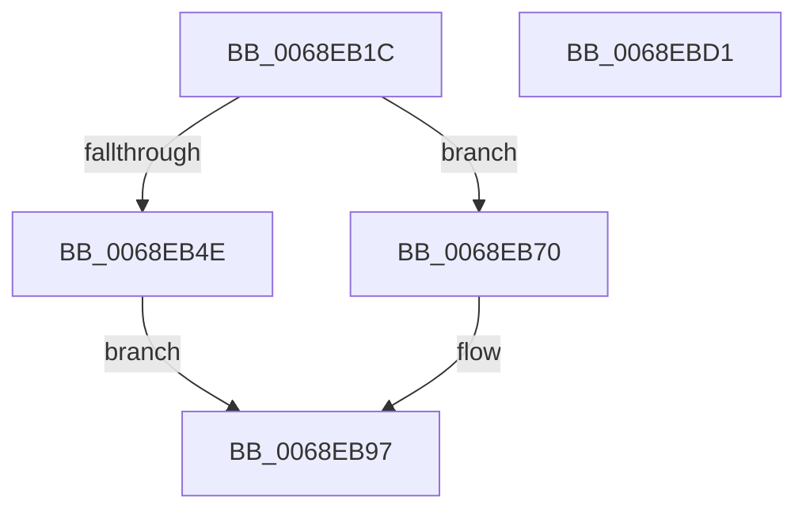

# MiInitializeSlabDefragmentContext

- RVA: `0x0068EB1C`–`0x0068EBD2` (길이 `182` bytes)
- VA: `0x000000014068EB1C`
- 실행 섹션: `.text`
- PDB 이름 있음: `예`; PDB Function 태그: `아니요`
- unwind 정보 RVA: `0x0005C954`
- 디코드: `47`개 명령, `182/182` bytes 표시
- 미해석 바이트: `0` (있으면 어셈블리에 `.byte`로 보존)

> 이 문서는 커널 이미지의 기계어와 PDB 기호를 분석해 생성했습니다. 4번과 5번은 함수 원형과 자료형을 바이너리 사용 방식에서 추정한 C 해석이며 원본 소스 복구 결과는 아닙니다.

## 1. Dependencies

- 직접 호출 지점: **1**; 고유 호출 대상: **1**
- 직접 호출자로 확인된 함수: **2**
- RIP 상대 이미지 참조: **1**

### Outgoing calls
- `0x0068EB44` → [memset](../6C/memset_function_006C6C40.md) (function, `0x006C6C40`)

### Direct callers
- [MiDefragmentAllSlabsHelper](MiDefragmentAllSlabsHelper_function_0068D550.md) at `0x0068D649`
- [MiDefragmentSlabAllocator](MiDefragmentSlabAllocator_function_0068D6A0.md) at `0x0068D6F6`

### Static image references
- `0x0068EB54` → RVA `0x00011C60` (`.rdata`; read)

## 2. Other-region calls and transfers

- 다른 실행 섹션으로 향하는 call: **0**
- 별도 외부 분기/꼬리 이동을 확인하지 못했습니다.

## 3. Assembly (complete function range)

```asm
0068EB1C  48 89 5C 24 08                  mov qword ptr [rsp + 8], rbx
0068EB21  48 89 6C 24 10                  mov qword ptr [rsp + 0x10], rbp
0068EB26  48 89 74 24 18                  mov qword ptr [rsp + 0x18], rsi
0068EB2B  57                              push rdi
0068EB2C  48 83 EC 20                     sub rsp, 0x20
0068EB30  49 8B F8                        mov rdi, r8
0068EB33  49 63 F1                        movsxd rsi, r9d
0068EB36  48 8B EA                        mov rbp, rdx
0068EB39  41 B8 68 02 00 00               mov r8d, 0x268
0068EB3F  33 D2                           xor edx, edx
0068EB41  48 8B D9                        mov rbx, rcx
0068EB44  E8 F7 80 03 00                  call 0x1406c6c40
0068EB49  48 85 FF                        test rdi, rdi
0068EB4C  74 22                           je 0x14068eb70
0068EB4E  8B 87 84 00 00 00               mov eax, dword ptr [rdi + 0x84]
0068EB54  48 8D 0D 05 31 98 FF            lea rcx, [rip - 0x67cefb]
0068EB5B  89 43 44                        mov dword ptr [rbx + 0x44], eax
0068EB5E  8B 87 88 00 00 00               mov eax, dword ptr [rdi + 0x88]
0068EB64  48 C1 E8 04                     shr rax, 4
0068EB68  83 E0 03                        and eax, 3
0068EB6B  8B 0C C1                        mov ecx, dword ptr [rcx + rax*8]
0068EB6E  EB 27                           jmp 0x14068eb97
0068EB70  83 4B 44 FF                     or dword ptr [rbx + 0x44], 0xffffffff
0068EB74  48 8B 45 10                     mov rax, qword ptr [rbp + 0x10]
0068EB78  48 69 CE E8 00 00 00            imul rcx, rsi, 0xe8
0068EB7F  8B 94 01 D8 3D 00 00            mov edx, dword ptr [rcx + rax + 0x3dd8]
0068EB86  48 8D 0D D3 30 98 FF            lea rcx, [rip - 0x67cf2d]
0068EB8D  48 C1 EA 04                     shr rdx, 4
0068EB91  83 E2 03                        and edx, 3
0068EB94  8B 0C D1                        mov ecx, dword ptr [rcx + rdx*8]
0068EB97  48 8D 43 08                     lea rax, [rbx + 8]
0068EB9B  48 89 2B                        mov qword ptr [rbx], rbp
0068EB9E  48 8B 6C 24 38                  mov rbp, qword ptr [rsp + 0x38]
0068EBA3  48 83 C8 01                     or rax, 1
0068EBA7  48 89 43 08                     mov qword ptr [rbx + 8], rax
0068EBAB  48 8D 43 10                     lea rax, [rbx + 0x10]
0068EBAF  89 73 48                        mov dword ptr [rbx + 0x48], esi
0068EBB2  48 83 C8 01                     or rax, 1
0068EBB6  48 8B 74 24 40                  mov rsi, qword ptr [rsp + 0x40]
0068EBBB  48 89 43 10                     mov qword ptr [rbx + 0x10], rax
0068EBBF  89 4B 4C                        mov dword ptr [rbx + 0x4c], ecx
0068EBC2  C6 43 50 11                     mov byte ptr [rbx + 0x50], 0x11
0068EBC6  48 8B 5C 24 30                  mov rbx, qword ptr [rsp + 0x30]
0068EBCB  48 83 C4 20                     add rsp, 0x20
0068EBCF  5F                              pop rdi
0068EBD0  C3                              ret
0068EBD1  CC                              int3
```

## 4. C-style interpretation (structured pseudocode)

```c
__int64 __fastcall MiInitializeSlabDefragmentContext(__int64 a1, __int64 a2, __int64 a3, int a4)
{
    __int64 result;
    __int64 v_rsp;
    unsigned __int64 v_stack_p10;
    unsigned __int64 v_stack_p18;
    unsigned __int64 v_stack_p8;

    v_stack_p8 = v_rbx;
    v_stack_p10 = v_rbp;
    v_stack_p18 = v_rsi;
    v_rsp = (v_rsp) - (32);
    a2 = 0;
    result = memset(a1, a2, 616, a4);
    if (a3 == 0) goto loc_0068EB70;
    *(unsigned int *)(a1 + 68) = (unsigned int)((unsigned int)(*(unsigned int *)(a3 + 132)));
    result = ((unsigned int)(*(unsigned int *)(a3 + 136))) >> (4);
    result = (unsigned int)((result) & (3));
    goto loc_0068EB97;
loc_0068EB70:
    a1 = ((unsigned int)(*(unsigned int *)(v_rip - 6803195 + result * 8))) * ((int)(a4));
    a2 = ((unsigned int)(*(unsigned int *)(a1 + *(unsigned __int64 *)(a2 + 16) * 1 + 15832))) >> (4);
    a2 = (unsigned int)((a2) & (3));
loc_0068EB97:
    *(unsigned __int64 *)(a1) = a2;
    result = (a1 + 8) | (1);
    *(unsigned __int64 *)(a1 + 8) = result;
    *(unsigned int *)(a1 + 72) = (unsigned int)((int)(a4));
    result = (a1 + 16) | (1);
    *(unsigned __int64 *)(a1 + 16) = result;
    *(unsigned int *)(a1 + 76) = (unsigned int)((unsigned int)(*(unsigned int *)(v_rip - 6803245 + a2 * 8)));
    *(unsigned __int8 *)(a1 + 80) = 17;
    v_rsp = (v_rsp) + (32);
    return result;
}
```

## 5. (Beta) C Style

```c
int64_t MiInitializeSlabDefragmentContext(void *Arg1, void *Arg2, int64_t Arg3, int32_t Arg4)
{
    uint8_t *arg1 = (uint8_t *)Arg1;
    uint8_t *arg2 = (uint8_t *)Arg2;

    int64_t result;
    int64_t local_rsp;
    uint64_t v_stack_p10;
    uint64_t v_stack_p18;
    uint64_t v_stack_p8;

    v_stack_p8 = local_rbx;
    v_stack_p10 = local_rbp;
    v_stack_p18 = local_rsi;
    local_rsp = (local_rsp) - (32);
    Arg2 = 0;
    result = memset(Arg1, Arg2, 616, Arg4);
    if (Arg3 == 0) goto loc_0068EB70;
    *(uint32_t *)(arg1 + 0x44) = (uint32_t)((uint32_t)(*(uint32_t *)(Arg3 + 0x84)));
    result = ((uint32_t)(*(uint32_t *)(Arg3 + 0x88))) >> (4);
    result = (uint32_t)((result) & (3));
    goto loc_0068EB97;
loc_0068EB70:
    Arg1 = ((uint32_t)(*(uint32_t *)(v_rip - 0x67CEFB + result * 8))) * ((int32_t)(Arg4));
    Arg2 = ((uint32_t)(*(uint32_t *)(arg1 + *(uint64_t *)(arg2 + 0x10) * 1 + 0x3DD8))) >> (4);
    Arg2 = (uint32_t)((Arg2) & (3));
loc_0068EB97:
    *(void **)(arg1) = Arg2;
    result = (Arg1 + 8) | (1);
    *(uint64_t *)(arg1 + 0x8) = result;
    *(uint32_t *)(arg1 + 0x48) = (uint32_t)((int32_t)(Arg4));
    result = (Arg1 + 16) | (1);
    *(uint64_t *)(arg1 + 0x10) = result;
    *(uint32_t *)(arg1 + 0x4C) = (uint32_t)((uint32_t)(*(uint32_t *)(v_rip - 0x67CF2D + arg2 * 8)));
    *(uint8_t *)(arg1 + 0x50) = 17;
    local_rsp = (local_rsp) + (32);
    return result;
}
```

### 관측된 메모리 오프셋

구조체 형식이 확인되지 않은 접근은 인자 기준의 오프셋으로만 기록했습니다.

| 기준 인자 | 오프셋 표현 | 폭 (bit) | 접근 |
|---|---:|---:|---|
| `Arg1` | `+ 0x0` | `64` | `W` |
| `Arg1` | `+ 0x8` | `64` | `R` |
| `Arg1` | `+ 0x8` | `64` | `W` |
| `Arg1` | `+ 0x10` | `64` | `R` |
| `Arg1` | `+ 0x10` | `64` | `W` |
| `Arg1` | `+ 0x44` | `32` | `R/W` |
| `Arg1` | `+ 0x44` | `32` | `W` |
| `Arg1` | `+ 0x48` | `32` | `W` |
| `Arg1` | `+ 0x4C` | `32` | `W` |
| `Arg1` | `+ 0x50` | `8` | `W` |
| `Arg2` | `+ 0x10` | `64` | `R` |

## 6. Execution-region graph

[열기: 2D/3D 그래프와 함수 탐색 컨트롤 패널](../../../control-panel.html?section=text&rva=0x0068EB1C&view=graph)

- 2D 그래프는 위에서 아래로 흐르고, 3D 그래프는 빈 공간을 드래그해 회전합니다. Shift+드래그는 이동, 휠은 확대·축소, 함수 노드 선택은 대상 보고서 이동입니다.

### Static fallback


