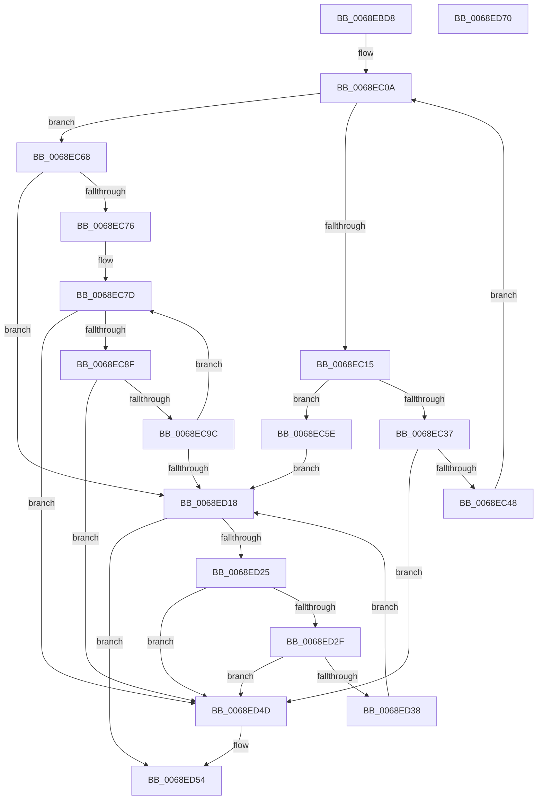

# MiInitializeSlabIdentities

- RVA: `0x0068EBD8`–`0x0068ED71` (길이 `409` bytes)
- VA: `0x000000014068EBD8`
- 실행 섹션: `.text`
- PDB 이름 있음: `예`; PDB Function 태그: `아니요`
- unwind 정보 RVA: `0x000D6FC4`
- 디코드: `101`개 명령, `409/409` bytes 표시
- 미해석 바이트: `0` (있으면 어셈블리에 `.byte`로 보존)

> 이 문서는 커널 이미지의 기계어와 PDB 기호를 분석해 생성했습니다. 4번과 5번은 함수 원형과 자료형을 바이너리 사용 방식에서 추정한 C 해석이며 원본 소스 복구 결과는 아닙니다.

## 1. Dependencies

- 직접 호출 지점: **3**; 고유 호출 대상: **3**
- 직접 호출자로 확인된 함수: **1**
- RIP 상대 이미지 참조: **1**

### Outgoing calls
- `0x0068EC2D` → [ExAllocatePoolMm](../35/ExAllocatePoolMm_function_0035B690.md) (function, `0x0035B690`)
- `0x0068ECFB` → [MiInitializeSlabAllocator](MiInitializeSlabAllocator_function_0068E85C.md) (function, `0x0068E85C`)
- `0x0068ED46` → [ExFreePoolWithTag](../../poolcode/B8/ExFreePoolWithTag_function_00B82870.md) (function, `0x00B82870`)

### Direct callers
- [MiCreateSlabIdentity](MiCreateSlabIdentity_function_0068D2D4.md) at `0x0068D34D`

### Static image references
- `0x0068EC0A` → RVA `0x00FC5000` (`ALMOSTRO`; read)

## 2. Other-region calls and transfers

- 다른 실행 섹션으로 향하는 call: **1**
  - `0x0068ED46` → [ExFreePoolWithTag](../../poolcode/B8/ExFreePoolWithTag_function_00B82870.md) (`.text` → `POOLCODE`)
- 별도 외부 분기/꼬리 이동을 확인하지 못했습니다.

## 3. Assembly (complete function range)

```asm
0068EBD8  48 8B C4                        mov rax, rsp
0068EBDB  48 89 58 08                     mov qword ptr [rax + 8], rbx
0068EBDF  48 89 70 10                     mov qword ptr [rax + 0x10], rsi
0068EBE3  48 89 78 18                     mov qword ptr [rax + 0x18], rdi
0068EBE7  4C 89 70 20                     mov qword ptr [rax + 0x20], r14
0068EBEB  55                              push rbp
0068EBEC  48 8B EC                        mov rbp, rsp
0068EBEF  48 83 EC 30                     sub rsp, 0x30
0068EBF3  48 8D 45 F0                     lea rax, [rbp - 0x10]
0068EBF7  33 DB                           xor ebx, ebx
0068EBF9  48 89 45 F8                     mov qword ptr [rbp - 8], rax
0068EBFD  48 8B F1                        mov rsi, rcx
0068EC00  48 8D 45 F0                     lea rax, [rbp - 0x10]
0068EC04  8B FB                           mov edi, ebx
0068EC06  48 89 45 F0                     mov qword ptr [rbp - 0x10], rax
0068EC0A  0F B7 05 EF 63 93 00            movzx eax, word ptr [rip + 0x9363ef]
0068EC11  3B F8                           cmp edi, eax
0068EC13  73 53                           jae 0x14068ec68
0068EC15  44 8B CF                        mov r9d, edi
0068EC18  BA 00 D0 04 00                  mov edx, 0x4d000
0068EC1D  41 0F BA E9 1F                  bts r9d, 0x1f
0068EC22  B9 40 00 00 00                  mov ecx, 0x40
0068EC27  41 B8 4D 69 53 6E               mov r8d, 0x6e53694d
0068EC2D  E8 5E CA CC FF                  call 0x14035b690
0068EC32  48 85 C0                        test rax, rax
0068EC35  74 27                           je 0x14068ec5e
0068EC37  48 8B 4D F8                     mov rcx, qword ptr [rbp - 8]
0068EC3B  48 8D 55 F0                     lea rdx, [rbp - 0x10]
0068EC3F  48 39 11                        cmp qword ptr [rcx], rdx
0068EC42  0F 85 05 01 00 00               jne 0x14068ed4d
0068EC48  48 89 48 08                     mov qword ptr [rax + 8], rcx
0068EC4C  48 8D 55 F0                     lea rdx, [rbp - 0x10]
0068EC50  48 89 10                        mov qword ptr [rax], rdx
0068EC53  FF C7                           inc edi
0068EC55  48 89 01                        mov qword ptr [rcx], rax
0068EC58  48 89 45 F8                     mov qword ptr [rbp - 8], rax
0068EC5C  EB AC                           jmp 0x14068ec0a
0068EC5E  BB 9A 00 00 C0                  mov ebx, 0xc000009a
0068EC63  E9 B0 00 00 00                  jmp 0x14068ed18
0068EC68  48 8B 4E 10                     mov rcx, qword ptr [rsi + 0x10]
0068EC6C  8B FB                           mov edi, ebx
0068EC6E  85 C0                           test eax, eax
0068EC70  0F 84 A2 00 00 00               je 0x14068ed18
0068EC76  4C 8D B1 90 44 00 00            lea r14, [rcx + 0x4490]
0068EC7D  48 8B 55 F0                     mov rdx, qword ptr [rbp - 0x10]
0068EC81  48 8D 45 F0                     lea rax, [rbp - 0x10]
0068EC85  48 39 42 08                     cmp qword ptr [rdx + 8], rax
0068EC89  0F 85 BE 00 00 00               jne 0x14068ed4d
0068EC8F  48 8B 02                        mov rax, qword ptr [rdx]
0068EC92  48 39 50 08                     cmp qword ptr [rax + 8], rdx
0068EC96  0F 85 B1 00 00 00               jne 0x14068ed4d
0068EC9C  48 89 45 F0                     mov qword ptr [rbp - 0x10], rax
0068ECA0  48 8D 4D F0                     lea rcx, [rbp - 0x10]
0068ECA4  48 89 48 08                     mov qword ptr [rax + 8], rcx
0068ECA8  4C 8B CE                        mov r9, rsi
0068ECAB  8B C7                           mov eax, edi
0068ECAD  44 8B C7                        mov r8d, edi
0068ECB0  48 69 C8 80 DF 00 00            imul rcx, rax, 0xdf80
0068ECB7  48 8B 46 10                     mov rax, qword ptr [rsi + 0x10]
0068ECBB  48 89 94 01 B0 DE 00 00         mov qword ptr [rcx + rax + 0xdeb0], rdx
0068ECC3  48 8D 82 E0 CA 04 00            lea rax, [rdx + 0x4cae0]
0068ECCA  48 89 82 D8 CA 04 00            mov qword ptr [rdx + 0x4cad8], rax
0068ECD1  49 8B CE                        mov rcx, r14
0068ECD4  C7 82 D0 CA 04 00 41 00 00 00   mov dword ptr [rdx + 0x4cad0], 0x41
0068ECDE  48 8D 82 00 CB 04 00            lea rax, [rdx + 0x4cb00]
0068ECE5  48 89 82 F8 CA 04 00            mov qword ptr [rdx + 0x4caf8], rax
0068ECEC  C7 82 F0 CA 04 00 41 00 00 00   mov dword ptr [rdx + 0x4caf0], 0x41
0068ECF6  BA 08 00 00 00                  mov edx, 8
0068ECFB  E8 5C FB FF FF                  call 0x14068e85c
0068ED00  0F B7 05 F9 62 93 00            movzx eax, word ptr [rip + 0x9362f9]
0068ED07  FF C7                           inc edi
0068ED09  49 81 C6 80 DF 00 00            add r14, 0xdf80
0068ED10  3B F8                           cmp edi, eax
0068ED12  0F 82 65 FF FF FF               jb 0x14068ec7d
0068ED18  48 8B 4D F0                     mov rcx, qword ptr [rbp - 0x10]
0068ED1C  48 8D 45 F0                     lea rax, [rbp - 0x10]
0068ED20  48 3B C8                        cmp rcx, rax
0068ED23  74 2F                           je 0x14068ed54
0068ED25  48 8D 45 F0                     lea rax, [rbp - 0x10]
0068ED29  48 39 41 08                     cmp qword ptr [rcx + 8], rax
0068ED2D  75 1E                           jne 0x14068ed4d
0068ED2F  48 8B 01                        mov rax, qword ptr [rcx]
0068ED32  48 39 48 08                     cmp qword ptr [rax + 8], rcx
0068ED36  75 15                           jne 0x14068ed4d
0068ED38  48 8D 55 F0                     lea rdx, [rbp - 0x10]
0068ED3C  48 89 45 F0                     mov qword ptr [rbp - 0x10], rax
0068ED40  48 89 50 08                     mov qword ptr [rax + 8], rdx
0068ED44  33 D2                           xor edx, edx
0068ED46  E8 25 3B 4F 00                  call 0x140b82870
0068ED4B  EB CB                           jmp 0x14068ed18
0068ED4D  B9 03 00 00 00                  mov ecx, 3
0068ED52  CD 29                           int 0x29
0068ED54  48 8B 74 24 48                  mov rsi, qword ptr [rsp + 0x48]
0068ED59  8B C3                           mov eax, ebx
0068ED5B  48 8B 5C 24 40                  mov rbx, qword ptr [rsp + 0x40]
0068ED60  48 8B 7C 24 50                  mov rdi, qword ptr [rsp + 0x50]
0068ED65  4C 8B 74 24 58                  mov r14, qword ptr [rsp + 0x58]
0068ED6A  48 83 C4 30                     add rsp, 0x30
0068ED6E  5D                              pop rbp
0068ED6F  C3                              ret
0068ED70  CC                              int3
```

## 4. C-style interpretation (structured pseudocode)

```c
__int64 __fastcall MiInitializeSlabIdentities(__int64 a1)
{
    __int64 result;
    __int64 v_r14;
    __int64 v_rbx;
    __int64 v_rdi;
    __int64 v_rsp;
    unsigned __int64 v_stack_m10;
    unsigned __int64 v_stack_m18;
    unsigned __int64 v_stack_p10;
    unsigned __int64 v_stack_p18;
    unsigned __int64 v_stack_p20;
    unsigned __int64 v_stack_p8;

    *(unsigned __int64 *)(v_rsp + 8) = v_rbx;
    *(unsigned __int64 *)(v_rsp + 16) = v_rsi;
    *(unsigned __int64 *)(v_rsp + 24) = v_rdi;
    *(unsigned __int64 *)(v_rsp + 32) = v_r14;
    v_rsp = (v_rsp) - (48);
    v_rbx = 0;
    v_stack_m10 = v_stack_m18;
    v_stack_m18 = v_stack_m18;
loc_0068EC0A:
    if (0 >= ((unsigned int)(*(unsigned __int16 *)(v_rip + 9659375)))) goto loc_0068EC68;
    result = ExAllocatePoolMm(64, (unsigned int)(0x4D000ULL), (unsigned int)(0x6E53694DULL), 0);
    if (result == 0) goto loc_0068EC5E;
    if ((*(unsigned __int64 *)(v_stack_m10)) != v_stack_m18) goto loc_0068ED4D;
    *(unsigned __int64 *)(result + 8) = v_stack_m10;
    *(unsigned __int64 *)(result) = v_stack_m18;
    v_rdi = (unsigned int)((0) + 1);
    *(unsigned __int64 *)(v_stack_m10) = result;
    v_stack_m10 = result;
    goto loc_0068EC0A;
loc_0068EC5E:
    goto loc_0068ED18;
loc_0068EC68:
    if ((unsigned int)(result) == 0) goto loc_0068ED18;
loc_0068EC7D:
    if ((*(unsigned __int64 *)(v_stack_m18 + 8)) != v_stack_m18) goto loc_0068ED4D;
    if ((*(unsigned __int64 *)(*(unsigned __int64 *)(v_stack_m18) + 8)) != v_stack_m18) goto loc_0068ED4D;
    v_stack_m18 = *(unsigned __int64 *)(v_stack_m18);
    *(unsigned __int64 *)(*(unsigned __int64 *)(v_stack_m18) + 8) = v_stack_m18;
    a1 = (v_stack_m18) * ((unsigned int)((unsigned int)((unsigned int)((unsigned int)((unsigned int)(0xC000009AULL))))));
    *(unsigned __int64 *)(a1 + *(unsigned __int64 *)(a1 + 16) * 1 + 57008) = v_stack_m18;
    *(unsigned __int64 *)(v_stack_m18 + 314072) = v_stack_m18 + 314080;
    *(unsigned int *)(v_stack_m18 + 314064) = 65;
    *(unsigned __int64 *)(v_stack_m18 + 314104) = v_stack_m18 + 314112;
    *(unsigned int *)(v_stack_m18 + 314096) = 65;
    result = MiInitializeSlabAllocator(*(unsigned __int64 *)(a1 + 16) + 17552, 8, (unsigned int)((unsigned int)((unsigned int)((unsigned int)((unsigned int)(0xC000009AULL))))), a1);
    v_rdi = (unsigned int)(((unsigned int)((unsigned int)((unsigned int)(0xC000009AULL)))) + 1);
    v_r14 = (*(unsigned __int64 *)(a1 + 16) + 17552) + (0xDF80ULL);
    if (((unsigned int)(v_rdi)) < ((unsigned int)(*(unsigned __int16 *)(v_rip + 9659129)))) goto loc_0068EC7D;
loc_0068ED18:
    if (v_stack_m18 == v_stack_m18) goto loc_0068ED54;
    if ((*(unsigned __int64 *)(v_stack_m18 + 8)) != v_stack_m18) goto loc_0068ED4D;
    if ((*(unsigned __int64 *)(*(unsigned __int64 *)(v_stack_m18) + 8)) != v_stack_m18) goto loc_0068ED4D;
    v_stack_m18 = *(unsigned __int64 *)(v_stack_m18);
    *(unsigned __int64 *)(*(unsigned __int64 *)(v_stack_m18) + 8) = v_stack_m18;
    a2 = 0;
    result = ExFreePoolWithTag(v_stack_m18, a2, (unsigned int)((unsigned int)((unsigned int)((unsigned int)((unsigned int)(0xC000009AULL))))), a1);
    goto loc_0068ED18;
loc_0068ED4D:
loc_0068ED54:
    v_rsp = (v_rsp) + (48);
    return (unsigned int)((unsigned int)((unsigned int)(0xC000009AULL)));
}
```

## 5. (Beta) C Style

```c
int64_t MiInitializeSlabIdentities(void *Arg1)
{
    uint8_t *arg1 = (uint8_t *)Arg1;

    int64_t result;
    int64_t local_r14;
    int64_t local_rbx;
    int64_t local_rdi;
    int64_t local_rsp;
    uint64_t v_stack_m10;
    uint64_t v_stack_m18;
    uint64_t v_stack_p10;
    uint64_t v_stack_p18;
    uint64_t v_stack_p20;
    uint64_t v_stack_p8;

    *(uint64_t *)(local_rsp + 0x8) = local_rbx;
    *(uint64_t *)(local_rsp + 0x10) = local_rsi;
    *(uint64_t *)(local_rsp + 0x18) = local_rdi;
    *(uint64_t *)(local_rsp + 0x20) = local_r14;
    local_rsp = (local_rsp) - (48);
    local_rbx = 0;
    v_stack_m10 = v_stack_m18;
    v_stack_m18 = v_stack_m18;
loc_0068EC0A:
    if (0 >= ((uint32_t)(*(uint16_t *)(v_rip + 0x9363EF)))) goto loc_0068EC68;
    result = ExAllocatePoolMm(64, (uint32_t)(0x4D000ULL), (uint32_t)(0x6E53694DULL), 0);
    if (result == 0) goto loc_0068EC5E;
    if ((*(uint64_t *)(v_stack_m10)) != v_stack_m18) goto loc_0068ED4D;
    *(uint64_t *)(result + 0x8) = v_stack_m10;
    *(uint64_t *)(result) = v_stack_m18;
    local_rdi = (uint32_t)((0) + 1);
    *(uint64_t *)(v_stack_m10) = result;
    v_stack_m10 = result;
    goto loc_0068EC0A;
loc_0068EC5E:
    goto loc_0068ED18;
loc_0068EC68:
    if ((uint32_t)(result) == 0) goto loc_0068ED18;
loc_0068EC7D:
    if ((*(uint64_t *)(v_stack_m18 + 0x8)) != v_stack_m18) goto loc_0068ED4D;
    if ((*(uint64_t *)(*(uint64_t *)(v_stack_m18) + 0x8)) != v_stack_m18) goto loc_0068ED4D;
    v_stack_m18 = *(uint64_t *)(v_stack_m18);
    *(uint64_t *)(*(uint64_t *)(v_stack_m18) + 0x8) = v_stack_m18;
    Arg1 = (v_stack_m18) * ((uint32_t)((uint32_t)((uint32_t)((uint32_t)((uint32_t)(0xC000009AULL))))));
    *(uint64_t *)(arg1 + *(uint64_t *)(arg1 + 0x10) * 1 + 0xDEB0) = v_stack_m18;
    *(uint64_t *)(v_stack_m18 + 0x4CAD8) = v_stack_m18 + 314080;
    *(uint32_t *)(v_stack_m18 + 0x4CAD0) = 65;
    *(uint64_t *)(v_stack_m18 + 0x4CAF8) = v_stack_m18 + 314112;
    *(uint32_t *)(v_stack_m18 + 0x4CAF0) = 65;
    result = MiInitializeSlabAllocator(*(uint64_t *)(arg1 + 0x10) + 17552, 8, (uint32_t)((uint32_t)((uint32_t)((uint32_t)((uint32_t)(0xC000009AULL))))), Arg1);
    local_rdi = (uint32_t)(((uint32_t)((uint32_t)((uint32_t)(0xC000009AULL)))) + 1);
    local_r14 = (*(uint64_t *)(arg1 + 0x10) + 17552) + (0xDF80ULL);
    if (((uint32_t)(local_rdi)) < ((uint32_t)(*(uint16_t *)(v_rip + 0x9362F9)))) goto loc_0068EC7D;
loc_0068ED18:
    if (v_stack_m18 == v_stack_m18) goto loc_0068ED54;
    if ((*(uint64_t *)(v_stack_m18 + 0x8)) != v_stack_m18) goto loc_0068ED4D;
    if ((*(uint64_t *)(*(uint64_t *)(v_stack_m18) + 0x8)) != v_stack_m18) goto loc_0068ED4D;
    v_stack_m18 = *(uint64_t *)(v_stack_m18);
    *(uint64_t *)(*(uint64_t *)(v_stack_m18) + 0x8) = v_stack_m18;
    a2 = 0;
    result = ExFreePoolWithTag(v_stack_m18, a2, (uint32_t)((uint32_t)((uint32_t)((uint32_t)((uint32_t)(0xC000009AULL))))), Arg1);
    goto loc_0068ED18;
loc_0068ED4D:
loc_0068ED54:
    local_rsp = (local_rsp) + (48);
    return (uint32_t)((uint32_t)((uint32_t)(0xC000009AULL)));
}
```

### 관측된 메모리 오프셋

구조체 형식이 확인되지 않은 접근은 인자 기준의 오프셋으로만 기록했습니다.

| 기준 인자 | 오프셋 표현 | 폭 (bit) | 접근 |
|---|---:|---:|---|
| `Arg1` | `+ 0x10` | `64` | `R` |

## 6. Execution-region graph

[열기: 2D/3D 그래프와 함수 탐색 컨트롤 패널](../../../control-panel.html?section=text&rva=0x0068EBD8&view=graph)

- 2D 그래프는 위에서 아래로 흐르고, 3D 그래프는 빈 공간을 드래그해 회전합니다. Shift+드래그는 이동, 휠은 확대·축소, 함수 노드 선택은 대상 보고서 이동입니다.

### Static fallback


